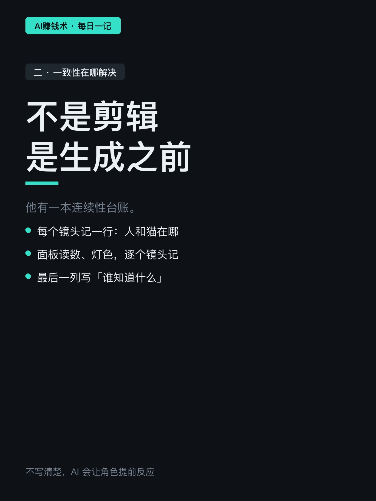
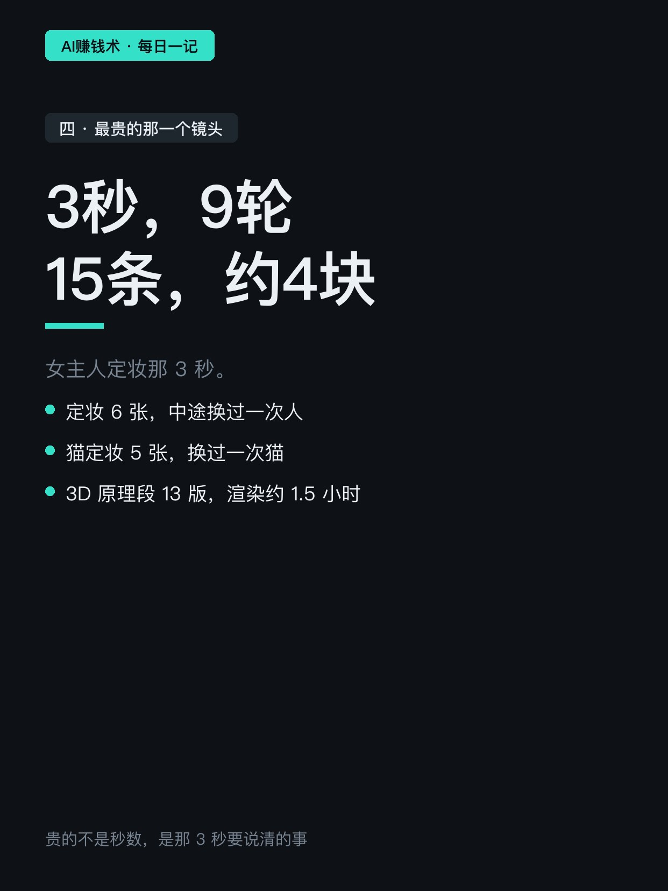
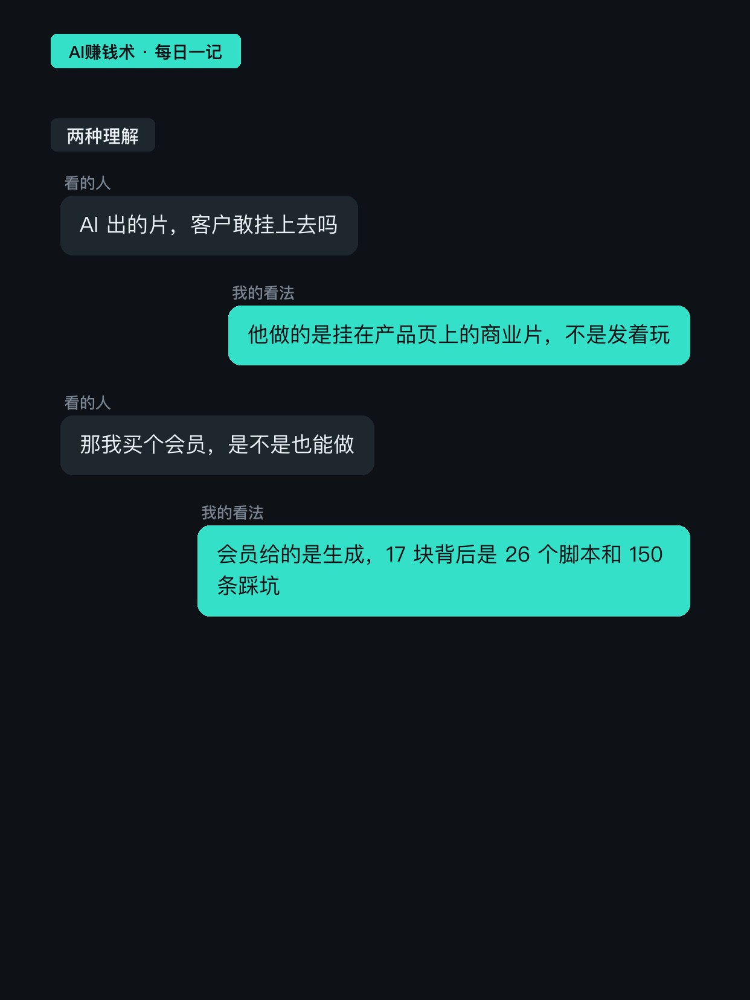

# 17块钱一条片，外面两三万

> — · 2026-11-06 11:03 发布 · AI 赚钱内容

## 标题（可直接复制）

```
17块钱一条片，外面两三万
```

## 正文（可直接复制发布）

同样一条产品片，找海外实拍加 3D 要两三万、等大半个月。他做出来的生成费是 17 块——测试、废片、返工全算在里面。

作者在深圳，在一家出海品牌的团队里负责把 AI 用起来，零影视基础。第一条片子用了 10 天，12 个步骤，26 个本地脚本，记了 150 条踩坑。下面的数字都是他的自述。

一、便宜不是因为模型便宜

是因为 12 个步骤里有 8 步在花钱之前。前 8 步全是不花钱的判断：这个产品能说什么、买家的心理节奏是什么、把「同一个世界」先锁死。第 9 步才开始生成，最后三步用代码和 3D 补精度。

他的原话是：17 块够用的秘密基本就在前 8 步，大部分错误还没花钱就被拦住了。

二、一致性要在生成之前解决

全片有一本连续性台账，每个镜头记一行：人和猫在哪、面板读数、灯色，最后一列写「谁知道什么」。

不写清楚，AI 会让角色对还没看到的事提前做出反应。剪辑只能救节奏，救不了因果。

三、改了近 20 版，生成费还是 17 块

50 秒 20 个镜头，关键帧静图 50 多张，AI 片段约 80 条，精剪近 20 版。最贵的单个镜头是女主人那 3 秒：9 轮、15 条片段、约 4 块。第二条片子直接套沉淀下来的流程，4 小时做完。

这套流程不是所有产品都能套。他划了三个条件：卖点是看不见的过程，比如除臭、净化、静音；客单价够高；外观结构简单。三条不占，省下来的生成费填不平判断的成本。

收尾

他自己留了一句限定：17 块只是生成费，出图走订阅，3D、配乐、音效都是零，真正的成本是一个人 10 天的时间和判断。

所以这不是「一条片子 17 块」，是「一条片子 17 块加十天」。你手上那件反复做的事，前 8 步写清楚了吗？

## 话题标签

#AI视频 #商业片 #工作流 #AI赚钱术 #AI赚钱术日记

## 配图（8 张）








## 发布信息

| 项 | 值 |
|---|---|
| 平台 | 小红书 |
| 期数 | — |
| 发布时间 | 2026-11-06 11:03 |
| 正文长度 | 733 字 |
| 图片数量 | 8 张 |
| 状态 | 已发布 |
