# 19条素材，只有1条能发

> — · 2026-11-06 12:32 发布 · AI 赚钱内容

## 标题（可直接复制）

```
19条素材，只有1条能发
```

## 正文（可直接复制发布）

上周收的那批，十九条。第二天标成「可用」的，一条。

我有一个做内容的小号，一百多期了。做法很土：每天凌晨把链接抓成本地文件，早上读一遍，能用的排进候选，挑中的钉进一张去重表，再写稿、进待发表、到点自动发。跑顺的时候一天最多十篇（自述，后台记录）。

这周翻后台才看清一件事：我一直以为自己有一个素材库。其实那是一沓用一次就作废的凭证。

一、原理
一条素材要过四格：入库、判可用、占用、封存。
判可用只问三件事——讲什么、能不能用、落在哪个题材。标准很土：有人物、有金额、有步骤，才算可用；只有观点的，当场划掉，还要写上为什么划掉，免得下次重读。
那天十九条里过了一条。剩下十八条不是不好，是缺一块：有人没钱，有钱没步骤，有步骤没结果。

二、代价
真正改变我做法的是第三格：占用。
挑中一篇，第一件事不是写，是翻那张去重表。一百六十多行，每行是一个做过、或者已经占住的题材。撞了就换下一篇，回到表头重查；不撞，才把它钉进去，写上期数和时段。
钉子落下去，这篇素材就从库存里消失了。不是「这次用它」，是「以后都不能用」——同一篇换个侧面也算重发。我犯过一次：四天里把同一篇写成两版，第一版五百多次浏览，第二版只剩九十八次（自述，后台记录）。内容没变差，变的是位置只有一个。

三、边界
这套规矩只在一种前提下成立：素材是可替代的。真正稀缺的不是条目数量，是「能写成一篇」的那一条。所以我宁可十九条里只过一条，也不肯放宽「有人、有金额、有步骤」这条线——一放宽，写出来的就是正确的废话。
另一头是额度：一天最多十篇。这条线在，库存再多也不会多发。所以瓶颈不在采集量，在可用率。按那天的十九比一折算，想靠当天采集凑满十篇，得看一百九十条（折算，不是实测）。做不到，就只能吃库存——我翻待发表，好几篇的备注都写着「库存首次启用」。

库存垫着，日子就能过。可它只减不增，垫到见底那天，没人替你补。
你现在存着多少条素材？其中有多少条，你不看原文就能说出它的人物、金额和那三步？说不出来的那些，不是库存，是未读邮件。

## 话题标签

#AI赚钱术日记 #内容生产 #素材管理 #工作流 #养成系账号

## 配图（12 张）

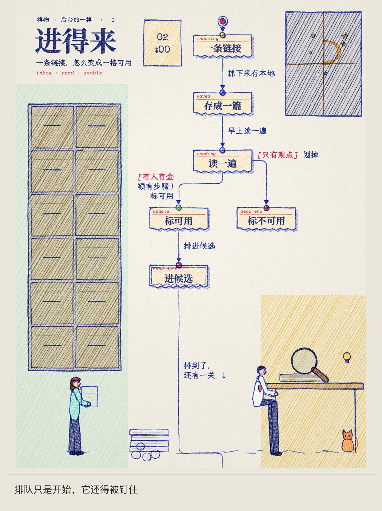
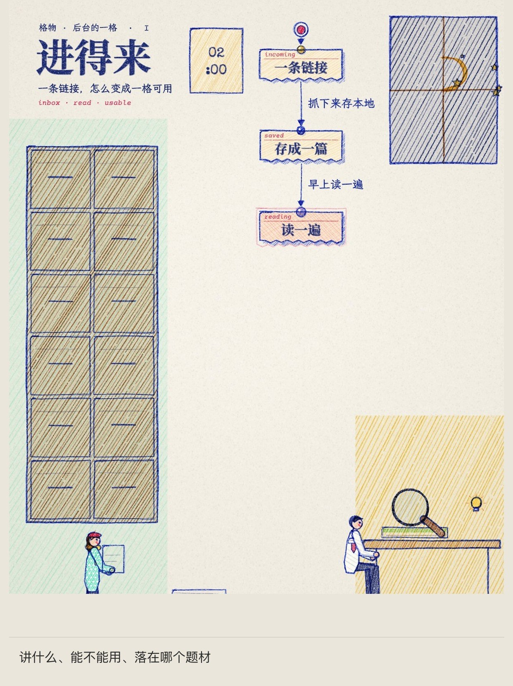
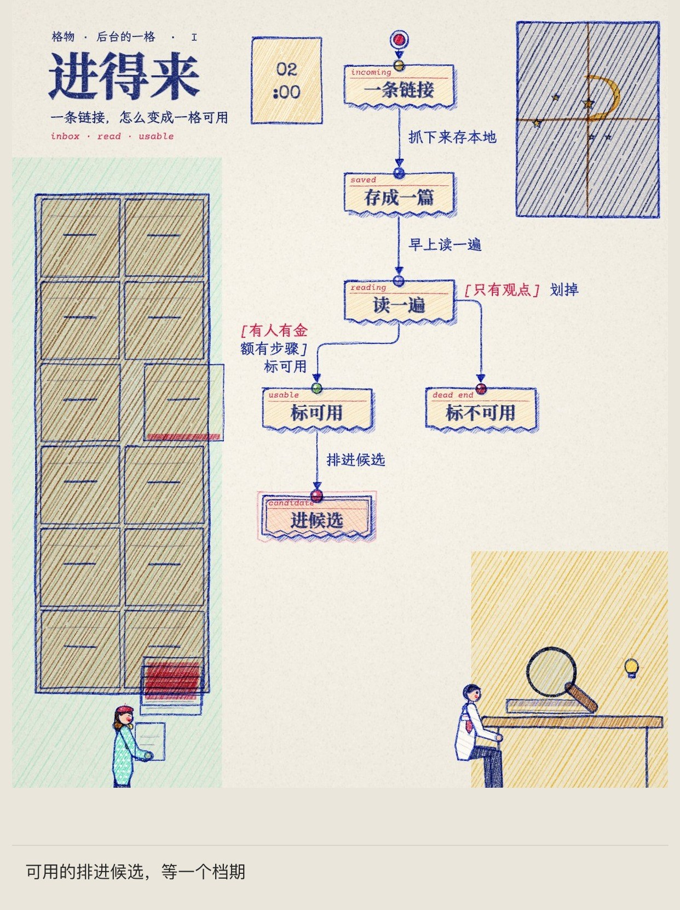
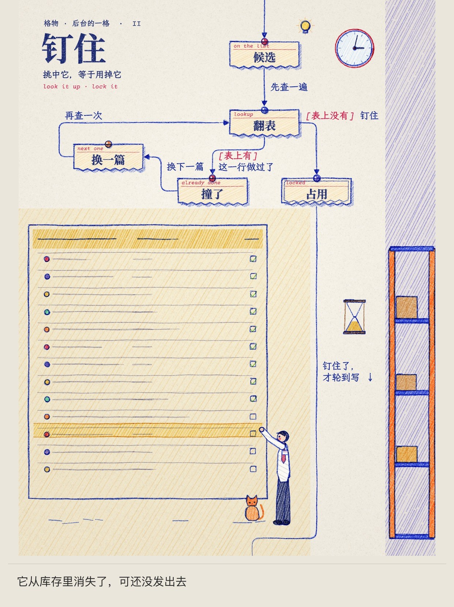
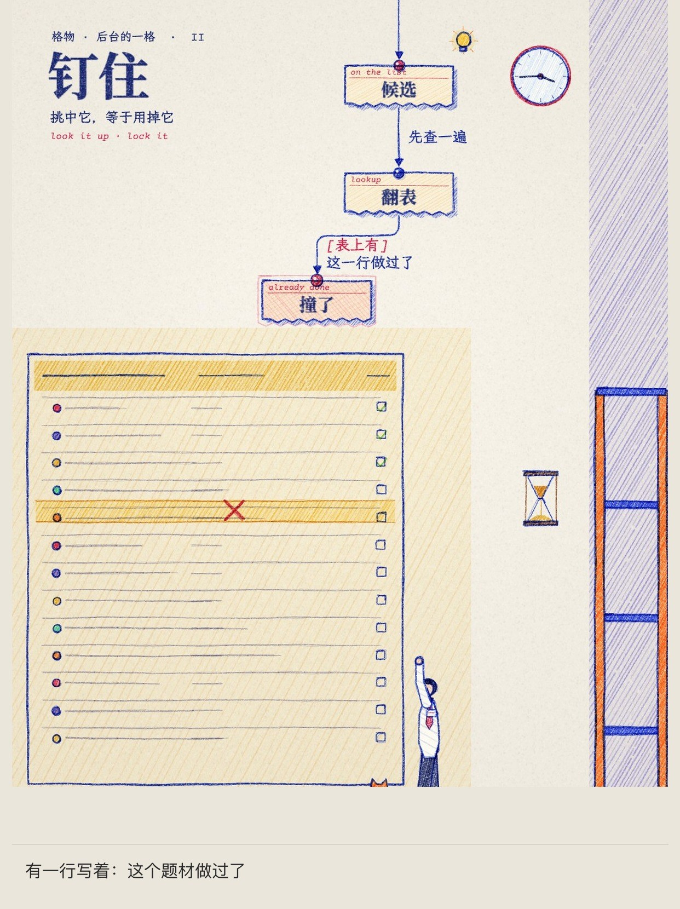
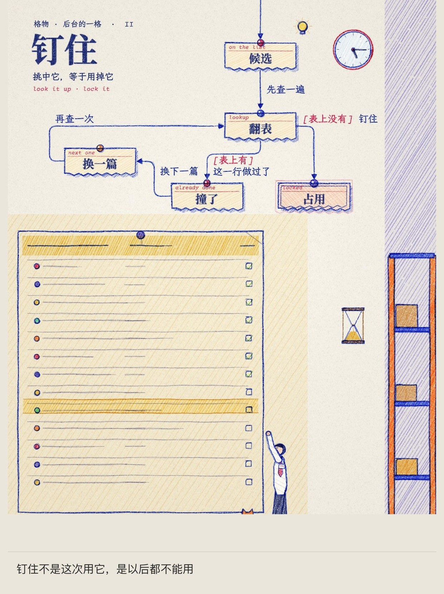
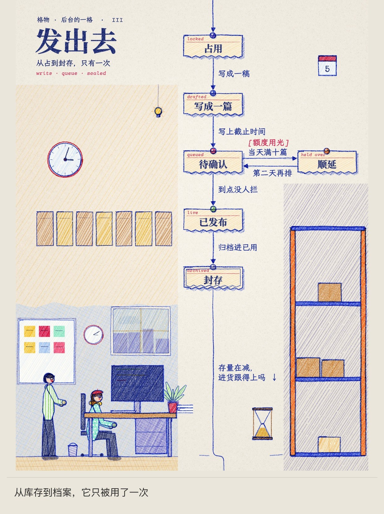
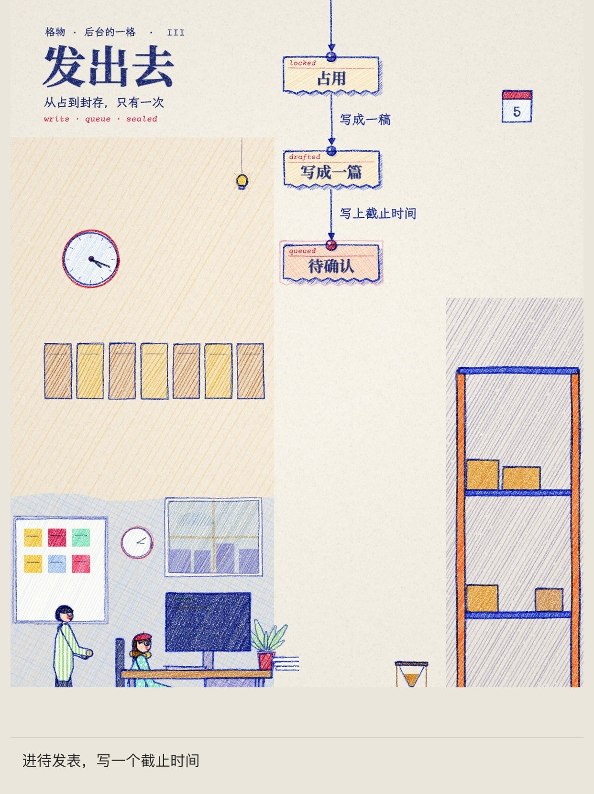
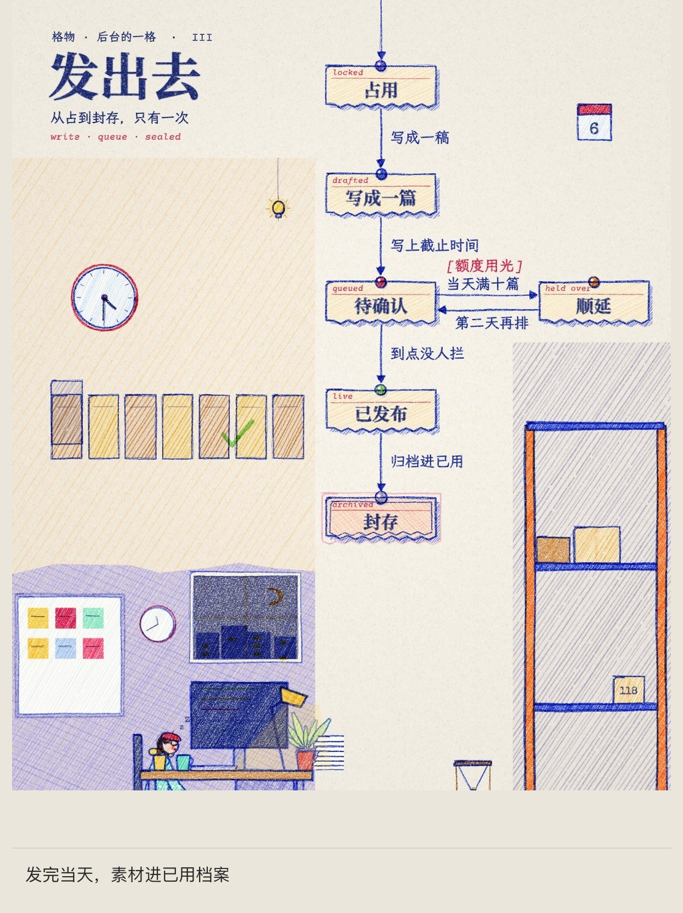
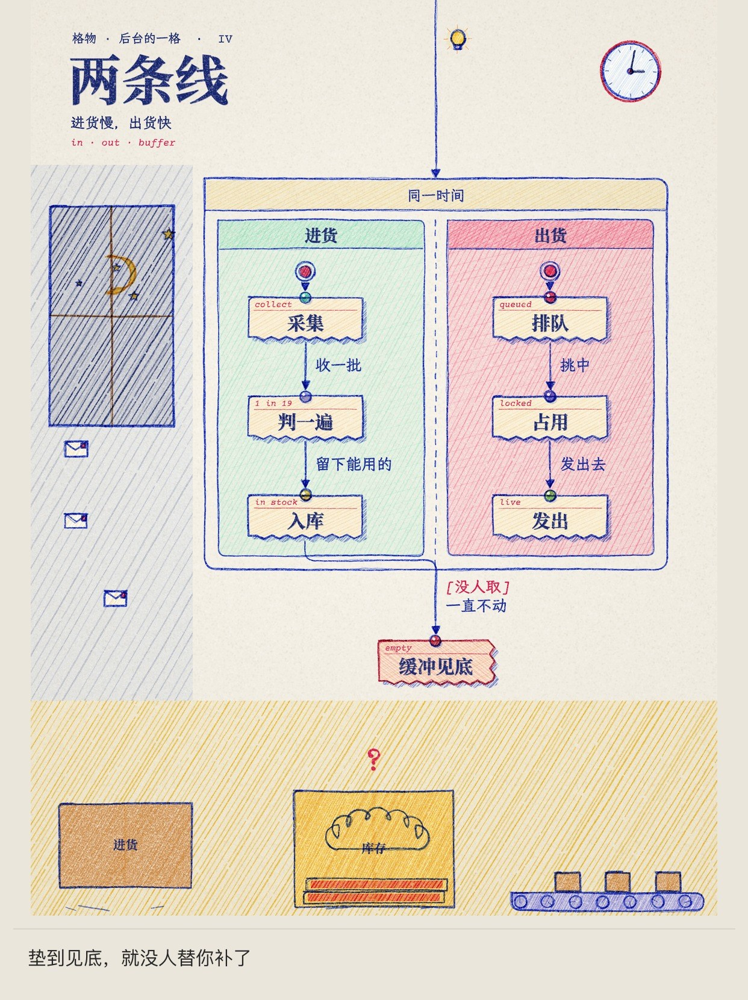
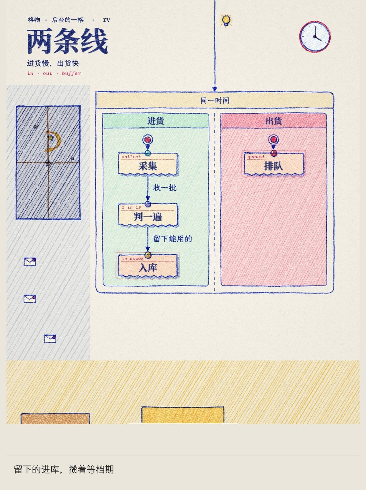
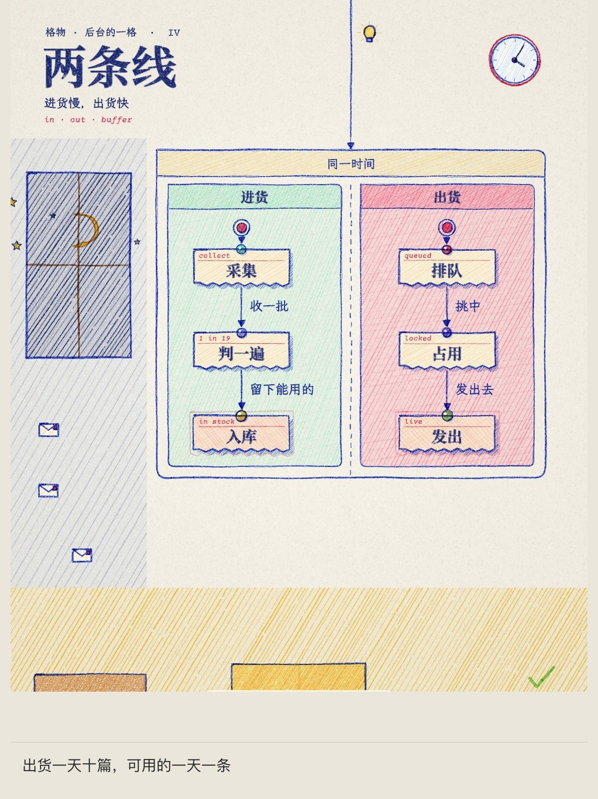

## 发布信息

| 项 | 值 |
|---|---|
| 平台 | 小红书 |
| 期数 | — |
| 发布时间 | 2026-11-06 12:32 |
| 正文长度 | 855 字 |
| 图片数量 | 12 张 |
| 状态 | 已发布 |
