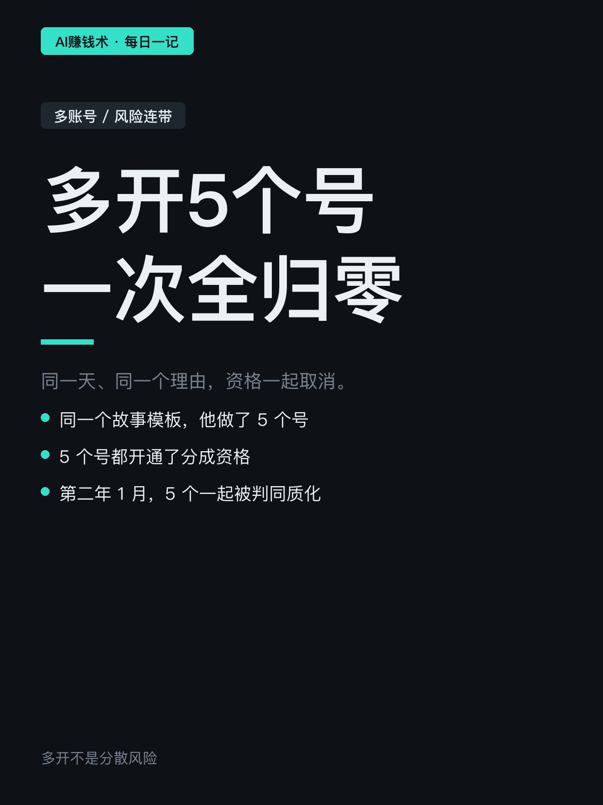
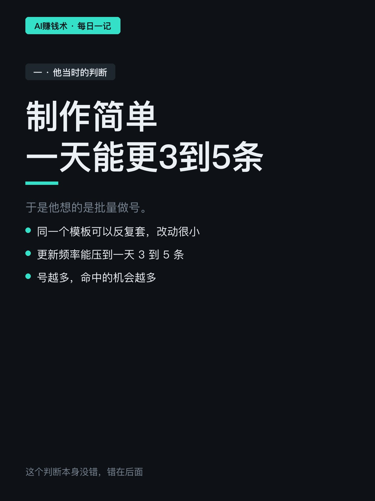
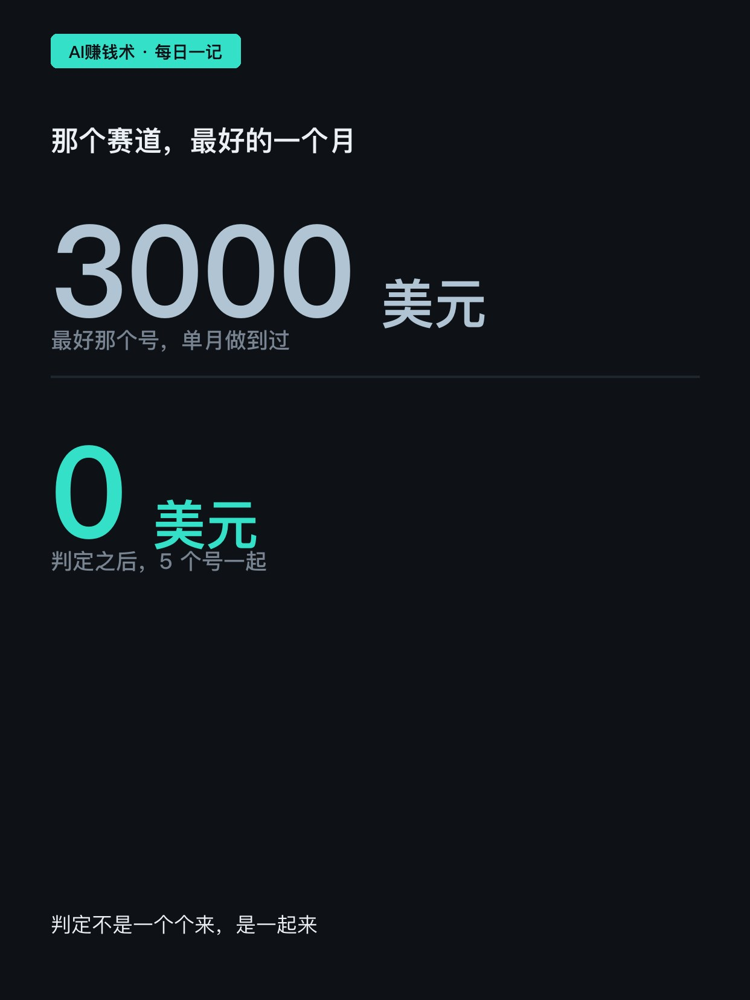
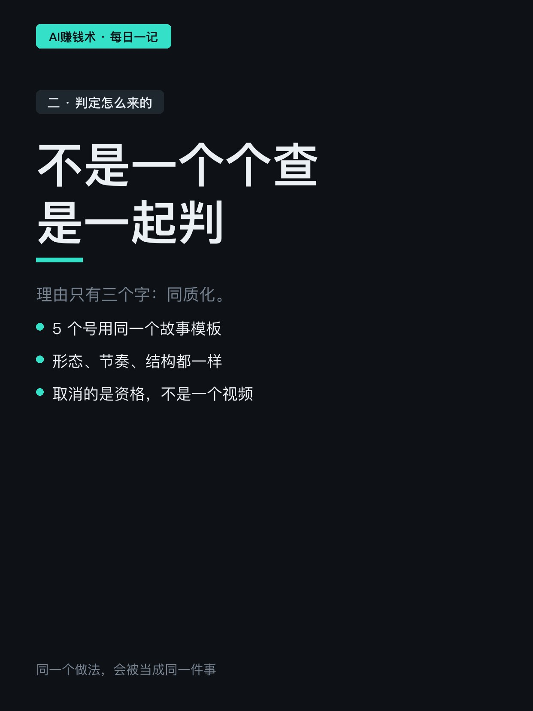
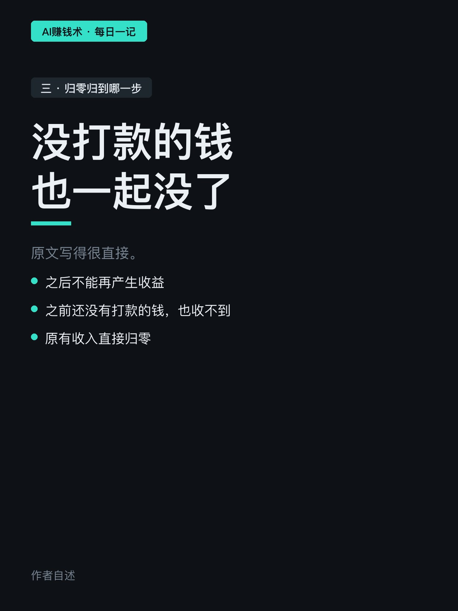
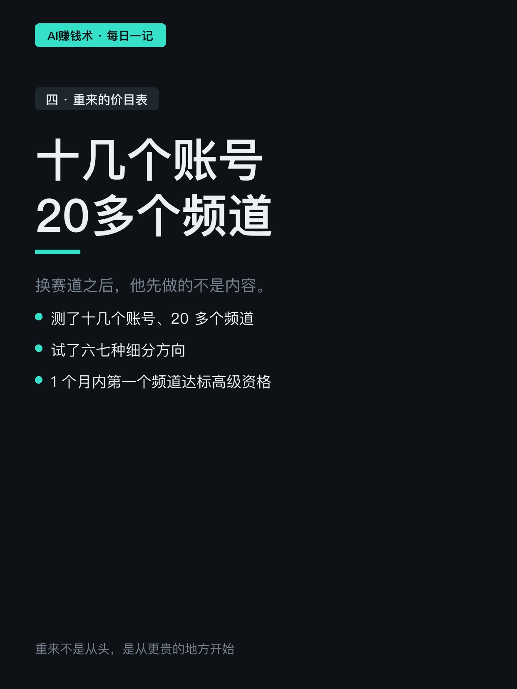
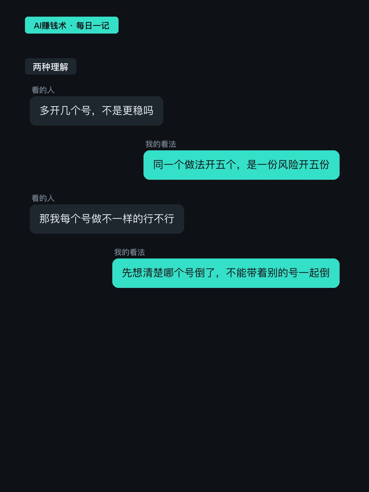
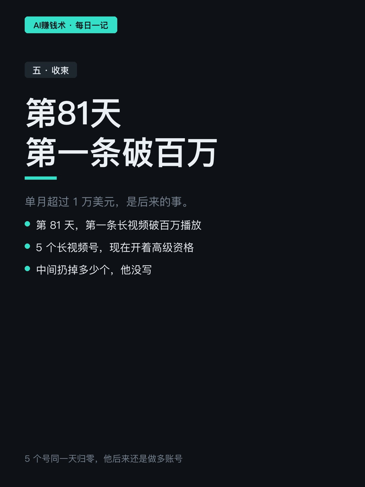

# 多开5个号，一次全归零

> — · 2026-11-06 09:02 发布 · AI 赚钱内容

## 标题（可直接复制）

```
多开5个号，一次全归零
```

## 正文（可直接复制发布）

同一个故事模板，他做了 5 个号，5 个都开通了分成资格。第二年 1 月，5 个号同时被判同质化，资格一起取消。

作者做出海长视频，现在是某个 AI 视频社群的咨询教练。他自己的说法是：当时觉得找到一个好模式——制作简单、一天能更 3 到 5 条、能批量做号。以下是他自述的经历。

一、多开号不是分散风险

是把风险绑在一起。同一个模板、同一种节奏、同一套结构，5 个号看起来是 5 份生意，在判定那一端是同一件事：不是 5 个作者，是同一个作者在 5 个地方做同一件事。

那个赛道他最高做到一个月 3000 美元左右。判定来的时候，5 个号一起，没有先后，也没有哪个号被单独提醒过。

二、归零归到哪一步

原文写得很直接：不只是之后不能再产生收益，连之前还没有打款的钱也收不到。后续收益完全停止，原有的收入直接归零。

这点最容易被忽略。多数人算风险，算的是「被限了再开一个」，没算过账上还没结算的那部分会一起停。开号的时候以为多几条腿走路，出事才发现是同一根绳上的五个结。

三、重来是有价目表的

转赛道之后，他先做的不是内容，是试：十几个账号、20 多个频道、六七种细分方向。1 个月内第一个频道达标高级资格，第 81 天第一条长视频破百万播放，单月超过 1 万美元。

现在他手上有 5 个做长视频的账号，都开着高级资格，短视频板块累计播放超过 1 亿——那是另一些号、另一套做法，跟前面归零的 5 个没有关系。

这些数字都是后来的事。中间扔掉多少个号、多少条片子，他没写。

收尾

5 个号、同一天、一起归零。他后来还是做多账号，只是换了一个说法：不是多开几个更稳，是先想清楚哪个号倒了不能带着别的号一起倒。

剩下的他没说。

## 话题标签

#账号矩阵 #内容出海 #风险 #AI赚钱术 #AI赚钱术日记

## 配图（8 张）










## 发布信息

| 项 | 值 |
|---|---|
| 平台 | 小红书 |
| 期数 | — |
| 发布时间 | 2026-11-06 09:02 |
| 正文长度 | 725 字 |
| 图片数量 | 8 张 |
| 状态 | 已发布 |
