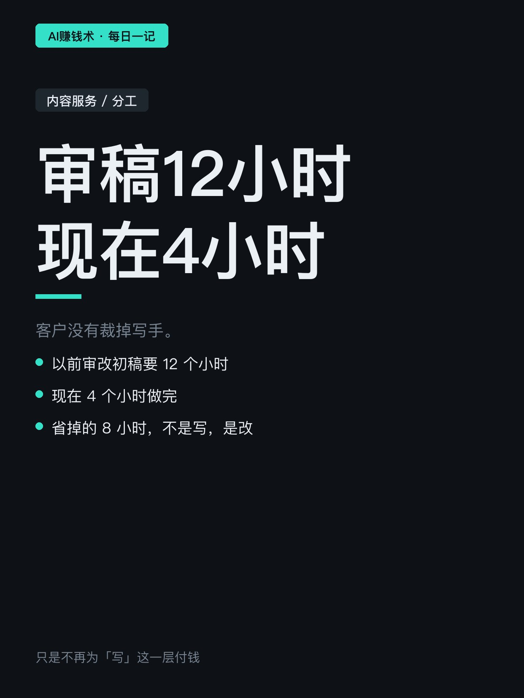
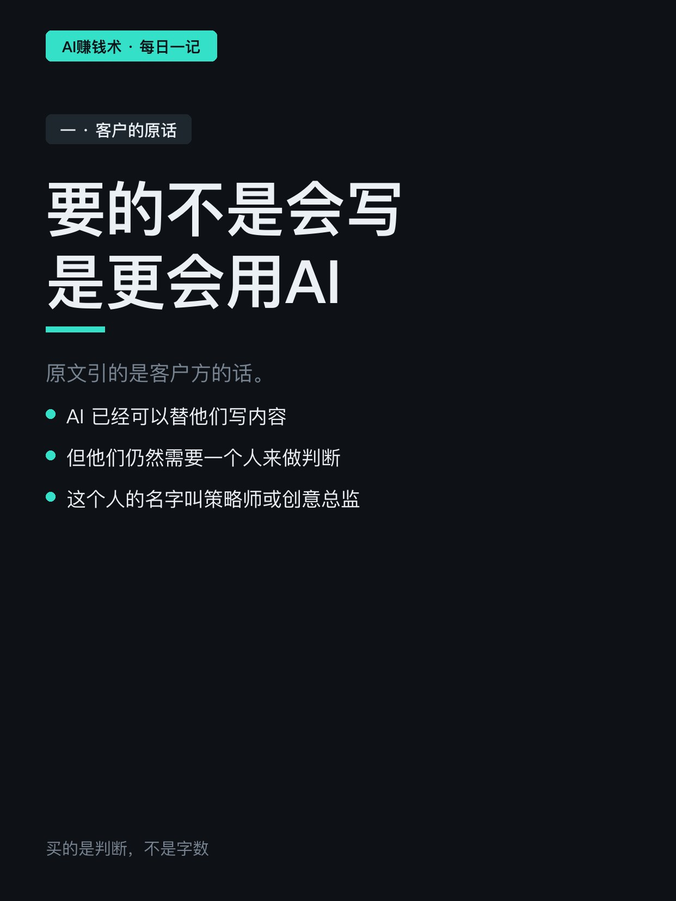
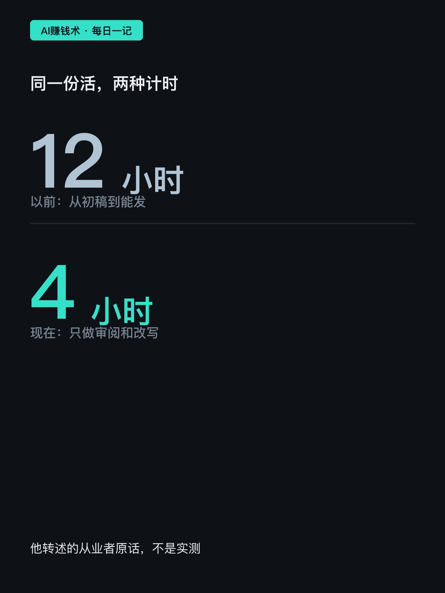
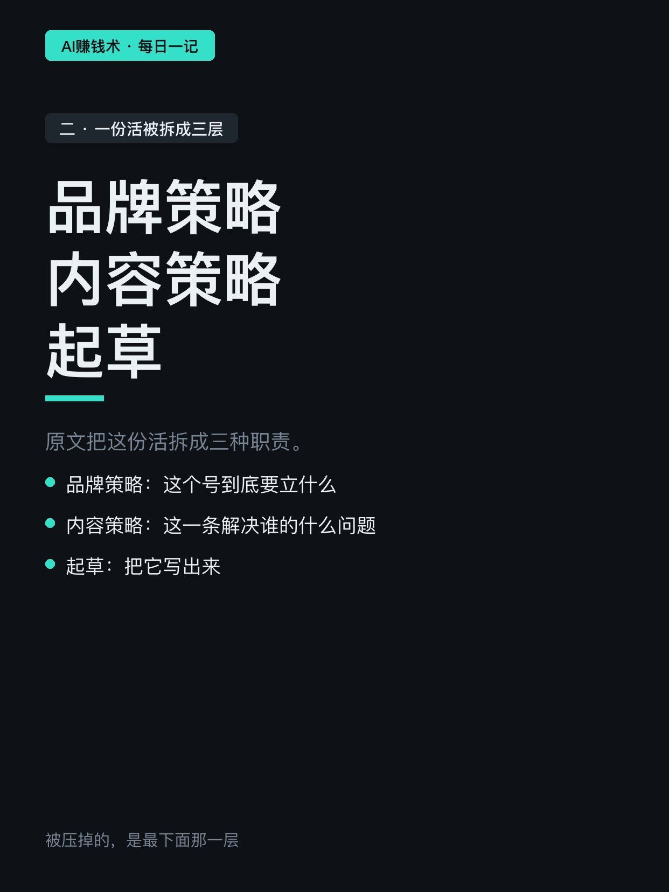
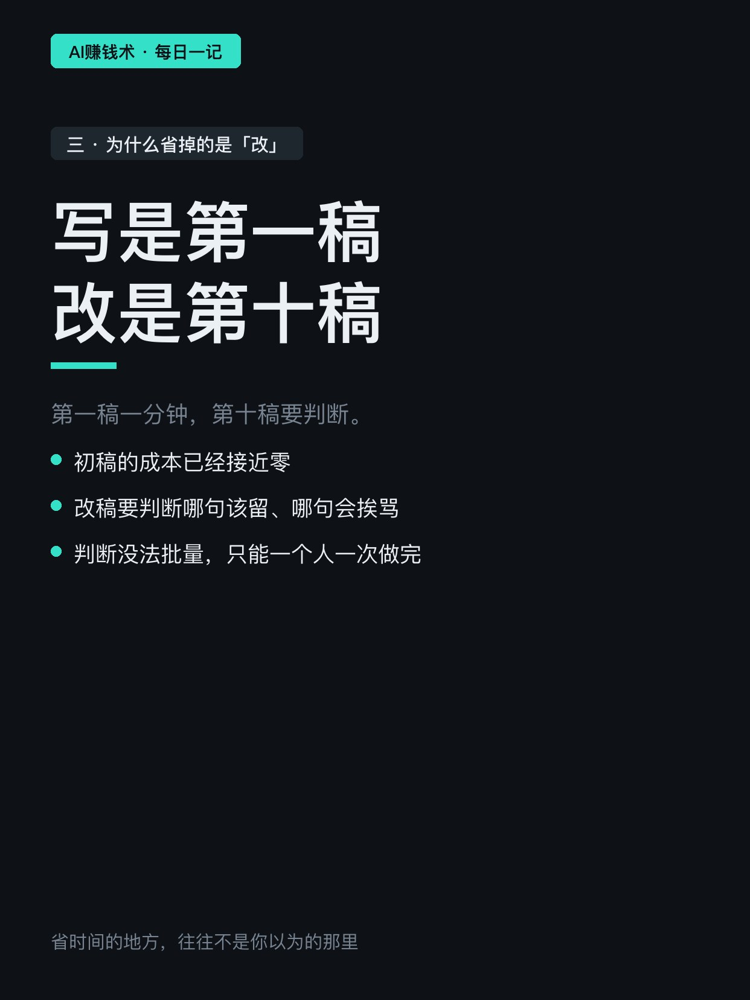
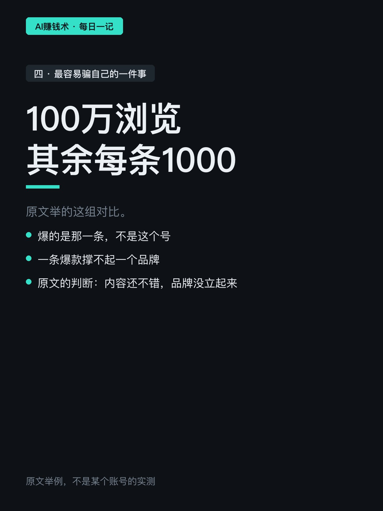
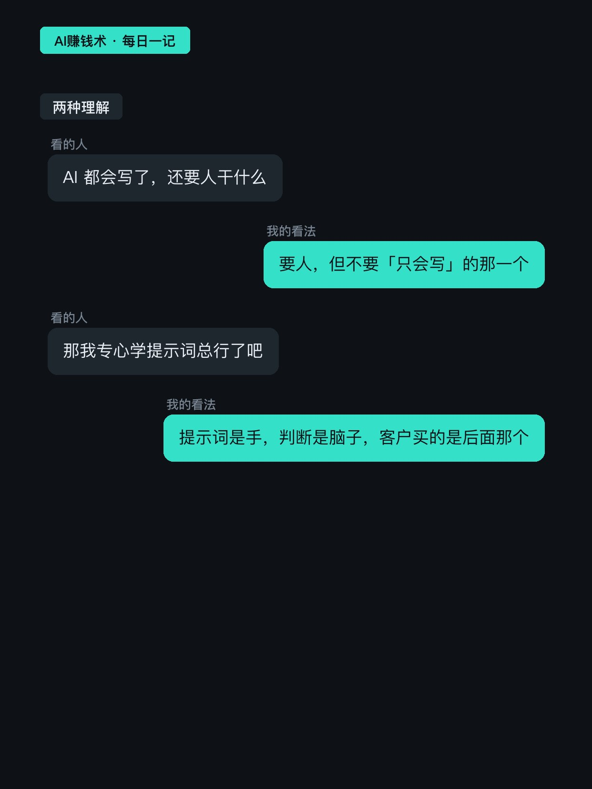
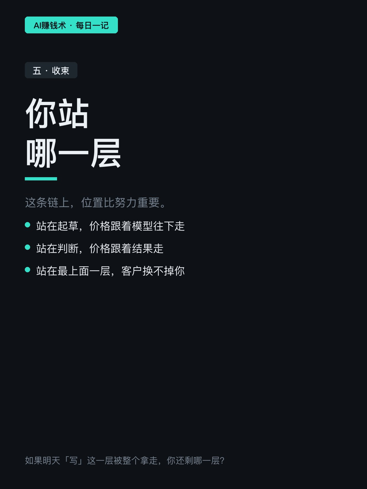

# 审稿12小时，现在4小时

> — · 2026-11-06 10:02 发布 · AI 赚钱内容

## 标题（可直接复制）

```
审稿12小时，现在4小时
```

## 正文（可直接复制发布）

一家内容服务机构的人说，他现在全部的工作就是审阅和改写初稿——每天 4 个小时做完，以前要 12 个小时。客户没有裁掉写手，只是不再为「写」这一层付钱。

这段来自 Dan Koe 的一篇长文，11 月初译成中文后存进了我的资料夹。原文引的是一家内容服务机构从业者的原话，不是作者自测，也不是我实测。

一、客户买的不再是「会写」

原文引客户方的话：「AI 可以替他们写内容，但他们仍然知道，自己需要一位比他们更善于利用 AI 的策略师或创意总监。」

也就是说，预算没有消失，只是从「产出多少字」挪到了「判断得准不准」。

二、写作的活被压成了审改

同一份活被拆成三种职责：品牌策略、内容策略、起草。省掉的 8 小时不是写，是改——第一稿 AI 一分钟能出，第十稿要判断哪句该留、哪句会挨骂、哪句会被截图。

判断没法批量，只能一个人一次做完。所以时间没有被省掉，是被集中到了更高的一层。

一份活被拆成三层之后，最容易掉下去的是最下面那层：它最先被工具吃掉，也最容易被拿去比价。

三、单条爆款最容易骗自己

原文举了一组对比：一条 100 万浏览，其余每条只有 1000 浏览。它的判断是「这说明你的内容还不错，但你的品牌根本没有建立起来」。

爆的是那一条，不是这个号。把一条的运气当成结构，是这一行最常见的误判。

收尾

所以问题不是「AI 会不会写」，是「你在这条链上站在哪一层」。站在起草，价格跟着模型往下走；站在判断，价格跟着结果走。

原文给的落点是两个方向：成为自己的创意团队，或者成为别人的创意团队。前者是把三层都长在自己身上，后者是把其中一层卖给别人，卖哪一层决定你的价格锚在哪。

如果明天客户把「写」这一层整个拿走，你手上还剩哪一层？

## 话题标签

#AI写作 #内容策略 #职业分层 #AI赚钱术 #AI赚钱术日记

## 配图（8 张）










## 发布信息

| 项 | 值 |
|---|---|
| 平台 | 小红书 |
| 期数 | — |
| 发布时间 | 2026-11-06 10:02 |
| 正文长度 | 734 字 |
| 图片数量 | 8 张 |
| 状态 | 已发布 |
