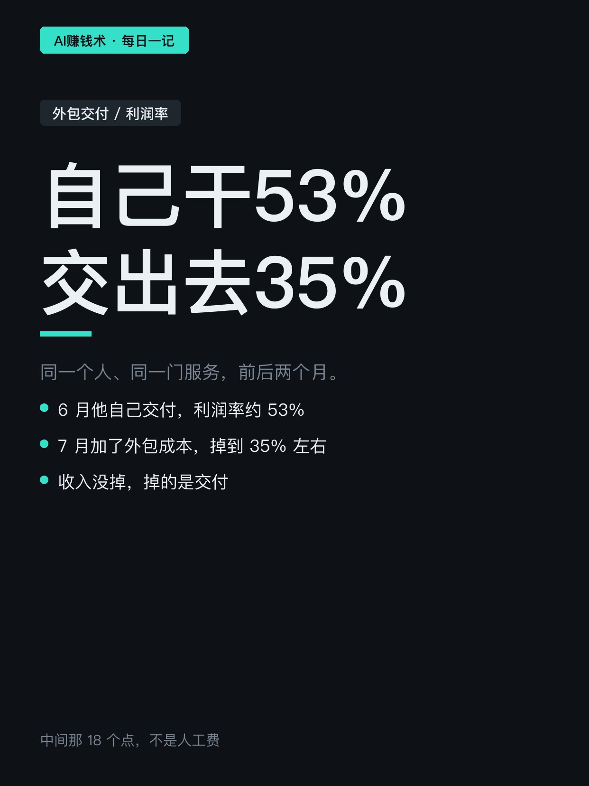
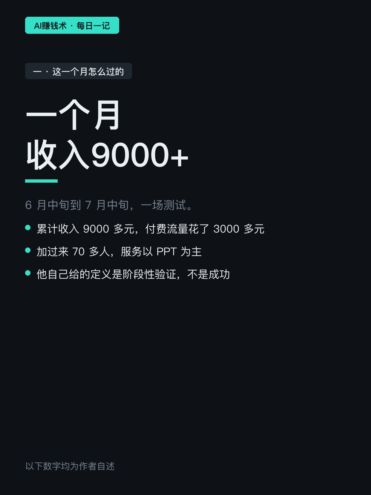
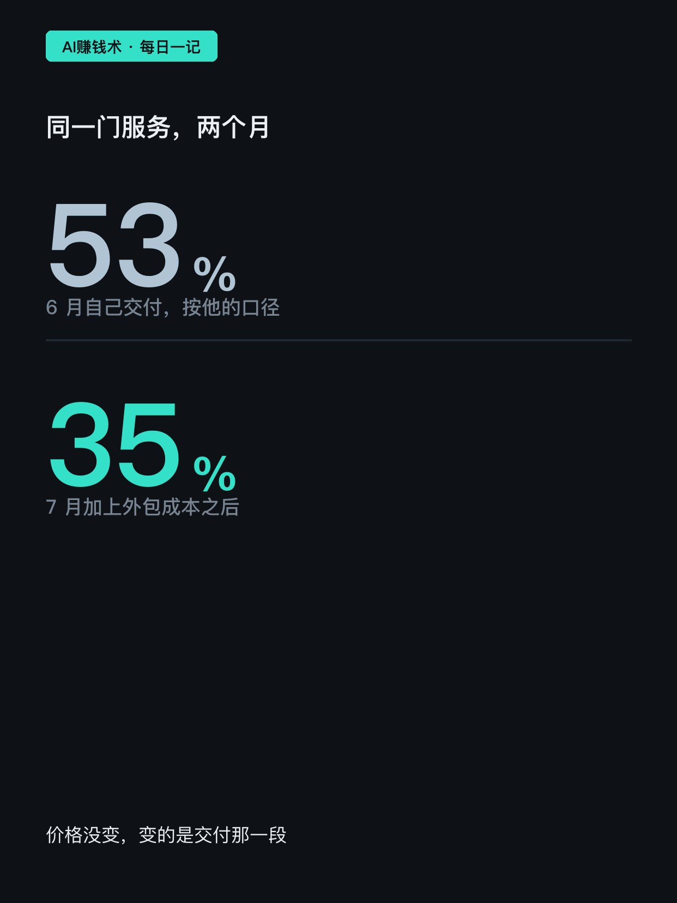
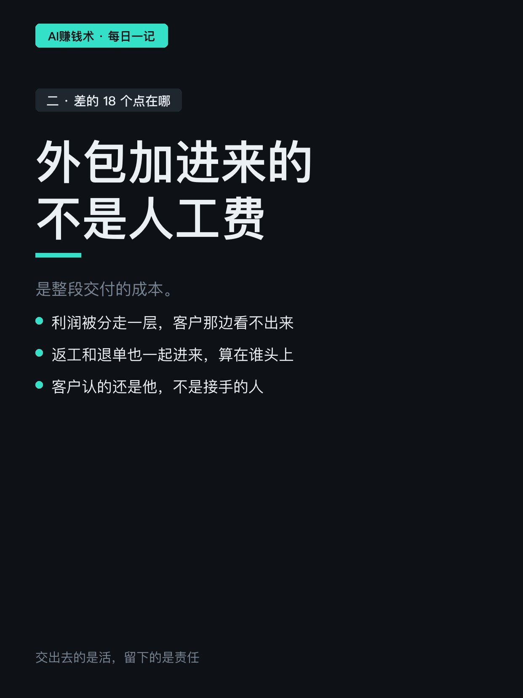
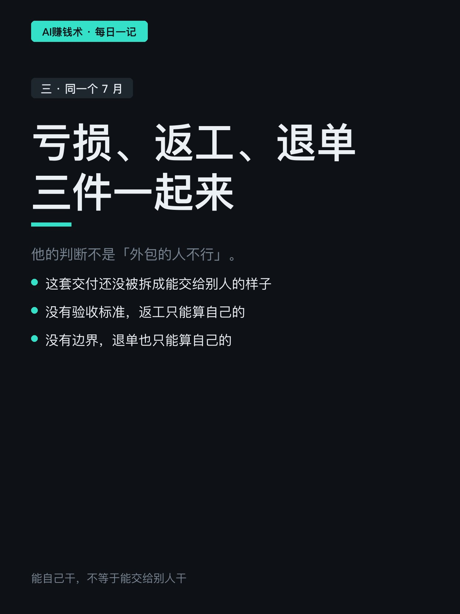
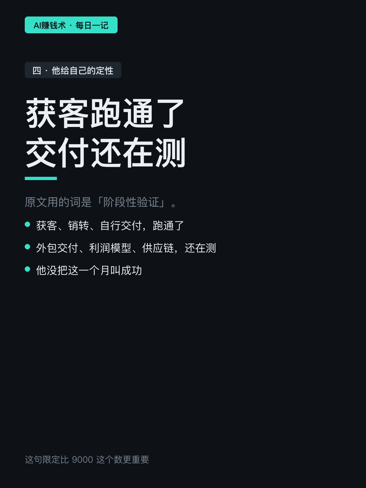

# 自己干53%，交出去35%

> — · 2026-11-06 08:02 发布 · AI 赚钱内容

## 标题（可直接复制）

```
自己干53%，交出去35%
```

## 正文（可直接复制发布）

同一个人、同一门服务，6 月利润率约 53%，7 月变成 35%。中间那 18 个点，不是人工费。

作者做了 10 年广告投放，从一线做到管理层，累计操盘预算 2 亿以上，2026 年从公司出来单干，坐标成都。6 月中旬到 7 月中旬，他用一个月跑了一场测试：累计收入 9000 多元，付费流量花了 3000 多元，加过来 70 多人，服务以 PPT 为主。下面的数字都是他的自述。

一、差的 18 个点，全在交付环节

6 月主要由他自己交付，按他当时的核算口径，利润率约 53%。7 月开始把活交给别人做，同样的服务、同样的价格，加上外包成本之后，掉到 35% 左右。

收入没掉，价格没掉，掉的是交付。他原来一个人做完的那条线，被切成两段，中间那一段要付钱给别人。

二、外包不只把利润分出去

还把钱以外的风险留在自己身上。同一个 7 月，原文写「还经历了亏损、返工和退单」，三件事一起出现。

他的解释不是「外包的人不行」，是这套交付还没有被拆成能交给别人的样子：没有验收标准，返工就只能算自己的；没有边界，退单也只能算自己的。客户认的还是他，不是接手的人。

三、他自己没把这一个月叫成功

原文给的定性是「阶段性验证」——获客、销转和自行交付跑通了，外包交付、利润模型和供应链还在继续测试。

这句限定比 9000 这个数重要。很多人看到收入就以为跑通了，他自己的判断是：能自己干，只是第一步。

收尾

外包不是把活分出去，是把利润分出去、把风险留下。53% 到 35% 之间那 18 个点，就是他还没学会怎么把「我会做」翻译成「别人也能做」的价钱。

你手上那摊活，有几件能写成一页纸交给别人？

## 话题标签

#外包交付 #一人公司 #利润率 #AI赚钱术 #AI赚钱术日记

## 配图（8 张）









## 发布信息

| 项 | 值 |
|---|---|
| 平台 | 小红书 |
| 期数 | — |
| 发布时间 | 2026-11-06 08:02 |
| 正文长度 | 708 字 |
| 图片数量 | 8 张 |
| 状态 | 已发布 |
