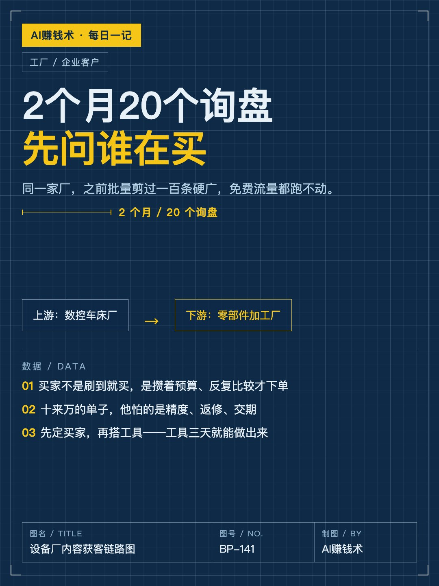
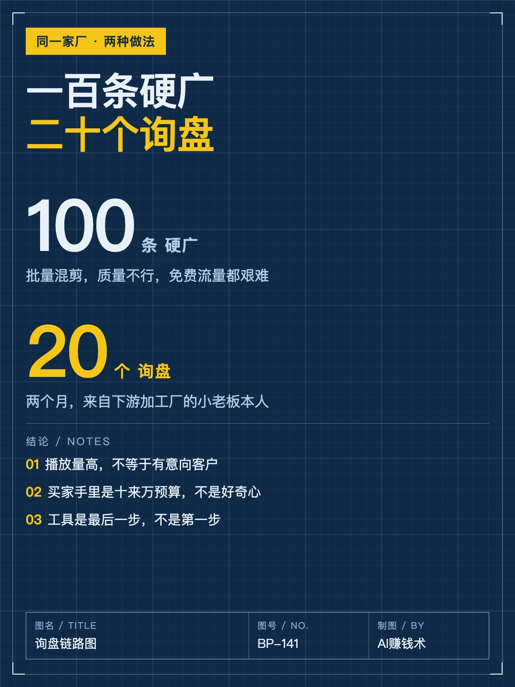
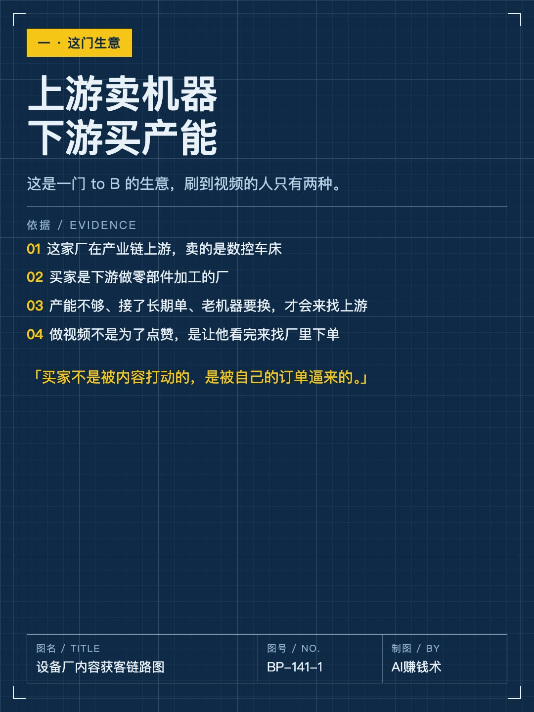
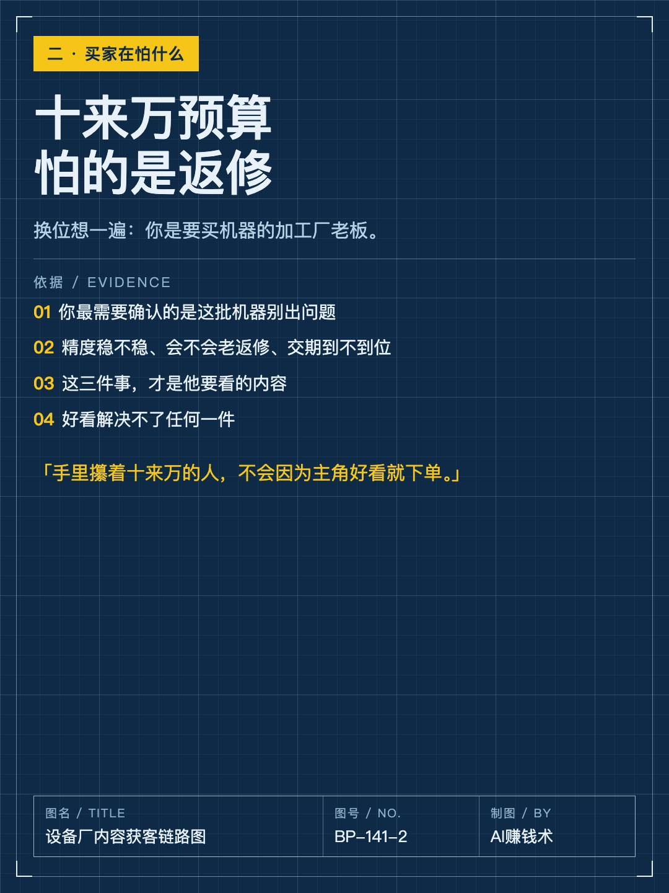
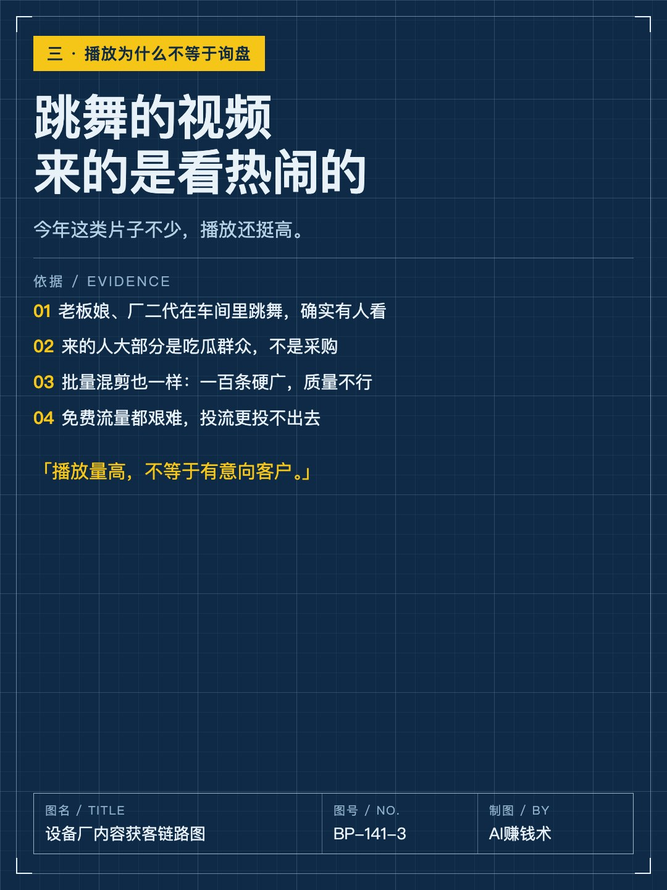
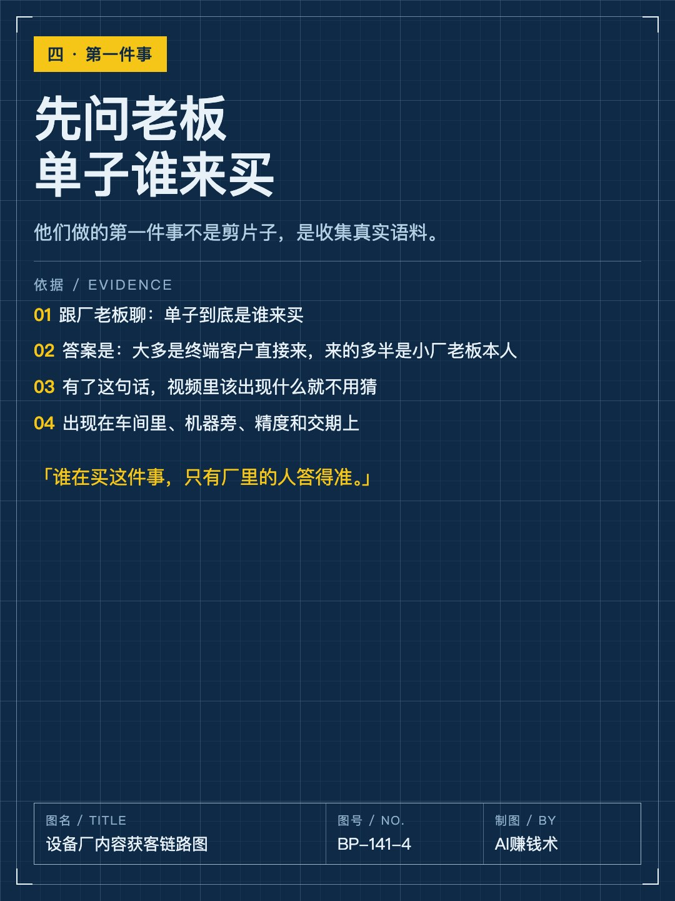
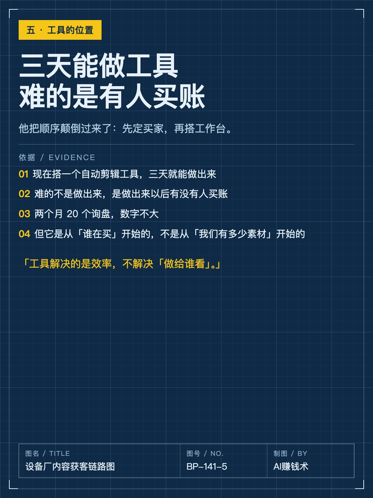
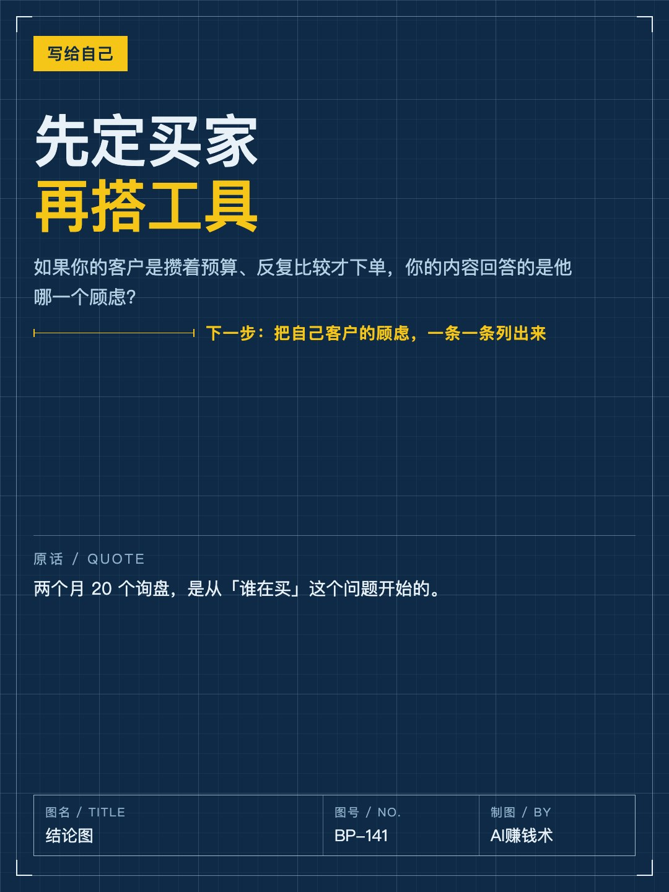

# 2个月20个询盘，先问谁在买

> — · 2026-11-07 11:02 发布 · AI 赚钱内容

## 标题（可直接复制）

```
2个月20个询盘，先问谁在买
```

## 正文（可直接复制发布）

一家本地的设备厂，两个月拿到 20 个企业客户询盘。同一个厂，之前批量剪过一百条硬广，免费流量都跑不动。

作者在东莞做了一场「AI 加实体获客」的线下分享，这个案例是他服务过的一家工厂。因为涉及合作方，他不展开具体项目，只讲能复用的方法。以下是他的分享。

一、先看清这是门什么生意

这家厂在产业链上游，卖数控车床。买家是下游做零部件加工的厂：产能不够了、接了长期单、老机器要换，才会来找上游买设备。

所以这是一门 to B 的生意。刷到视频的人，要么是采购，要么是开加工厂的小老板。做视频的目的不是让人点赞，是让他看完来找厂里下单。

二、有播放没询盘，是因为没想清楚买家在怕什么

今年刷到过不少这种片子：老板娘或者厂二代在车间里跳舞，播放还挺高，来的人大部分是看热闹的。

换个位置想。你是要买机器的加工厂老板，手里攥着十来万预算。你最需要确认的是这批机器买回来别出问题：精度稳不稳、会不会老返修、交期到不到位。

这时候你刷到一条跳舞的视频，主角再好看，你也不会把十来万的单子交给这家厂。

播放量高，不等于有意向客户。批量混剪的问题也一样：一百条硬广，质量不行，免费流量都艰难，投流更投不出去。

三、顺序是先定买家，再搭工具

他们做的第一件事不是剪片子，是收集真实语料——跟厂老板聊，问单子到底是谁来买。老板的答案是：大多是终端客户直接来，来的多半是小厂老板本人。

有了这句话，「视频里该出现什么」就不再靠猜：出现在车间里、出现在机器旁、出现在交期和精度上。

工具反而是最后一步。他自己的说法是，现在搭一个自动剪辑工具，三天就能做出来。难的不是做出来，是做出来以后有没有人买账。

两个月 20 个询盘，是个不大的数字。但它是从「谁在买」这个问题开始的，不是从「我们有多少素材」开始的。

如果你的客户不是刷到就买，而是攒着预算、反复比较才下单，你现在的内容，回答的是他哪一个顾虑？

## 话题标签

#工厂获客 #企业客户 #内容获客 #AI赚钱术 #AI赚钱术日记

## 配图（8 张）










## 发布信息

| 项 | 值 |
|---|---|
| 平台 | 小红书 |
| 期数 | — |
| 发布时间 | 2026-11-07 11:02 |
| 正文长度 | 803 字 |
| 图片数量 | 8 张 |
| 状态 | 已发布 |
