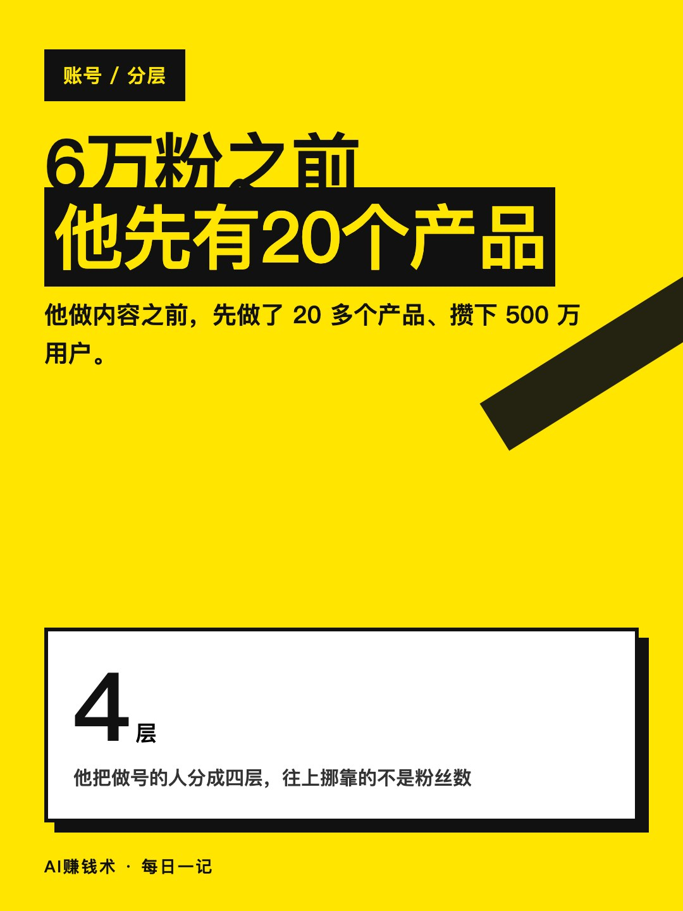
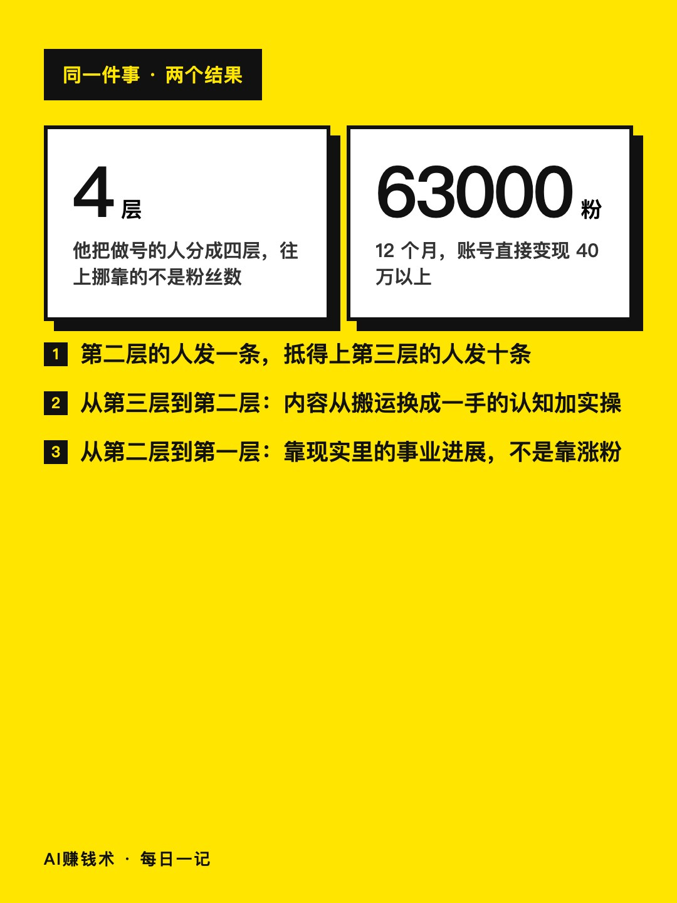
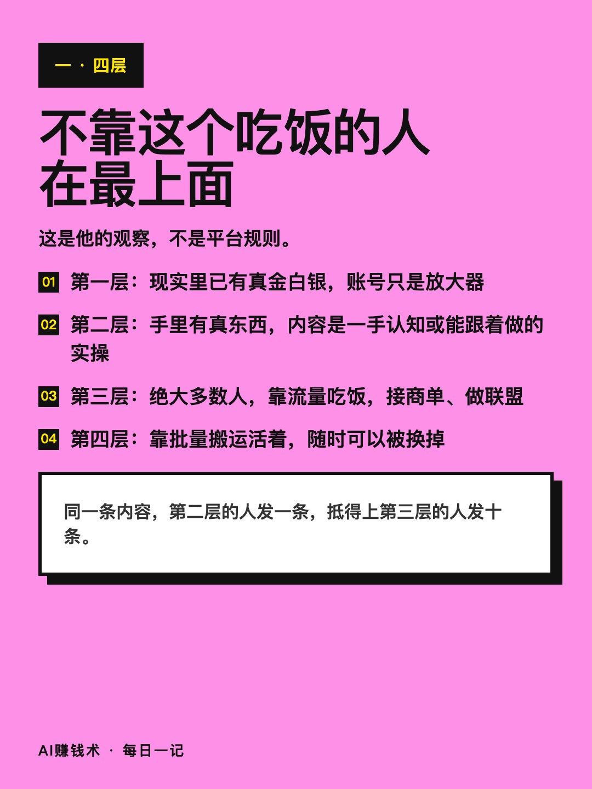
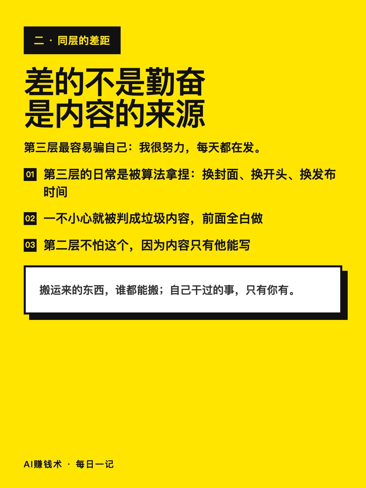
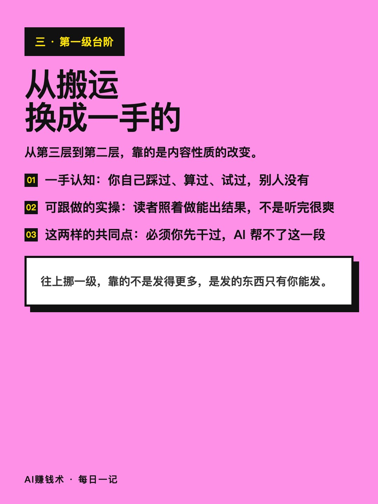
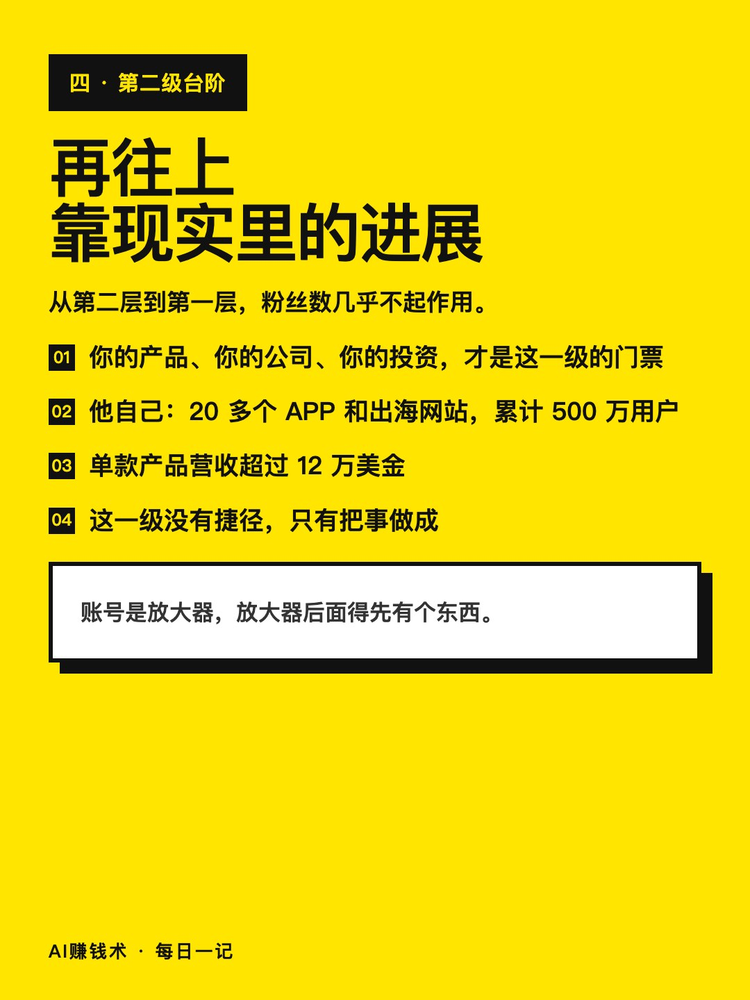
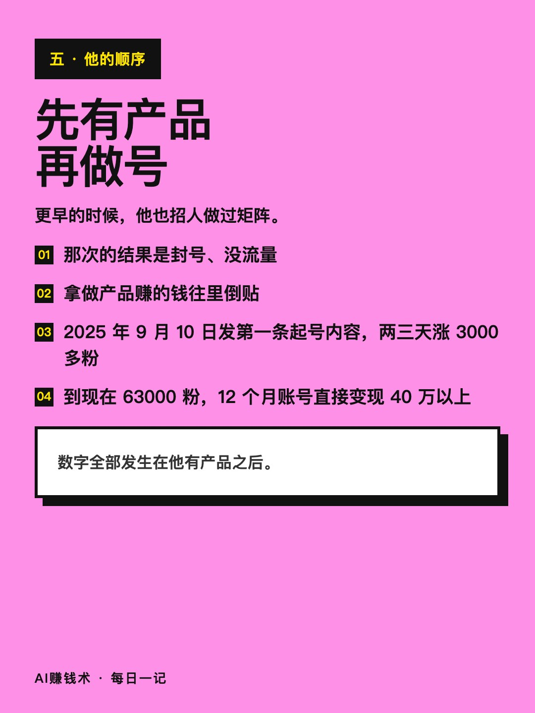
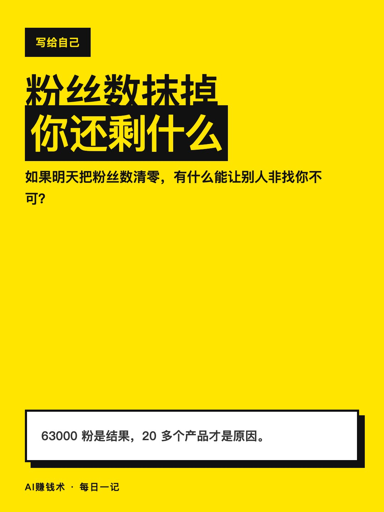

# 6万粉之前，他先有20个产品

> — · 2026-11-07 09:02 发布 · AI 赚钱内容

## 标题（可直接复制）

```
6万粉之前，他先有20个产品
```

## 正文（可直接复制发布）

他先做了 20 多个产品、累计 500 万用户，然后才去做号。12 个月，63000 粉，账号直接变现 40 万以上。

作者是 UI 出身，做了 8 年 APP 和 SaaS 产品。他不是从内容起家的，是从产品起家的。以下都是他自述。

一、他把做号的人分成四层

最上面一层，是不靠这个吃饭的人——现实里已经有真金白银，账号只是放大器。

第二层，是手里有真东西的人：内容要么是一手认知，要么是能直接上手跟着做的实操。第三层是绝大多数人，靠流量吃饭，接商单、做联盟，一不小心就被判成垃圾内容。最底下一层，靠批量搬运活着。

这是他的观察，不是平台规则。但它解释了一件很实际的事：同一条内容，第二层的人发一条，抵得上第三层的人发十条。

二、往上挪的两级台阶，没有一级是粉丝数

从第三层到第二层，靠的不是更勤奋，是内容的来源变了：从「信息搬运」换成「一手认知加实操」。这两样的共同点是，必须你自己先干过，机器替不了这一段。

从第二层到第一层，靠的是现实里的事业进展——你的产品、你的公司、你的投资。粉丝数在这一步几乎不起作用。

他自己就是按这个顺序走的。更早的时候他招人做过矩阵，结果是封号、没流量，拿做产品赚的钱往里倒贴。

三、数字是结果，顺序才是方法

2025 年 9 月 10 日，他发第一条起号内容，两三天涨了 3000 多粉。到现在 63000 粉，12 个月账号直接变现 40 万以上——这只是账号挂钩的三类现金，不含产品订阅。

六篇长内容破百万阅读，单篇最高 268 万。还有一条视频被人搬到别处，播到几千万——那不是他的成绩，只说明内容本身能跑。

这些数字，全部发生在他有产品之后。

所以问题可能不是「我还要不要做号」，是「我现在这一层，靠什么往上挪一格」。

如果明天把账号上的粉丝数清零，你手上还剩什么，能让别人非找你不可？

## 话题标签

#账号分层 #内容定位 #个人品牌 #AI赚钱术 #AI赚钱术日记

## 配图（8 张）










## 发布信息

| 项 | 值 |
|---|---|
| 平台 | 小红书 |
| 期数 | — |
| 发布时间 | 2026-11-07 09:02 |
| 正文长度 | 781 字 |
| 图片数量 | 8 张 |
| 状态 | 已发布 |
