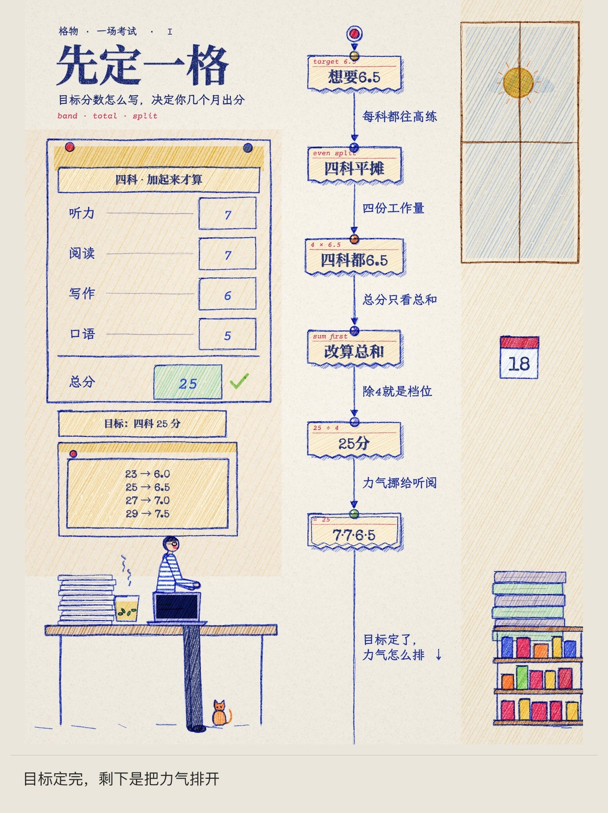
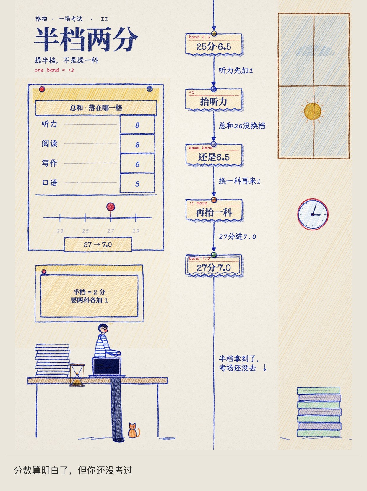
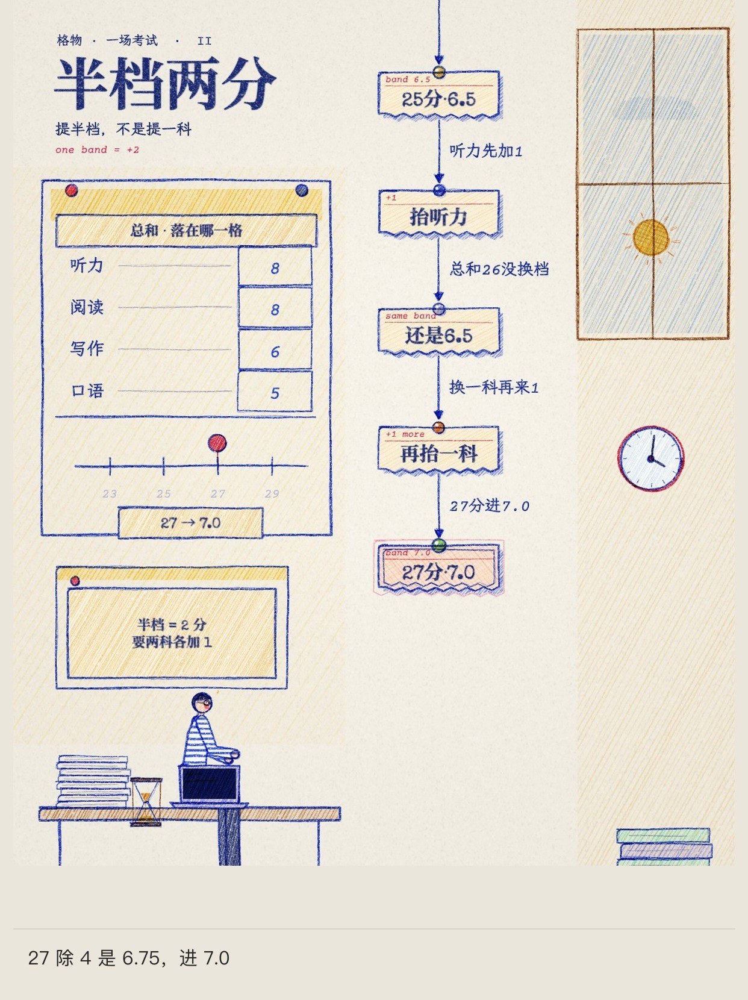
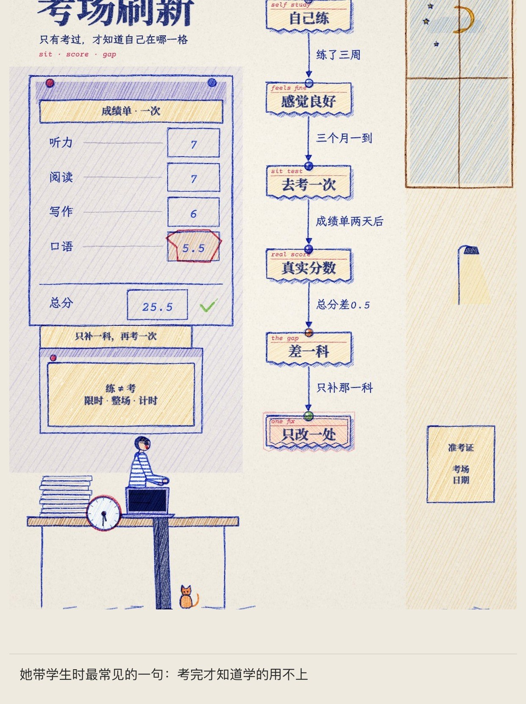
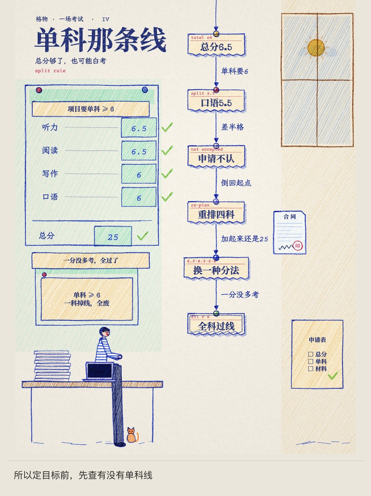
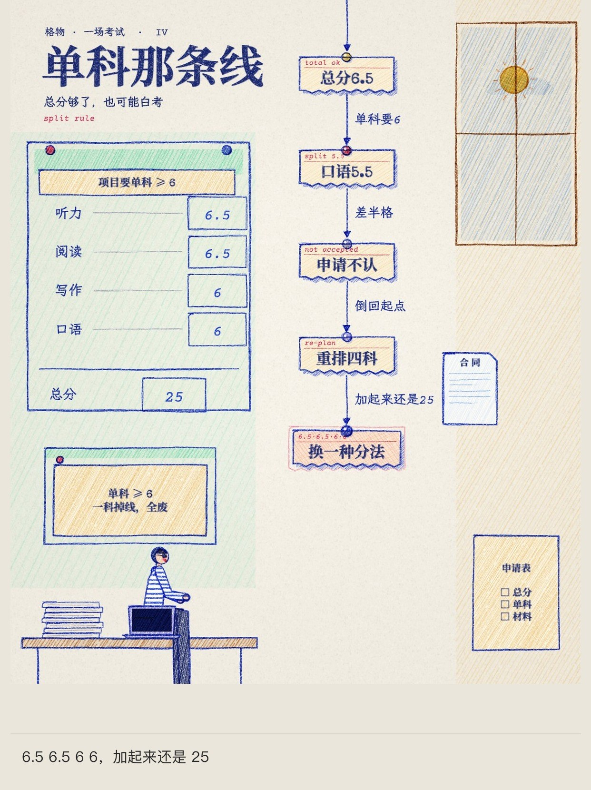

# 想考6.5，口语只要5分

> — · 2026-11-07 12:32 发布 · AI 赚钱内容

## 标题（可直接复制）

```
想考6.5，口语只要5分
```

## 正文（可直接复制发布）

想考 6.5 分的人，第一反应通常是四科都往 6.5 练。但 6.5 这个数字不是四科平均出来的，是四科加起来落在哪一格。

先说清楚这是谁的经验。Sera，雅思 8 分，开了一间雅思工作室，按她自己的说法带过上百个学生出分；英语基本自学，小镇做题家。她写的那篇万字备考长文，第一节不是背单词，是定目标分数——她的原话是，目标分定得多好，出分就有多快。下面这些换算规则是考试本身的，配置是她带学生的经验，两件事分开看。

第一，总分只认四科总和。四科加起来除以 4，再四舍五入到最近的 0.5，就是你的档位。所以真正的门槛是总和：23 分是 6.0，25 分是 6.5，27 分是 7.0，29 分是 7.5。25 分摊到四科是 6.25，但你可以不摊平——7、7、6、5 加起来就是 25，口语只考 5 分，总分照样 6.5。

第二，偏科要付两笔代价。一是提半档要总和加 2 分：从 25 到 27，单科加 1 分不够，得两科各加 1。二是单科线：总分到了 6.5，口语只有 5.5，而项目要求单科不低于 6，照样不认。她的解法不是多考一分，是把四科重排成 6.5、6.5、6、6——总和还是 25，四科全过线，一分没多考。

第三，这套配置有边界。它成立的前提是中国考生的强弱格局：听阅强、口写弱，她给的门槛是高考英语 120 以上、四六级擦边过；口写本来就强的人照抄，只会把力气放错。另一个边界是时间：单次备考别超过三个月，三个月一到就去考一次，因为练习和考场是两套动作——平时写作文不限时，考场上就是写不完；听力从没一口气听过一整套。一场考试两千块确实不便宜，预算紧就先做一遍还原机考的模拟。

她还有一句话：分数够用就行，多一分都是浪费。这话容易听成偷懒，其实是让你先算再练——先查换算表，再看目标项目有没有单科线，最后才决定力气往哪放。多数人把顺序反过来了：先埋头练四科，考完才发现卡住的是那条单科线。

你手上那个目标分，是照着换算表和单科线算出来的，还是照着自己想要的那个数字写下来的？

## 话题标签

#AI赚钱术日记 #雅思 #留学申请 #学习方法 #考试规划

## 配图（12 张）














## 发布信息

| 项 | 值 |
|---|---|
| 平台 | 小红书 |
| 期数 | — |
| 发布时间 | 2026-11-07 12:32 |
| 正文长度 | 852 字 |
| 图片数量 | 12 张 |
| 状态 | 已发布 |
