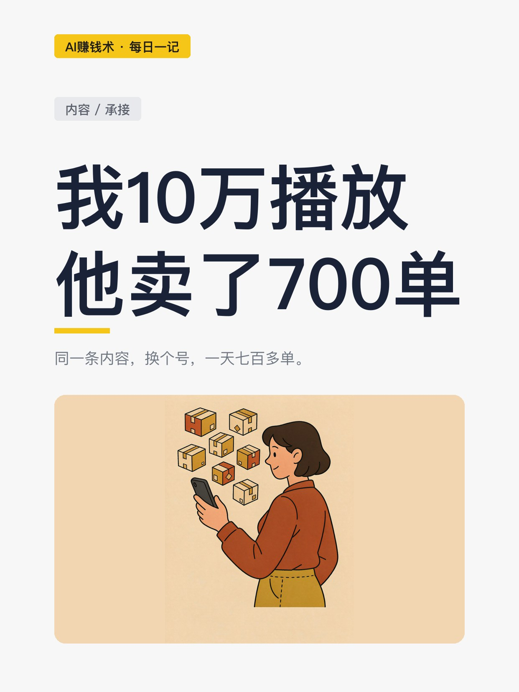
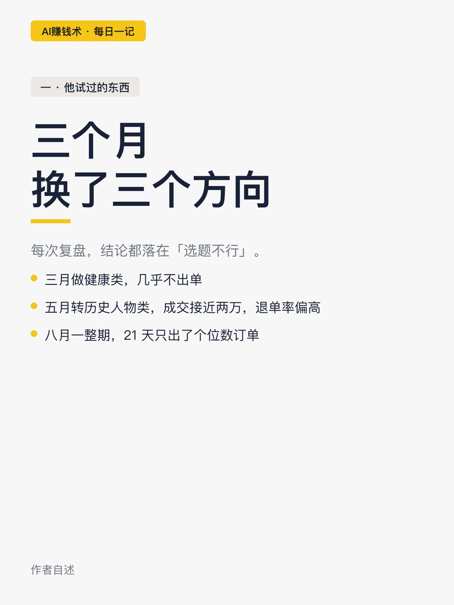
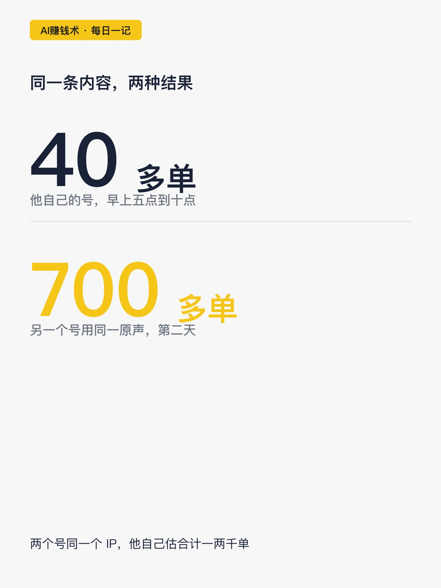
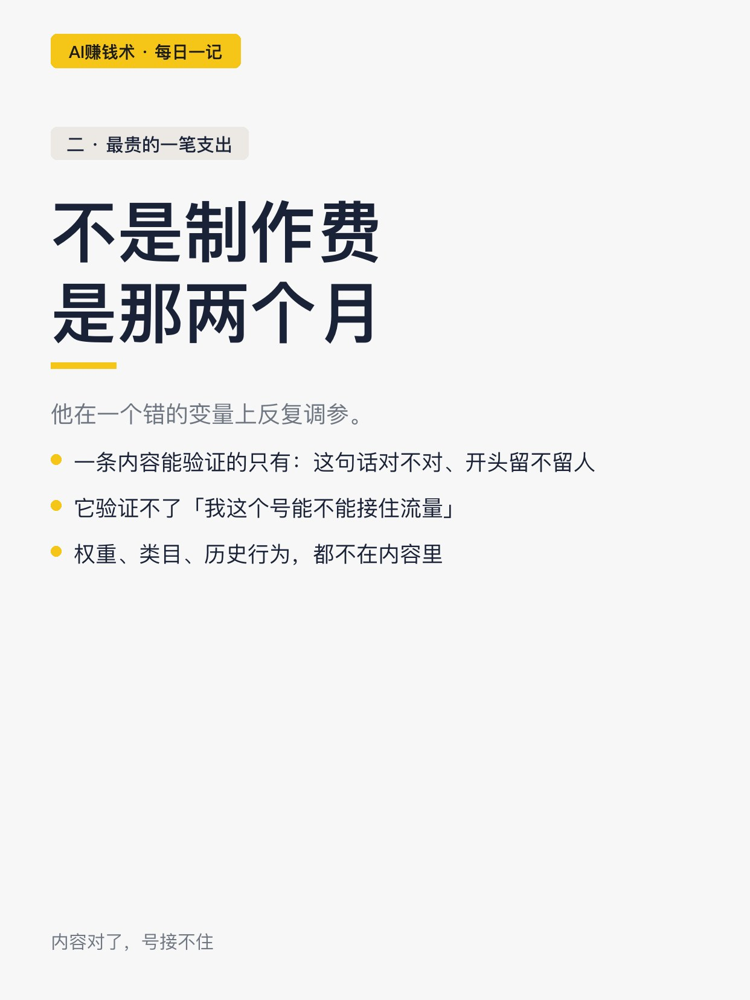
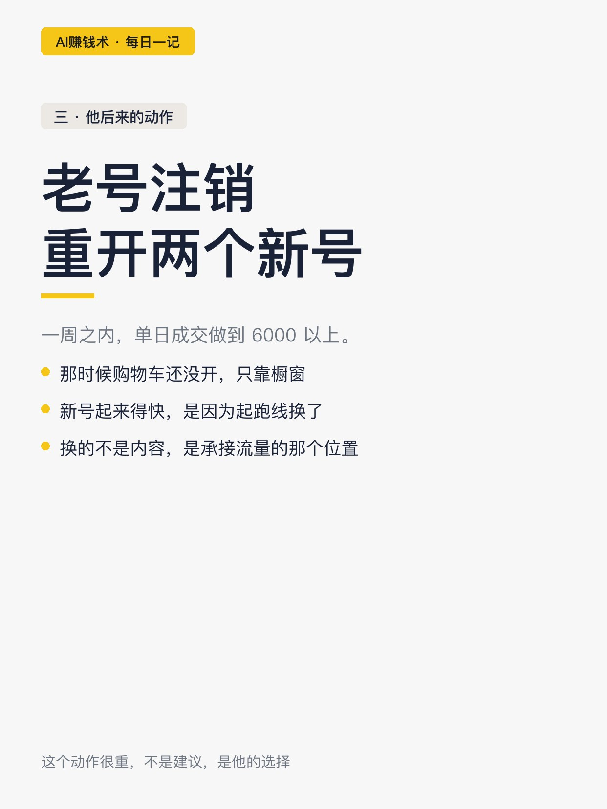
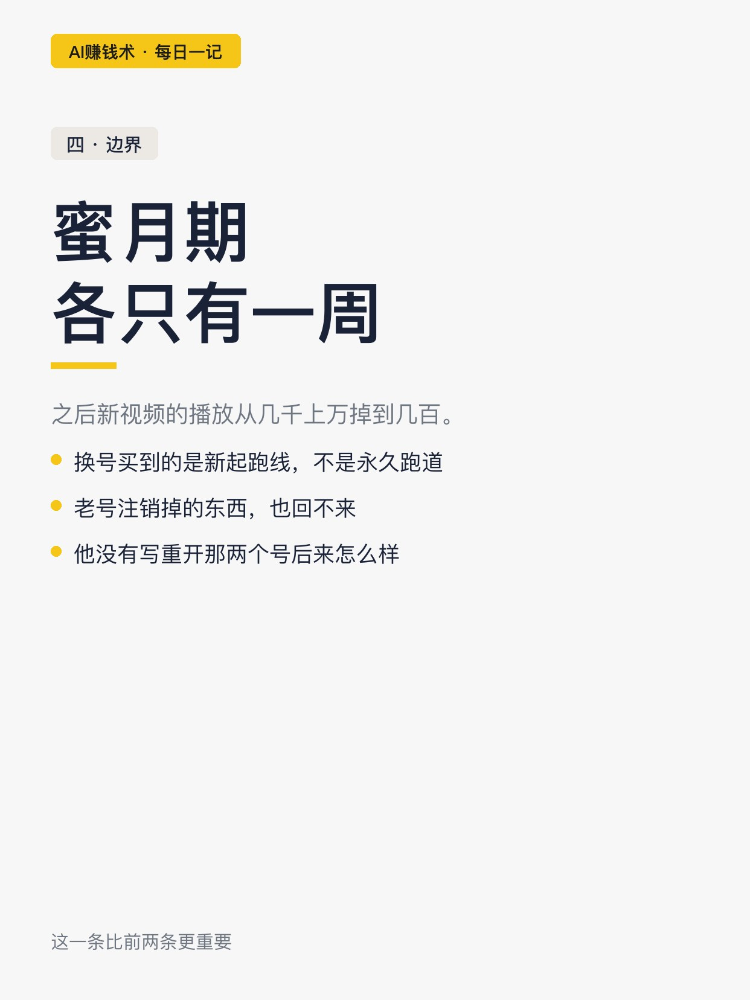
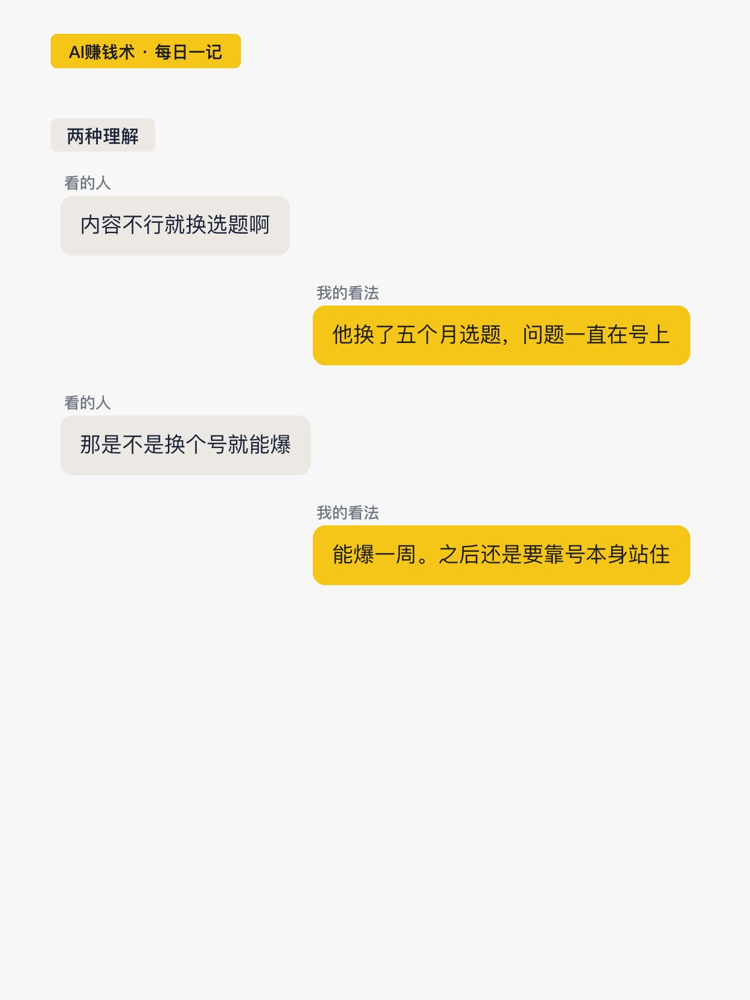
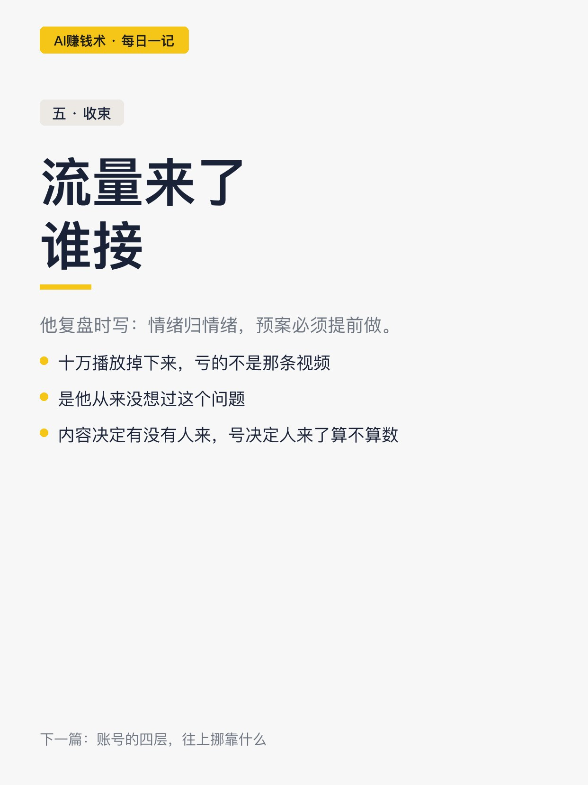

# 我10万播放，他卖了700单

> — · 2026-11-07 08:02 发布 · AI 赚钱内容

## 标题（可直接复制）

```
我10万播放，他卖了700单
```

## 正文（可直接复制发布）

那条视频冲到十万播放的时候，他自己只卖出四十多单。同一条内容，几个小时后出现在另一个号上，一天七百多单。

作者做过产品和交互设计，后来转做图书带货。三月到八月，他一直在换选题——换到第八个月才发现，换错了地方。以下都是他自述。

一、内容是对的，是号接不住

三月他做健康类，几乎不出单。五月转历史、人物类，成交金额接近两万，但退单率偏高。六月这个号流量下滑。八月一整期下来，21 天只出了个位数订单。

他每次复盘都落在同一个结论上：选题不行。于是继续换。

真正的答案出现在那条爆款里。视频下午发出，第二天早上五点到十点，卖出四十多单；接近中午，播放冲到十万，然后被判违规下架。几个小时之后，另一个号用他的原声发了同一条内容：先是一百多单，第二天七百多单。两个号同一个 IP，他自己估，合计一两千单，成交金额超过十万。

同样的画面，同样的声音。差的只有一件东西：这个号是谁的。

二、他代价最大的地方，是把五个月花在了内容上

三月到八月，他试了三个方向、换了无数条片子。真正的成本不是制作费，是他一直在一个错的变量上反复调参。

一条内容能验证的东西很少：这句话对不对、这个开头留不留人。但它验证不了「我这个号能不能接住流量」。后者不是内容问题，是账号本身的位置问题——权重、类目、历史行为，都不在你手里。

他后来做的动作很重：把老号注销，重开两个新号。

三、换号不是万能的，蜜月期只有一周

新号起来得快。一周之内，在还没开购物车、只靠橱窗的情况下，单日成交做到 6000 以上。

但两个新号的蜜月期，各只有一周左右。之后新视频的播放从几千上万掉到几百。换号买到的是一个新起跑线，不是一条永久的跑道；老号上那些积累，注销掉也回不来。

他自己最后的总结是：情绪归情绪，预案必须提前做。

十万播放掉下来的那一刻，亏的不是那条视频。是他从来没想过——流量真来了，谁接。

如果你的号明天突然起了一条爆款，你手上有什么东西，是能立刻接住的？

## 话题标签

#内容承接 #账号运营 #流量 #AI赚钱术 #AI赚钱术日记

## 配图（8 张）










## 发布信息

| 项 | 值 |
|---|---|
| 平台 | 小红书 |
| 期数 | — |
| 发布时间 | 2026-11-07 08:02 |
| 正文长度 | 827 字 |
| 图片数量 | 8 张 |
| 状态 | 已发布 |
