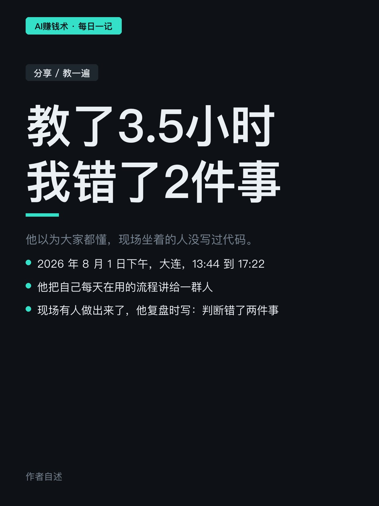
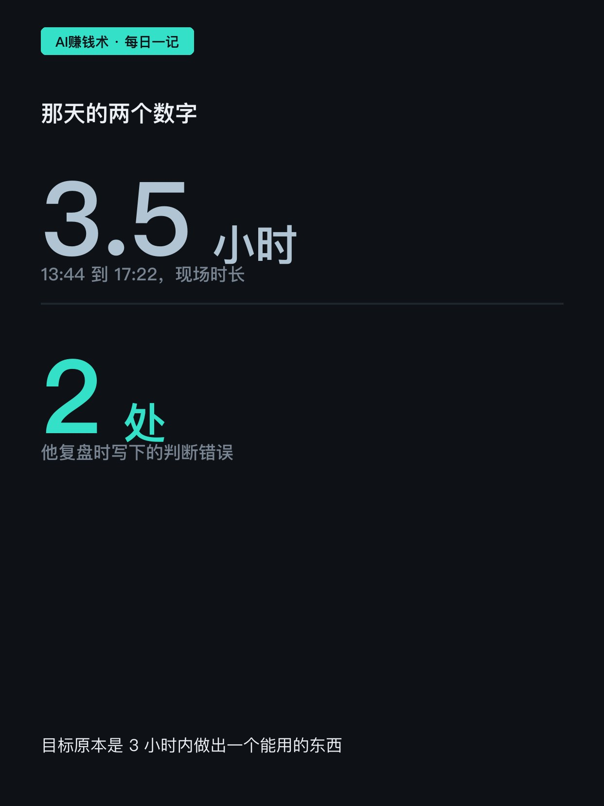
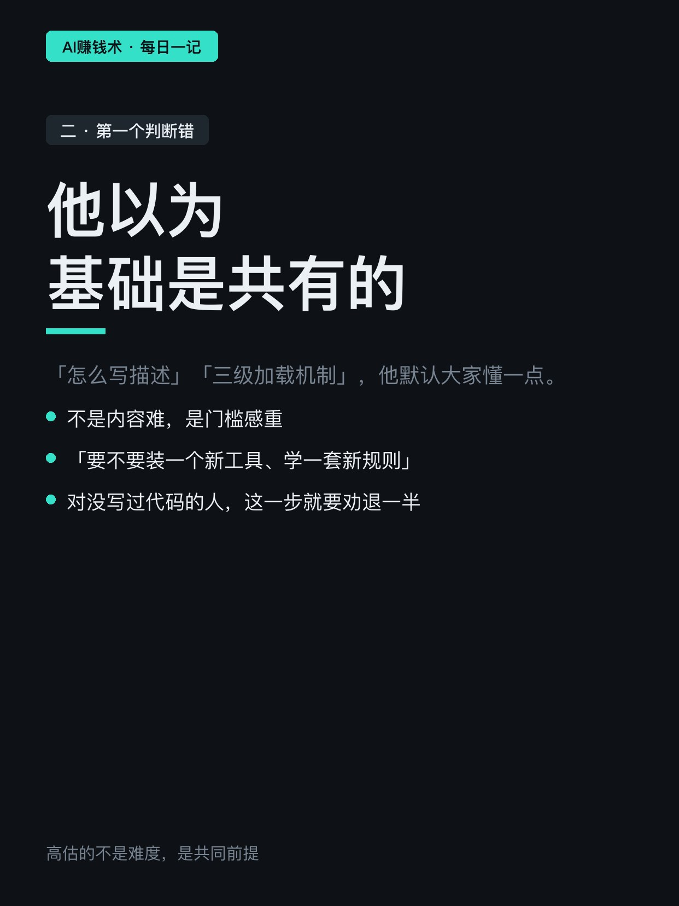
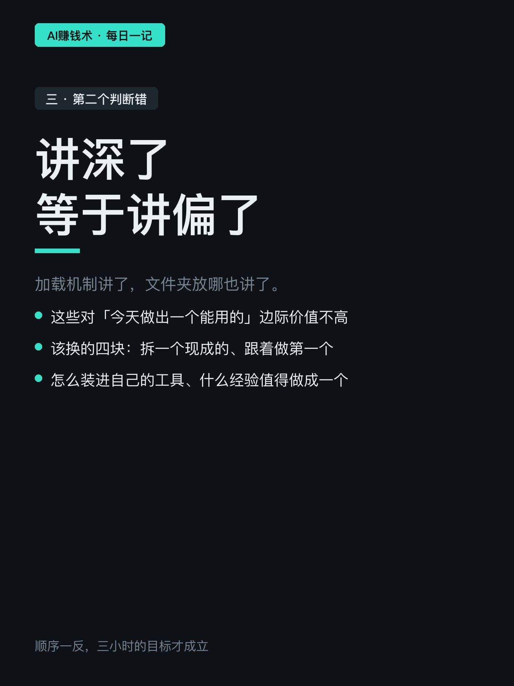
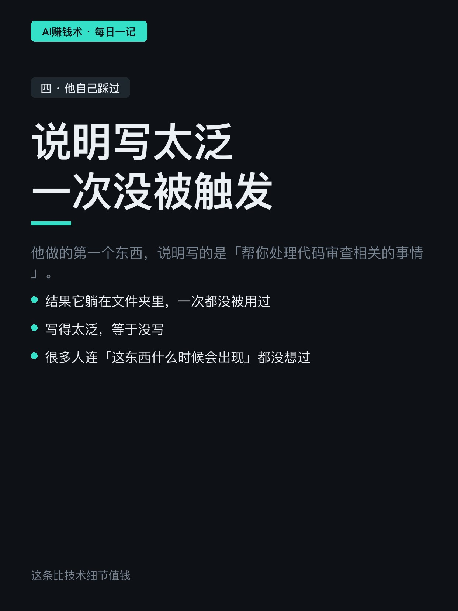

# 教了3.5小时，我错了2件事

> — · 2026-11-07 10:02 发布 · AI 赚钱内容

## 标题（可直接复制）

```
教了3.5小时，我错了2件事
```

## 正文（可直接复制发布）

3 个半小时，他把自己每天在用的流程讲给一群没写过代码的人。现场有人当场做出来了，他复盘时写：我判断错了两件事。

2026 年 8 月 1 日下午 13:44 到 17:22，大连。作者是做了 10 年 Java 开发的独立开发者。以下都是他自述。

一、他按自己的水平备的课

他以为「怎么写描述」「三级加载机制」这些，大家多少懂一点。

现场坐着的人是：做室内设计和项目施工的、从互联网转去做企业 AI 服务的、做营销策划的、自称 AI 小白的职场新人、做了四五年直播带货的博主、做外贸的。

不是内容难。是「要不要装一个新工具、学一套新规则」这件事，对没写过代码的人来说，本身就是一道门槛。

二、讲深了，等于讲偏了

他把加载机制讲了不少，文件该放哪个文件夹也讲了。复盘时他的判断是：这些对「今天做出一个能用的东西」这件事，边际价值不高。

该换成四块：拆一个现成的看结构、跟着做第一个、怎么装进自己的工具、什么经验值得做成一个。顺序一反，三小时的目标才成立。他现场验证的结论是：零代码的人能跟上这套流程，也能做出第一个。

三、他自己先踩过同一个坑

他做的第一个东西，说明写的是「帮你处理代码审查相关的事情」。结果它躺在文件夹里，一次都没被触发过。

写得太泛，等于没写。这句话后来成了他课上第一个要纠正的动作——不是教人写得漂亮，是教人写得具体，具体到「什么时候该叫你」。

这也是他高估基础的另一面：他默认别人知道「触发条件」这回事，其实很多人连「这东西什么时候会出现」都没想过。

3 个半小时，有人当场做出了第一个。他把两件事写进了复盘：一件是高估了基础，一件是讲深了。

这两件事，自己一个人练的时候一辈子发现不了——因为你永远不知道自己默认了多少东西。

那些没做出来的人卡在哪一步，他没写。

## 话题标签

#把方法讲清楚 #AI工具 #线下分享 #AI赚钱术 #AI赚钱术日记

## 配图（8 张）









## 发布信息

| 项 | 值 |
|---|---|
| 平台 | 小红书 |
| 期数 | — |
| 发布时间 | 2026-11-07 10:02 |
| 正文长度 | 759 字 |
| 图片数量 | 8 张 |
| 状态 | 已发布 |
