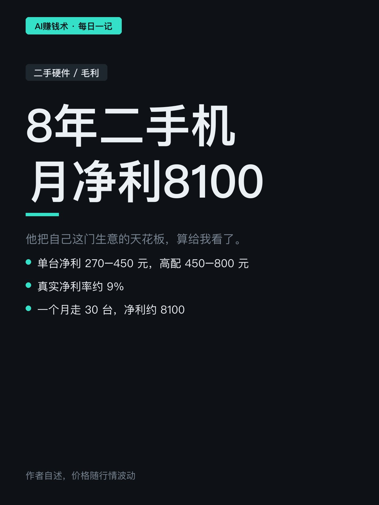
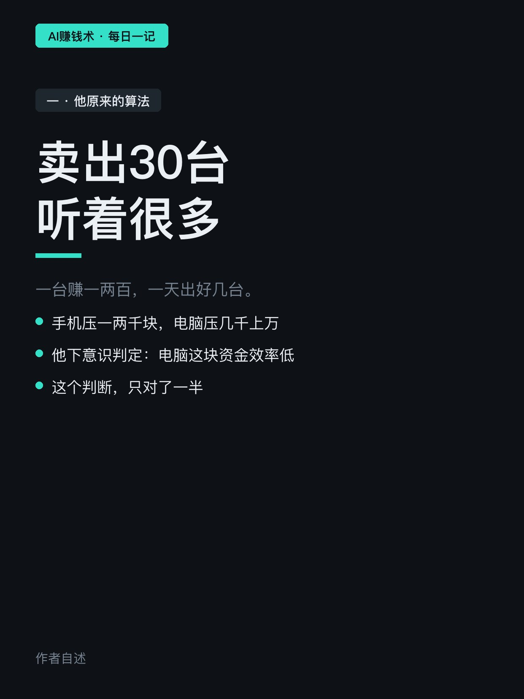
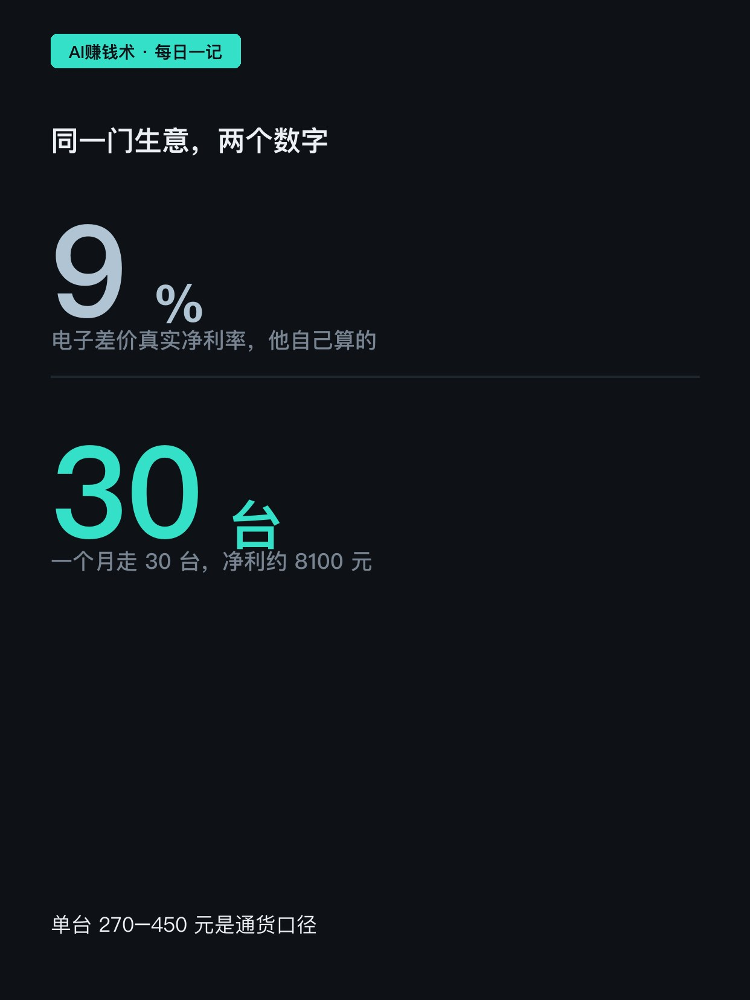
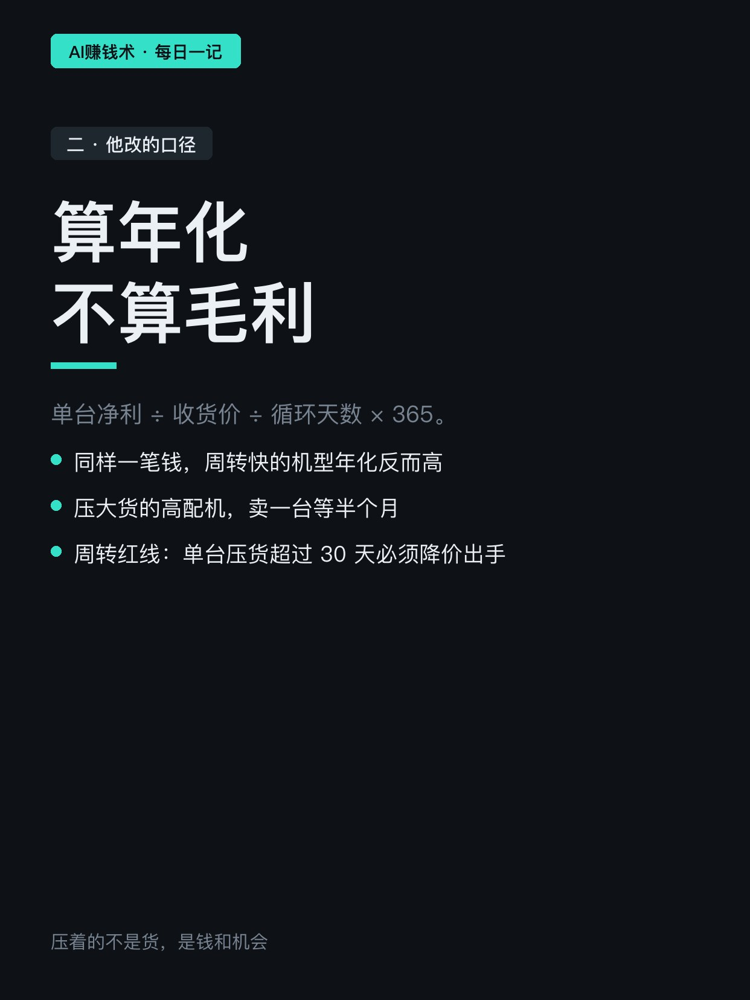
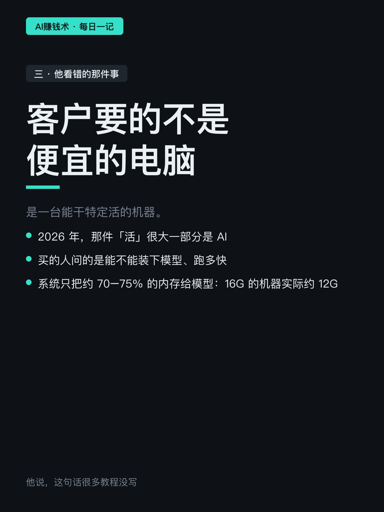
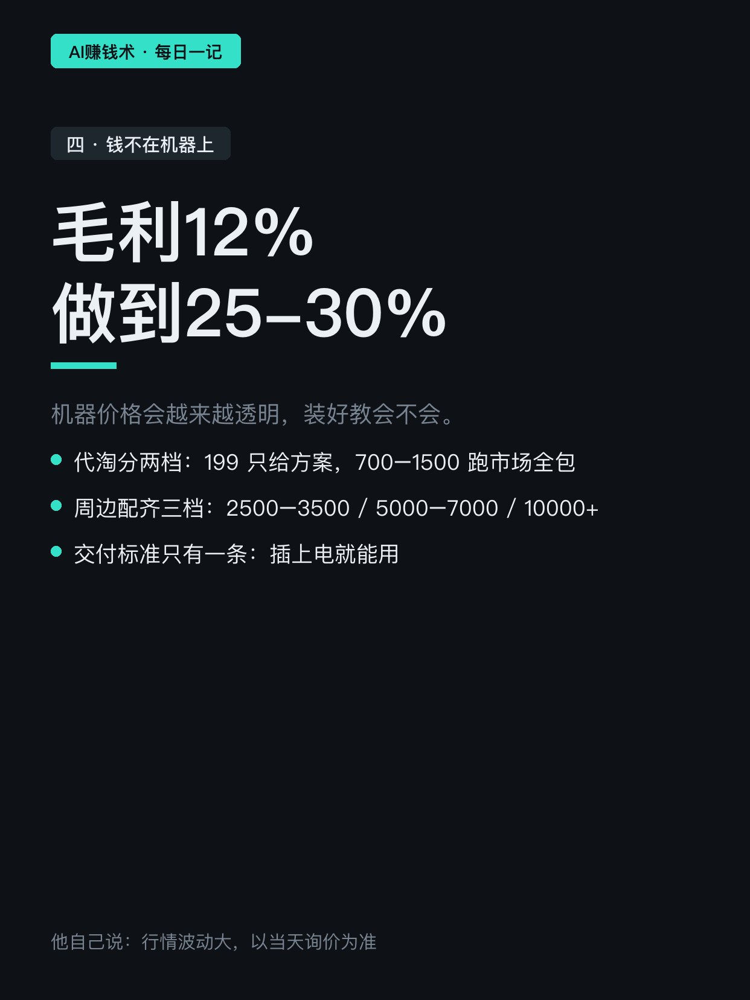
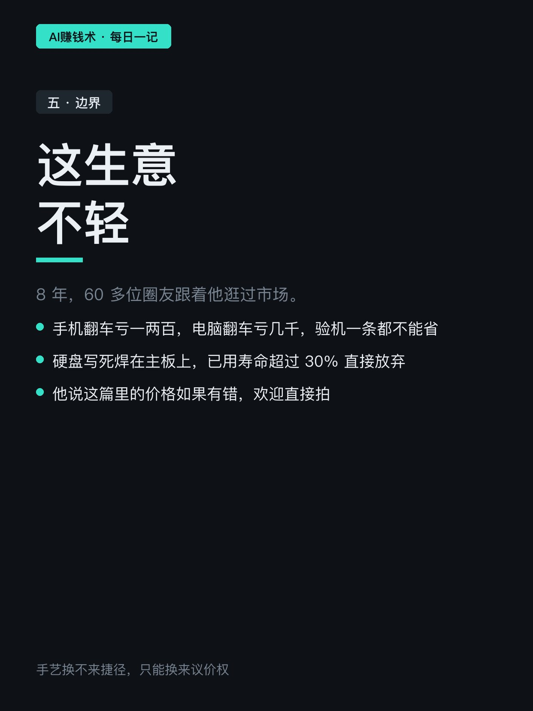

# 8年二手机，月净利8100

> — · 2026-11-08 10:02 发布 · AI 赚钱内容

## 标题（可直接复制）

```
8年二手机，月净利8100
```

## 正文（可直接复制发布）

做了8年二手机，一个月净利8100块。

作者在深圳一个电子市场做了8年，主业二手 iPhone 精品机，电脑一直在做但没当回事。今年9月他在一场 AI 大会上聊了一下午，回来把电脑加进主线。以下是他自述。

一、他原来的账，漏了一半

一台手机赚一两百，一天出好几台；一台电脑压几千上万，出手还慢。他判定电脑这块资金效率低。这个判断只对了一半。

正确的算法是：（单台净利 ÷ 收货价）÷ 循环天数 × 365。同样的钱，周转快的机型年化反而远高于压大货的高配机——他用单台毛利率做决策，漏算了周转天数。

按他的账：差价真实净利率约9%，一个月走30台，净利约8100。单台270–450元，高配450–800元。

二、他原来把电脑看错了

他以为买二手电脑的人是想要一台便宜的电脑。实际上人家要的是能干特定活的机器，而2026年那个「活」很大一部分是 AI：能不能装下模型、跑得多快。

还有个细节：系统不会把整块内存都给模型，实际能用约70%–75%，16G 的机器只有约12G 能分给模型。所以「16G 就能跑 16G 模型」是不准确的。

三、钱不在机器上

他判断机器价格会越来越透明，毛利只会往5–8%收敛，所以他做机器之外那一段。

代淘分两档：199 只给选机方案和行情价，700–1500 是跑市场、验机、砍价、发货全包。他说必须写清两档，不然客户会拿最低那档要求全包。周边配齐三档：2500–3500、5000–7000、10000+。交付标准只有一条：插上电就能用。他要卖的不是一台二手电脑，是一台能跑 AI 的工作站，毛利从12%提到25–30%。

四、边界

装好教会没法批量，一天就那么多小时。这行也重：手机翻车亏一两百，电脑翻车亏几千；硬盘焊在主板上，已用寿命超30%他直接不收。他做了8年，带过60多位圈友逛市场。价格他自己留了一句：行情波动大，以当天询价为准。

五、一句话

信息差一直在，只是换了形式。早年是哪里能拿到便宜货，现在是谁知道这台机器适不适合你、买回去怎么让它产生价值。

如果你卖的东西差价正在归零，你手上还剩哪一段是不能被比价的？

## 话题标签

#二手交易 #硬件生意 #信息差 #AI赚钱术 #AI赚钱术日记

## 配图（8 张）










## 发布信息

| 项 | 值 |
|---|---|
| 平台 | 小红书 |
| 期数 | — |
| 发布时间 | 2026-11-08 10:02 |
| 正文长度 | 896 字 |
| 图片数量 | 8 张 |
| 状态 | 已发布 |
