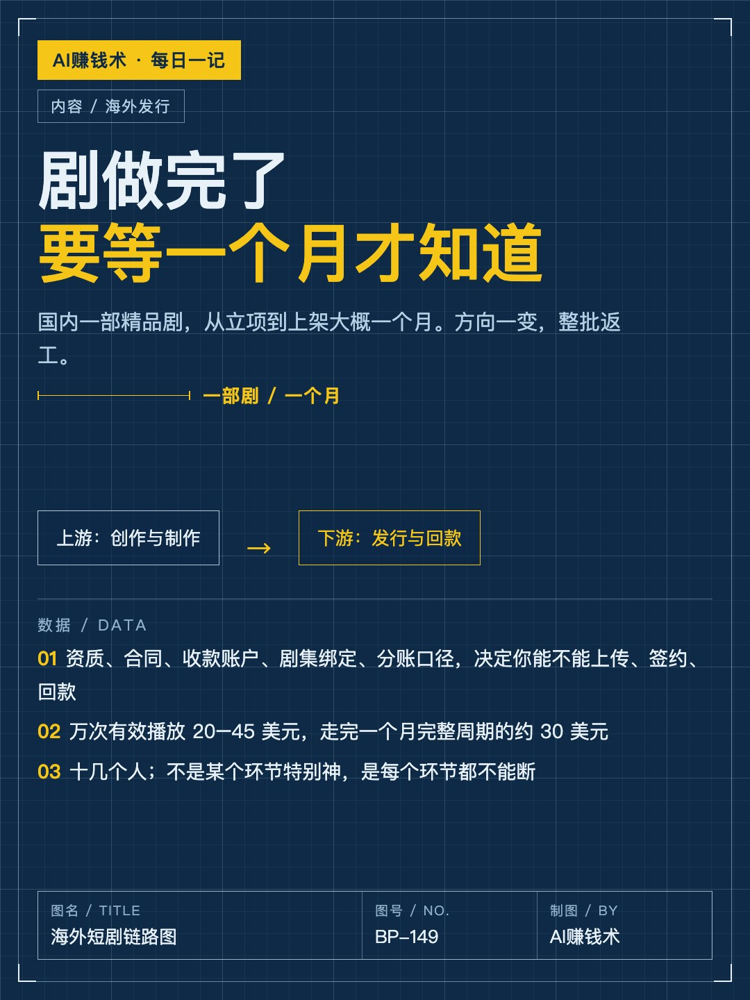
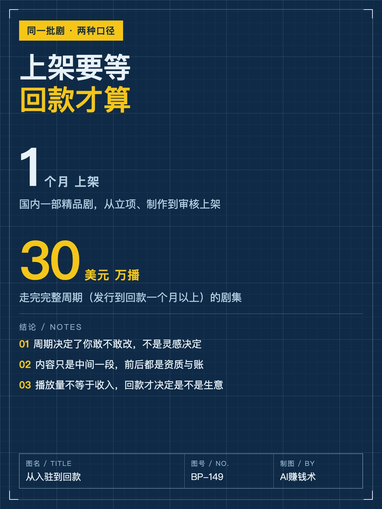
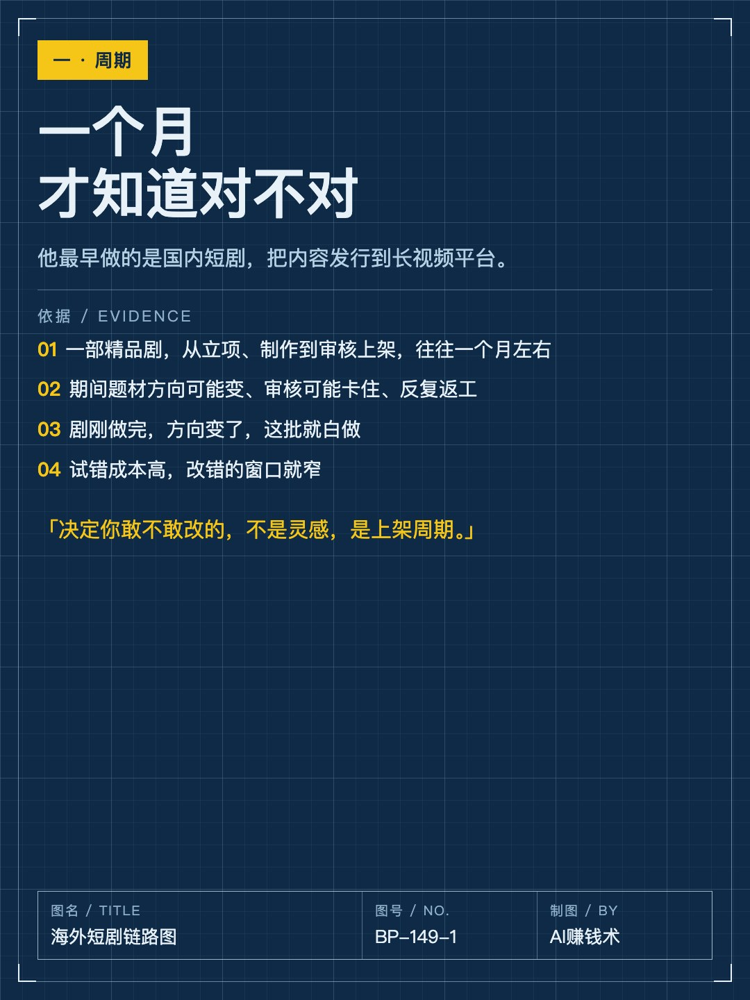
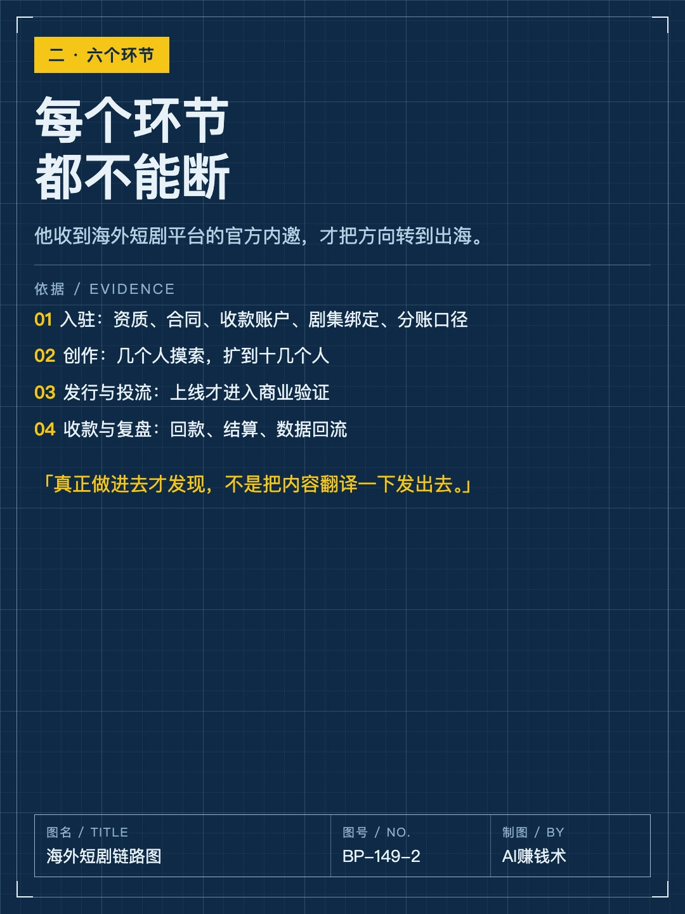
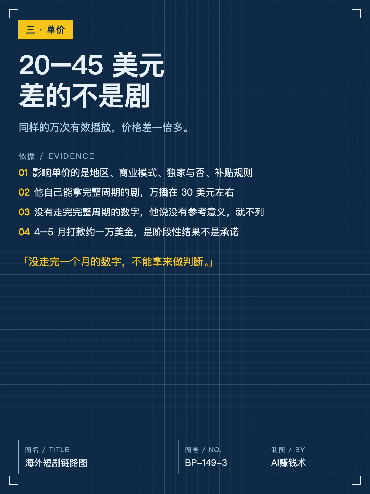
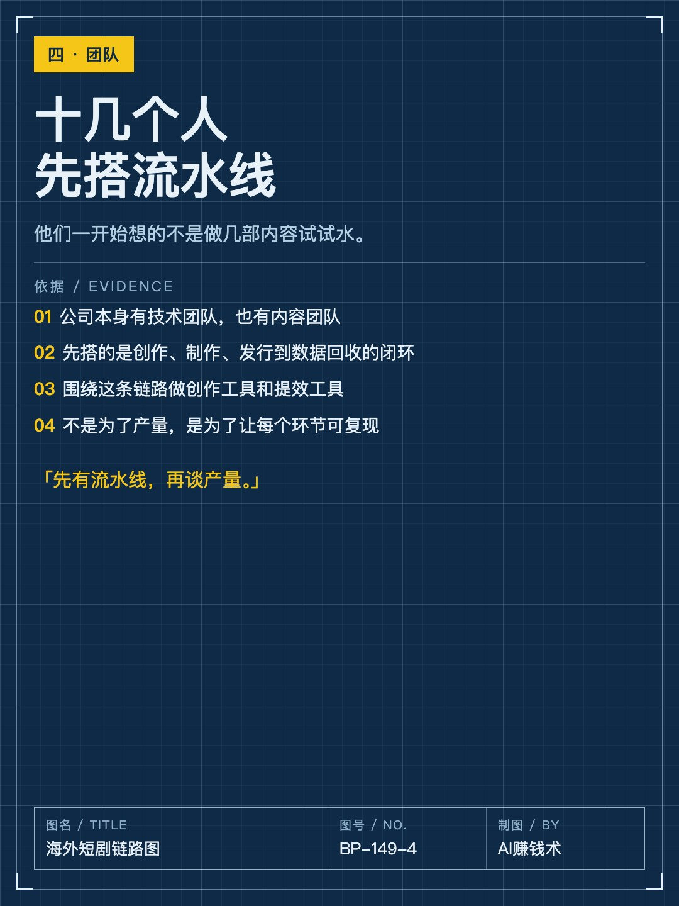
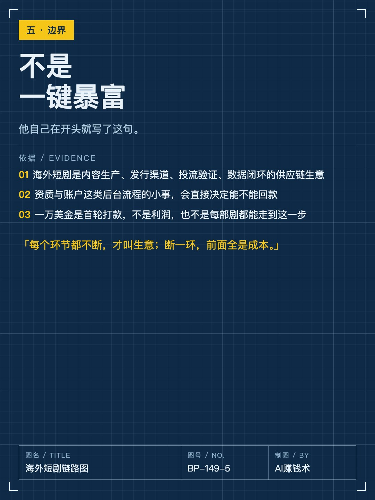

# 剧做完了，要等一个月才知道

> — · 2026-11-08 11:02 发布 · AI 赚钱内容

## 标题（可直接复制）

```
剧做完了，要等一个月才知道
```

## 正文（可直接复制发布）

一部剧从做完到知道它行不行，中间隔着一个多月。

作者2026年初开始做 AI 漫剧和海外短剧，团队十几个人，最早做的是国内短剧。以下是他自述。

一、先卡住他的不是创作，是周期

国内一部精品剧，从立项、制作到审核上架，往往要一个月左右。这一个月里，题材方向可能变、审核可能卡住、内容要反复返工。剧刚做完，方向变了，这批就白做。

试错成本高，改错的窗口就窄。他的判断是：决定你敢不敢改的，不是灵感，是上架周期。

后来他们收到一个海外短剧平台的官方邀请，才把方向转到出海。真正做进去发现，这不是把内容翻译一下发出去。

二、六个环节，断一环前面全是成本

入驻这一关就要准备：资质、合同、收款账户、剧集绑定、分账口径。这些看起来像后台流程的小事，直接决定你能不能上传、能不能签约、能不能正常回款。

往后是创作、发行、投流、收款、复盘。内容生产侧从最早几个人摸索，扩到十几个人。他们一开始想的不是做几部内容试试水，而是搭一条从创作、制作、发行到数据回收的闭环，顺带做创作工具和提效工具。

他自己那句话是：不是某一个环节特别神，而是每个环节都不能断。

三、播放量不等于收入

他们4–5月打款约一万美金。这个数字是阶段性结果，不是利润，也不是每部剧都能走到这一步。

单价这块，万次有效播放大概20–45美元，受地区、商业模式、独家与否、补贴规则影响。他自己能拿完整周期的剧，万播在30美元左右；没走完完整周期的数字，他说没有参考意义，干脆不列。

所以判断一部剧，不能只问播了多少，要先问它走到哪一步了。没走完从发行到回款那一个多月，任何数字都只是过程量。

四、边界

他在开头就写了一句：海外短剧不是 AI 一键暴富，而是内容生产、发行渠道、投流验证、数据闭环的供应链生意。

十几个人、一条链路、一个多月的周期，换来的是一万美金的首次打款。这个投入产出比好看不好看，各人自己算。

五、一句话

先看周期，再看单价。周期决定你敢不敢改，单价决定你改得对不对。

你手上那门生意，从做完到拿到钱，中间隔着多久？

## 话题标签

#海外短剧 #内容出海 #回款周期 #AI赚钱术 #AI赚钱术日记

## 配图（8 张）










## 发布信息

| 项 | 值 |
|---|---|
| 平台 | 小红书 |
| 期数 | — |
| 发布时间 | 2026-11-08 11:02 |
| 正文长度 | 861 字 |
| 图片数量 | 8 张 |
| 状态 | 已发布 |
