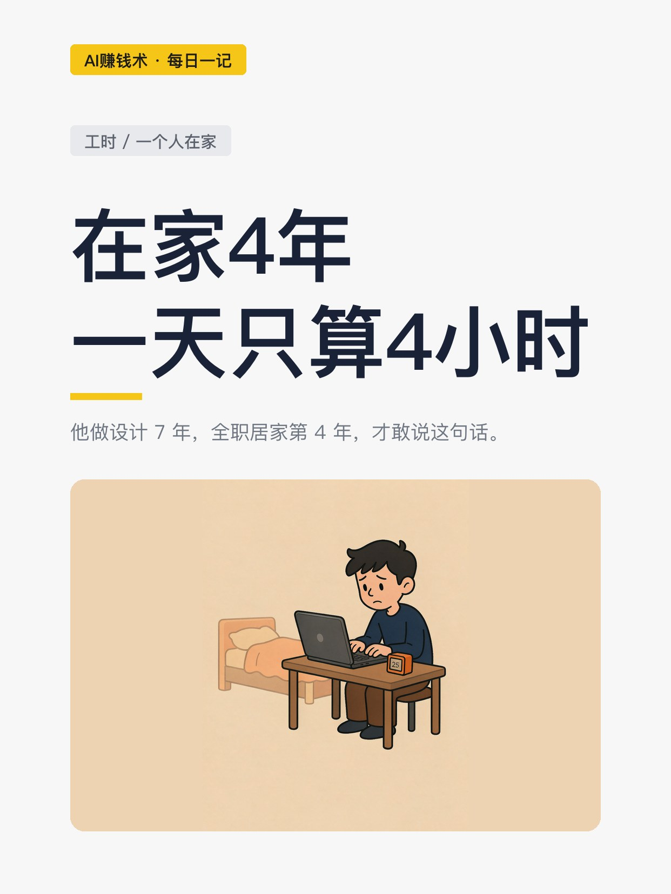
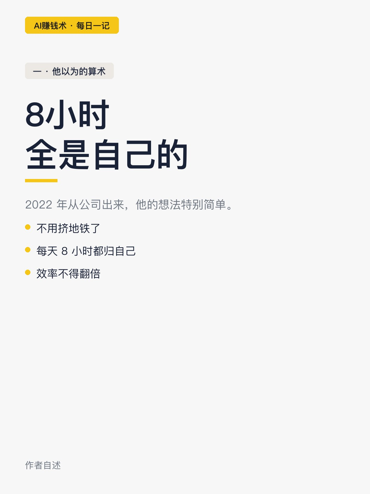
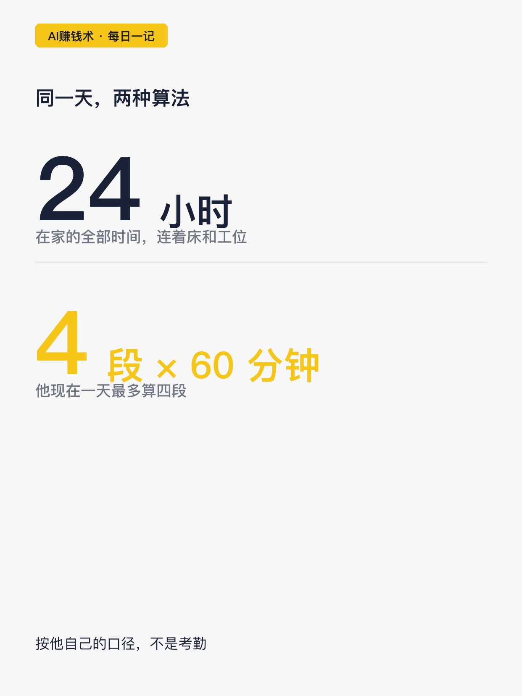
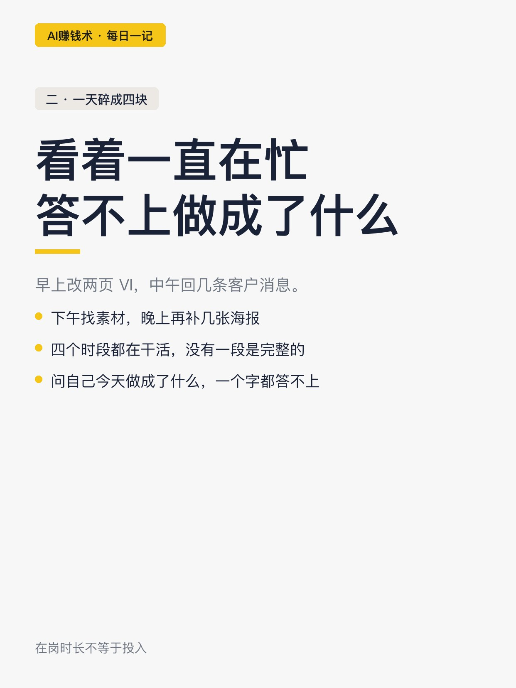
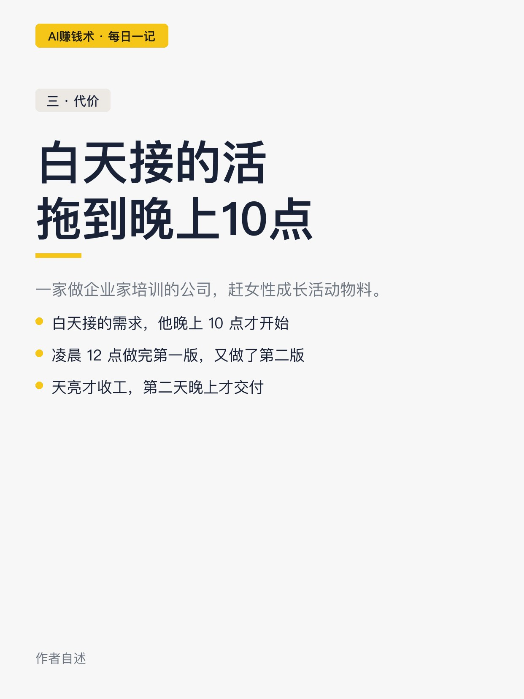
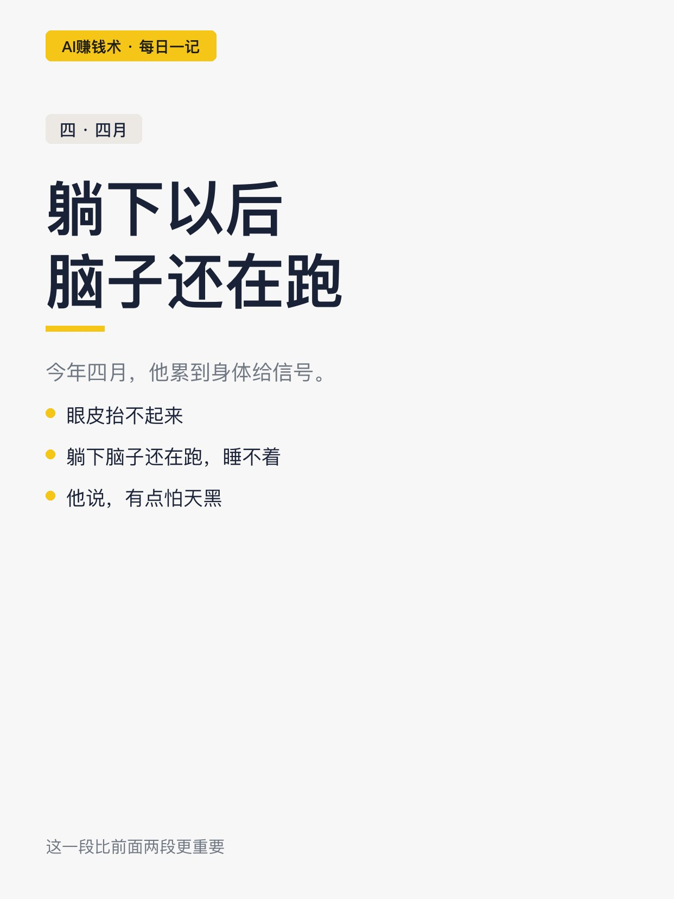
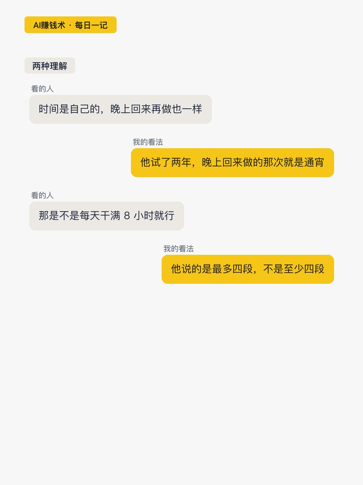
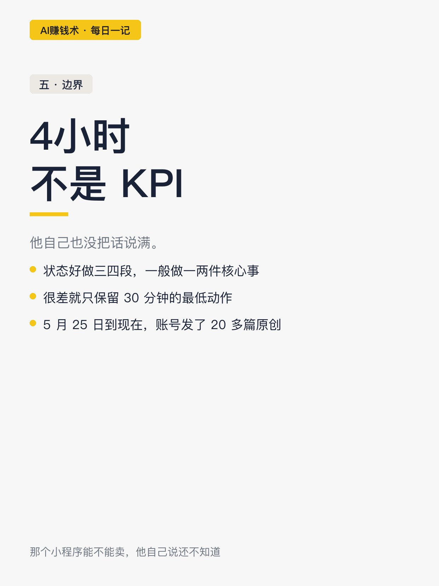

# 在家4年，我一天只算4小时

> — · 2026-11-08 08:02 发布 · AI 赚钱内容

## 标题（可直接复制）

```
在家4年，我一天只算4小时
```

## 正文（可直接复制发布）

他在家办公4年，最后只承认每天4小时算数。

作者做了7年设计，2022年从公司出来，全职居家，到写这篇时整4年。下面都是他自述。

一、他一开始算错了

出来那天的想法特别简单：不用挤地铁了，每天8小时全归自己，效率不得翻倍。结果头两年，他比谁都躺得勤——工位离床只有三步。

真正的问题不是懒。是他后来发现，一天被切成四块：早上改两页VI，中午回几条客户消息，下午找素材，晚上再补几张海报。看着一整天都在忙，可问自己「今天到底做成了什么」，一个字都答不上。

在岗时长不等于投入。这句话谁都懂，难的是它没有报警器，你自己不会知道。

二、代价不是钱，是身体

为一家做企业家培训的公司赶女性成长活动的物料，他白天接的需求，拖到晚上10点才开始。凌晨12点做完第一版，又做了第二版，天亮才收工，第二天晚上才交付。

今年四月，他累到眼皮抬不起来，躺下脑子还在跑，睡不着，甚至有点怕天黑。

到这一步，他才承认「时间是自己的」这句话是假的——时间从来没归过他，只是没人管而已。

三、他现在的口径

一个实体计时器，一次60分钟，一天最多四段，中途离开就按暂停。状态好做三四段，一般做一两件核心事，很差就只保留30分钟的最低动作。

注意是「最多」，不是「至少」。四段做满就是上限，不是达标线。

从5月25日到现在，他的账号发了20多篇原创。他把这个数摆出来，没有说这四小时换回多少钱——原文里就没有收入数字，他也不打算编一个。

边界也写清：那4小时不是每天必须完成的KPI，也不是考勤。他自己承认，刚上线的那个小程序「能不能卖、能卖多少，目前还不知道」。这套节奏值不值，他还得再跑半年。

四、他真正改的东西

不是效率，是「一天里到底有几小时算数」。这件事没人替他算，只能自己一刀一刀切出来。

如果明天把你的工位搬到床边三步，你一天有几小时是真的在干活？

## 话题标签

#工时管理 #一人公司 #在家办公 #AI赚钱术 #AI赚钱术日记

## 配图（8 张）










## 发布信息

| 项 | 值 |
|---|---|
| 平台 | 小红书 |
| 期数 | — |
| 发布时间 | 2026-11-08 08:02 |
| 正文长度 | 782 字 |
| 图片数量 | 8 张 |
| 状态 | 已发布 |
