# 客户手上有工具，还是花钱找他做

> — · 2026-11-08 12:32 发布 · AI 赚钱内容

## 标题（可直接复制）

```
客户手上有工具，还是花钱找他做
```

## 正文（可直接复制发布）

客户手上有工具，还是花钱找人做。这事我一开始也没想通。

按泽言自己的说法，他做代做这行，接过的单差别大得离谱：有很轻的小活，一单几块钱；有给一个直播间做演讲稿加配图；还有一份两万的单，是把几万条订单信息一条条做成截图——发货时间、订单号、发货状态，全来自一张表格。

最让他想不通的是知识卡片。他自己做了工具放出去引流，客户来问价，他跟人说这工具你自己就能用，把知识点粘进去，风格随便挑，很简单。客户还是让他做。

后来他想明白了：他们不是不会，是没时间。

这是第一层，原理。一个人决定付钱，通常不是卡在“不会用”，是卡在“今天这件事得做完”。他去搜的时候，同一个问题能搜出几千条，说明需求早就在那儿，不需要谁去教育市场。他没走到“学会”那一格，他走到了“找人代做”那一格。能接住的，是这一格。

第二层是代价。代做按件算，单件的钱很薄，薄到返工一次就白干。所以规格要在开工前写死：几份、多大、给谁看、哪天要。写不死就先退回去问清楚，别用返工换定金。他接那份两万的单，流程是固定的：客户给表，脚本按列往里填，模板位置钉死，跑完抽十张跟原表逐行对，对不上就整批重跑，不挑着补。几万份的量，只有流程固定才敢接。

第三层是边界。代做和定做是两门生意。代做是“你要的东西长这样，我按这个做出来”；定做是“我边做你边改”。客户一开始说“按我的想法改一改”，这单就从代做滑到定做，周期变长、来回变多，原来那套按件算的账立刻不成立。他的判断很干脆：能标准化的接，要反复改的不接。

所以这门生意看着是卖手艺，其实是卖“你明天就能用”。客户拿回去是要给自家业务带人、开播、交付的，他花的这点钱，在他自己那场直播里就回来了。

几块钱、两万、几万条，都是他自述的经历；“不是不会，是没时间”是他给的判断，我认同，但它仍然只是判断。

你现在手上那件事，有哪一步是别人搜得到、却不愿意花今天去做的？

## 话题标签

#AI赚钱术日记 #小生意 #接单 #副业思路 #交付

## 配图（12 张）

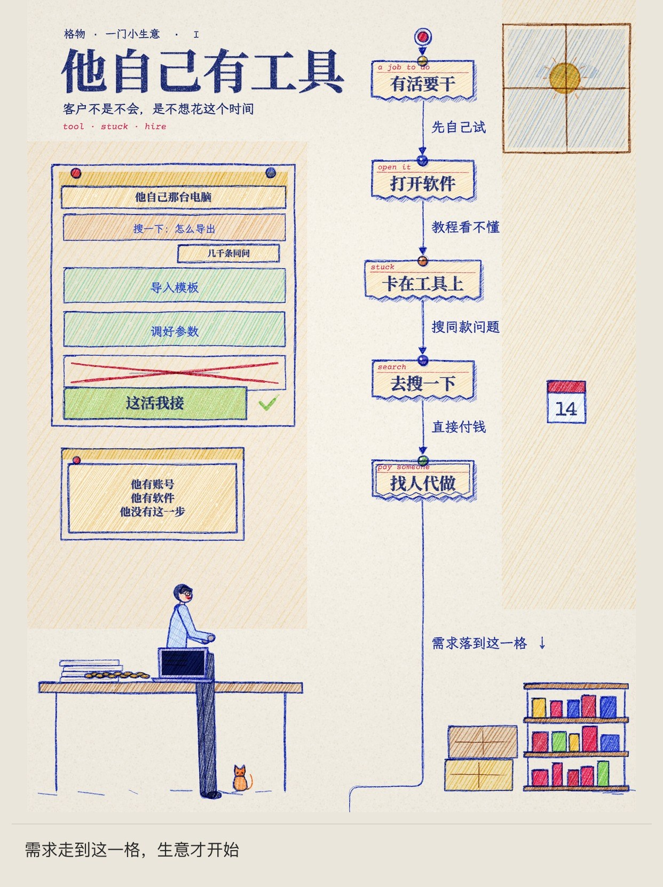
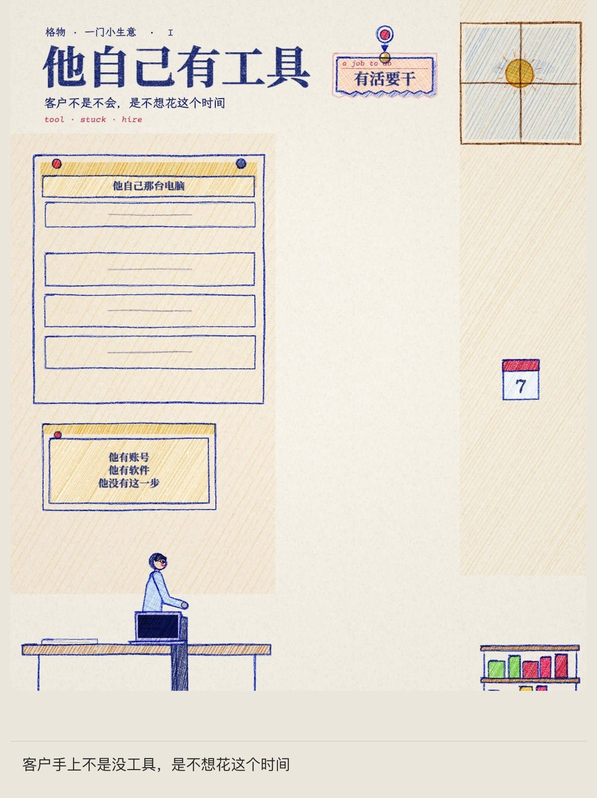
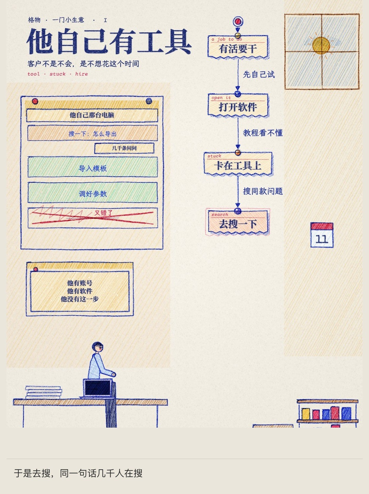
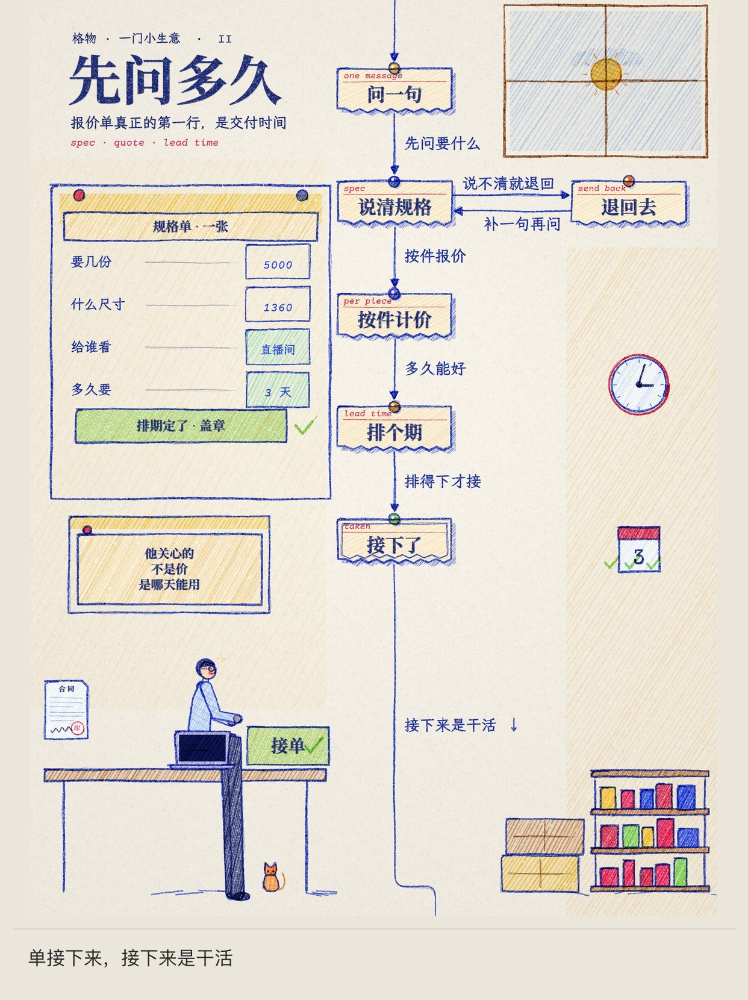
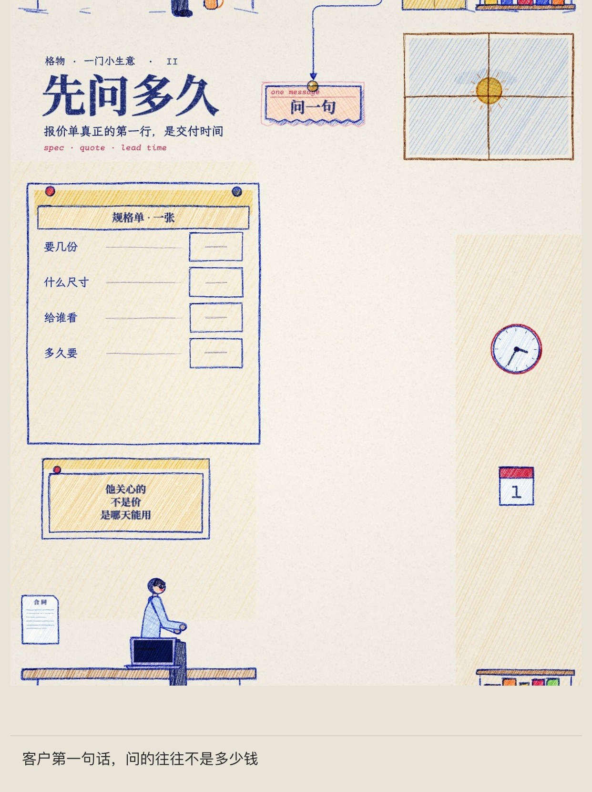
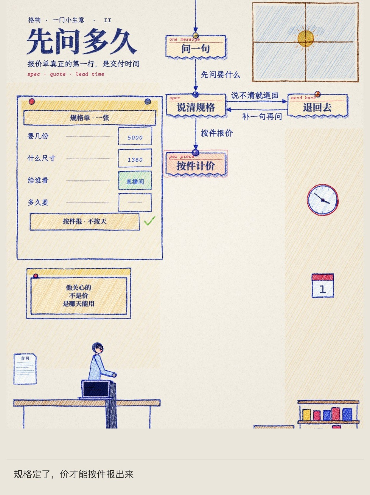
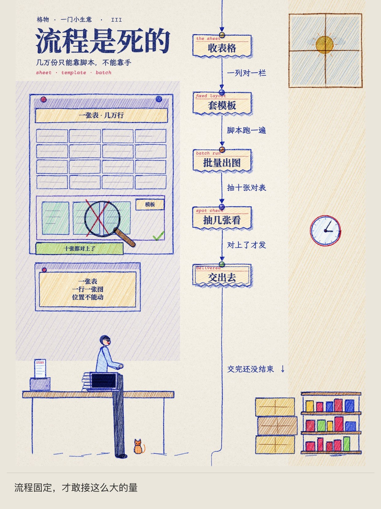
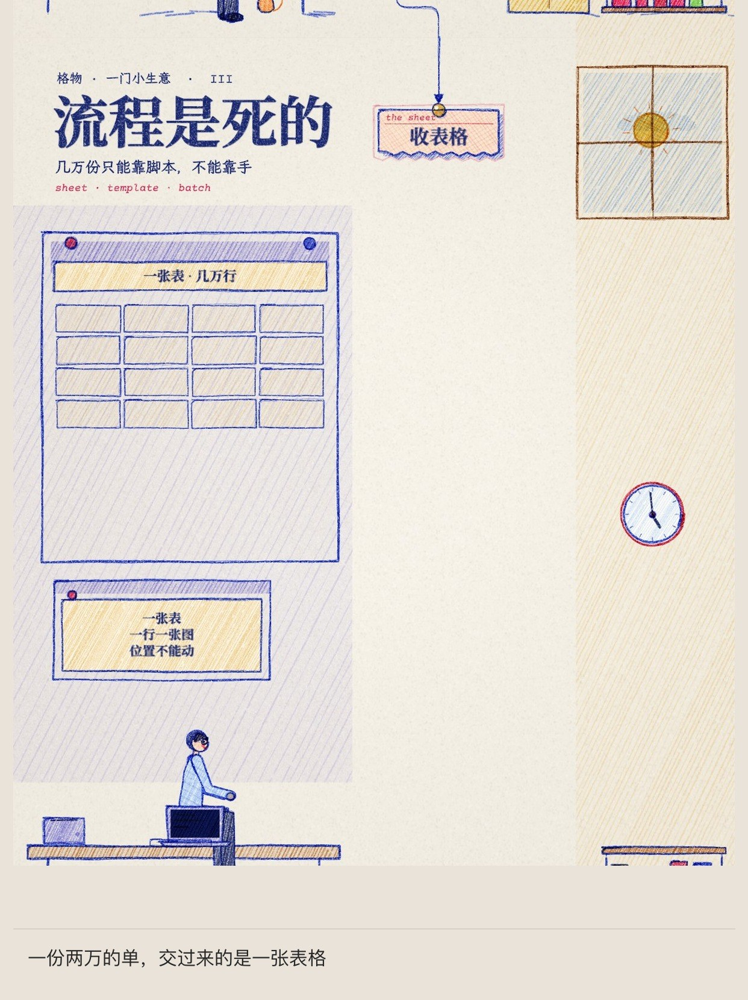
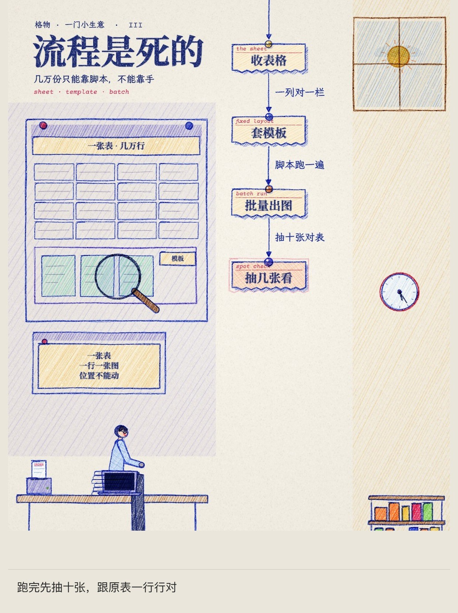
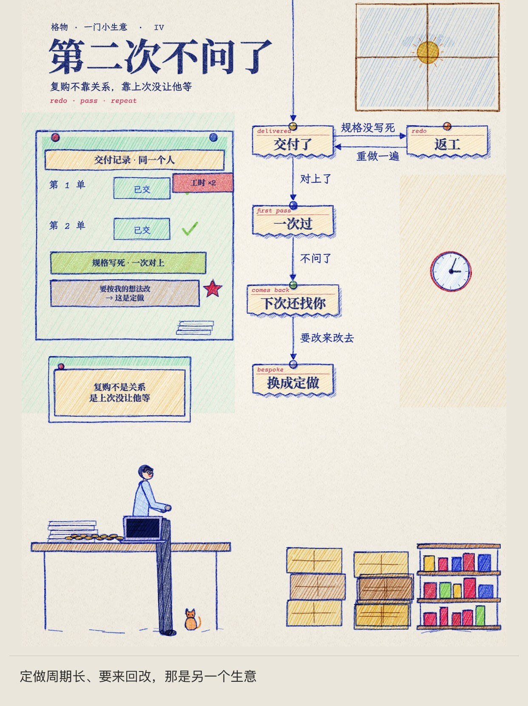
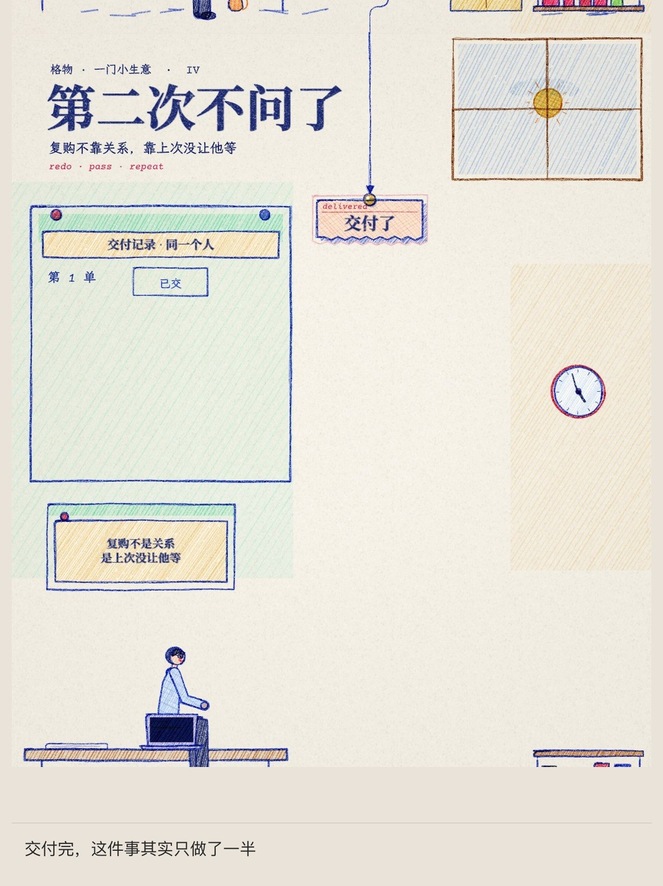
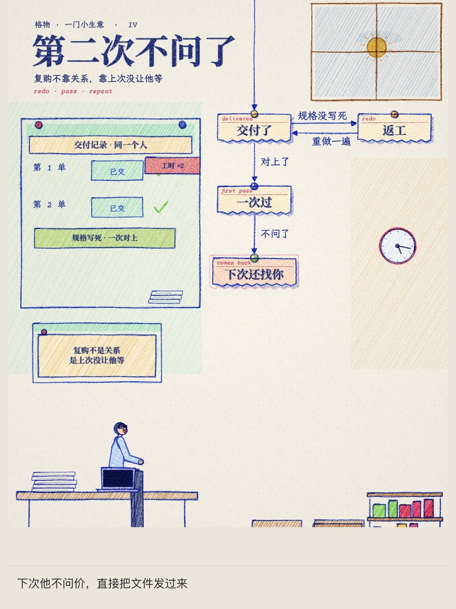

## 发布信息

| 项 | 值 |
|---|---|
| 平台 | 小红书 |
| 期数 | — |
| 发布时间 | 2026-11-08 12:32 |
| 正文长度 | 792 字 |
| 图片数量 | 12 张 |
| 状态 | 已发布 |
