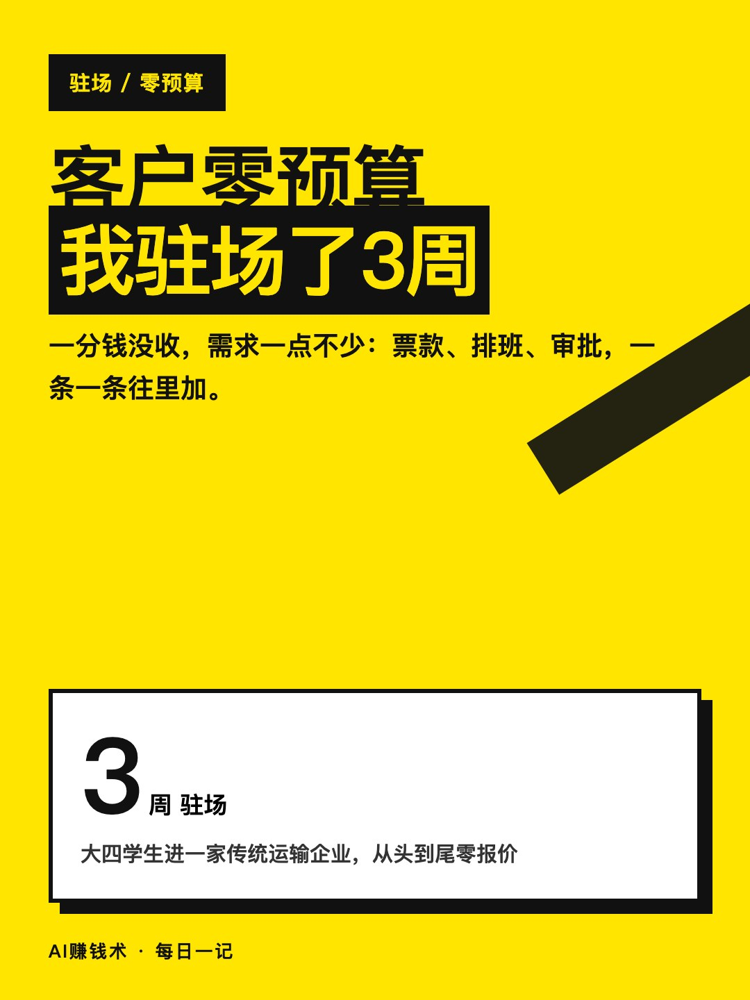
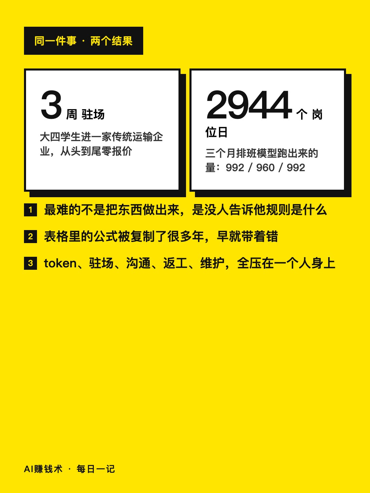
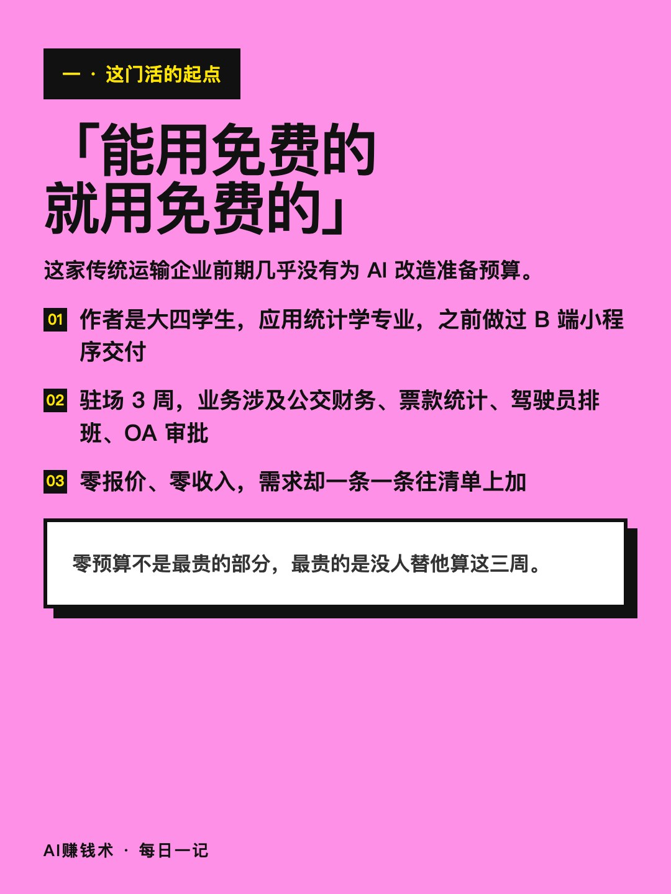
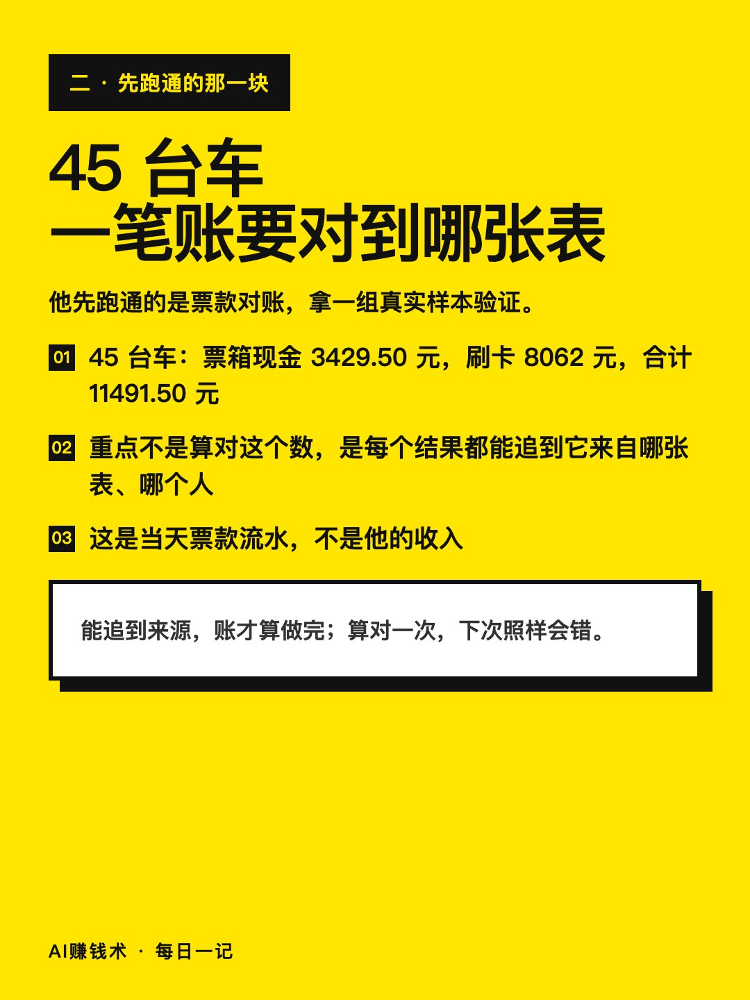
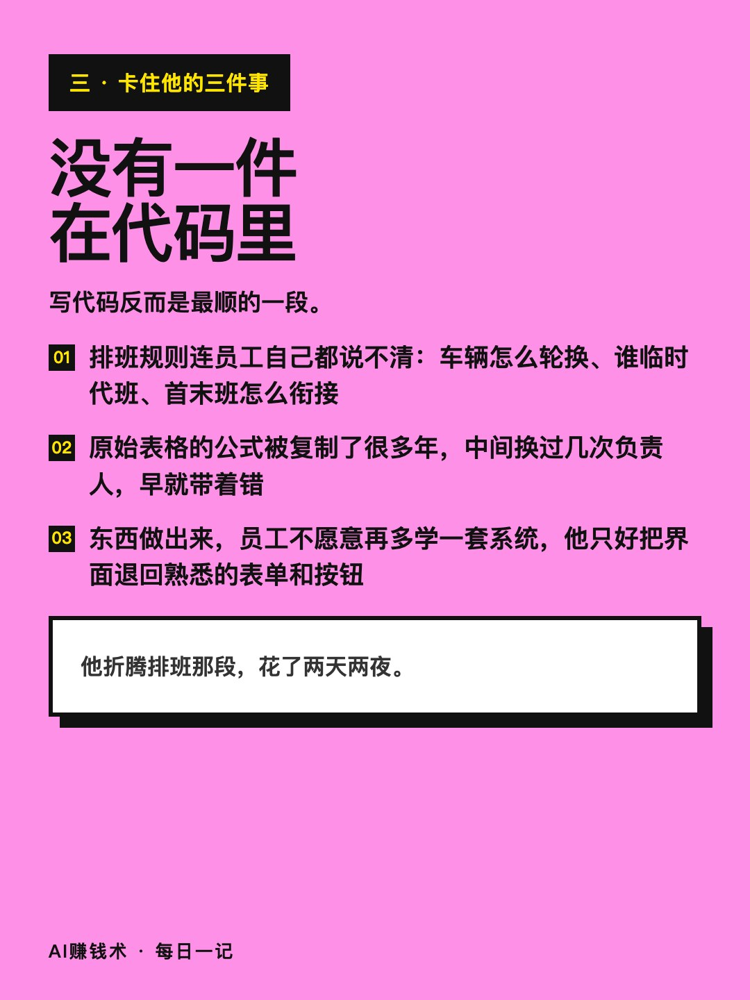
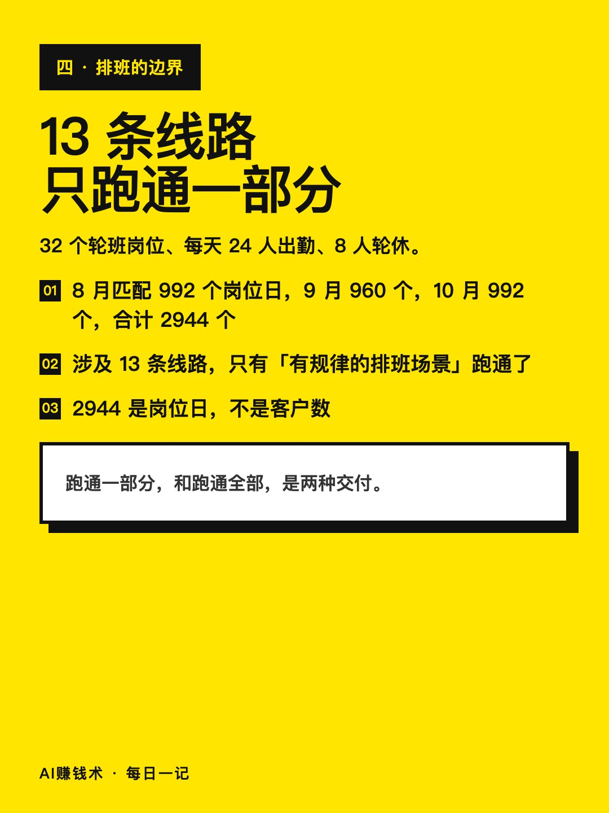
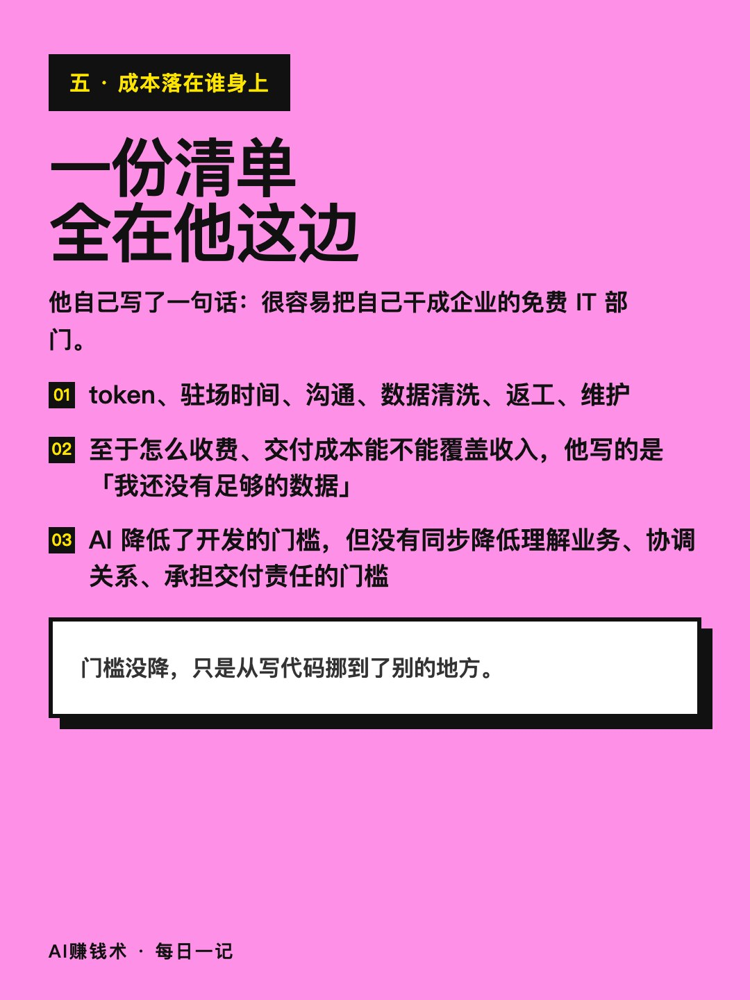
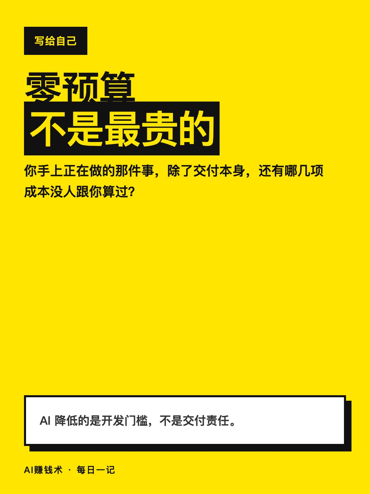

# 客户零预算，我驻场了3周

> — · 2026-11-08 09:02 发布 · AI 赚钱内容

## 标题（可直接复制）

```
客户零预算，我驻场了3周
```

## 正文（可直接复制发布）

三周，一分钱没有。需求一点没少。

作者是大四学生，应用统计学专业，之前做过 B 端小程序交付。这次他进了一家传统运输企业做 AI 改造，驻场三周。下面都是他自述。

一、这家企业没为这件事准备预算

原话是：能用免费的就用免费的，能白嫖额度就尽量白嫖。可业务清单一点不短——公交财务、票款统计、驾驶员排班、OA 审批，一条一条往里加。

二、他先跑通的是一笔账

票款对账，拿一组真实样本验证：45 台车，票箱现金 3429.50 元，刷卡 8062 元，合计 11491.50 元。

重点不是算对这个数。是每个结果都能追到它来自哪张表、哪个人。能追到来源，账才算做完；只算对一次，下次照样会错。

这是当天票款流水，不是他的收入。

三、真正卡住他的三件事，没有一件在代码里

第一，排班的规则连员工自己都说不清：车辆怎么轮换、谁临时代班、首末班怎么衔接。他折腾排班那一段，花了两天两夜。

第二，原始表格里的公式被复制了很多年，中间换过几次负责人，早就带着错。他不改公式，后面所有结果都是错的。

第三，东西做出来了，员工不愿意再多学一套系统。他最后把界面退回员工熟悉的表单和按钮——不是产品妥协，是没人愿意为「更好用」多付一次学习成本。

排班模型涉及 13 条线路，只有「有规律的排班场景」跑通了。8 月匹配 992 个岗位日，9 月 960 个，10 月 992 个，三个月合计 2944 个。这是岗位日，不是客户数，跑通一部分和跑通全部，是两种交付。

四、成本全压在他一个人身上

token、驻场时间、沟通、数据清洗、返工、维护，都是他的。他自己写了一句话：很容易把自己干成企业的免费 IT 部门。

至于怎么收费、交付成本能不能覆盖收入，他写的是「我还没有足够的数据」。全文零报价、零收入，没有一个金额是他的钱。

五、他留下的那句判断

AI 降低了开发的门槛，但没有同步降低理解业务、协调关系、承担交付责任的门槛。门槛没消失，只是从写代码挪到了别的地方。

零预算不是最贵的部分，最贵的是这三周没人替他算。

你上次免费帮人做的那件事，是从哪一步开始变成长期维护的？

## 话题标签

#企业服务 #驻场交付 #成本结构 #AI赚钱术 #AI赚钱术日记

## 配图（8 张）










## 发布信息

| 项 | 值 |
|---|---|
| 平台 | 小红书 |
| 期数 | — |
| 发布时间 | 2026-11-08 09:02 |
| 正文长度 | 896 字 |
| 图片数量 | 8 张 |
| 状态 | 已发布 |
