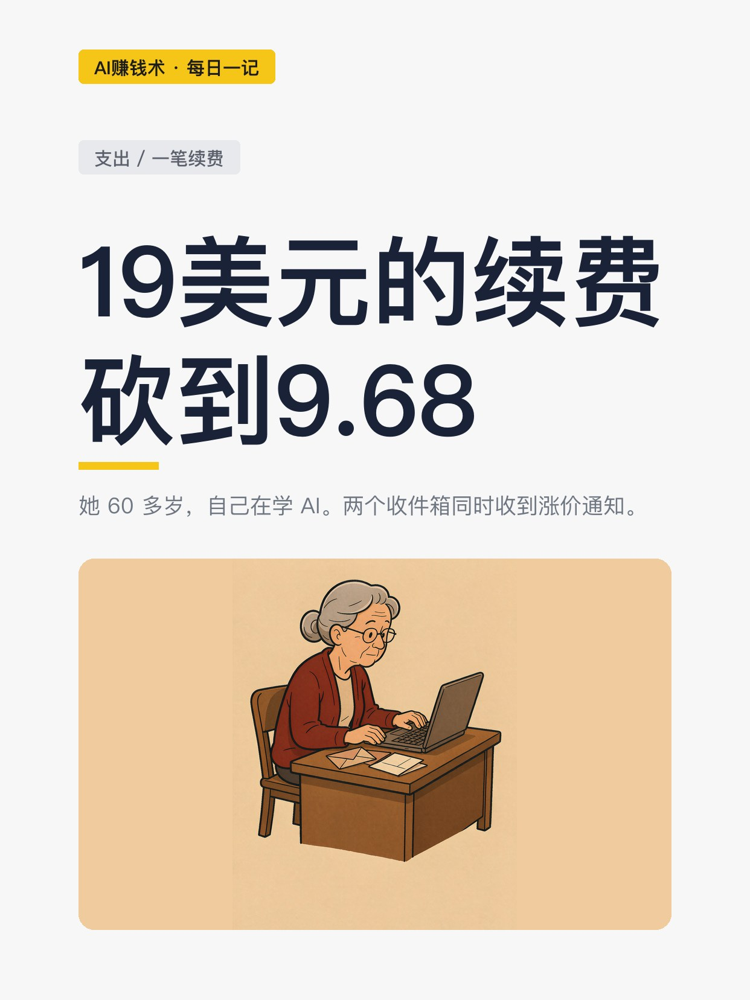
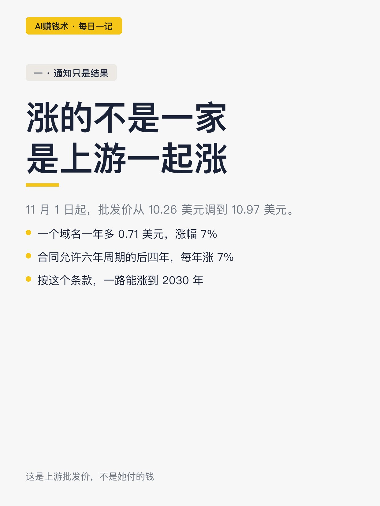
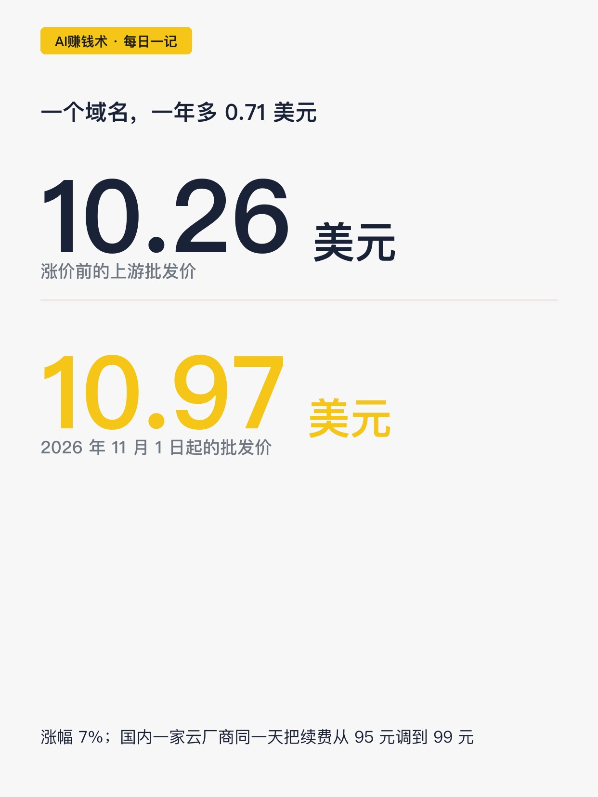
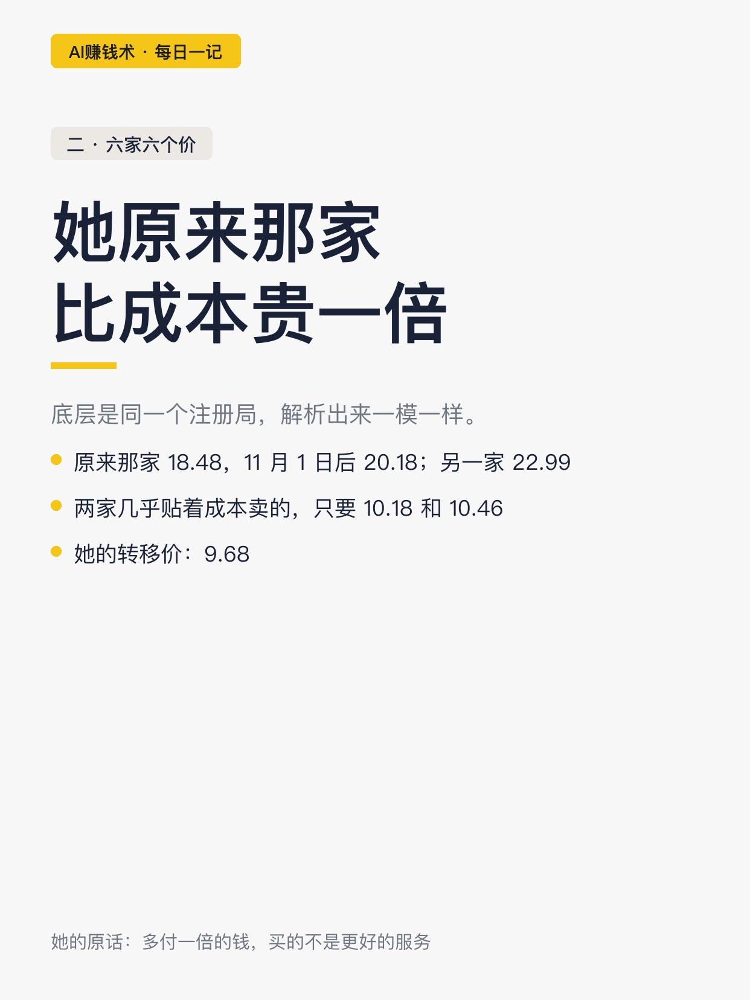
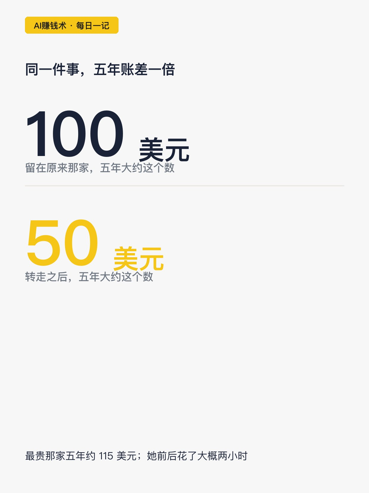
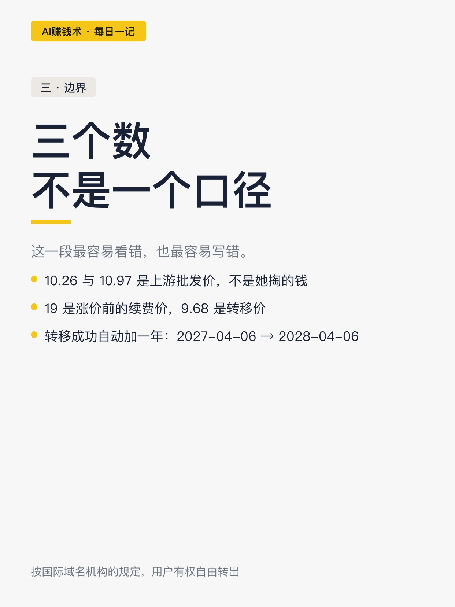
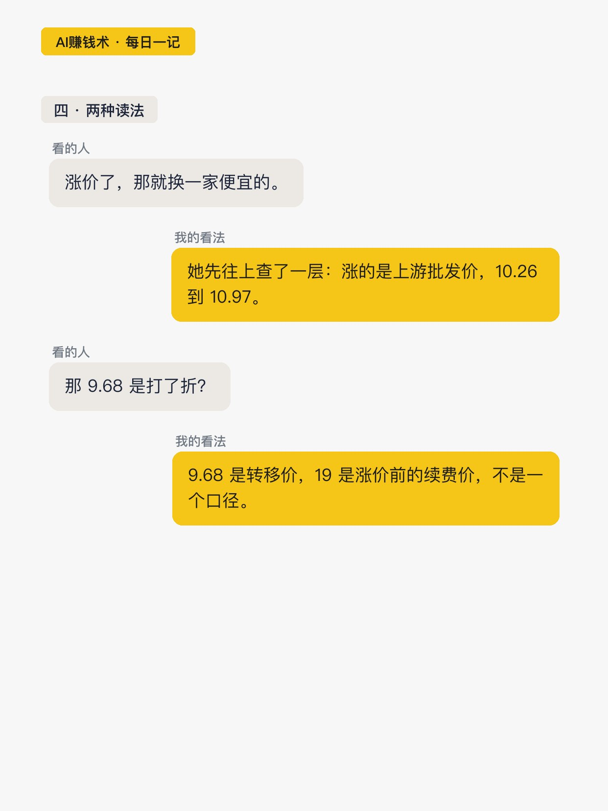
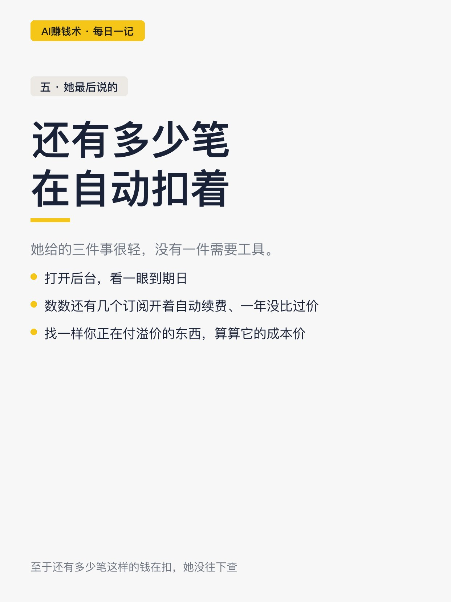

# 19美元的续费，砍到9.68

> — · 2026-11-09 08:02 发布 · AI 赚钱内容

## 标题（可直接复制）

```
19美元的续费，砍到9.68
```

## 正文（可直接复制发布）

两个收件箱里同时躺着一封涨价通知。她第一反应是「又要涨钱了」，差点一起划过去。多看了一眼，往上查了两层，最后把一笔续费从快 19 美元压到 9.68 美元，还白捡了一年有效期。

她今年 60 多岁，自己在学 AI，手上有一批小站要养。下面都是她自述。

一、通知只是结果，原因在上游

11 月 1 日起，这个通用后缀的批发价从 10.26 美元调到 10.97 美元——一个域名一年多 0.71 美元，涨幅 7%。合同还允许在六年周期的后四年每年涨 7%，一路能涨到 2030 年。所以这不是涨一次，是开了个头。

国内一家云厂商也在 10 月 22 日发了公告：11 月 1 日零点起，同一后缀的续费从 95 元调到 99 元，注册 85 到 90，转入 80 到 90。上游一动，下游全跟着动。

二、同一个东西，六家报出六种价

她原来那家续费 18.48 美元，11 月 1 日之后 20.18；另一家 22.99；而两家几乎贴着成本卖的，只要 10.18 和 10.46，转移价 9.68。批发价是 10.97。

底层是同一个注册局，解析出来的东西一模一样。她的原话是：你多付一倍的钱，买的不是更好的服务，是你习惯了、懒得动。

三、代价是两小时，钱在后面几年

转移成功后自动加一年有效期，她的到期日从 2027 年 4 月 6 日顺延到 2028 年 4 月 6 日。算五年账：留在原处约 100 美元，转走约 50，最贵那家约 115。她前后花了大概两小时。

四、三个数不是一个口径

10.26 到 10.97 是上游批发价，不是她掏的钱；19 是涨价前的续费价，9.68 是转移价；转移自带一年，不等于打了五折。按国际域名机构的规定，用户有权自由转出，但要先确认域名解锁、拿到授权码，别等到期前一周才动手——时间不够，什么价都谈不成。

她最后给的三件事很轻：打开后台看一眼到期日；数数还有几个订阅开着自动续费、一年没比过价；找一样你正在付溢价的东西，算算它的成本价。至于还有多少笔这样的钱在自动扣着，她没往下查。

你自己账上，有几笔是「懒得动」在付钱？

## 话题标签

#成本结构 #续费 #比价 #AI赚钱术 #AI赚钱术日记

## 配图（8 张）










## 发布信息

| 项 | 值 |
|---|---|
| 平台 | 小红书 |
| 期数 | — |
| 发布时间 | 2026-11-09 08:02 |
| 正文长度 | 892 字 |
| 图片数量 | 8 张 |
| 状态 | 已发布 |
