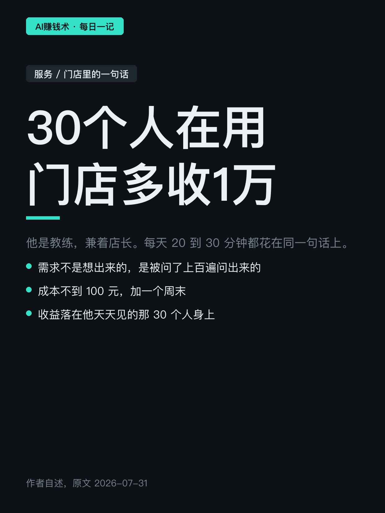
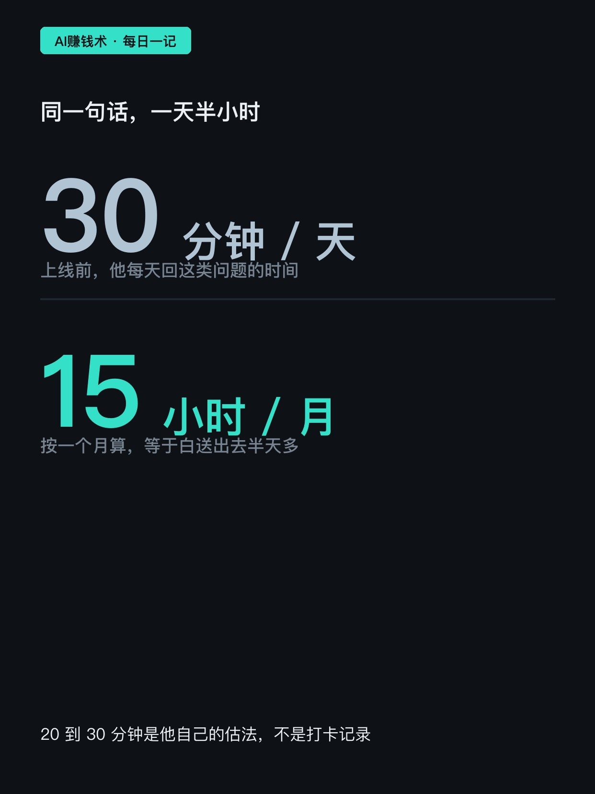
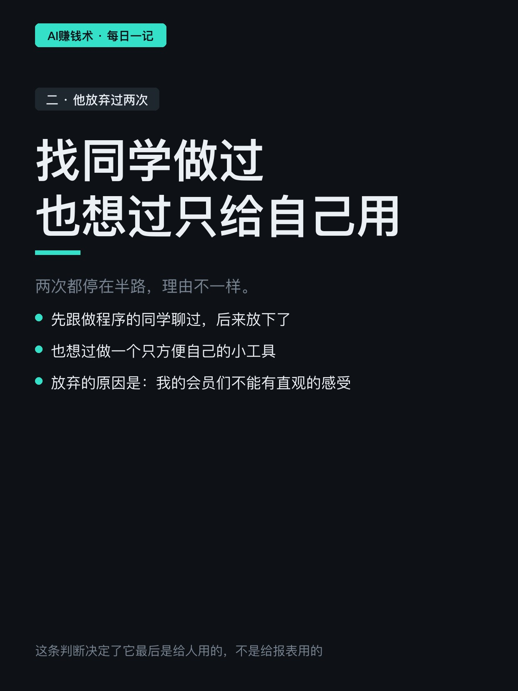
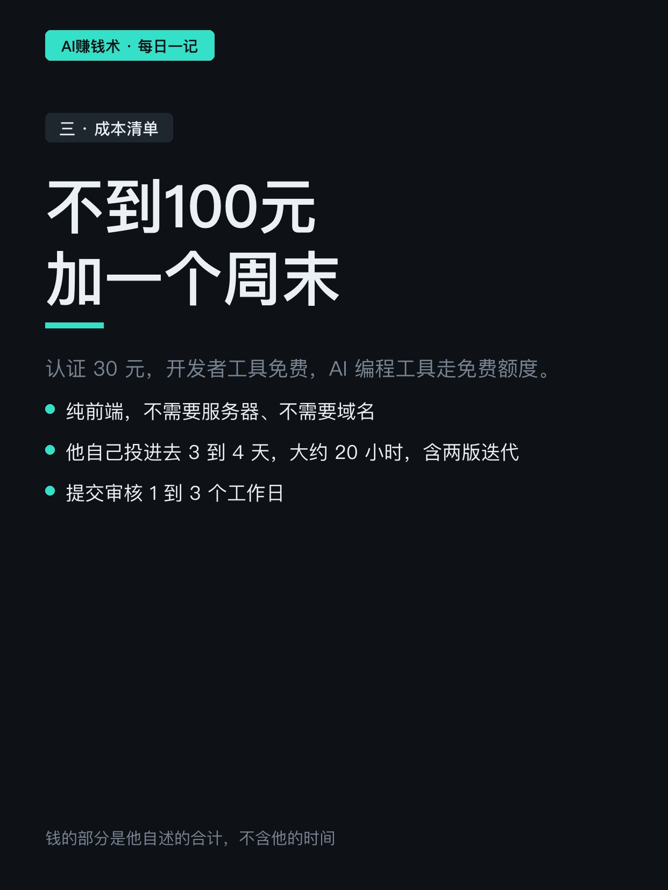
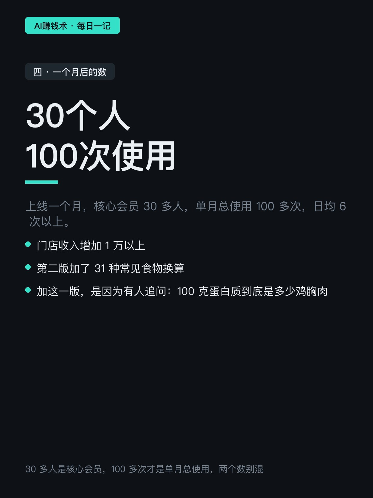
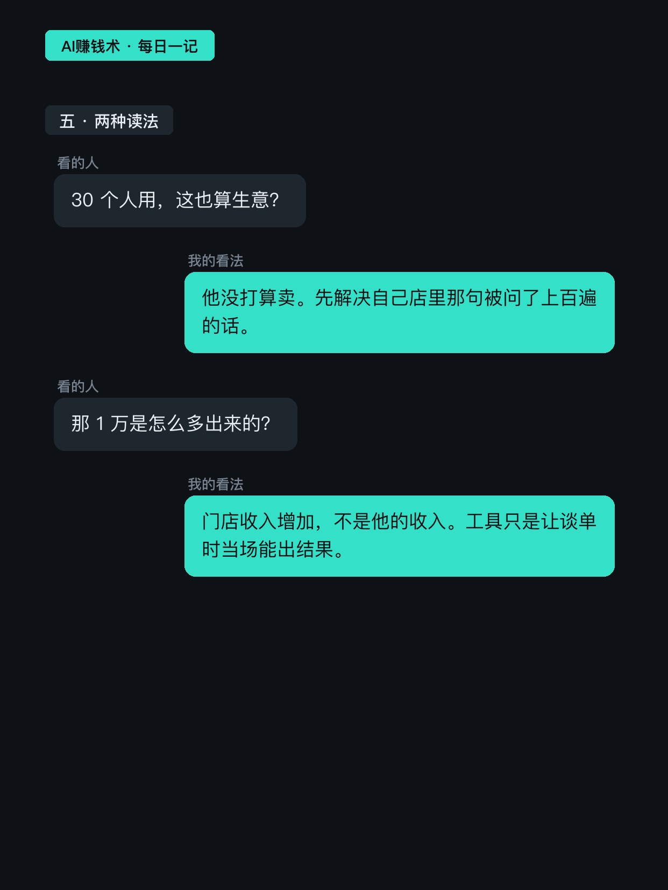
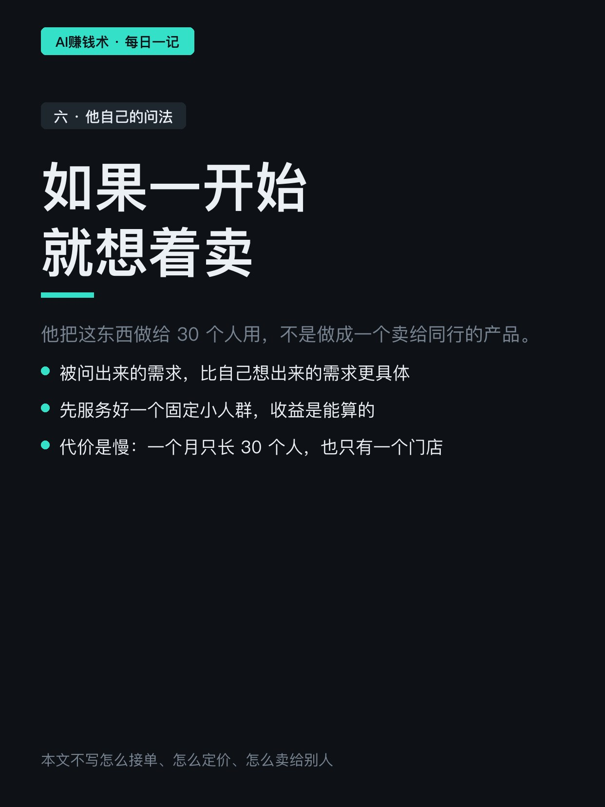

# 30个人在用，门店多收1万

> — · 2026-11-09 10:02 发布 · AI 赚钱内容

## 标题（可直接复制）

```
30个人在用，门店多收1万
```

## 正文（可直接复制发布）

他在一家健身工作室当教练，兼着店长。每天有 20 到 30 分钟，花在同一件事上：回会员那句「我今天该吃多少」。

有人 11:30 吃饭，有人 12:15，有人 13:00。他的时间被切成一段一段。

一、需求不是想出来的，是被问出来的

每个会员都在问：我今天该吃多少、这个食物可以吃多少、今天吃这么多够了吗。三句话指向同一件事——想要具体的食物、具体的份量。

他之前跟做程序的同学聊过，放下了。也想过做一个只方便自己的工具，也放下了，理由是：我的会员们不能有直观的感受。

这一条判断很关键。它决定了这个东西最后是给人当场用的，不是给自己看的报表。

二、成本低到不像一门生意

认证 30 元，开发者工具免费，AI 编程工具走免费额度，纯前端、不需要服务器也不需要域名。加上他自己投进去 3 到 4 天，大约 20 小时，含两版迭代，合计不到 100 元加一个周末。提交审核 1 到 3 个工作日。

这里要说清：不到 100 元不含他的时间。20 小时按什么价算，他没说，我也不替他算。

三、收益落在他天天见的 30 个人身上

上线一个月：核心会员 30 多人在用，单月总使用 100 多次，日均 6 次以上，门店收入增加 1 万以上。

省下的不只是时间。谈单的时候，当场输入身高体重就能出结果，更容易把课程需要的次数定下来——这是他自己写的直接变化。

第二版是因为会员追问才加的。有人问：一天吃 100 克蛋白质，到底是多少鸡胸肉？他才加了 31 种常见食物的换算。

四、三个数要分开看

30 多人是核心会员，不是全部会员；100 多次是单月总使用，不是人数；1 万以上是门店收入增加，不是他的收入。这三个数塞进同一个句子里就错了。

边界也在这儿：这是一家店、一个城市、一个教练兼职店长。它证明的是「一个固定小人群的重复问题值得先做掉」，不是「照这个能复制到一百家店」。

他把这东西做给 30 个人用，而不是做成一个卖给同行的产品。如果一开始就想着卖，他还会先花一个周末，去解决自己店里那句被问了上百遍的话吗？

你手上被问得最多的是哪一句，你为它做过什么？

## 话题标签

#门店生意 #重复问题 #小工具 #AI赚钱术 #AI赚钱术日记

## 配图（8 张）










## 发布信息

| 项 | 值 |
|---|---|
| 平台 | 小红书 |
| 期数 | — |
| 发布时间 | 2026-11-09 10:02 |
| 正文长度 | 894 字 |
| 图片数量 | 8 张 |
| 状态 | 已发布 |
