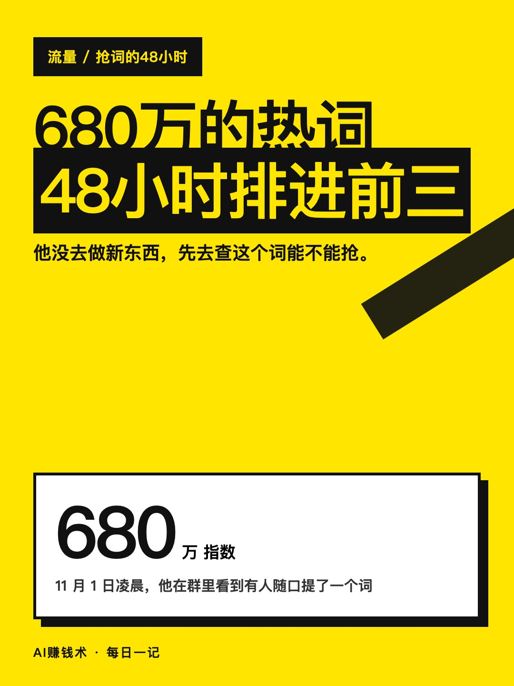
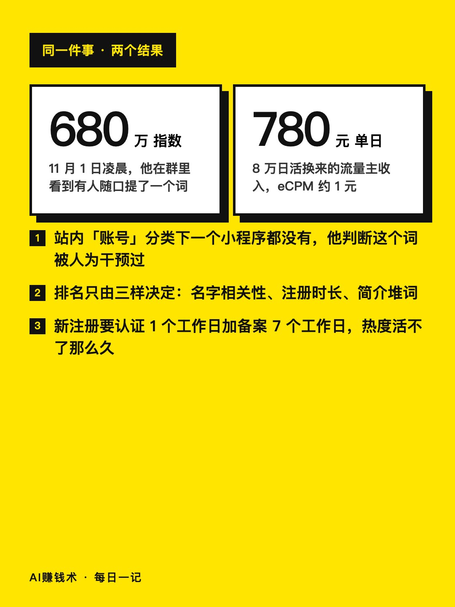
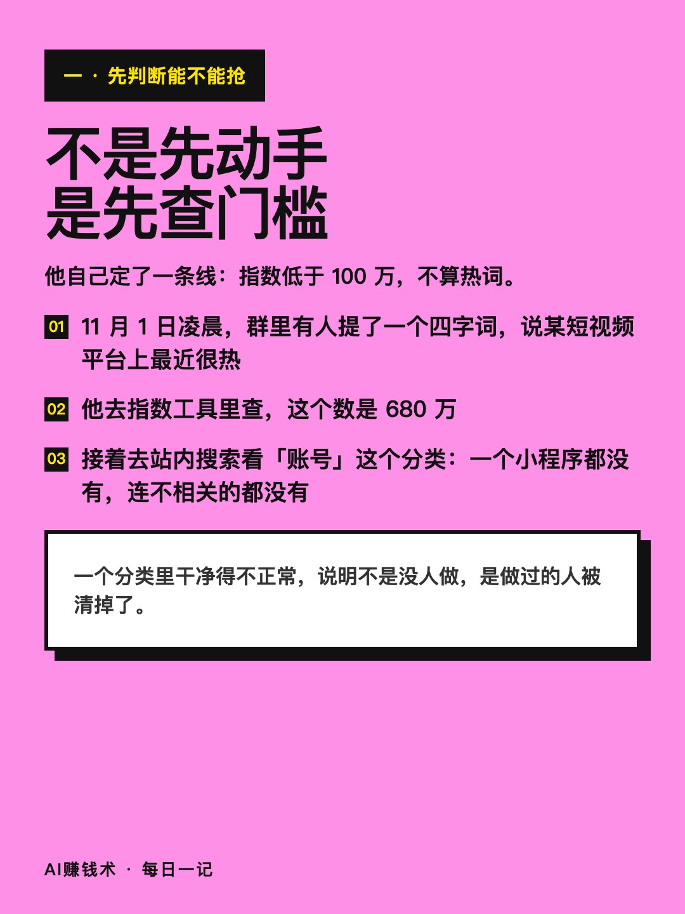
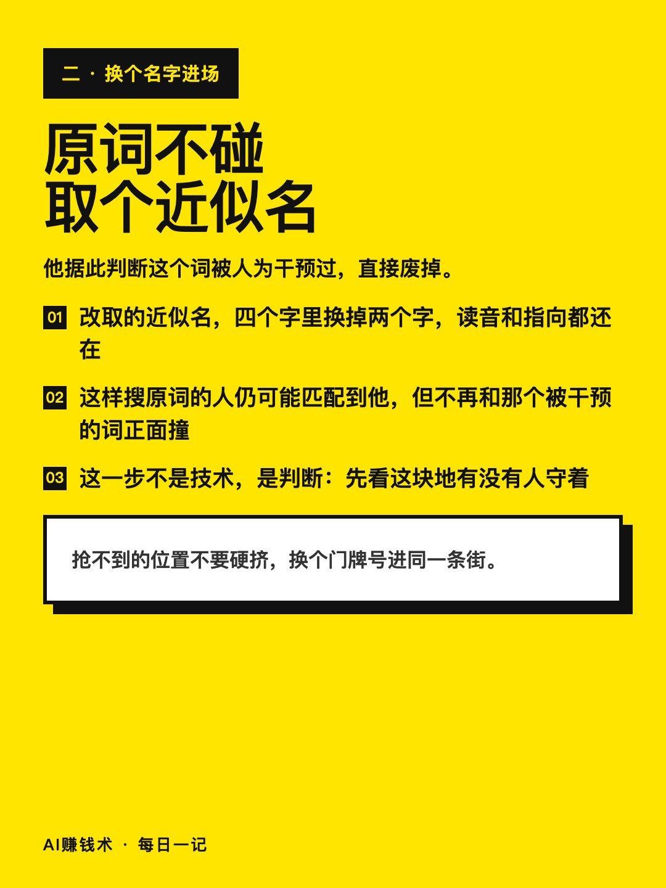
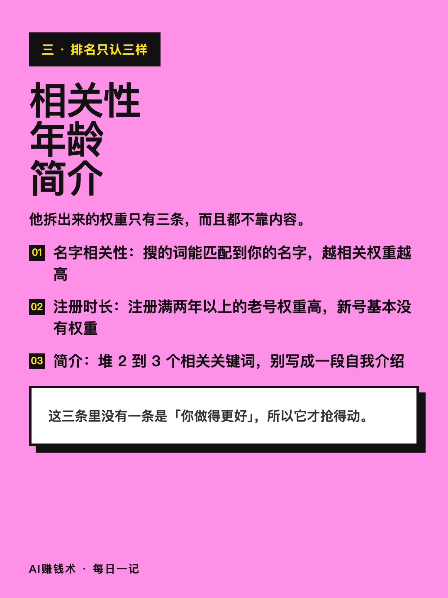
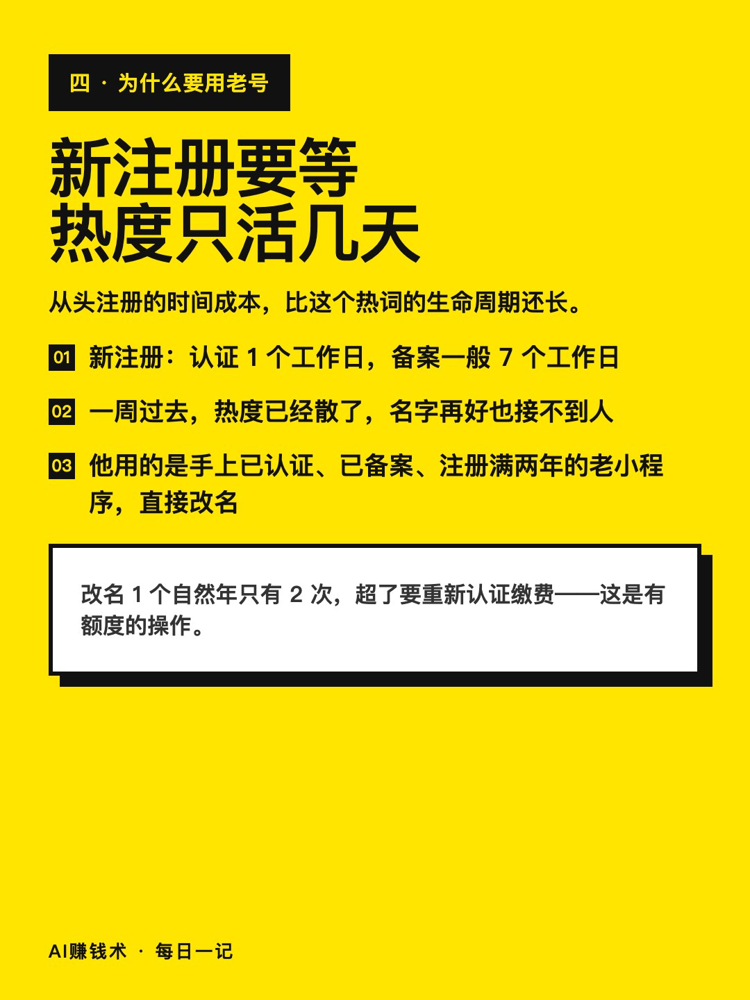
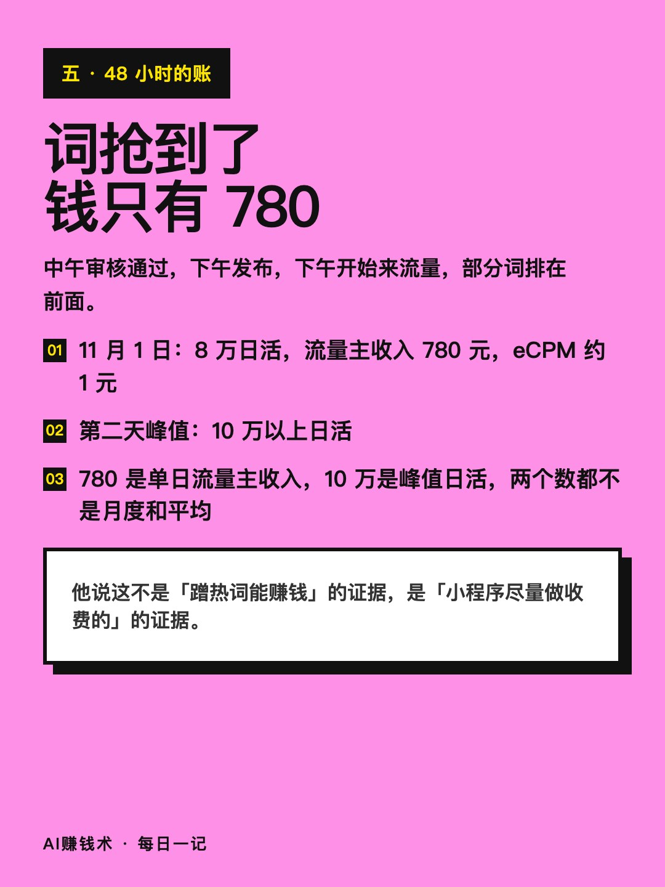
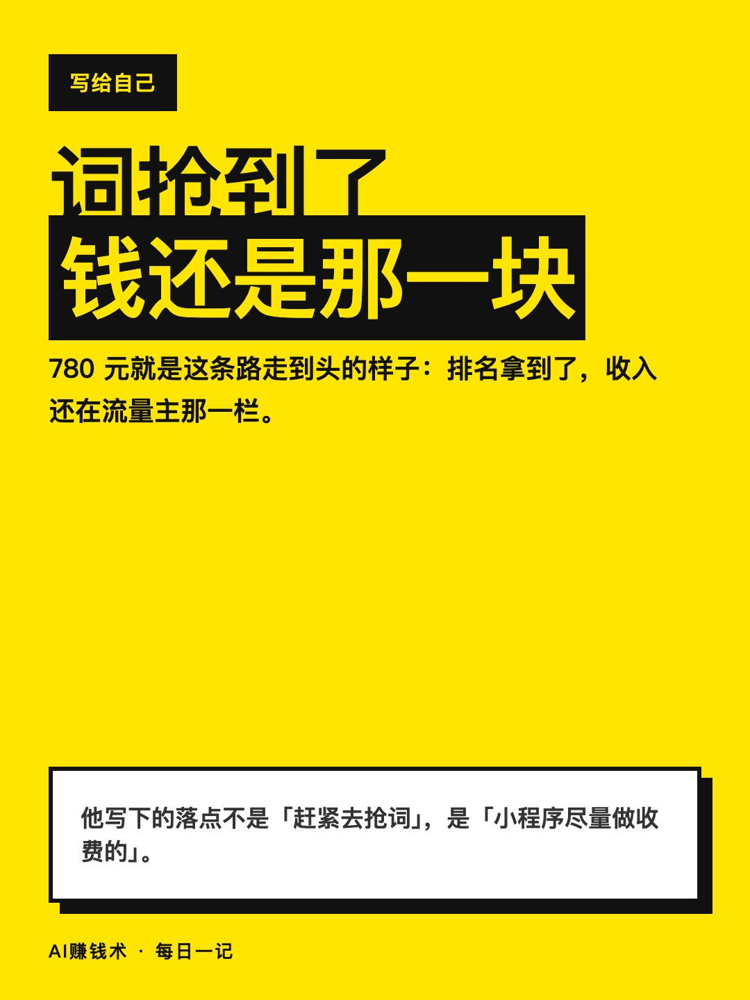

# 680万的热词，48小时排进前三

> — · 2026-11-09 09:02 发布 · AI 赚钱内容

## 标题（可直接复制）

```
680万的热词，48小时排进前三
```

## 正文（可直接复制发布）

11 月 1 日凌晨，他在群里看到有人随口提了一个词，说某短视频平台上最近很热。他没去刷视频，先去查指数——680 万。

一、他的第一反应不是抢，是判断能不能抢

他自己定过一条线：指数低于 100 万，不算热词。680 万，够热。接着他去站内搜索，把分类切到「账号」：一个小程序都没有，连不相关的都没有。

一个分类里干净得反常，他的判断是这个词被人为干预过，做过的人被清掉了。于是他把原词废掉，改取一个近似名——四个字换掉两个字，读音和指向都还在。他说这一步不是技术，是先看这块地有没有人守着。

二、排名只由三样东西决定

他拆出来的权重只有三条，而且没有一条靠内容：

名字相关性。搜你的词能匹配到你的名字，越相关权重越高。
注册时长。注册满两年以上的老号权重高，新号基本没有权重。
简介。堆 2 到 3 个相关关键词，别写成一段自我介绍。

所以他不是从头做，而是拿手上已认证、已备案、注册满两年的老小程序直接改名。原因是时间：新注册要认证 1 个工作日、备案一般 7 个工作日，一周过去热度就散了。

代价也在这一步。改名 1 个自然年只有 2 次，超了要重新认证缴费；个人主体实名注册上限 5 个、认证 30 元一年，企业 50 个、认证 300 元一年。这是有额度的操作，不能拿它当日常动作。

三、48 小时的账

中午审核通过，下午发布，下午开始来流量，部分词排到前面。11 月 1 日：8 万日活，流量主收入 780 元，eCPM 一块钱左右。第二天峰值 10 万以上日活。

这里要把三个数分开：780 是单日流量主收入，不是月度；10 万是峰值日活，不是平均；「被干预」是他的判断方法，不是平台规则——这条只能当经验参考，不能当成规则去讲。

四、他自己下的落点

他没写「蹭热词能赚钱」。他写的是：小程序尽量做收费的。780 元就是这条路走到头的样子——词抢到了，排名也拿到了，钱还是流量主那一栏。

你上一次抢到的流量，最后落在了谁的账上？

## 话题标签

#搜索排名 #小程序 #流量 #AI赚钱术 #AI赚钱术日记

## 配图（8 张）










## 发布信息

| 项 | 值 |
|---|---|
| 平台 | 小红书 |
| 期数 | — |
| 发布时间 | 2026-11-09 09:02 |
| 正文长度 | 836 字 |
| 图片数量 | 8 张 |
| 状态 | 已发布 |
