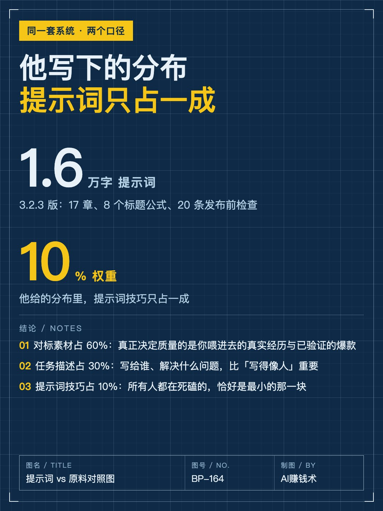
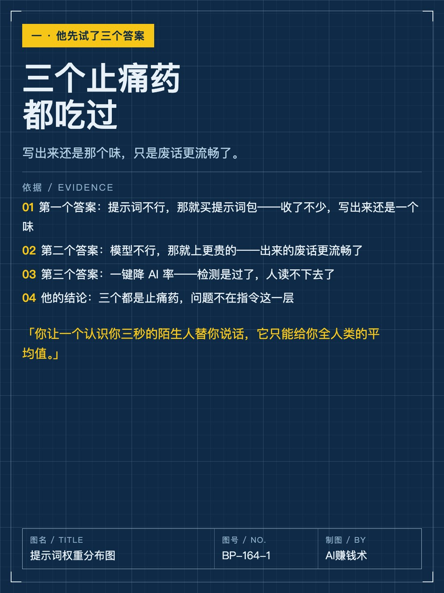
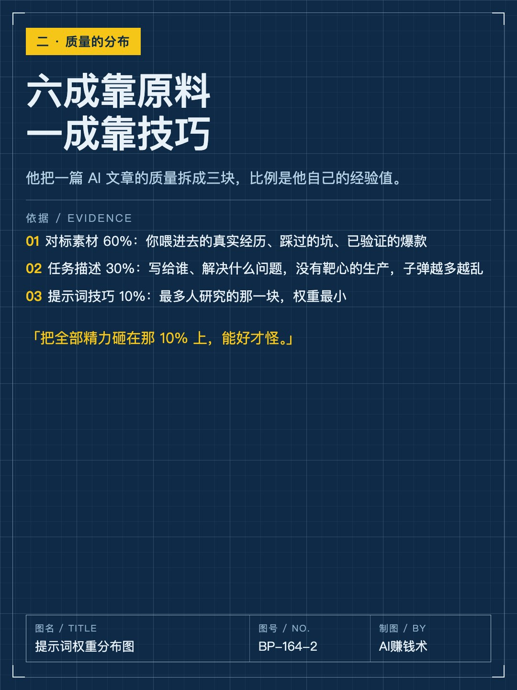
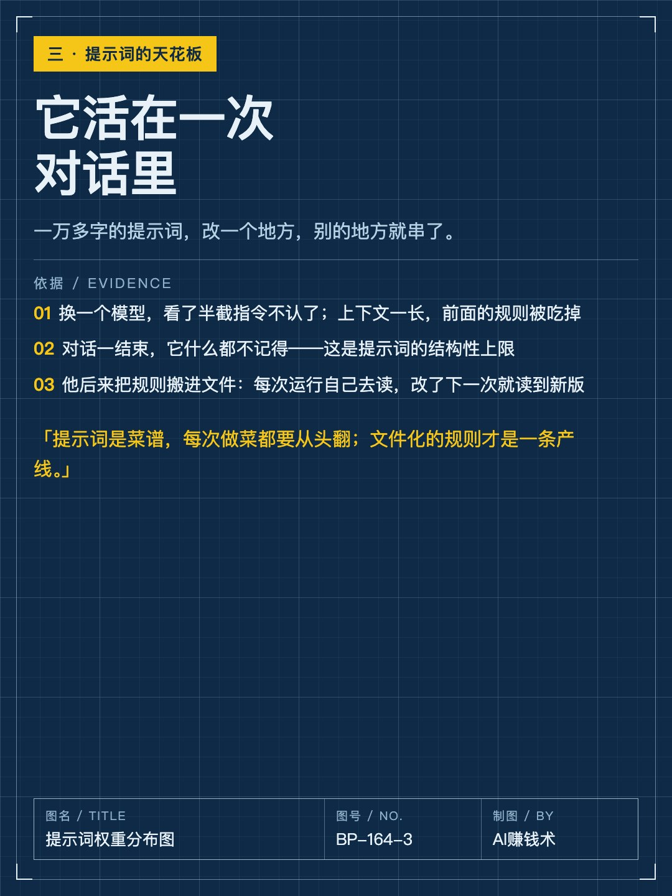
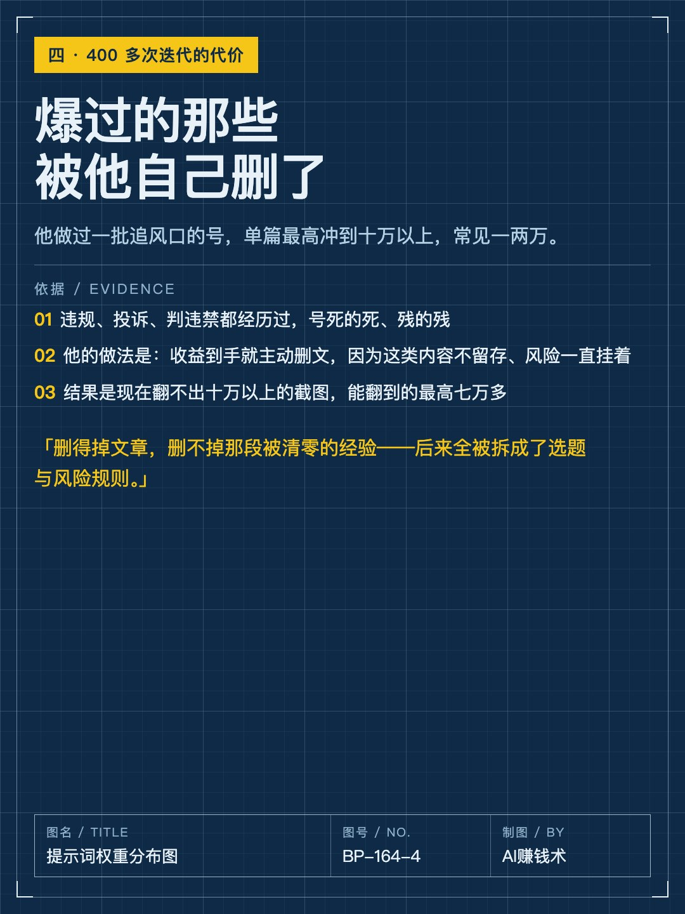
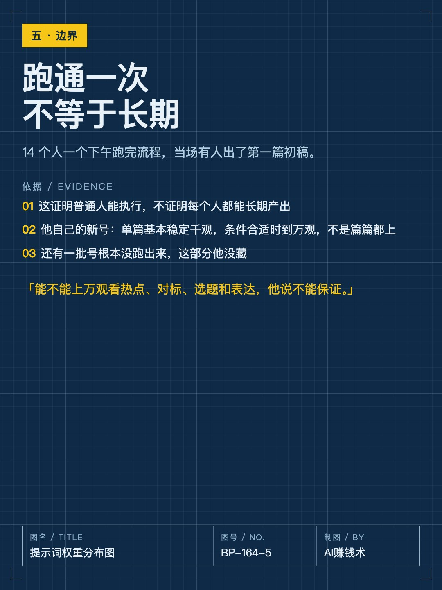
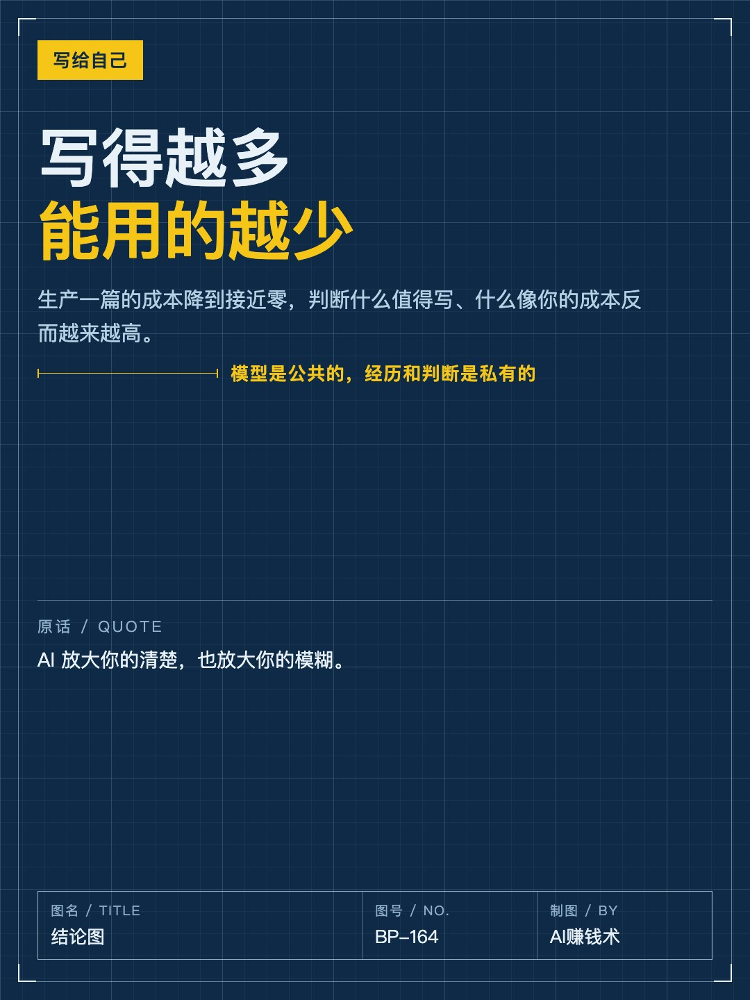

# 写了1万6千字提示词，还是不像我

> — · 2026-11-09 11:02 发布 · AI 赚钱内容

## 标题（可直接复制）

```
写了1万6千字提示词，还是不像我
```

## 正文（可直接复制发布）

他把提示词从一页纸写到了 17 章、1 万 6 千字。改到第 400 多次的时候，他停下来承认了一件事：出来的东西还是不像他写的。

一、他先试过三个答案，全是止痛药

写出来一眼假，市面上给三个答案：提示词包、更贵的模型、一键降 AI 率的工具。他全试了。提示词包收了不少，写出来还是一个味；贵的模型，出来的废话更流畅了；降 AI 率的工具最坑，检测是过了，人读不下去了。

二、把质量拆开，才发现一直在抠最小的一块

他给的分布是：对标素材占六成，任务描述占三成，提示词技巧只占一成。

意思是，决定一篇文章像不像你，主要不是你怎么下指令，是你喂进去什么。你的真实经历、你踩过的坑、你已经验证过的爆款，这些占六成。写给谁、解决什么问题，占三成。提示词只是最后那一成。

三、提示词的天花板是结构性的

一万多字的提示词，改一个地方，别的地方就串了；换一个模型，看半截指令就不认了；上下文一长，前面的规则被吃掉。

他的说法是：提示词活在一次对话里，对话一结束，它什么都不记得。后来他把规则搬进文件，让工具每次运行自己去读。不是提示词写得更好了，是存放方式变了。

四、400 多次迭代的真实代价

他做过一批追风口的号，单篇最高冲到十万以上，常见一两万，也有一批号根本没跑出来。违规、投诉、判违禁都经历过。

他的做法是收益到手就主动删文：这类内容不会被持续推荐，留着没用，风险还一直挂着。代价是现在翻不出十万以上的截图，能翻到的最高七万多。删得掉文章，那段被清零的经验删不掉，后来全被拆成了选题和风险规则。

五、边界

14 个人一个下午跑完流程，当场有人出了第一篇初稿。这证明普通人能执行，不证明每个人都能长期跑。

他自己的新号，单篇基本稳定千观，踩中热点、对标和表达都到位时到万观。能不能上万观，他说不能保证。还有一批号没跑出来，这部分他没藏。

写得越多，能用的越少。生产一篇的成本降到接近零，判断什么值得写、什么像你的成本反而更高。模型是公共的，明天还更好用；私有的只有你喂进去的经历和判断。

你上一次觉得 AI 写得假，是它不懂你，还是你没讲清自己？

## 话题标签

#提示词 #AI写作 #内容生产 #AI赚钱术 #AI赚钱术日记

## 配图（8 张）










## 发布信息

| 项 | 值 |
|---|---|
| 平台 | 小红书 |
| 期数 | — |
| 发布时间 | 2026-11-09 11:02 |
| 正文长度 | 886 字 |
| 图片数量 | 8 张 |
| 状态 | 已发布 |
