# 每段都用了AI，中间断了三次

> — · 2026-11-09 12:32 发布 · AI 赚钱内容

## 标题（可直接复制）

```
每段都用了AI，中间断了三次
```

## 正文（可直接复制发布）

有人问过一个做 AI 落地服务的人一句话：你每一段都用了 AI，为什么客户还在问同一句话？

他叫亦恒，今年 7 月先讲的是「内容怎么做出来」——用 AI 整理自己的经历、判断选题。做了两个月，撞上一个更麻烦的问题：内容发出去，真的有人来咨询了，问的都是「到底多少钱、具体怎么服务、第一步我能得到什么」，于是他得重新翻资料、重新解释一遍；等真到交付那一步，前面聊过的客户情况和判断，又接不上了。他自己的说法是：每一段都用了 AI，可不同的环节还在反复从头开始。

断的不是 AI 的能力，是环节之间没有承接的东西。他后来的做法是把「问题—资料—处理步骤—人的判断—用完之后反馈」接成一条：客户问的「多少钱、怎么服务」，能直接调出价格范围、服务说明和原始出处；但这个人是从哪来的、是不是已经在做最后决定，仍然要人结合沟通去判断。同一条线往下走，评论和私信不再停在那儿——他判断对方缺的是哪一步：还没选事、手里没料、还是一轮都没跑过，再决定怎么回。三种人回的不是同一段话。

不接的代价也不是多花几分钟。是每一轮重新找资料、重新解释产品、重新回想上次为什么这样选题；是一条内容做完，事实、选题理由、定稿边界、客户追问都没留下来，下一条又从空白页开始。按他自己的说法，9 月一个服务周期做到六位数左右的利润（这是他自己的口径，没有第三方核对），真正省下的不是写稿时间，是返工。

但能交给 AI 的只有整理、出候选、起草；核实事实、决定取舍、承担承诺，一样都不能交出去。他写得很直白：不能因为一个人留了一条评论，就把他算成客户，更不能算成成交。

所以那种「按一下按钮出十篇稿」的提效，基本是假的。真的提效发生在四个格子之间：问题、内容、咨询、交付。你手上那条链路，哪一格是断的？

## 话题标签

#AI赚钱术日记 #AI工作流 #一人公司 #客户咨询 #内容创作

## 配图（12 张）

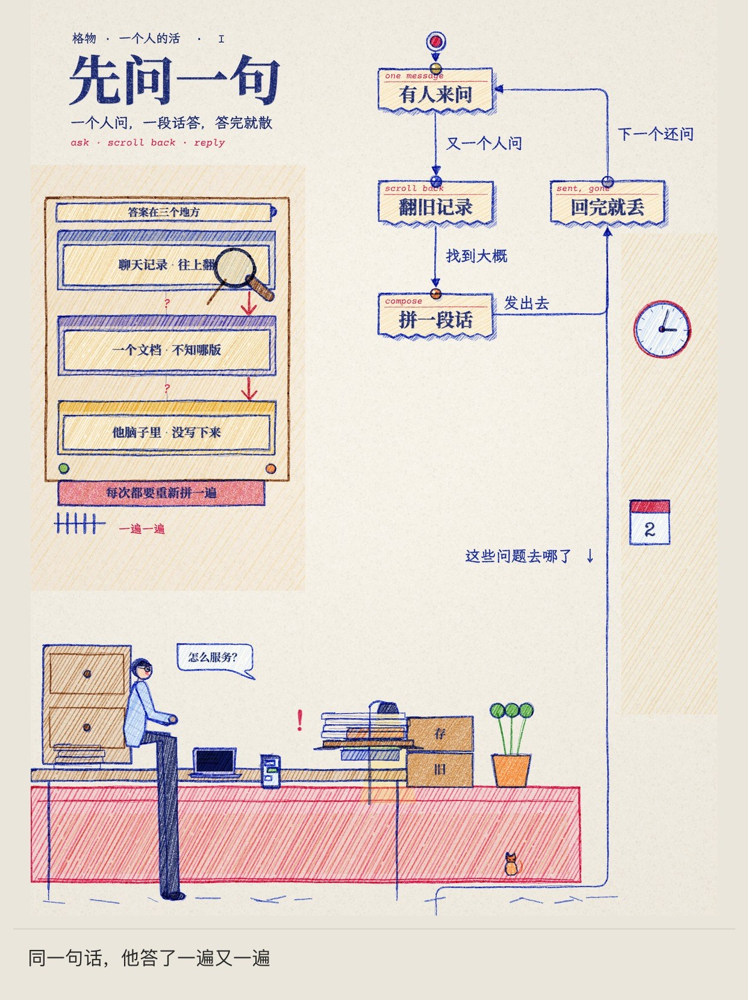
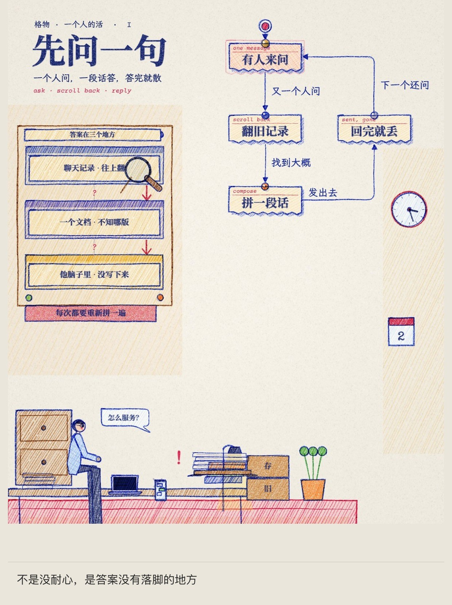
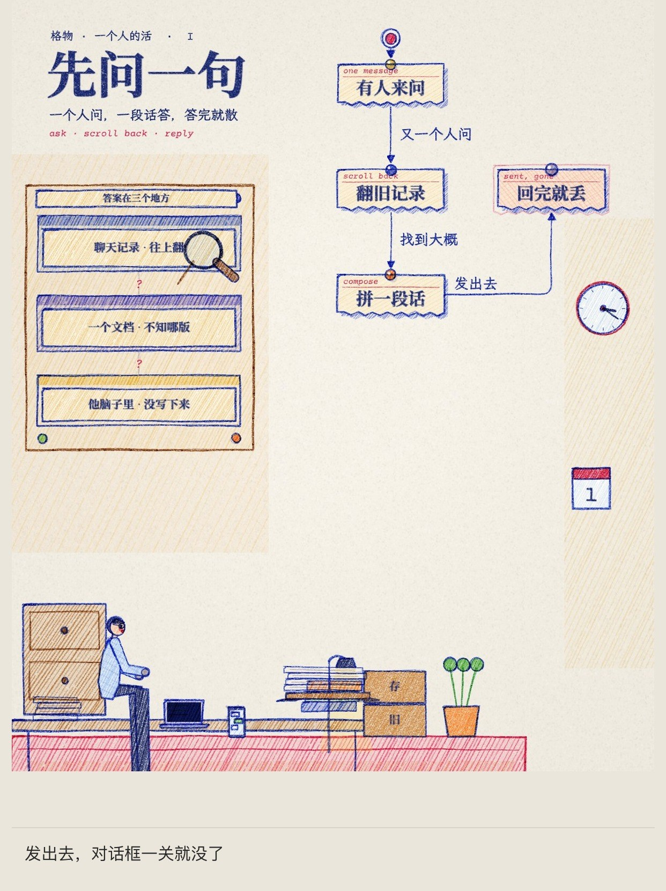
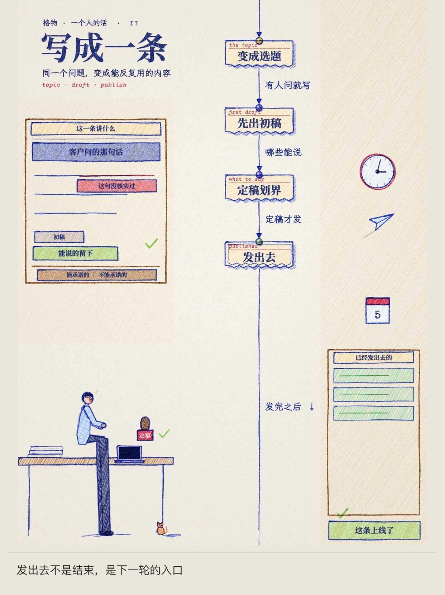
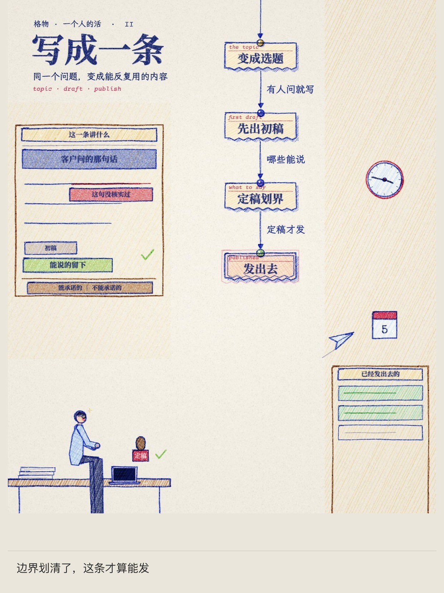
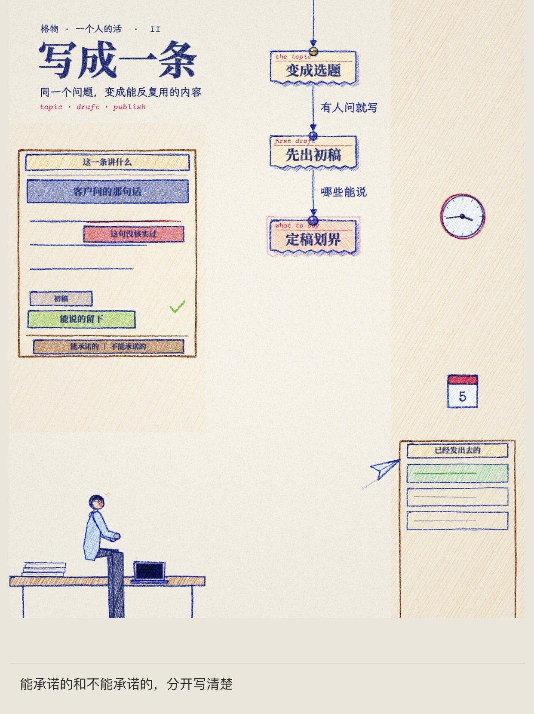
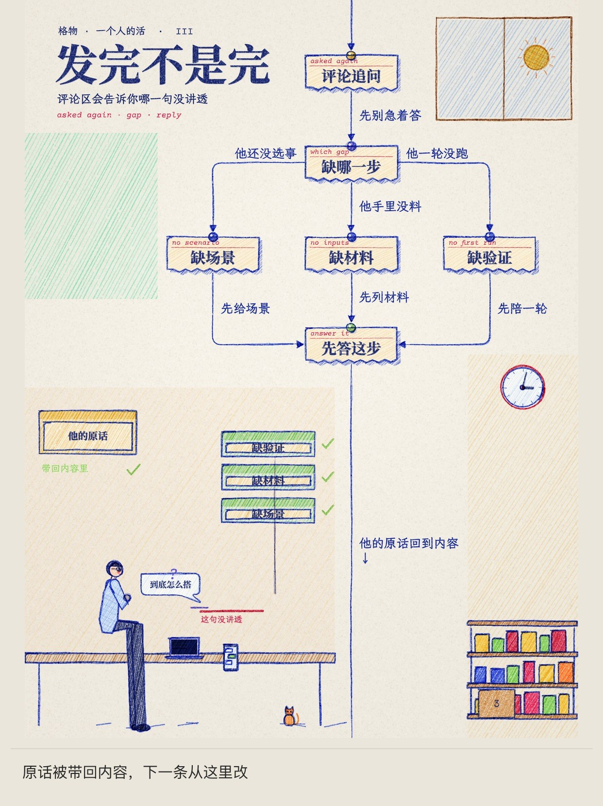
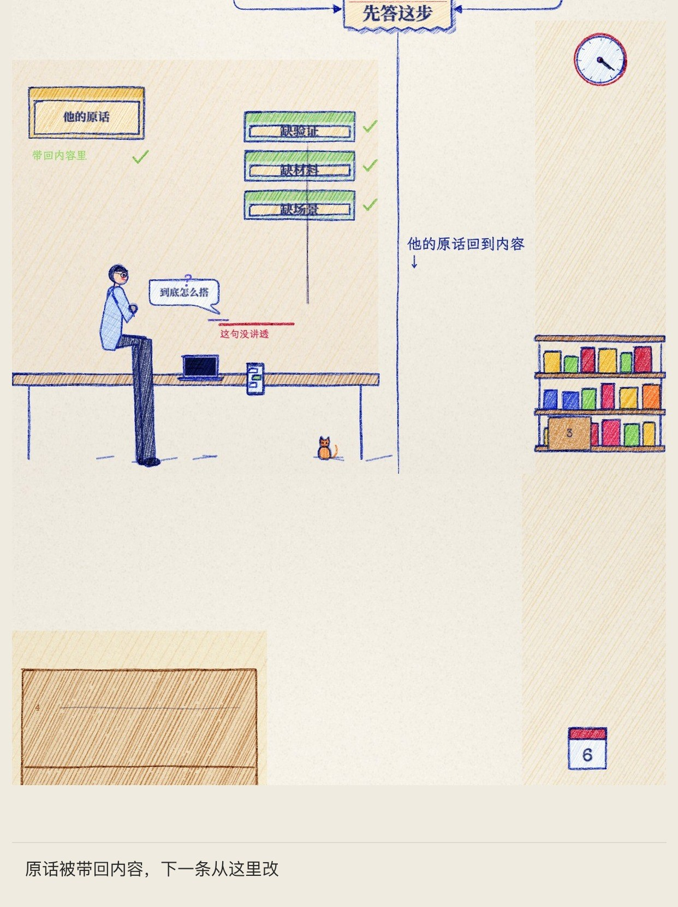
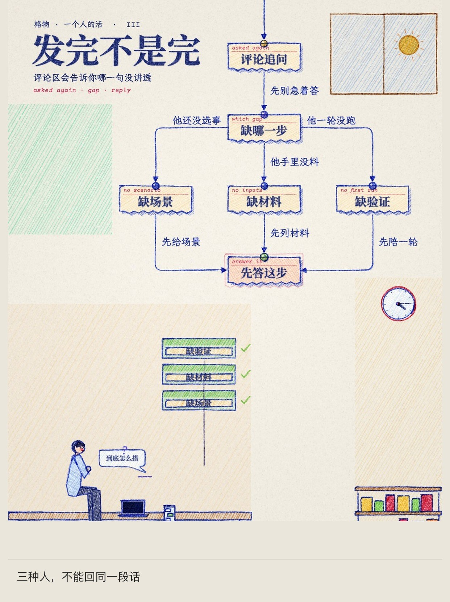
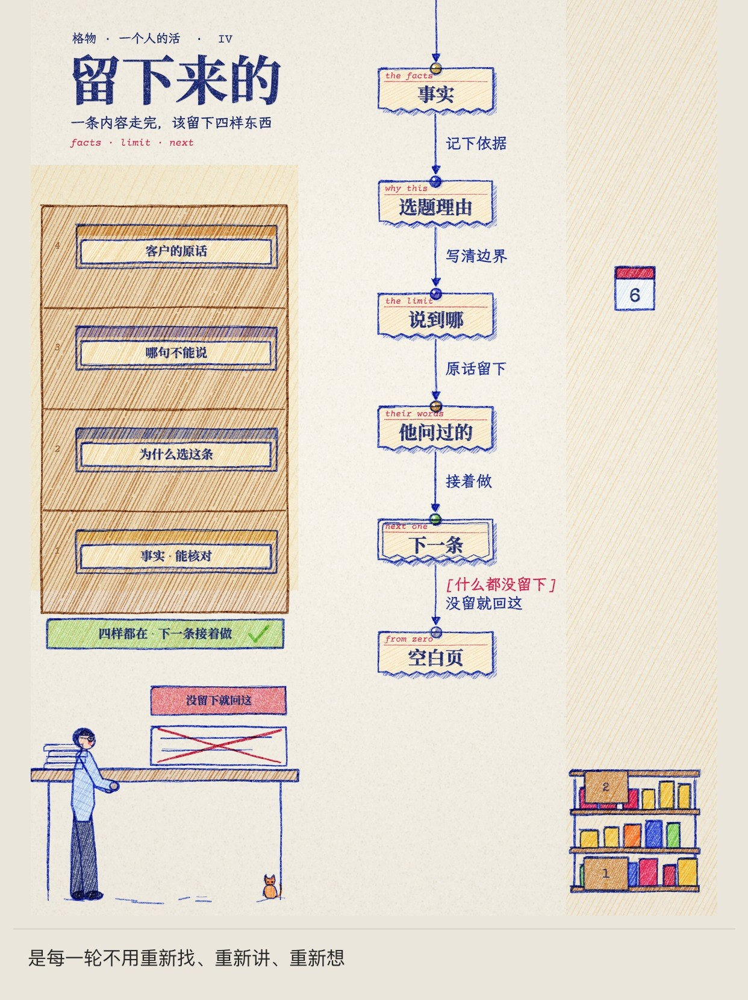
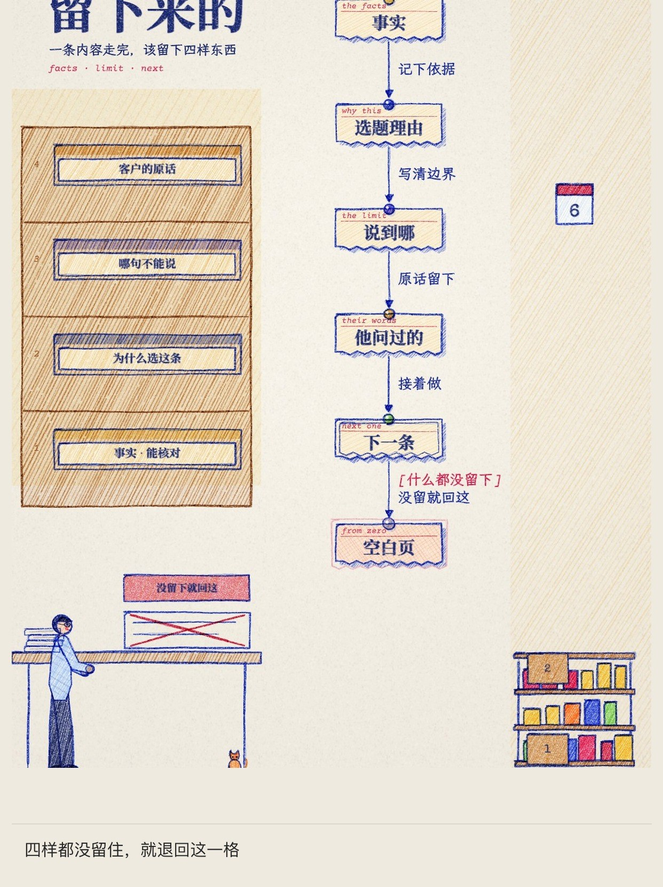
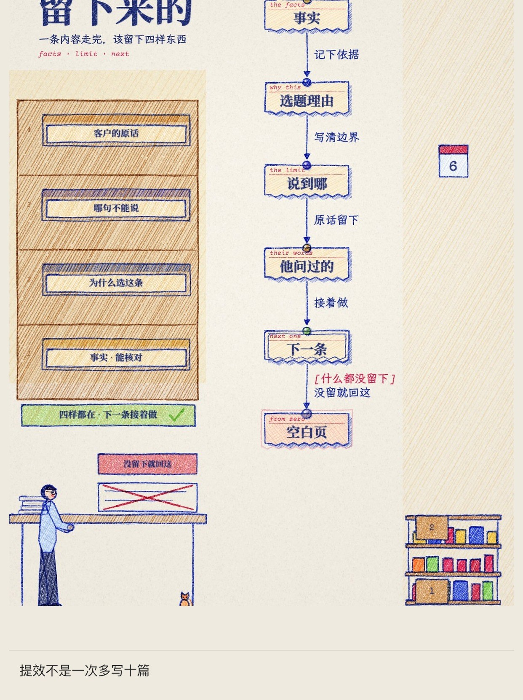

## 发布信息

| 项 | 值 |
|---|---|
| 平台 | 小红书 |
| 期数 | — |
| 发布时间 | 2026-11-09 12:32 |
| 正文长度 | 737 字 |
| 图片数量 | 12 张 |
| 状态 | 已发布 |
