# 20人的活动，成败在开场前

> — · 2026-11-10 12:32 发布 · AI 赚钱内容

## 标题（可直接复制）

```
20人的活动，成败在开场前
```

## 正文（可直接复制发布）

一场二十个人的活动，是从哪一刻开始办成的？开场那一刻，还是开场前一周？

成都的尹阳第一次做线下分享会的组织者。按他自己的说法，两场活动满意度做到了九成，第一场来了二十多人。但他回头看，第一步既不是定主题，也不是找场地，而是私下去问人：你愿不愿意来讲？主题、场地、流程，都是等人答应之后才一点点补上的。

我判断，一场活动真正的进度条，画在开场之前。

先说原理。他把每一件「还没发生」的事，都提前推了一格：提前两三周去问嘉宾的时间（他说很少有人提前这么久规划，所以反而好约）；嘉宾定了就拉一个群对内容，先问清楚每人擅长什么、准备讲什么、从哪个角度切，避免几个人讲重复；报名的人提前一周一个个加上好友、拉进群，提前两天发地址、流程、几点开始，前一天和当天上午各再提醒一次。结果是开场那天没有救火，只有执行。

再说代价。这些提前量全落在组织者身上。他给自己定的规矩是「嘉宾只负责讲，其他我来兜」——场地、听众、流程、提醒、主持稿，一样不落。主持稿不是念名字，是给每位嘉宾写一段介绍词，说他为什么值得听；还要自己备一份 PPT，万一有人临时来不了，自己能顶上。这些都是没人看见的时间，现场不会有人为它鼓掌。

最后说边界。场地确实是他的先天优势，他在一家投资公司上班，借场地方便。但他自己说，场地只是基础条件，不是核心能力；人、内容、流程和时间组织不清楚，有场地也不一定顺。这套做法也只在小规模里成立——二十多人已经开始难控，一个人多讲一句，整场的时间就散掉了。所以它的前提是：人不多，而且你愿意在没人看见的地方提前干活。

组局不是把人叫到一起，是把一场活动里的不确定，提前处理掉。

你上一次组织活动——哪怕是攒一次饭局——是开场前一周就在推进，还是当天才开始救火？

## 话题标签

#AI赚钱术日记 #线下活动 #活动策划 #社群运营 #一人公司

## 配图（12 张）

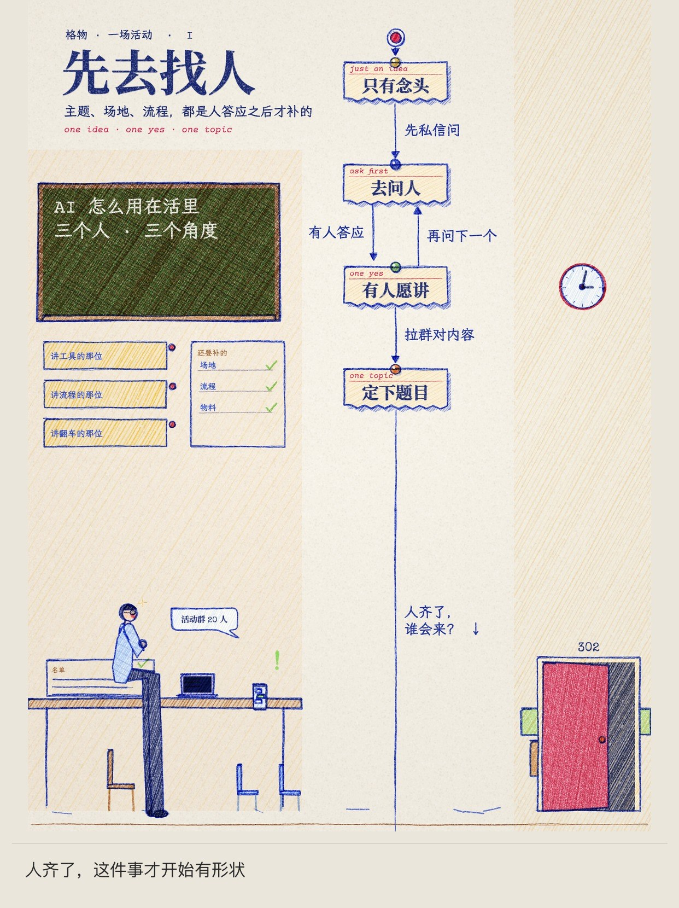
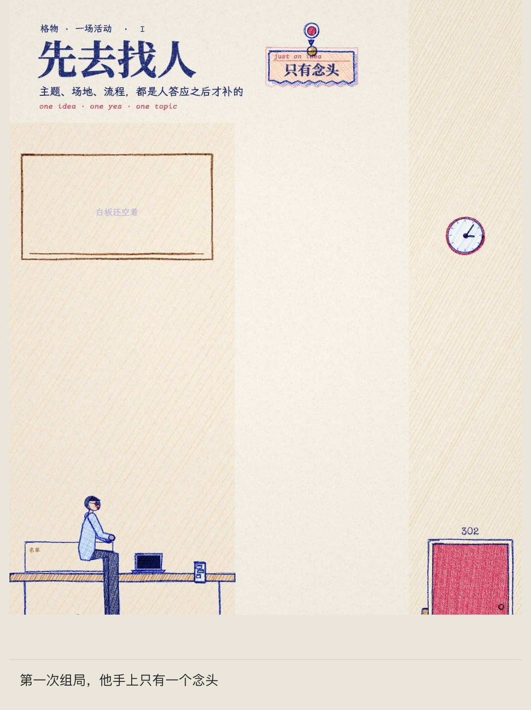
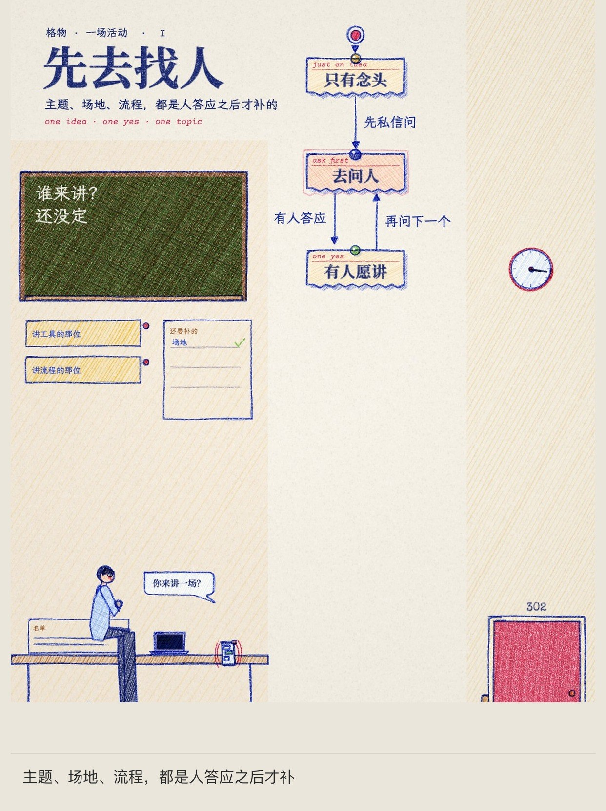
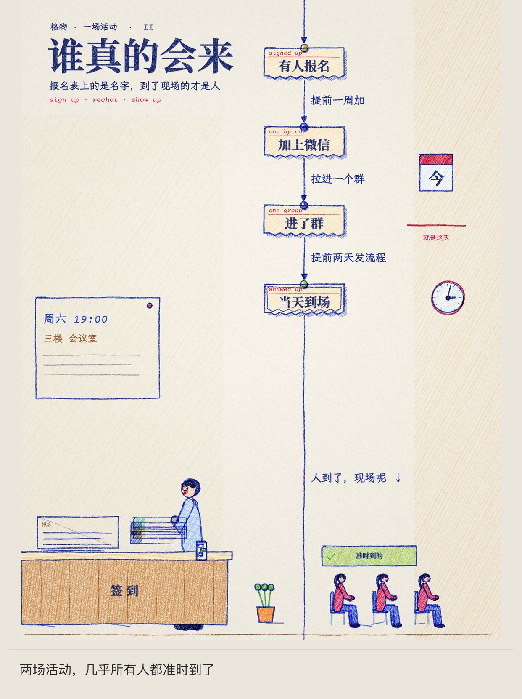
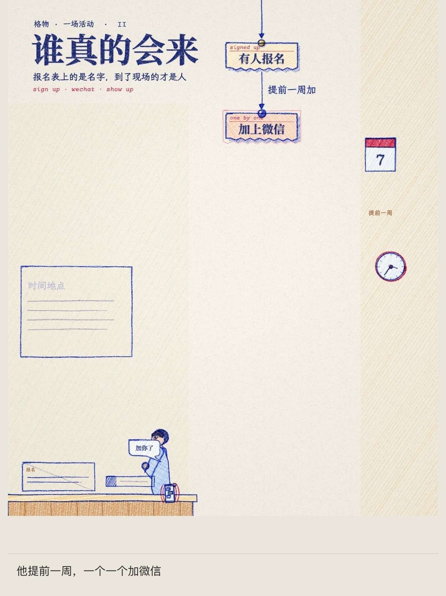
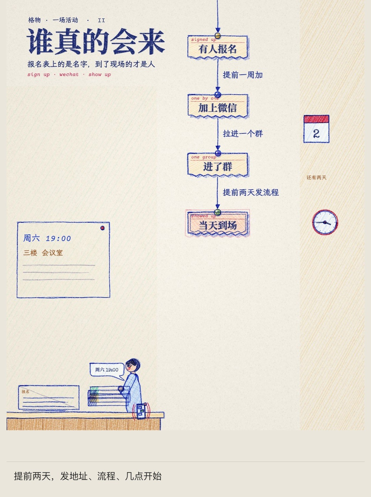
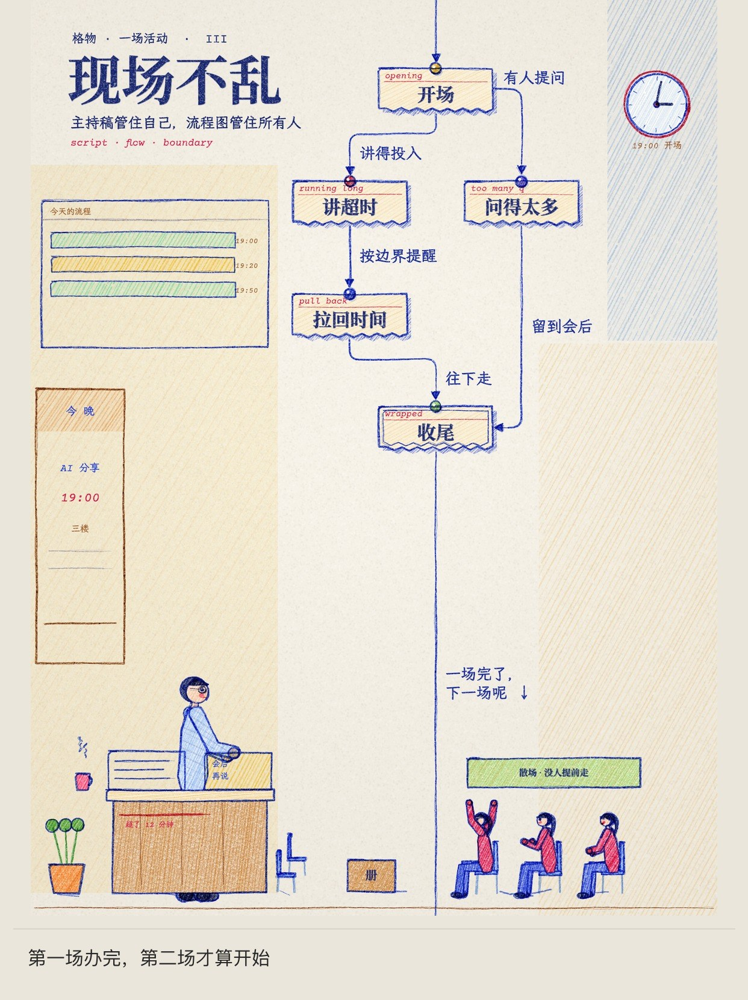
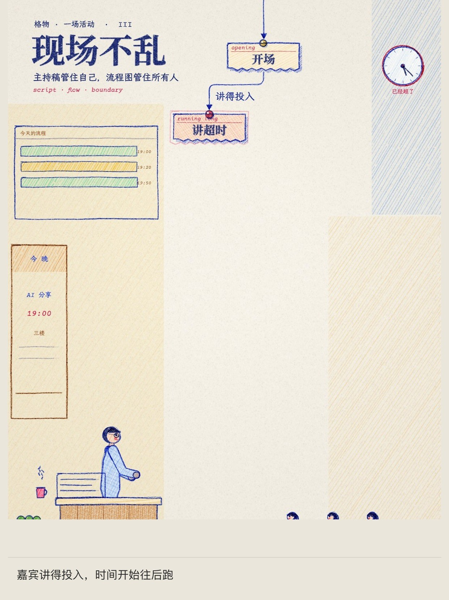
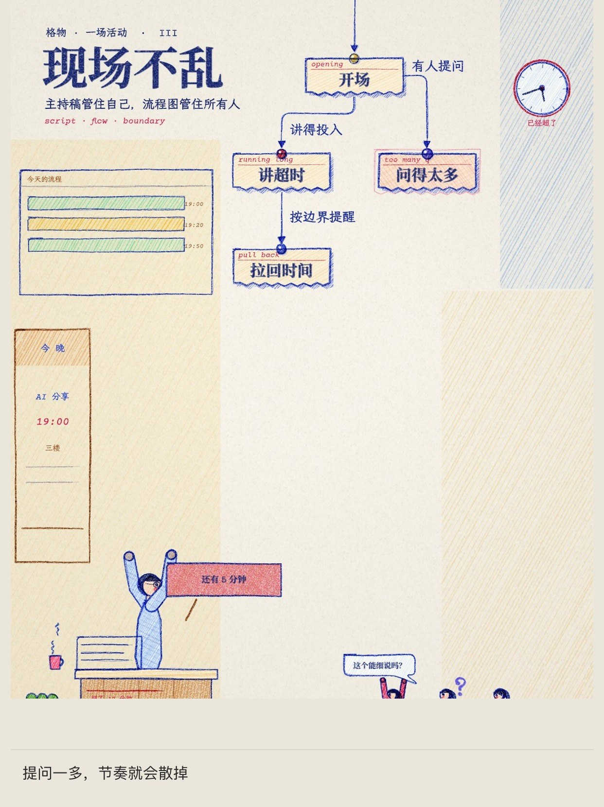
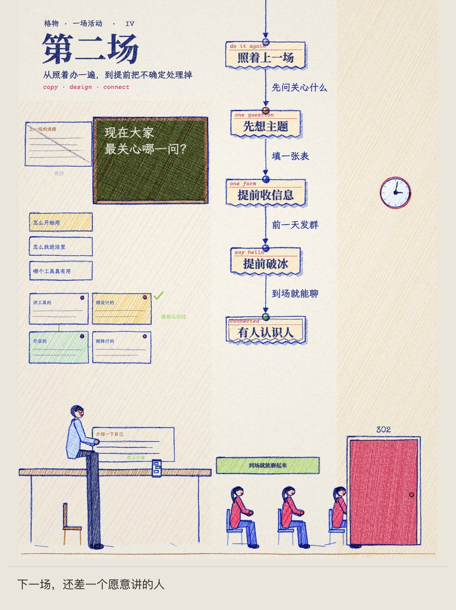
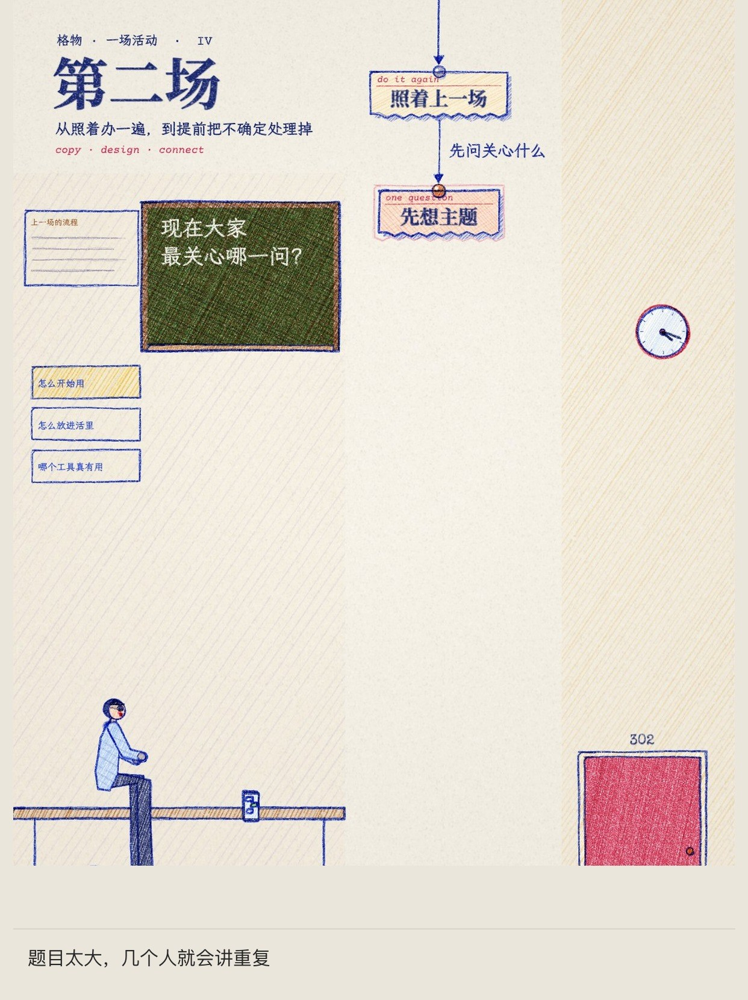
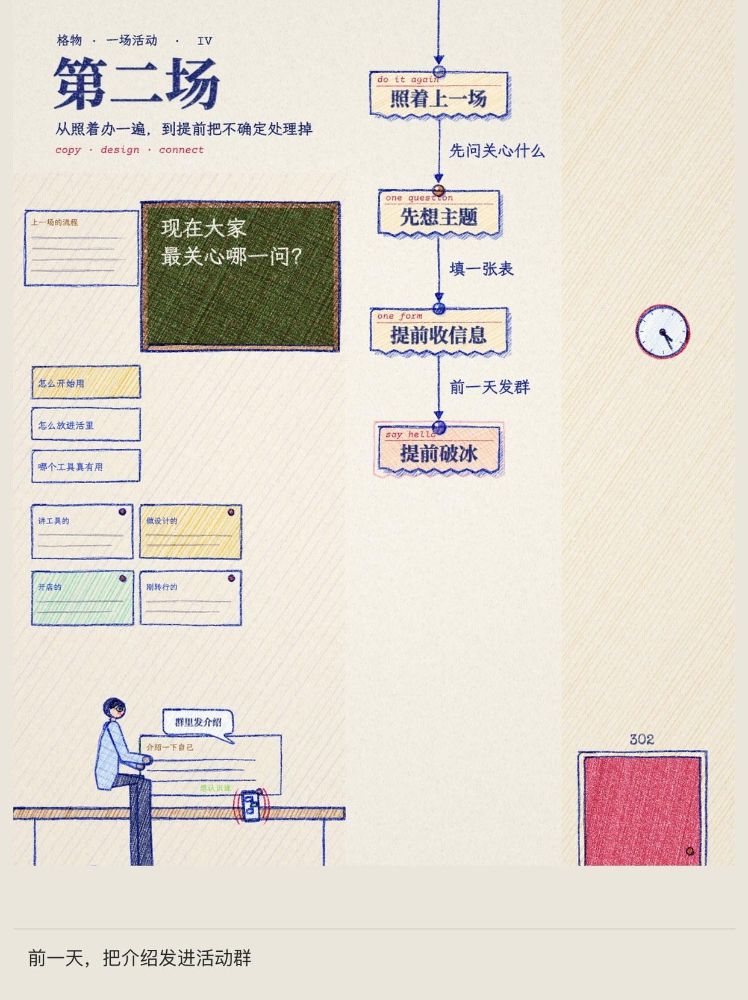

## 发布信息

| 项 | 值 |
|---|---|
| 平台 | 小红书 |
| 期数 | — |
| 发布时间 | 2026-11-10 12:32 |
| 正文长度 | 734 字 |
| 图片数量 | 12 张 |
| 状态 | 已发布 |
