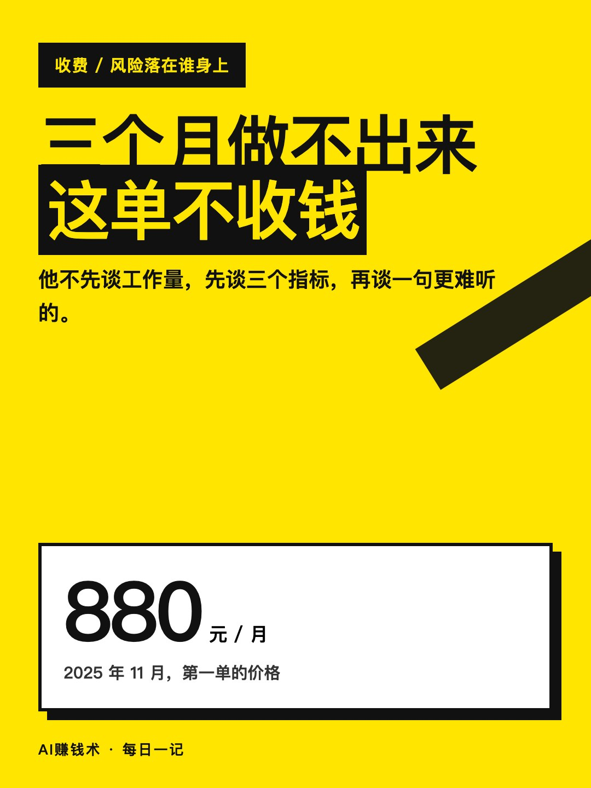
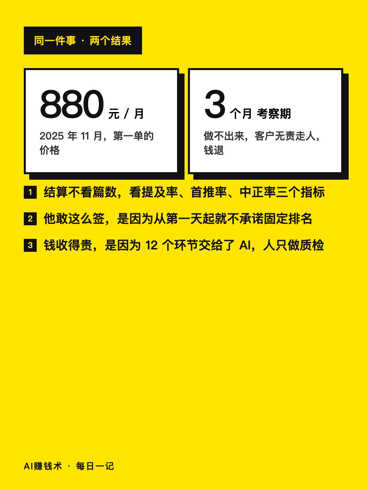
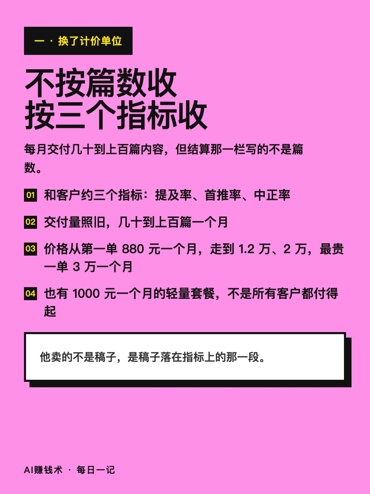
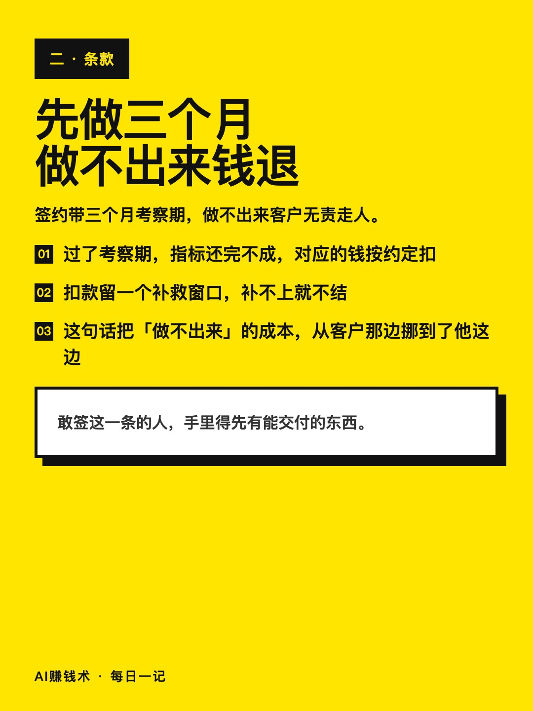
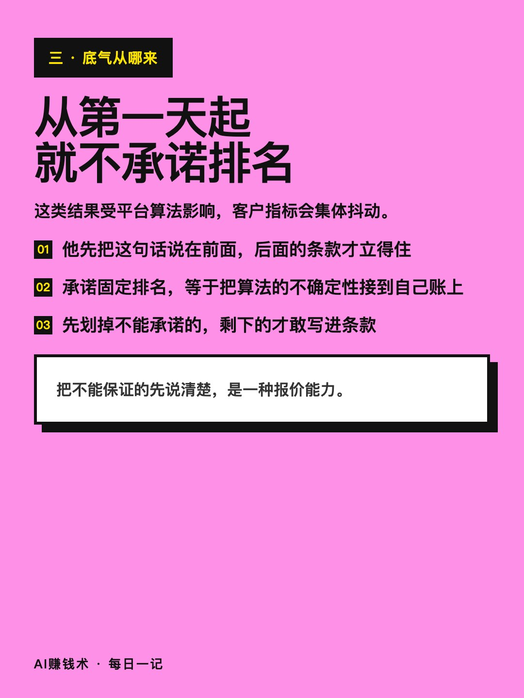
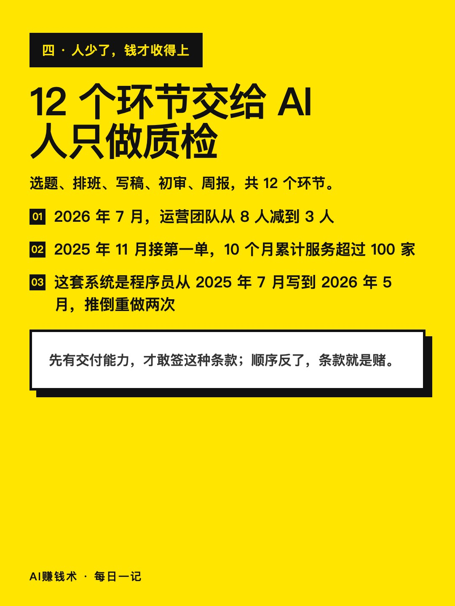
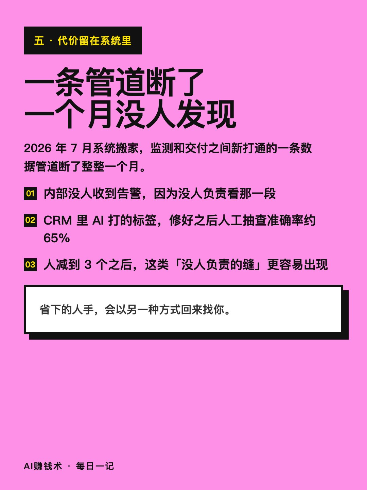

# 三个月做不出来，这单不收钱

> — · 2026-11-10 09:02 发布 · AI 赚钱内容

## 标题（可直接复制）

```
三个月做不出来，这单不收钱
```

## 正文（可直接复制发布）

别人报价先谈工作量，他一上来先谈三个数字：提及率、首推率、中正率。然后加一句更难听的——签约先做三个月，做不出来，你无责走人，钱我退。

一、他不按篇数收钱

每月交付几十到上百篇内容，但结算那一栏写的不是篇数。第一单是 880 元一个月。现在手上：1.2 万一个月、2 万一个月，最贵一单 3 万一个月，也有 1000 元一个月的轻量套餐。客户是两家专业服务机构，本文不点行业。

二、他把「做不出来」先接了过来

签约带三个月考察期，做不出来客户无责走人；过了考察期指标还完不成，对应的钱按约定扣，留一个补救窗口，补不上就不结。

他敢这么签，底气不是技术，是他从第一天起就不承诺固定排名——这类结果受平台算法影响，客户指标会集体抖动。先把这句不能保证的说在前面，后面的条款才立得住。

三、钱收得贵，是因为人少了

2025 年 11 月接第一单，10 个月累计服务超过 100 家。内部把选题、排班、写稿、初审、周报共 12 个环节交给 AI，人只做质检。2026 年 7 月，运营团队从 8 人减到 3 人。质检这一步减不掉：稿子出去之前，还得有人看一眼像不像人话。

这套系统不是买来的：程序员从 2025 年 7 月写到 2026 年 5 月，推倒重做两次才成型。先有交付能力，才敢签这种条款——顺序反了，条款就是赌。

四、代价留在系统里

2026 年 7 月系统搬家，监测和交付之间新打通的一条数据管道断了整整一个月，没人发现。内部给客户资料打标签时，AI 标完人工抽查，修好之后准确率约 65%。

至于三个月之后那些指标到底有没有兑现过，他没写。

把风险写进条款的人，通常先把成本压进了系统。你的「做不出来不结账」，是拿什么撑着的？

## 话题标签

#B端服务 #交付管理 #商业条款 #AI赚钱术 #AI赚钱术日记

## 配图（8 张）










## 发布信息

| 项 | 值 |
|---|---|
| 平台 | 小红书 |
| 期数 | — |
| 发布时间 | 2026-11-10 09:02 |
| 正文长度 | 729 字 |
| 图片数量 | 8 张 |
| 状态 | 已发布 |
