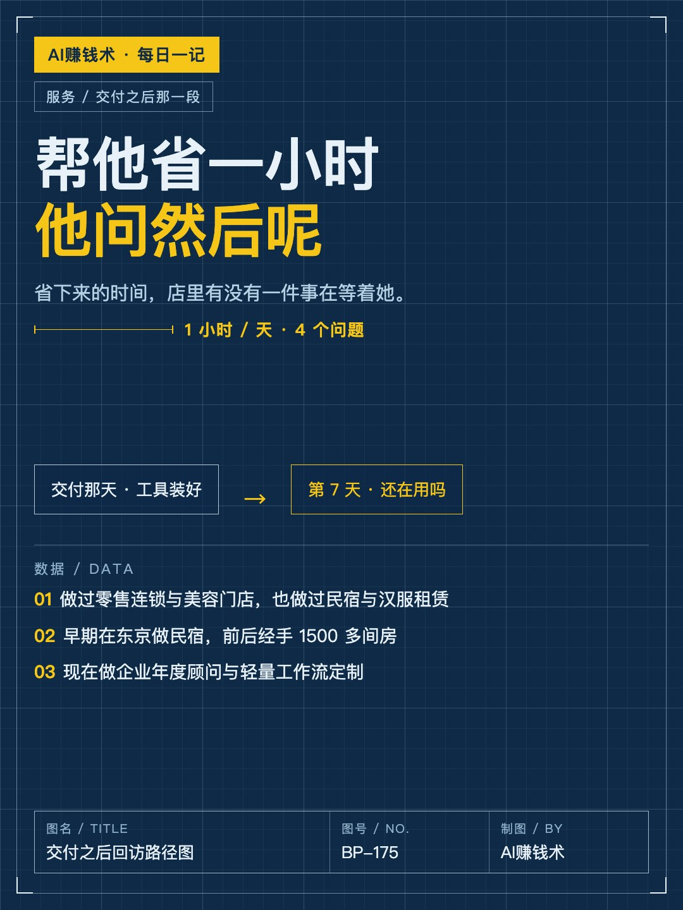
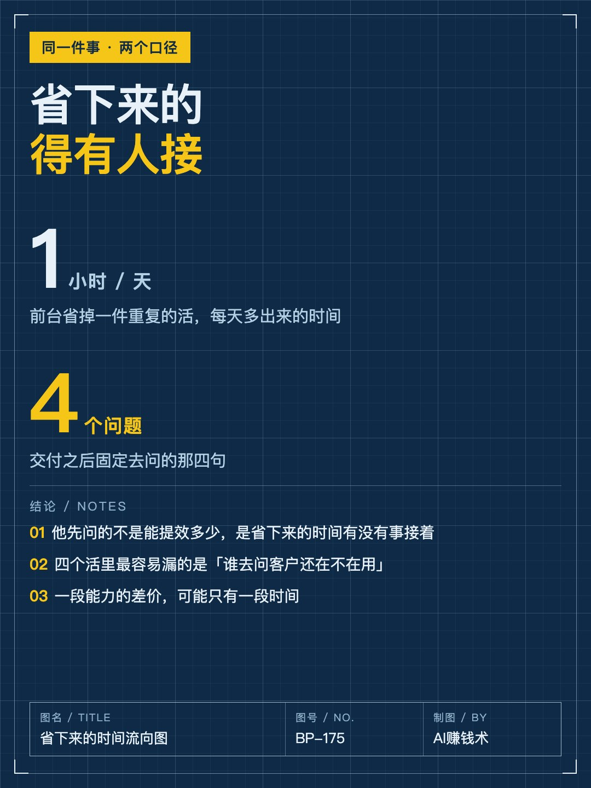
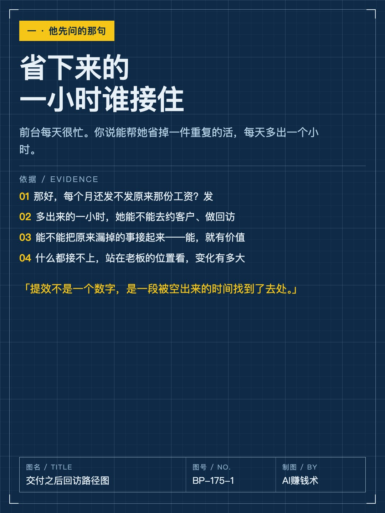
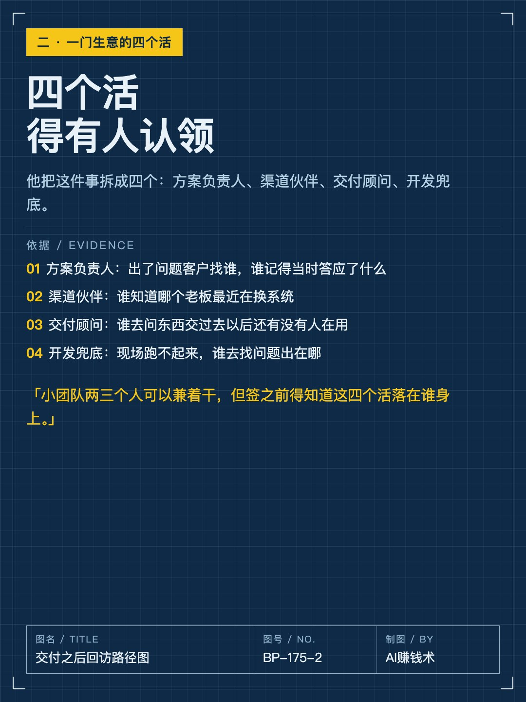
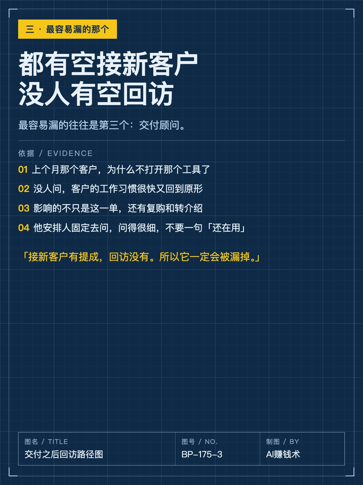
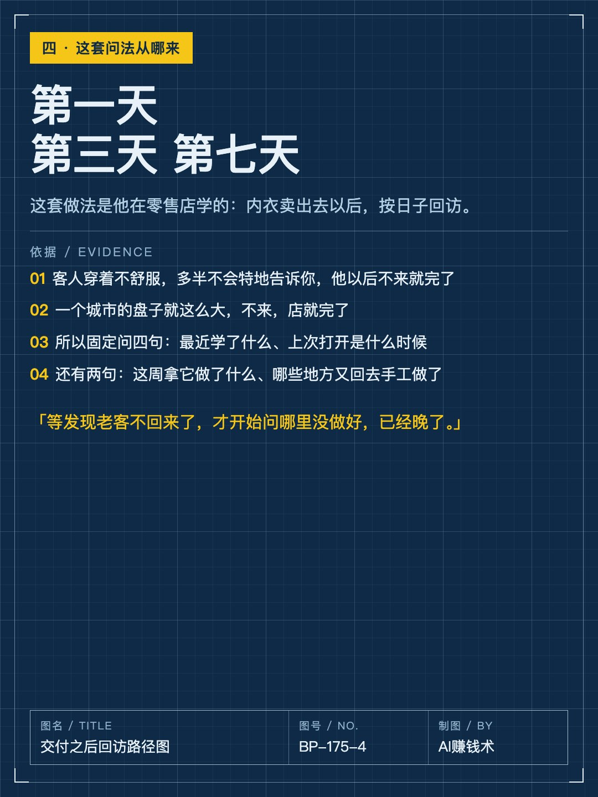
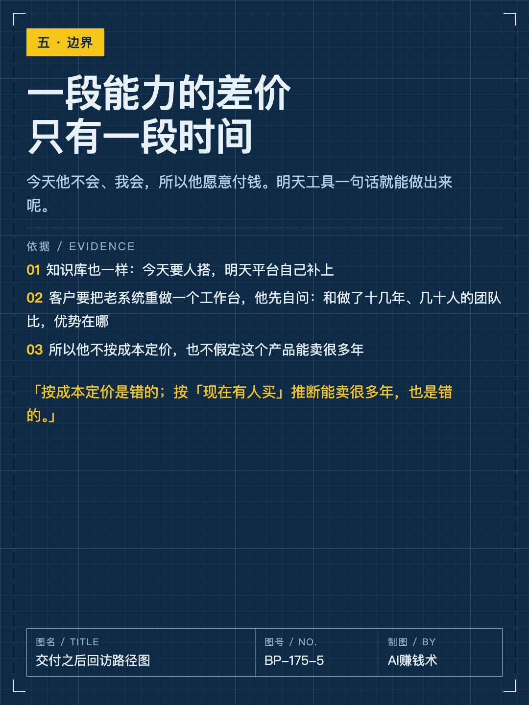
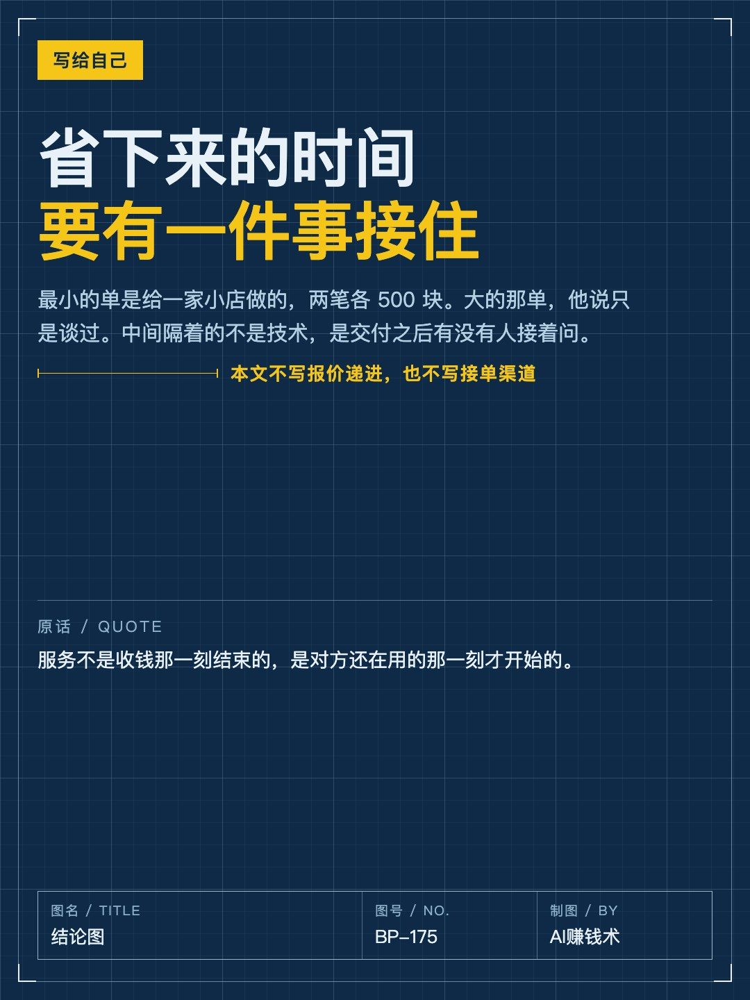

# 帮他省一小时，他问然后呢

> — · 2026-11-10 11:02 发布 · AI 赚钱内容

## 标题（可直接复制）

```
帮他省一小时，他问然后呢
```

## 正文（可直接复制发布）

他跟老板聊，很少先说能提效多少。他先问一句：省下来的这点时间，你店里有没有一件事等着她去做？

一、省下来的一小时，得有人接住

前台每天很忙。你说我能帮她省掉一件重复的活，每天多出一个小时。那好——每个月还发不发原来那份工资？发。那多出来的一个小时，她能不能去约客户、做回访，能不能把原来漏掉的事接起来？能，就有价值。如果什么都接不上，站在老板的位置看，变化有多大？

所以他不只说提效。他更想知道：省下来的这点时间，有没有一件事在等着。这句话问在前面，是因为他见过太多提效提完、人还是原来的用法。

二、最容易被漏掉的那个活

他把一门生意拆成四个活：方案负责人、渠道伙伴、交付顾问、开发兜底。小团队两三个人可以兼着干。最容易漏的是第三个——大家都有空接新客户，没人有空去问：上个月那个客户，为什么不打开那个工具了。

他安排人固定去问四个问题：最近有没有学课程？上一次打开是什么时候？这周拿它做了什么？哪些地方又回去手工做了？

这套问法是从零售店搬来的：卖出去的内衣，第一天、第三天、第七天回访。客人穿着不舒服，多半不会特地告诉你，他以后不来就完了。

三、一段能力的差价，只有一段时间

他还留了一句更冷的：今天他不会、我会，所以他愿意付钱；明天工具自己就能一句话做出来，我还收得到同样的钱吗。

客户要把老系统重做一个工作台，他也先自问：和那些做了十几年、几十个人、只盯一个垂直行业的团队比，优势在哪。

四、最小的单和最大的单

最小的单是给一家小店做的，两笔各 500 块。大的那单，他说只是谈过。中间隔着的不是技术，是交付之后有没有人接着问。

服务不是把钱收进来的那一刻结束的，是对方还在用的那一刻才开始的。

你上一次交付完，是什么时候回去问过对方还在不在用？

## 话题标签

#交付 #客户成功 #AI工作流 #AI赚钱术 #AI赚钱术日记

## 配图（8 张）










## 发布信息

| 项 | 值 |
|---|---|
| 平台 | 小红书 |
| 期数 | — |
| 发布时间 | 2026-11-10 11:02 |
| 正文长度 | 741 字 |
| 图片数量 | 8 张 |
| 状态 | 已发布 |
