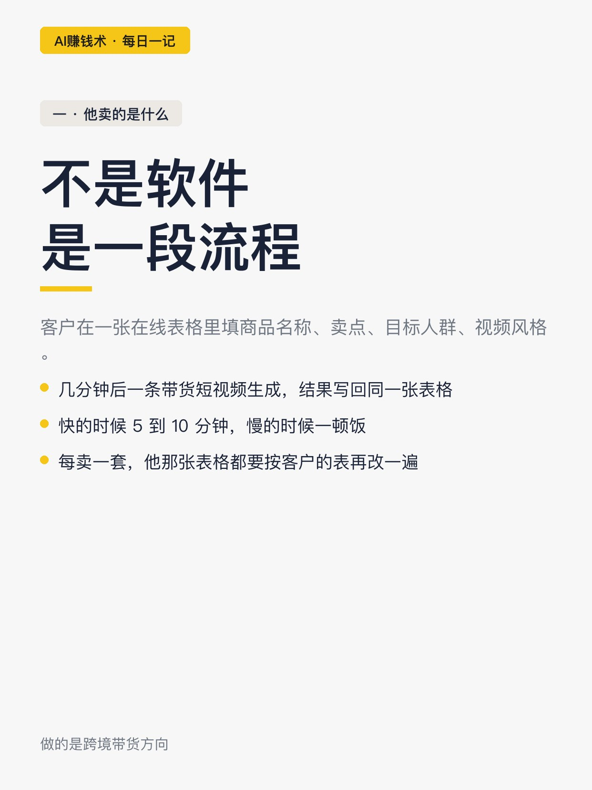
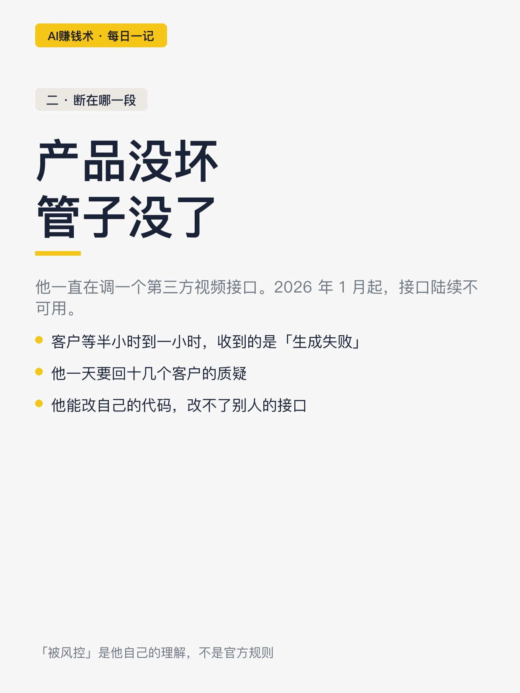
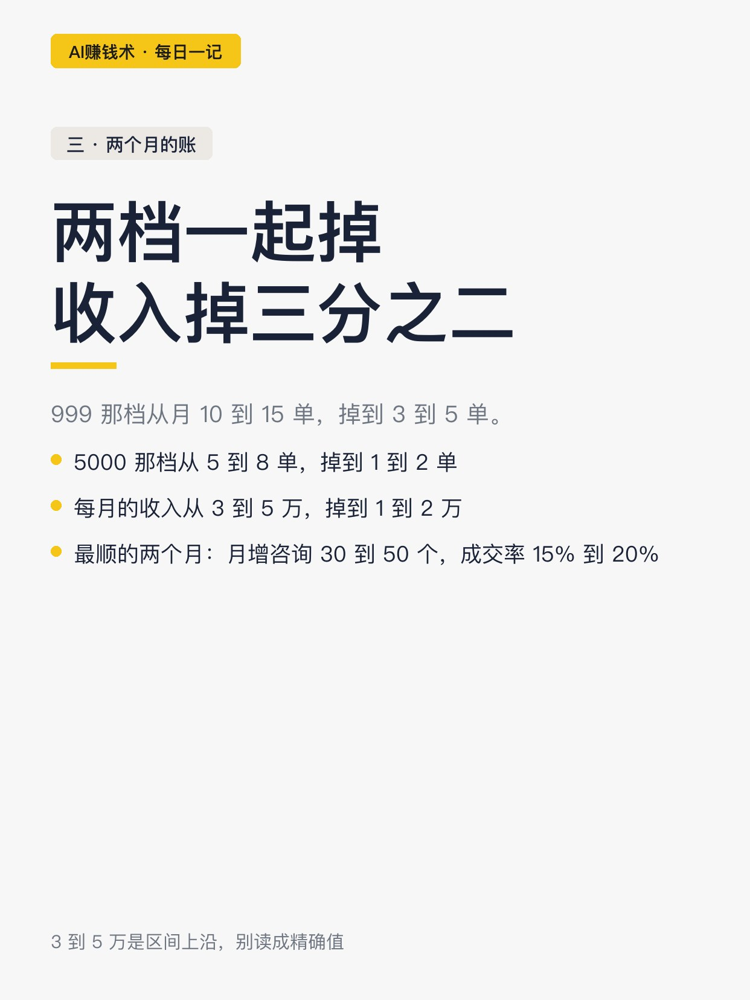
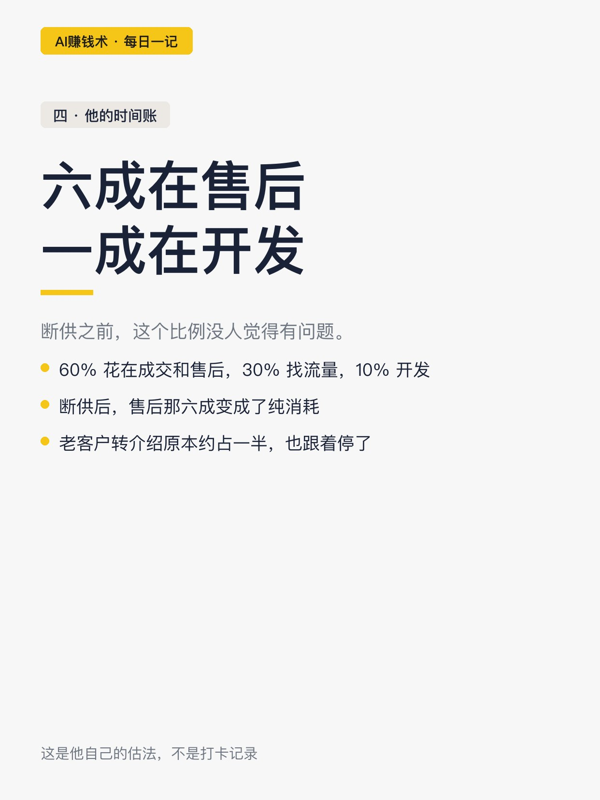
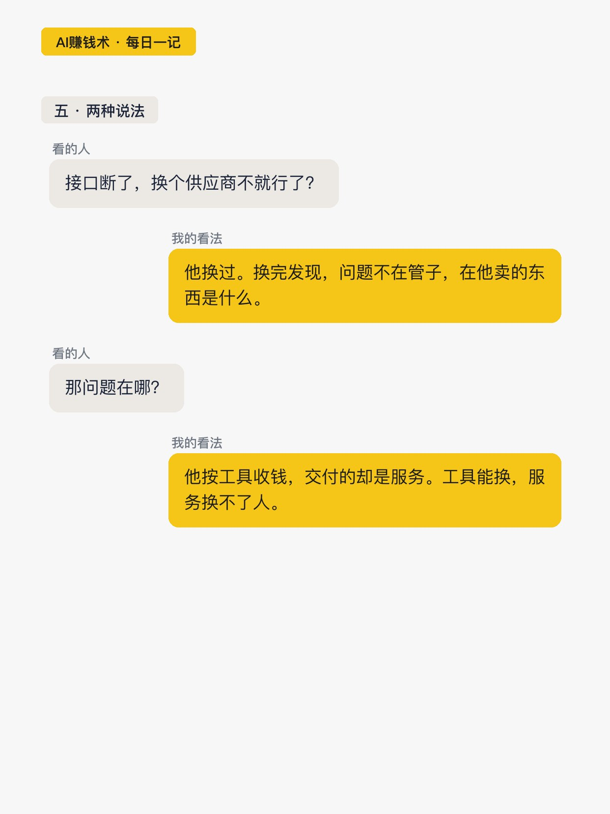
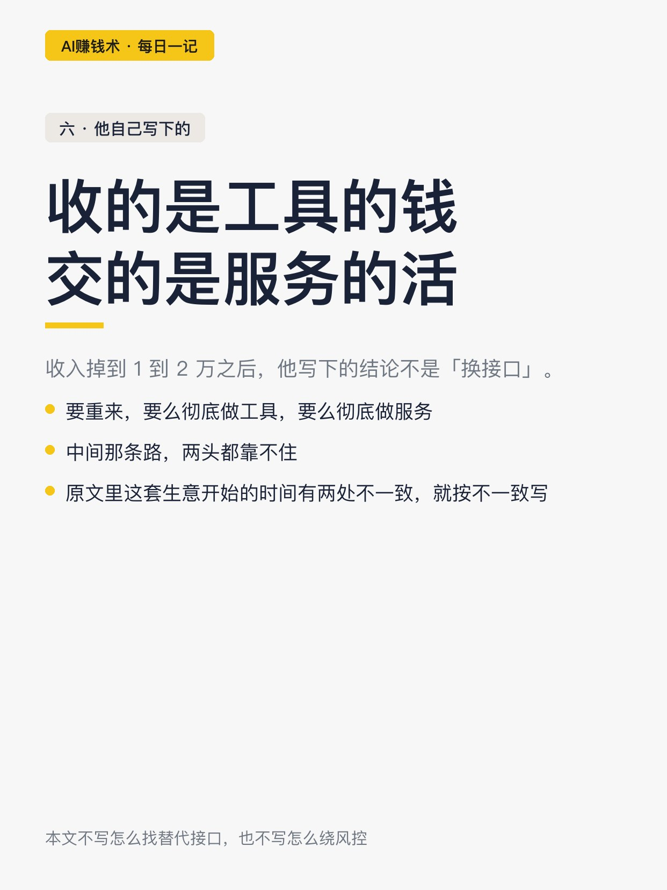

# 接口一断，5万变1万

> — · 2026-11-10 08:02 发布 · AI 赚钱内容

## 标题（可直接复制）

```
接口一断，5万变1万
```

## 正文（可直接复制发布）

产品没出过一次事故。规则没改，客户没跑，代码也没坏。可两个月里，他每月的收入从 3 到 5 万，掉到 1 到 2 万。

一、他卖的不是软件，是一段流程

做的是跨境带货方向。客户在一张在线表格里填商品名称、卖点、目标人群、视频风格，几分钟后一条带货短视频回到同一张表格里，快的时候 5 到 10 分钟。两个档：999 元含一条基础流程加一年维护，5000 元含 46 条流程加培训。累计卖出 50 多套。每卖一套，他那张表格都要按客户的表再改一遍——所以他不像卖软件的，像个上门装表的人。

二、断的不是产品，是上游

他一直在调一个第三方视频接口。2026 年 1 月起，接口陆续不可用。客户等半小时到一小时，收到的是「生成失败」。他一天要回十几个客户的质疑。999 那档从月 10 到 15 单掉到 3 到 5 单，5000 那档从 5 到 8 单掉到 1 到 2 单。老客户续费开始犹豫，说的话都一样：等稳定了再说。

他自己算过时间账：六成花在成交和售后，三成找流量，一成开发。断供之前，这个比例没人觉得有问题；断供之后，售后那六成变成了纯消耗。

三、他没换供应商，他换了判断

收入掉到 1 到 2 万之后，他写下的结论不是「换个接口」，是「收的是工具的钱，交付的却是服务的活」。要重来，要么彻底做工具，要么彻底做服务。中间那条路，两头都靠不住。

四、几个数得说清

50 多套是累计销量，不是月销量；3 到 5 万是区间上沿，不是精确值；原文里这套生意开始的时间有两处，一处写 2025 年 10 月、一处写 12 月，就不二选一了。这些都是他自述，没有第三方核过。

一根不属于自己的管子，撑不起一门按工具卖的生意。

你交付的东西里，有多少环节挂在别人的接口上？

## 话题标签

#AI工作流 #商业复盘 #供应链 #AI赚钱术 #AI赚钱术日记

## 配图（8 张）










## 发布信息

| 项 | 值 |
|---|---|
| 平台 | 小红书 |
| 期数 | — |
| 发布时间 | 2026-11-10 08:02 |
| 正文长度 | 742 字 |
| 图片数量 | 8 张 |
| 状态 | 已发布 |
