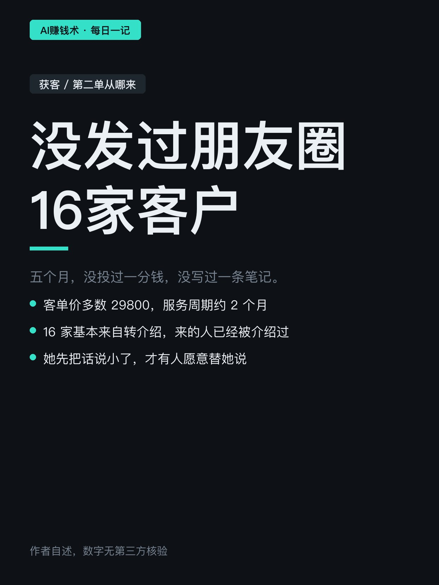
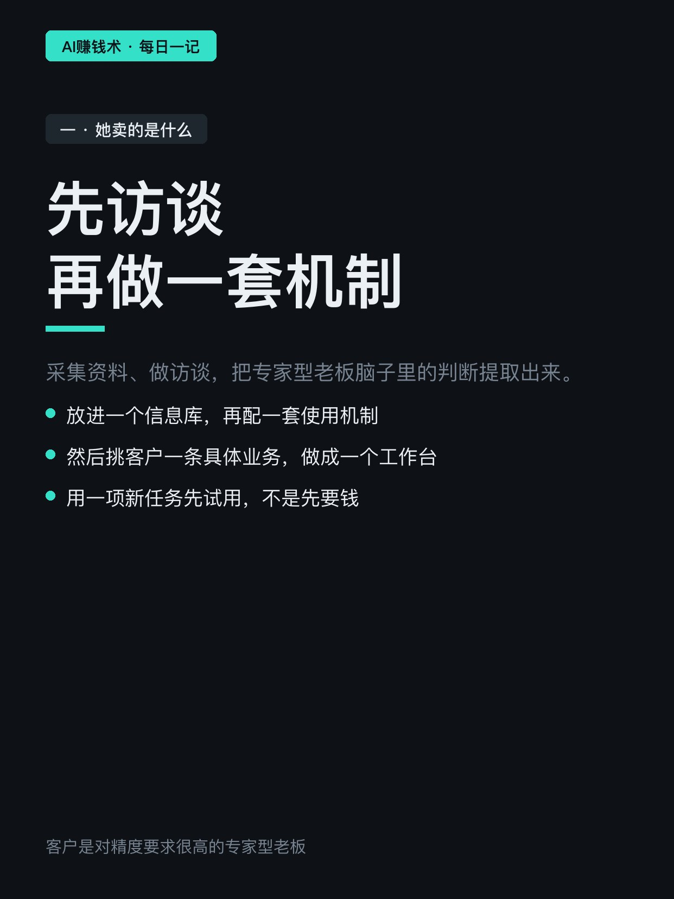
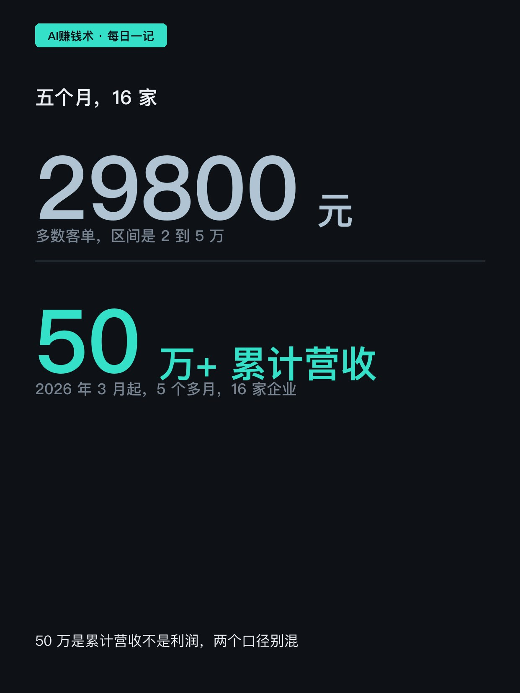
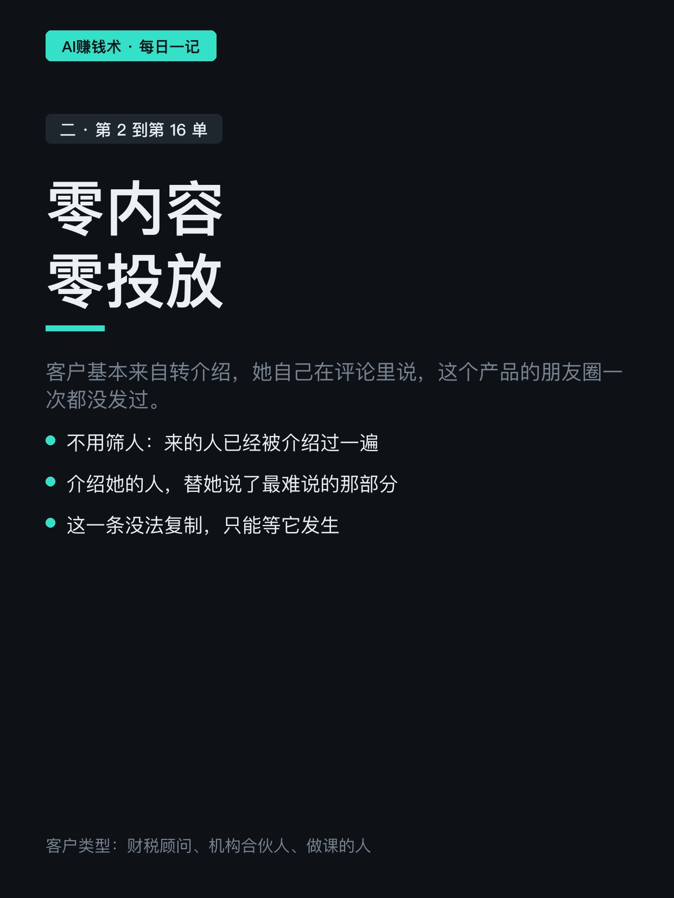
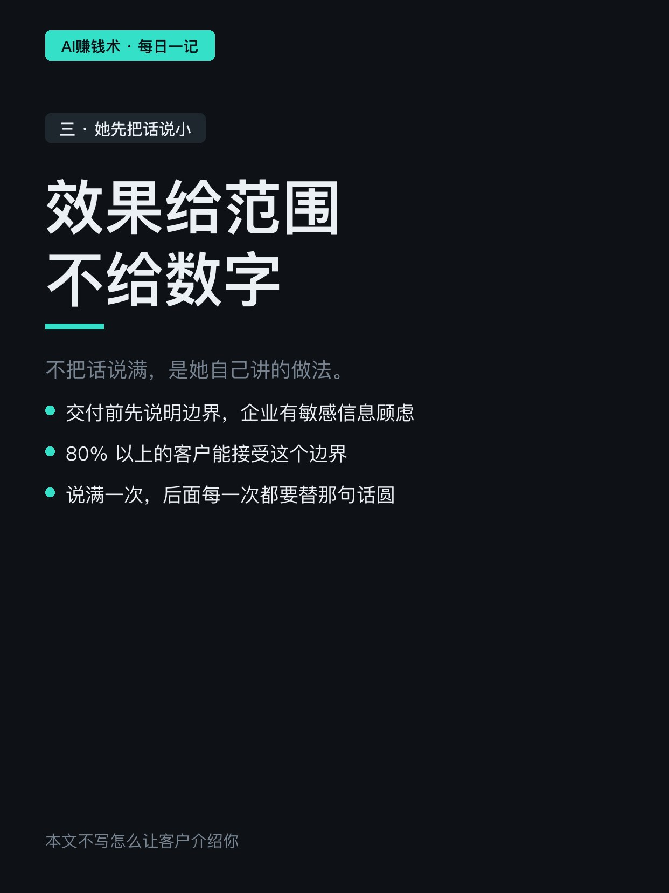
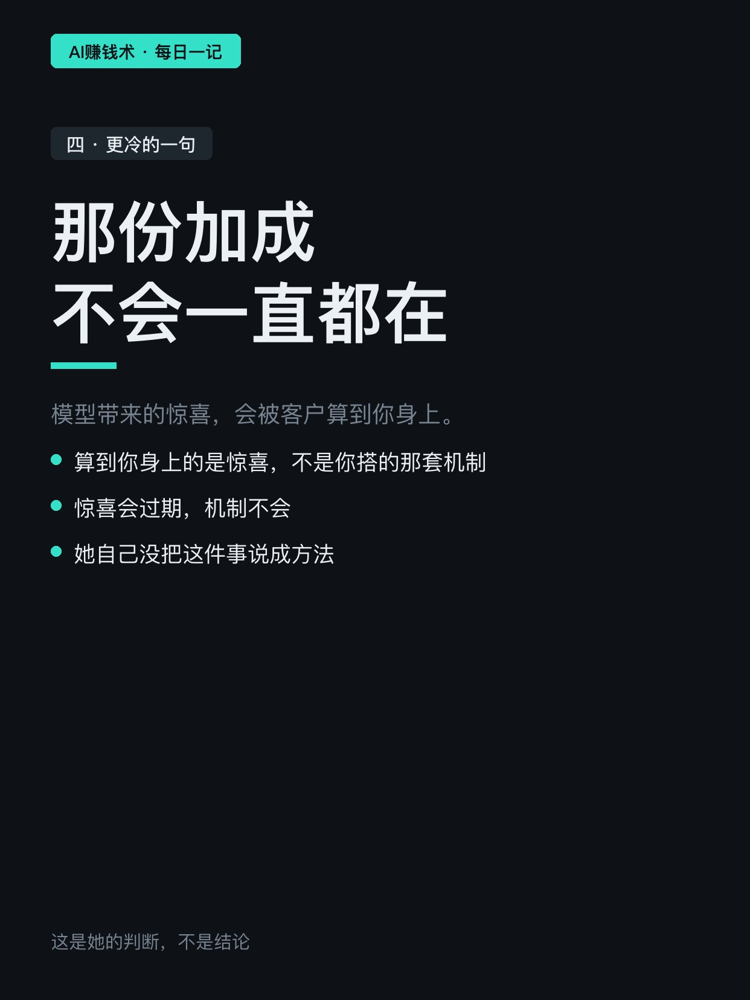
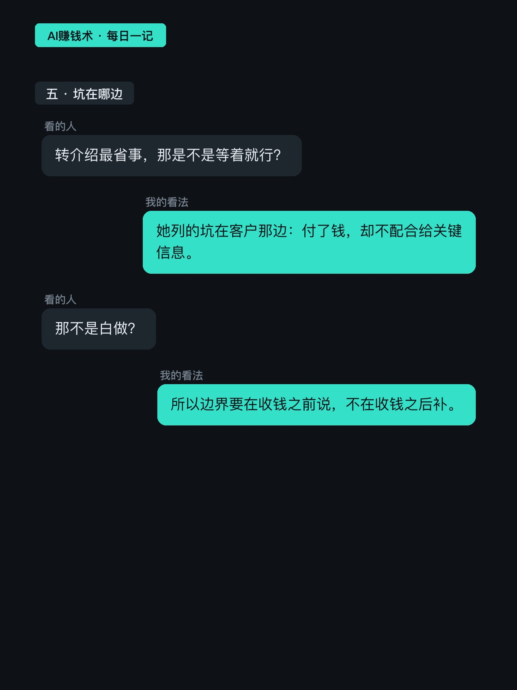
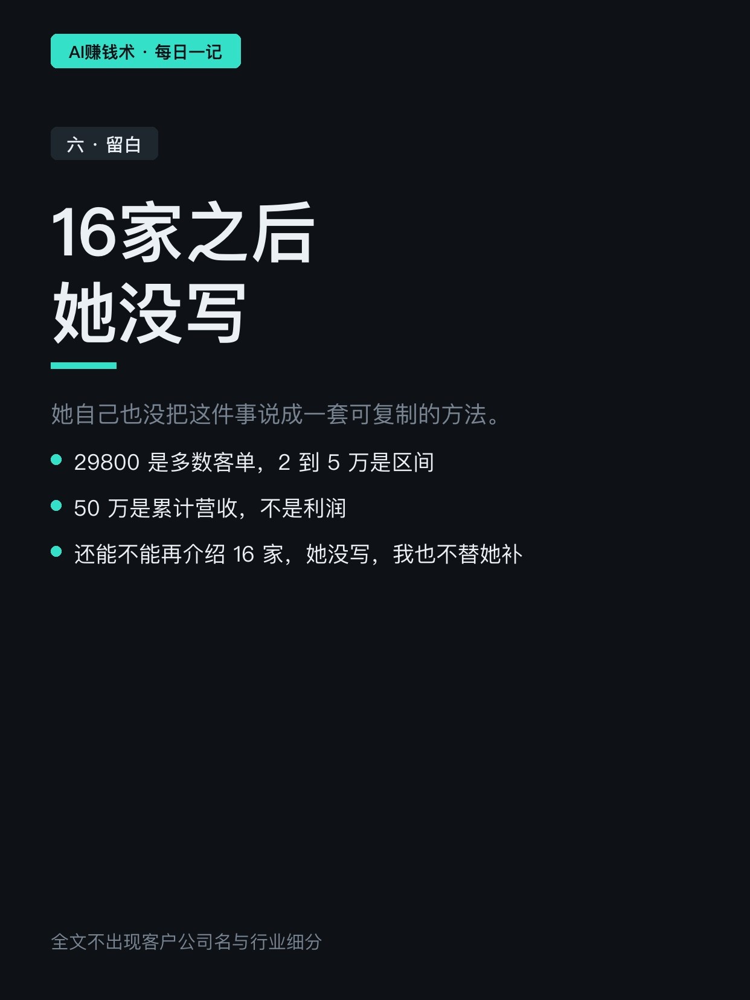

# 没发过朋友圈，16家客户

> — · 2026-11-10 10:02 发布 · AI 赚钱内容

## 标题（可直接复制）

```
没发过朋友圈，16家客户
```

## 正文（可直接复制发布）

五个月，16 家企业，客单价多数 29800。她没投过一分钱，没写过一条笔记，连这个产品的朋友圈都没发过。有人问她客户从哪来，她说了三个字：转介绍。

一、她卖的东西没有一行代码

先采集资料、做访谈，把专家型老板脑子里的判断提取出来，放进一个信息库，再配一套使用机制。然后挑客户一条具体业务做成一个工作台，用一项新任务试用。

客户是对精度要求很高的专家型老板：财税顾问、专业服务机构的合伙人、做课的人。客单价 2 到 5 万，多数 29800，服务周期约 2 个月。

二、第 2 到第 16 单怎么来的

2026 年 3 月起，5 个多月，16 家企业，累计营收超过 50 万。客户基本来自转介绍，她自己在评论里说，这个产品的朋友圈一次都没发过。

零内容、零投放。来的人已经被介绍过一遍，所以她不用筛。她挑客户也很窄：只接那种自己脑子里有判断、但说不清楚的老板。

三、转介绍能发生，是因为她先把话说小

效果上给范围，不给数字，不把话说满——这是她自己讲的做法。交付之前先说明边界，企业有敏感信息顾虑的，80% 以上的客户能接受。

她还有一句更冷的判断：模型带来的那点惊喜，会被客户算到你身上，而这份加成不会一直都在。

四、坑在客户那边

她列的第一个坑是客户付了钱，却不配合给关键信息。不是她不给，是客户内部没人愿意先动。

50 万是累计营收不是利润；29800 是多数客单，2 到 5 万是区间，两个口径不能混。这些数都是她自述，没有第三方核验。

她自己也没把这件事说成方法。她只说，那份加成不会一直都在。16 家之后还能不能再介绍 16 家，她没写。

如果来的人都被介绍过一遍，你还需要一个漏斗吗？

## 话题标签

#获客 #转介绍 #B端服务 #AI赚钱术 #AI赚钱术日记

## 配图（8 张）










## 发布信息

| 项 | 值 |
|---|---|
| 平台 | 小红书 |
| 期数 | — |
| 发布时间 | 2026-11-10 10:02 |
| 正文长度 | 713 字 |
| 图片数量 | 8 张 |
| 状态 | 已发布 |
