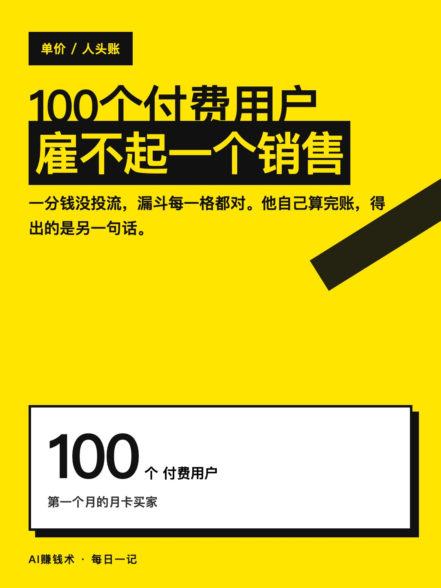
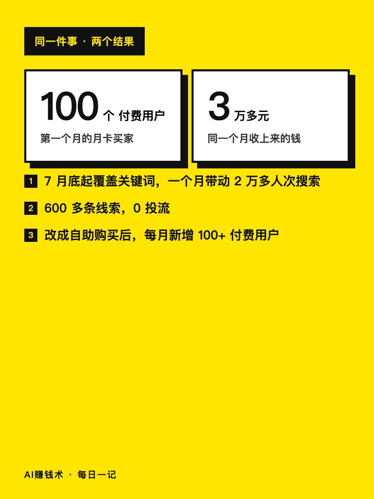
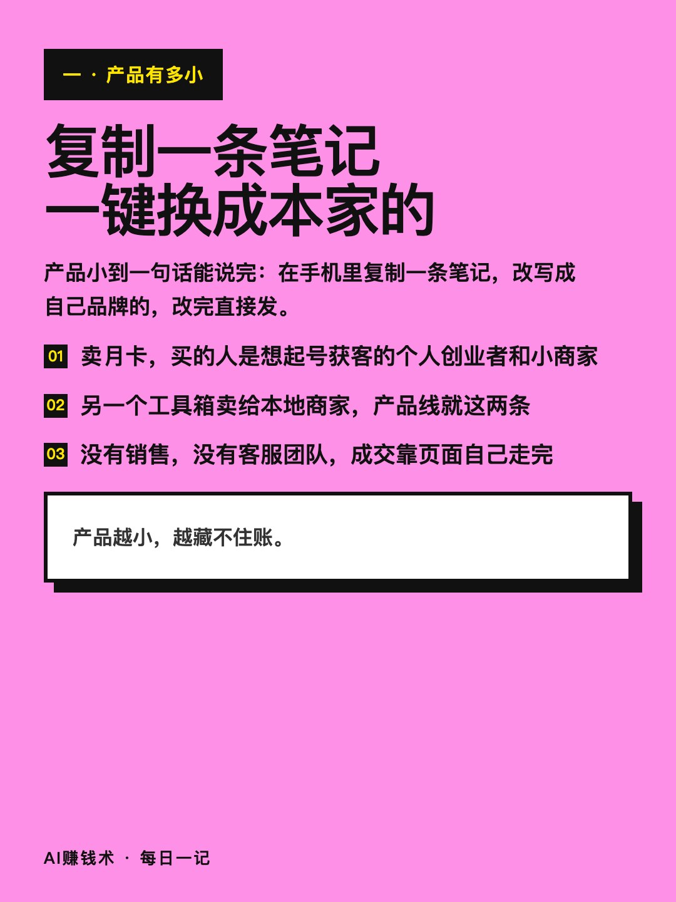
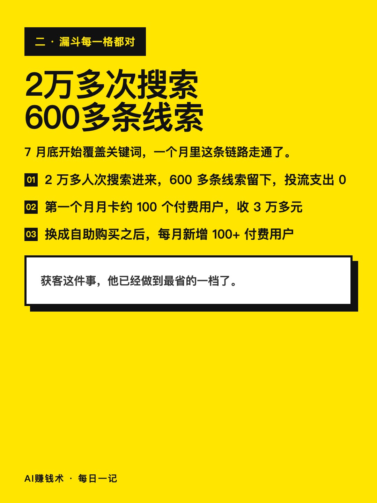
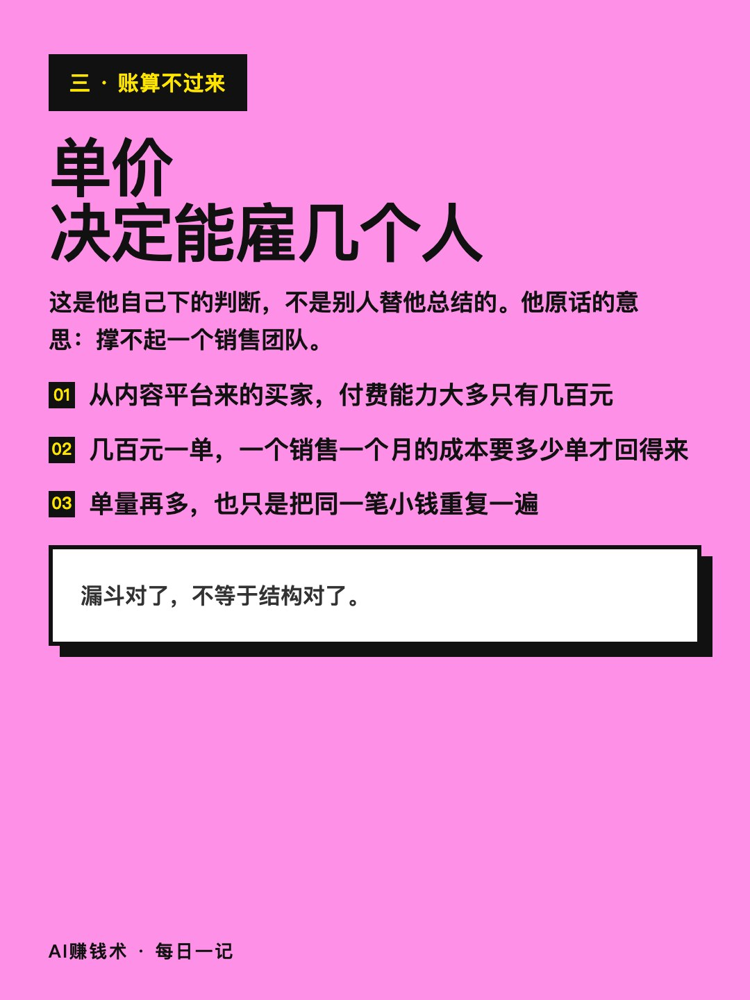
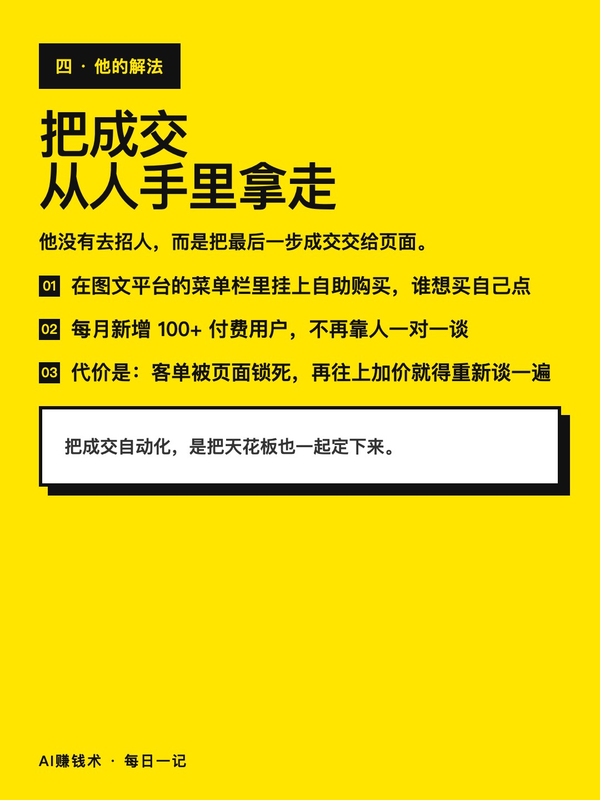
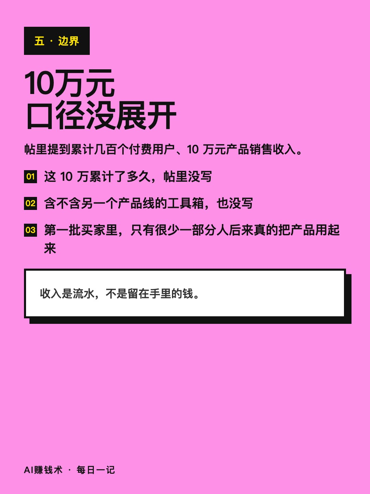
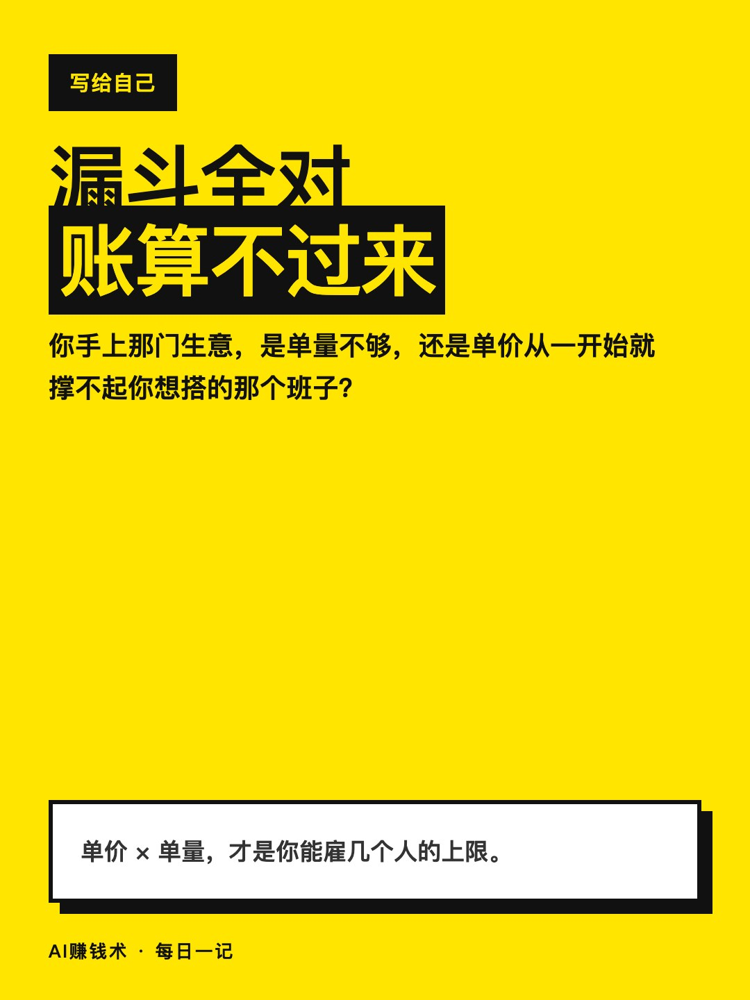

# 100个付费用户，雇不起一个销售

> — · 2026-11-11 09:02 发布 · AI 赚钱内容

## 标题（可直接复制）

```
100个付费用户，雇不起一个销售
```

## 正文（可直接复制发布）

第一个月 100 个付费用户，收 3 万多元。一分钱没投流，靠覆盖关键词带来 2 万多人次搜索、600 多条线索。漏斗每一格都对。然后他算了一笔账，得出的结论是：这些人，养不起一个销售。

一、产品小到一句话能说完

在手机里复制一条笔记的链接，一键改写成自己品牌的笔记，改完直接发。卖月卡，买的人是想起号获客的个人创业者和小商家；另一个工具箱卖给本地商家，产品线就这两条。没有销售，没有客服团队，成交尽量让页面自己走完。产品越小，账越藏不住。

二、获客这一段，他已经做到最省

7 月底开始覆盖关键词，一个月带动 2 万多人次搜索、600 多条线索，投流动作为 0。第一个月月卡约 100 个付费用户，收 3 万多元。后来改成在图文平台的菜单栏里自助购买，每月新增 100+ 付费用户。这套漏斗不是撞出来的，是他把每一格都对齐了才有的结果。

三、他算的是另一笔账

从内容平台来的买家，付费能力大多只有几百元。几百元一单，一个销售一个月的成本要多少单才回得来——具体数字他没写，只写了那句结论：撑不起一个销售。单量再多，也只是把同一笔小钱重复一遍。这是判断，不是抱怨；他把问题定位在定价结构上，不是定位在流量不够上。流量那一段，他其实已经解决得比多数人干净。

四、边界在哪

改自助购买，等于把成交最后一步从人手里拿走，也把客单锁在页面上。帖里还提到累计几百个付费用户、10 万元产品销售收入，但这 10 万累计了多久、含不含另一个产品线，都没展开。他自己也承认，第一批买家里只有很少一部分人后来真把产品用起来。

漏斗全对，不等于结构对。

你手上那门生意，现在是单量不够，还是单价从一开始就撑不起你想搭的那个班子？

## 话题标签

#AI工具 #获客漏斗 #一人公司 #AI赚钱术 #AI赚钱术日记

## 配图（8 张）










## 发布信息

| 项 | 值 |
|---|---|
| 平台 | 小红书 |
| 期数 | — |
| 发布时间 | 2026-11-11 09:02 |
| 正文长度 | 713 字 |
| 图片数量 | 8 张 |
| 状态 | 已发布 |
