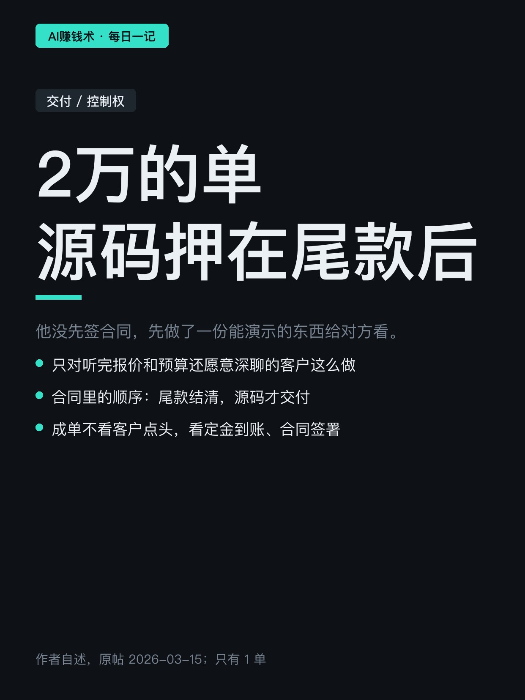
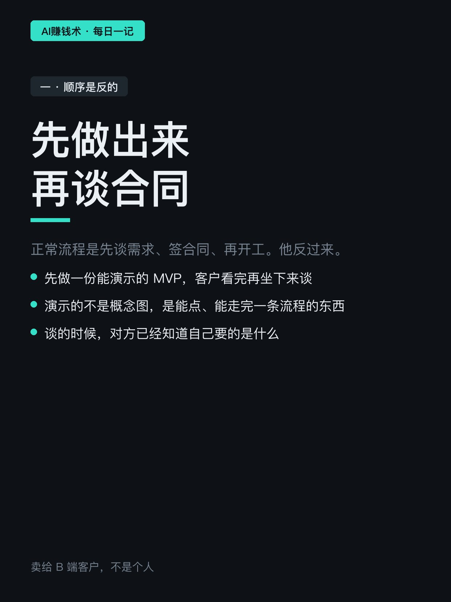
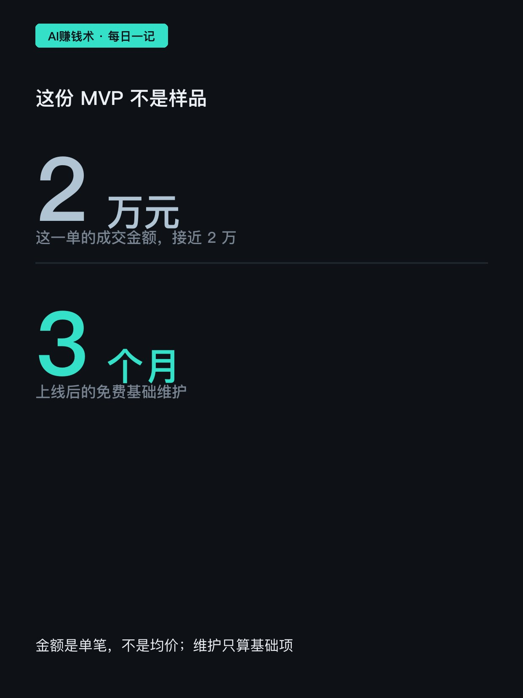
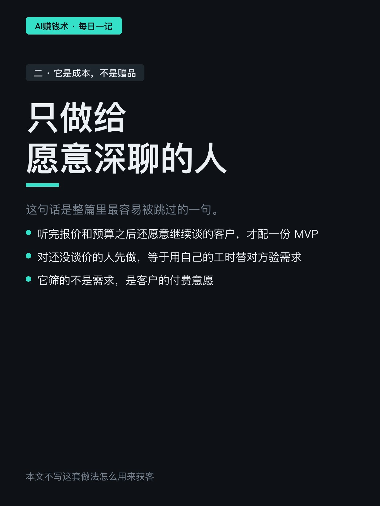
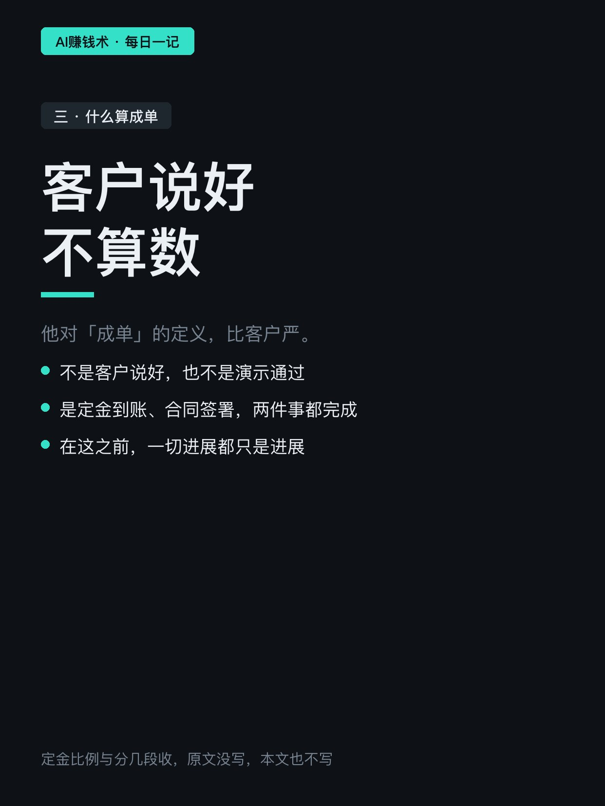
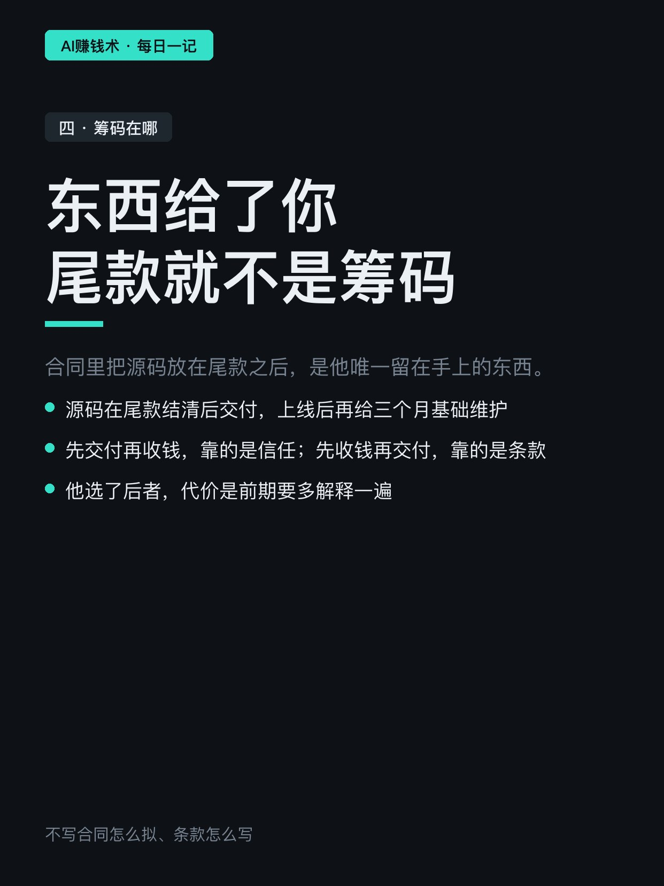
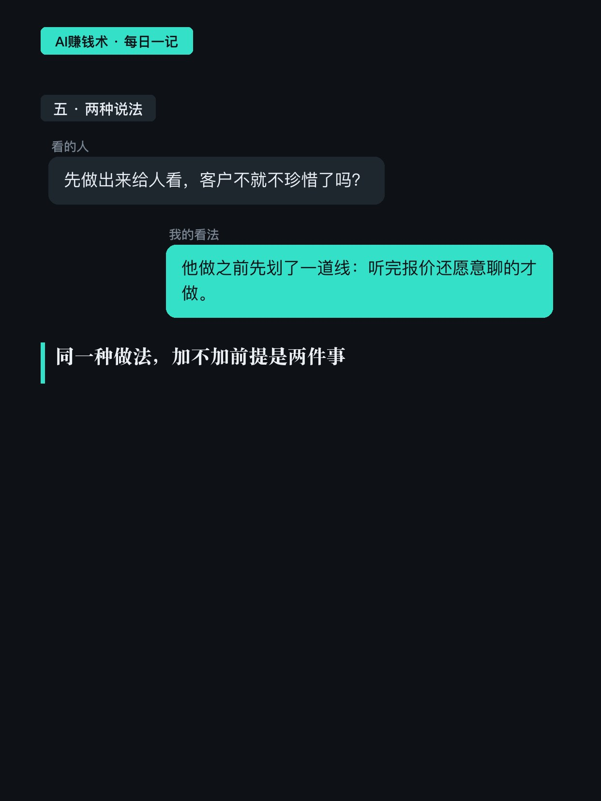
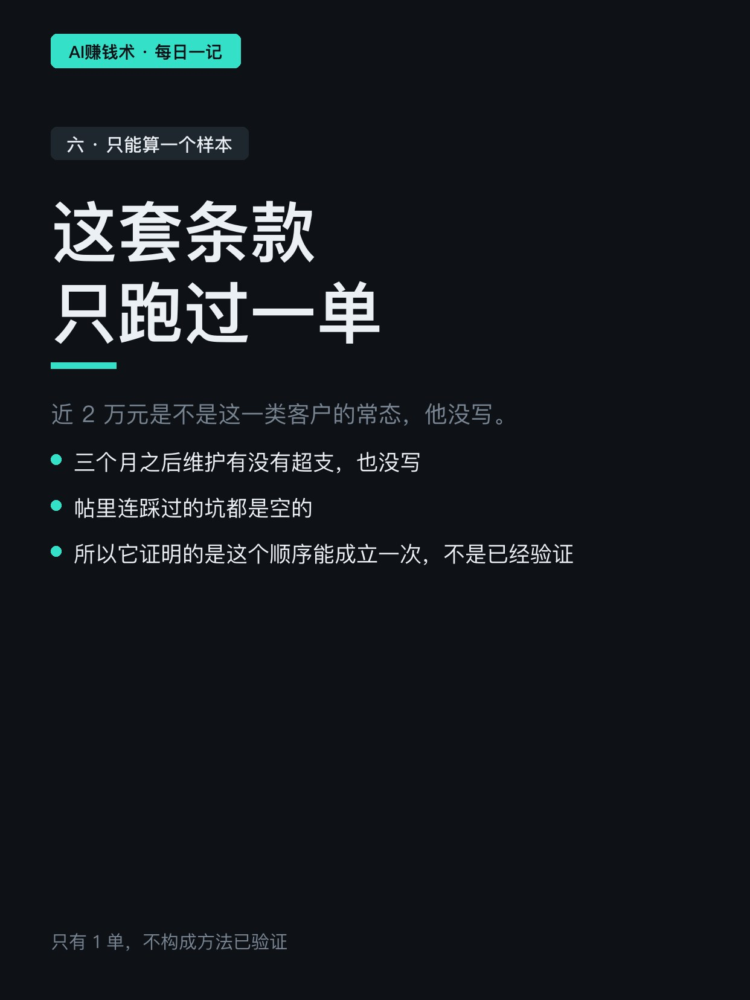

# 2万的单，源码押在尾款后

> — · 2026-11-11 10:02 发布 · AI 赚钱内容

## 标题（可直接复制）

```
2万的单，源码押在尾款后
```

## 正文（可直接复制发布）

他没先签合同。先做了一份能演示的东西给对方看——但源码，要等尾款结清才给。

一、顺序是反的

正常流程是先谈需求、签合同、再开工。他反过来：先做一份能演示的 MVP，客户看完，再坐下来谈。演示的不是概念图，是能点、能走完一条流程的东西。谈的时候，对方已经知道自己要的是什么，也知道这套东西长什么样。

二、这份 MVP 不是样品，是成本

整篇里最容易被跳过的一句是：只对「听完报价和预算之后还愿意深聊」的客户这么做。对还没谈价的人先做，等于拿自己的工时替对方验需求。所以它筛的不是需求，是付费意愿。代价也很清楚：一份能演示的 MVP，等于把交付里最难的那一段先走一遍，做不出来的客户，这段工时就是沉没的。做得出来，是因为他先答应了那条线；没答应那条线的人，做完也收不到钱。

三、什么算成单

他对成单的定义比客户严。不是客户说好，也不是演示通过，是定金到账、合同签署，两件事都完成。在这之前，一切进展都只是进展。这个定义很冷，但它决定了后面所有动作的节奏：没到账之前，不排期、不投入、不承诺上线时间。

四、筹码留在哪

合同里写着：源码在尾款结清后交付，上线后三个月免费基础维护。东西一旦全给了，尾款就不再是筹码。先交付再收钱靠的是信任，先收钱再交付靠的是条款，他选了后者，代价是前期要多解释一遍——客户会问，为什么不能先给。

五、边界

这套条款只跑过一单。近 2 万元是不是这一类客户的常态，他没写；三个月之后维护有没有超支，也没写；帖里连踩过的坑都是空的。所以它证明的是这个顺序能成立一次，不是已经验证过。

东西给出去的那一刻，你手上还剩什么？

你最近一单里，是先给了东西，还是先收了钱？

## 话题标签

#B端交付 #独立开发 #接单 #AI赚钱术 #AI赚钱术日记

## 配图（8 张）










## 发布信息

| 项 | 值 |
|---|---|
| 平台 | 小红书 |
| 期数 | — |
| 发布时间 | 2026-11-11 10:02 |
| 正文长度 | 704 字 |
| 图片数量 | 8 张 |
| 状态 | 已发布 |
