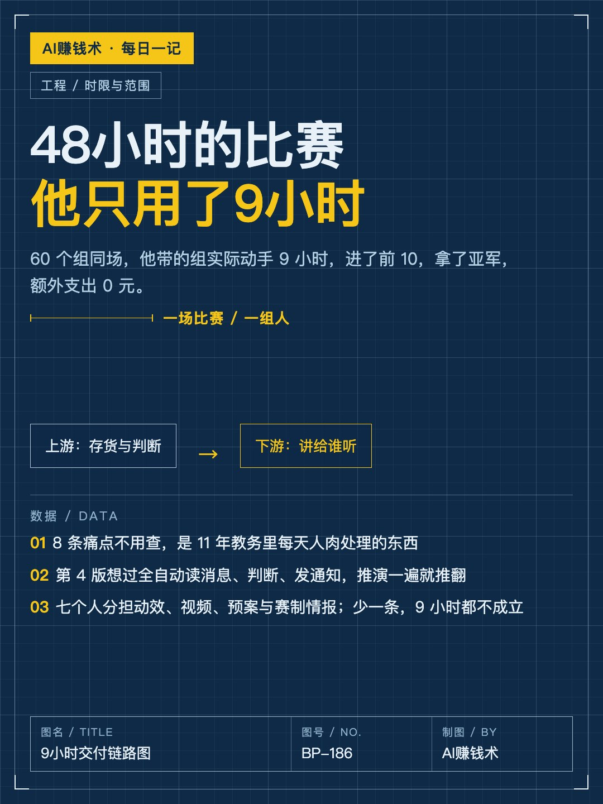
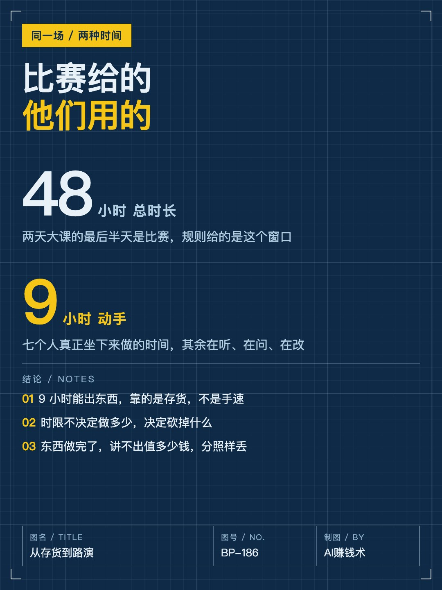
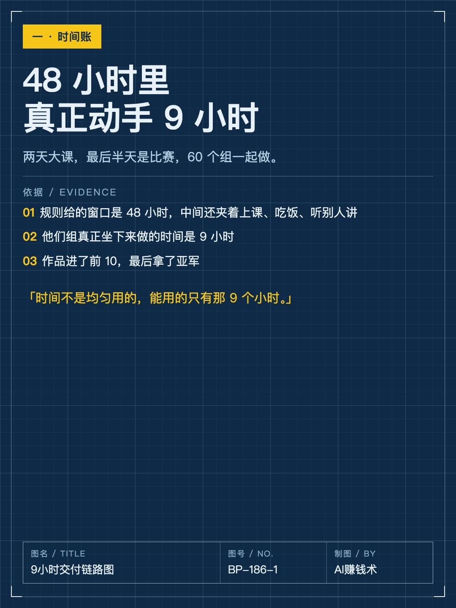
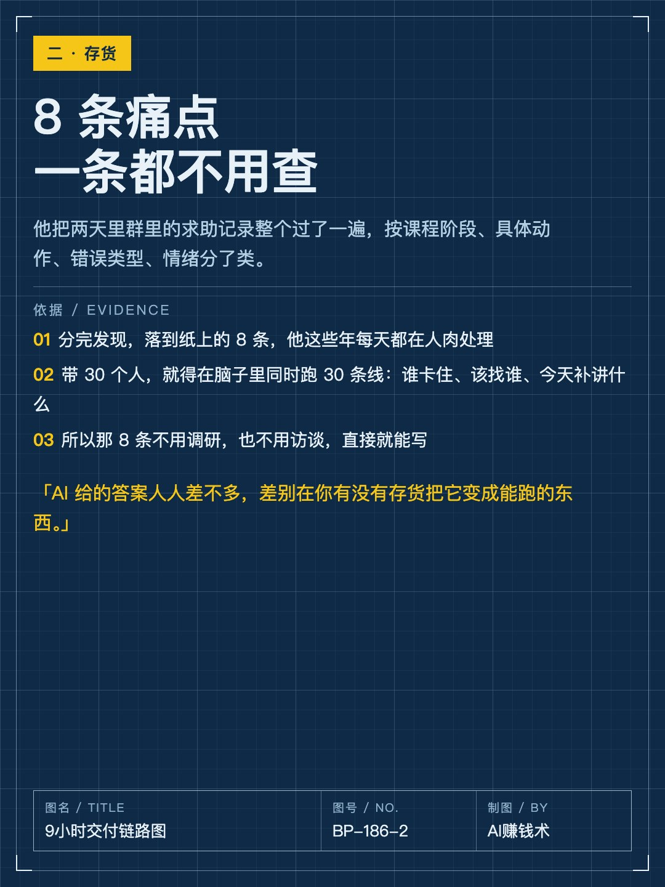
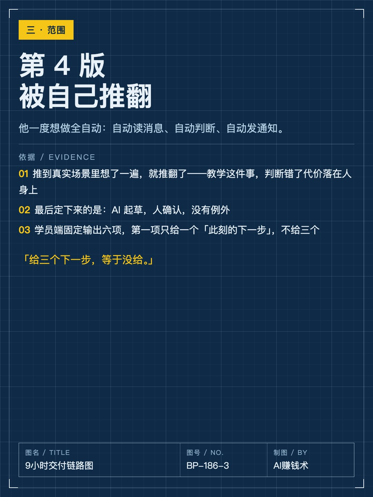
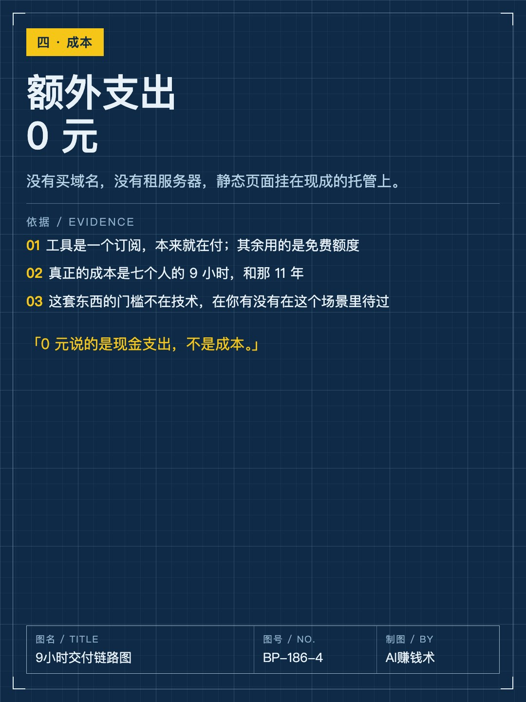
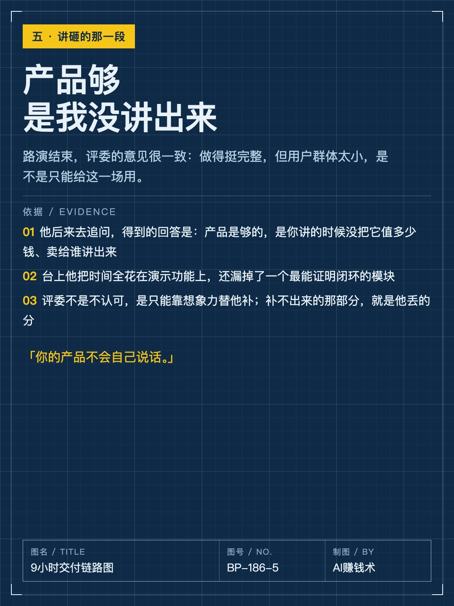
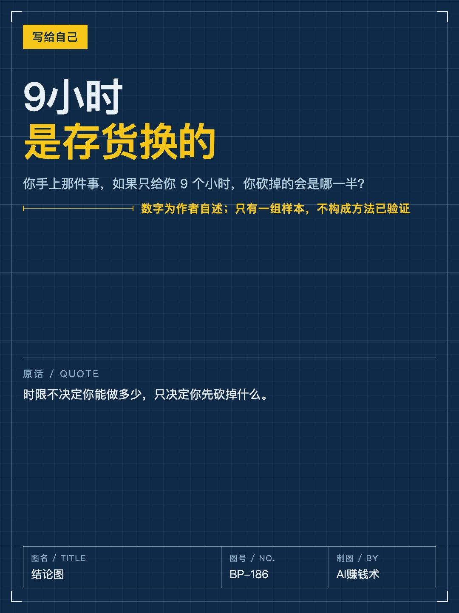

# 48小时的比赛，他只用了9小时

> — · 2026-11-11 11:02 发布 · AI 赚钱内容

## 标题（可直接复制）

```
48小时的比赛，他只用了9小时
```

## 正文（可直接复制发布）

48 小时的比赛，他们组真正坐下来动手的时间是 9 小时。60 个组同场，作品进了前 10，最后拿了亚军，现金额外支出 0 元。

一、9 小时不是手快，是存货

他先把两天里群中的求助记录整个过了一遍，按课程阶段、具体动作、错误类型、情绪分了类，最后落到 8 条。分完才发现，这 8 条他这些年每天都在人肉处理：带 30 个人，就得在脑子里同时跑 30 条线——谁卡住了、这个卡点该找谁、今天要补讲什么、晚上那份汇报怎么写。所以那 8 条不用调研，也不用访谈。

二、时限不决定做多少，决定砍掉什么

他一度想做全自动：自动读消息、自动判断、自动发通知。推到真实场景里想了一遍就推翻——教学这件事，判断错了代价落在人身上。最后定下来的是 AI 起草、人确认，没有例外。学员端固定输出六项，第一项只给一个「此刻的下一步」，不给三个：给三个，等于没给。

三、东西做完了，讲不出来照样丢分

路演结束，评委的意见很一致：产品挺完整，但用户群体看着太小，是不是只能给这一场用。他后来去追问，得到的回答更扎人——产品是够的，是你讲的时候没把它值多少钱、卖给谁讲出来。台上他把时间全花在演示功能上，还漏掉了一个最能证明闭环的模块。评委不是不认可，是只能靠想象力替他补。

四、这套前提少一条都不成立

七个人分担了动效、视频、预案和赛制情报；方法是课上现成的；工具是一个本来就在付的订阅；他是组长，所以看得见每个人卡在哪。这些条件凑齐了，9 小时才成立。他自己写下的那句是：门槛不在技术，在你有没有在这个场景里待过。

0 元说的是现金支出，不是成本。真正的成本是那七个人的 9 小时，和之前的 11 年。

你手上那件事，如果只给你 9 个小时，你先砍掉的是哪一半？

## 话题标签

#AI产品 #黑客松 #交付 #AI赚钱术 #AI赚钱术日记

## 配图（8 张）










## 发布信息

| 项 | 值 |
|---|---|
| 平台 | 小红书 |
| 期数 | — |
| 发布时间 | 2026-11-11 11:02 |
| 正文长度 | 730 字 |
| 图片数量 | 8 张 |
| 状态 | 已发布 |
