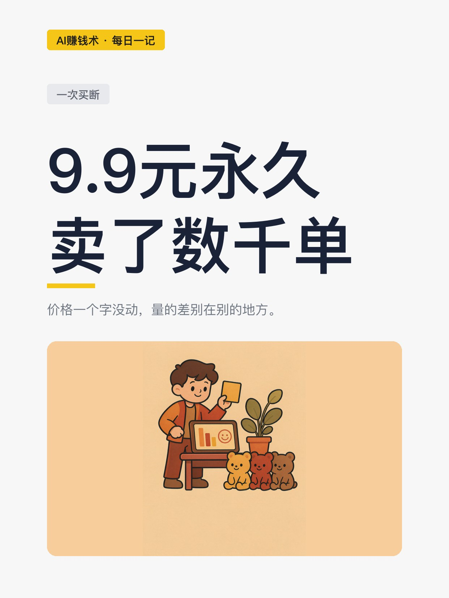
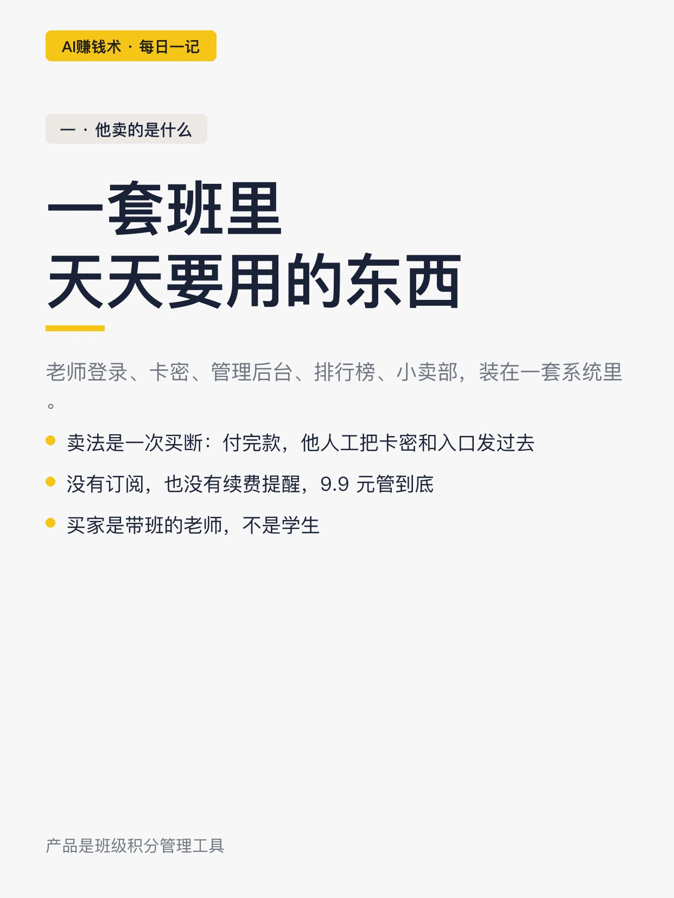
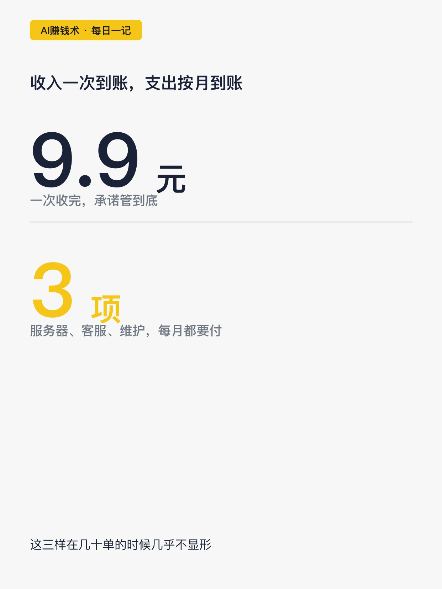
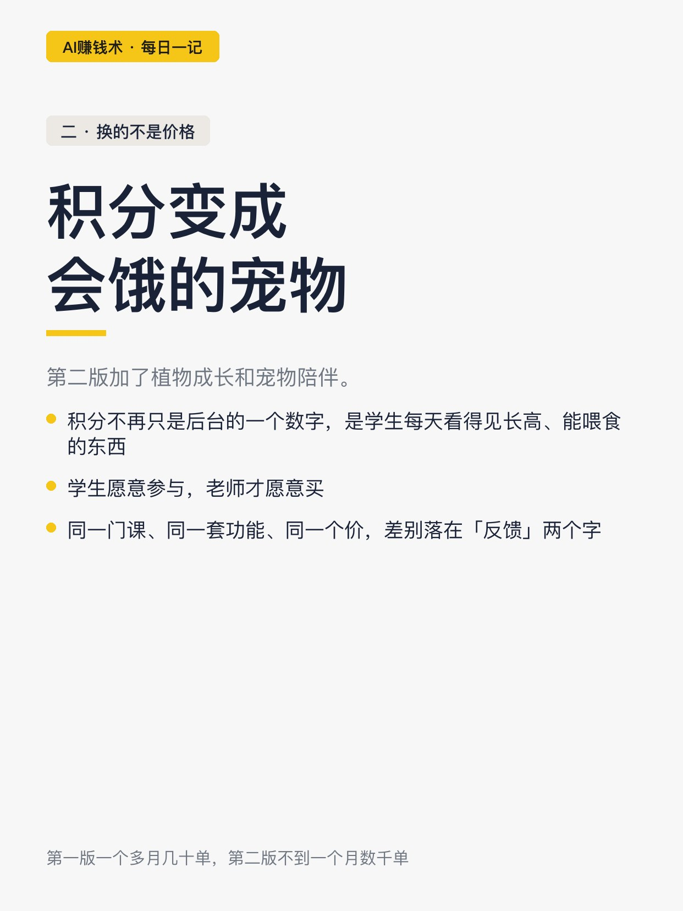
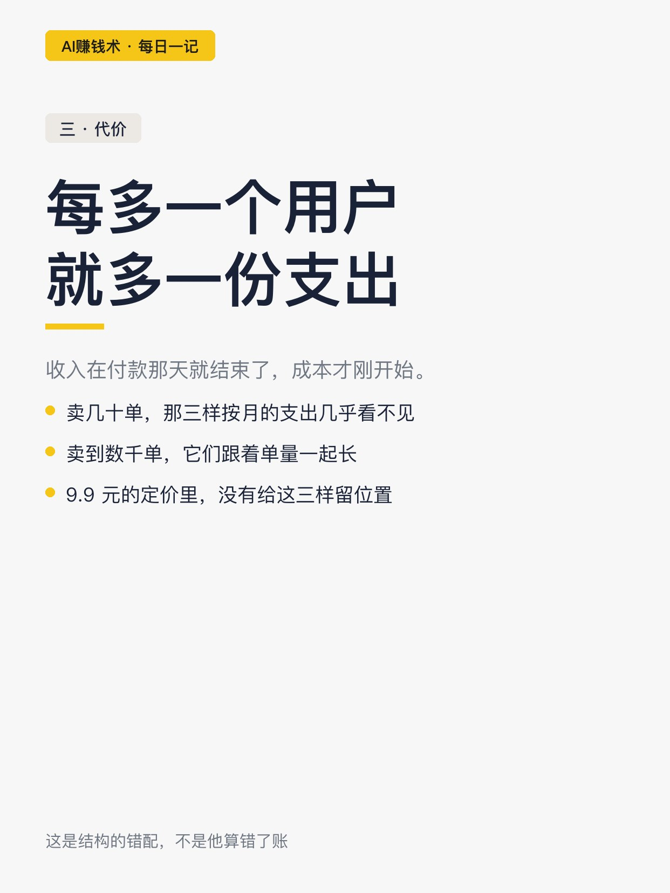
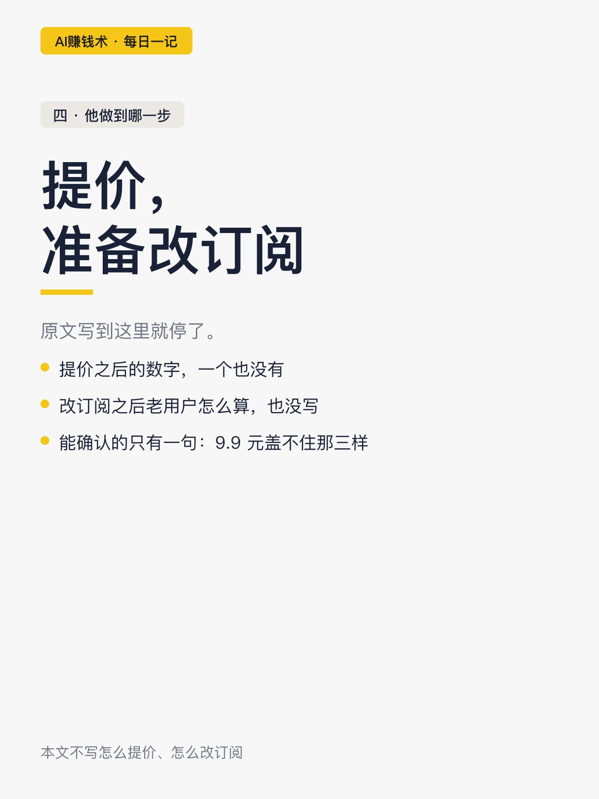
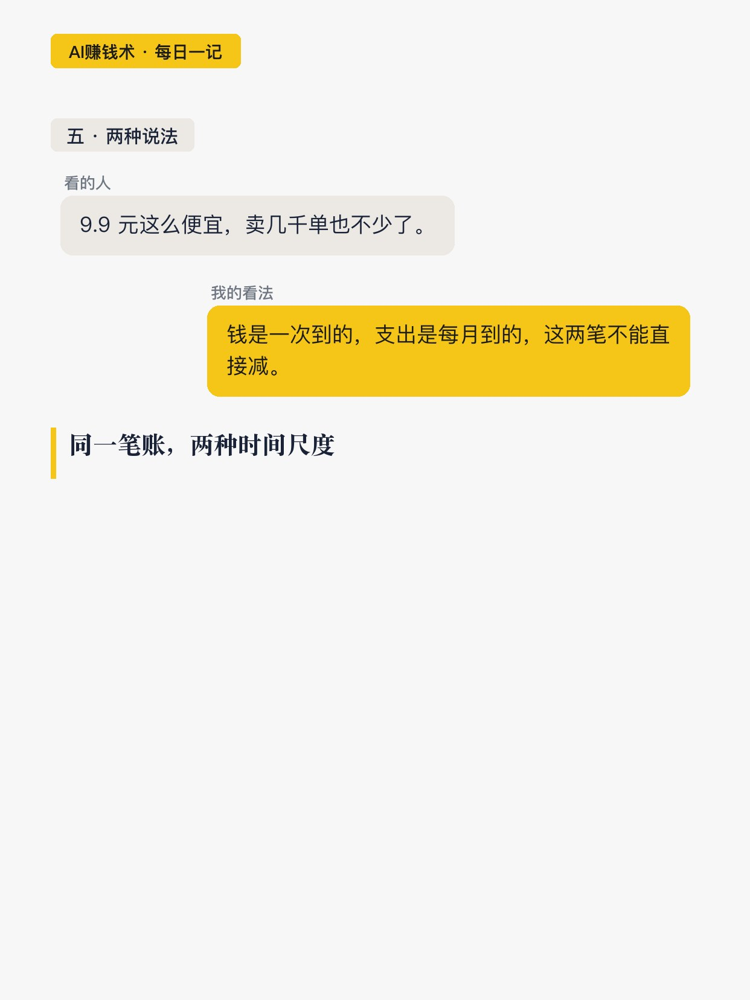
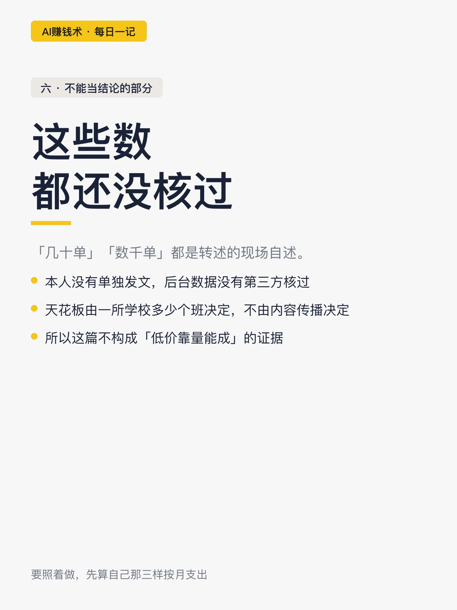

# 9.9元永久，卖了数千单

> — · 2026-11-11 08:02 发布 · AI 赚钱内容

## 标题（可直接复制）

```
9.9元永久，卖了数千单
```

## 正文（可直接复制发布）

9.9 元，永久使用。第一版上线一个多月，只卖了几十单。后来他把积分换成会长的植物、会饿的宠物，不到一个月卖了数千单。价格一个字没动。也就是那时候他发现：卖得越多，欠得越多。

一、他卖的是一套班里天天要用的东西

老师登录、卡密、管理后台、排行榜、小卖部，都装在一套系统里。卖法很土：一次买断，买家付完款，他人工把卡密和入口发过去。没有订阅，没有续费提醒，9.9 元管到底。买的人是带班的老师，不是学生——学生只看得见排行榜上的名字。

二、换版本换的不是价格，是「学生看不看得见」

第一版一个多月，几十单。第二版加了植物成长和宠物陪伴：积分不再只是后台里的一个数字，而是学生每天能看见长高、能喂食的东西。学生愿意参与，老师才愿意买。同一门课、同一套功能、同一个价格，量的差别就落在「反馈」这两个字上。这不是产品能力变了，是同一件事被看见的方式变了。

三、9.9 元盖不住三样按月的支出

服务器、客服、维护。收入在付款那天一次性到账，这三样是每个月都要付的。卖几十单的时候，它们几乎不显形；卖到数千单，它们跟着单量一起长。这不是他算错了账，是这套定价从第一天起就没给它们留位置。他后来的处理是提价，也在准备改成订阅——原文写到这里就停了，提价之后的数字一个也没有。

四、哪些不能当成结论

「几十单」「数千单」都是转述的现场自述，本人没有单独发文，后台也没核过。而且这套东西的天花板，由一所学校有多少个班决定，不由内容传得多远决定。所以这篇不是「低价靠量能成」的证据，只是一个时间错配的例子。

9.9 元卖的不是一套工具，是「以后都归我管」这句话。钱在付款那天一次到账，承诺从那天起按月扣款。

你手上有没有那种「一次收完、却要一直管」的东西？

## 话题标签

#AI工具 #一次买断 #成本结构 #AI赚钱术 #AI赚钱术日记

## 配图（8 张）










## 发布信息

| 项 | 值 |
|---|---|
| 平台 | 小红书 |
| 期数 | — |
| 发布时间 | 2026-11-11 08:02 |
| 正文长度 | 728 字 |
| 图片数量 | 8 张 |
| 状态 | 已发布 |
