# 收藏夹越攒越厚，能用的还是零

> — · 2026-11-11 12:32 发布 · AI 赚钱内容

## 标题（可直接复制）

```
收藏夹越攒越厚，能用的还是零
```

## 正文（可直接复制发布）

「我记得我看过那篇，但想不起来在哪儿。」

这是松月的原话。他每天读的东西很多，长文平台一个收藏夹，笔记软件一个，网页一个，聊天记录又是一个。看见好东西就点收藏，心里想的是：这个以后一定要认真读一遍。然后就没有以后了。

一个月后真要用它，只记得看过，不记得在哪。于是回去翻收藏夹，翻聊天记录，翻转发，翻到一半又刷到十条新的，一抬头两个小时过去了，正事忘了。

他自己做了个小东西来改这件事。我把他这套流程拆成四格看，比听方法清楚。

先说原理：真正的卡点不在收藏夹。收藏这个动作，是整条链里唯一有反馈的一步——点一下，界面立刻告诉你已收藏。而读和用这两步，没有任何东西逼你回来。所以一条信息在第二格就停死了，后面两格是空的，你还以为自己存下了东西。

再说代价：他试过给每个平台建文件夹、加标签。收一条要决定放哪个文件夹、打什么标签、属于哪一类，五件事。看起来很整齐，用起来很累，累到某一天，看见好东西也不想收了。他自己的说法是，系统设计得越复杂，越容易停在整理得很漂亮那一步。

他后来的做法是反过来：先砍掉分类，只留一个入口，一个只有自己在的群，看见什么就丢进去。丢的时候顺手写十几个字，这能干什么。比如这个案例可以进案例库，这个开头以后能参考。整理交给机器，机器把正文读一遍，拆成标题、来源、要点，存进同一张表，按词就能搜出来。前面再做一个只给自己看的页面，像刷信息流一样读。

但边界也在这里：机器只能整理，不能替你判断。只搬正文的库，一个月后你搜得到、点开看不懂，因为当初为什么存它，那句话没了。他补的那十几个字，其实存的是当时的判断。

他最后留了两条流：一条是自己随手收，解决什么让我感兴趣；一条是让机器定时抓，扫他划好的范围，解决什么我不该漏。只留一条，要么漏掉，要么被推荐算法带着走。

我的判断是，这不是工具问题，是流程里少了读和用这两格。工具换十个，格子还是空的。

你收藏夹里最近一次真的用上的，是哪一条？它当时为什么值得存，你现在还说得出来吗？

## 话题标签

#AI赚钱术日记 #信息管理 #知识库 #内容创作 #一人公司

## 配图（12 张）

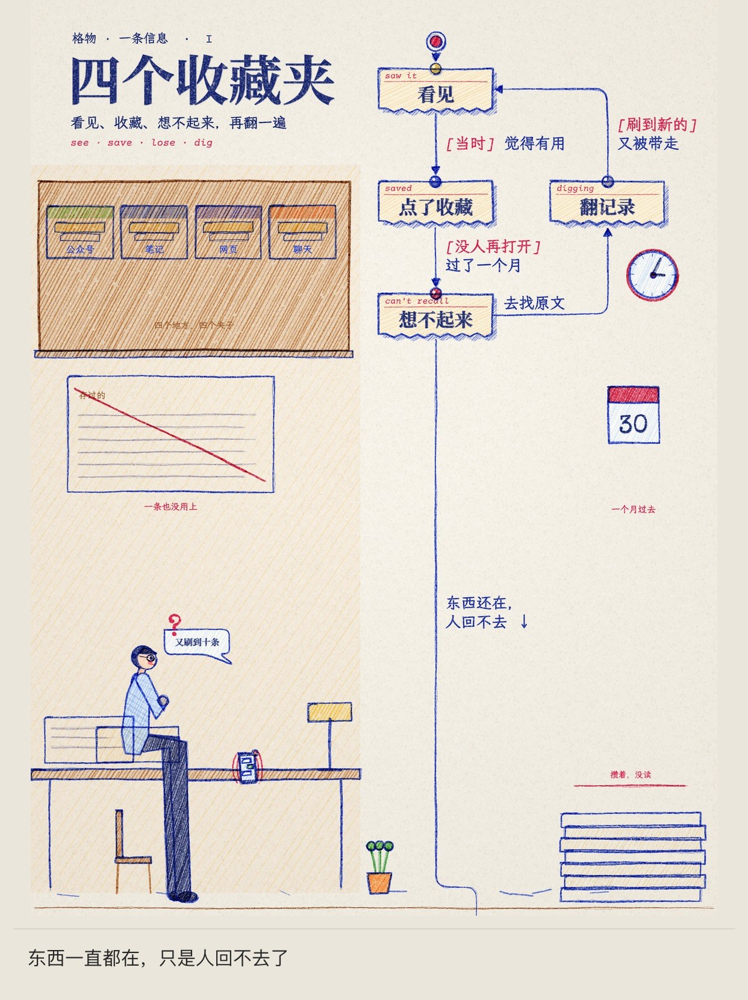
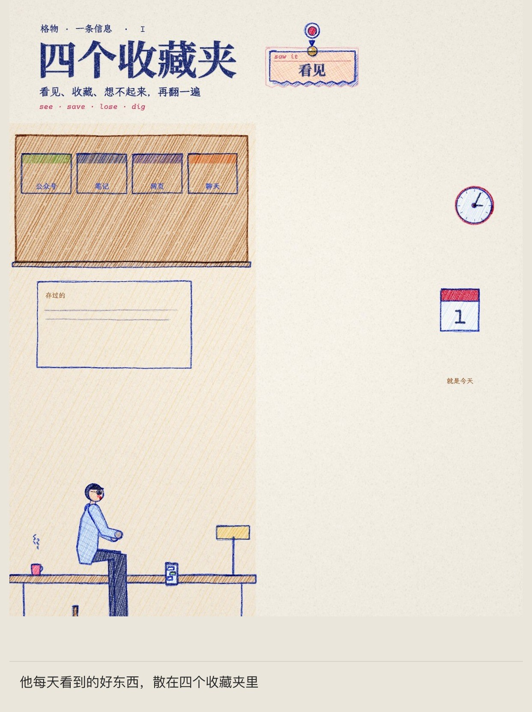
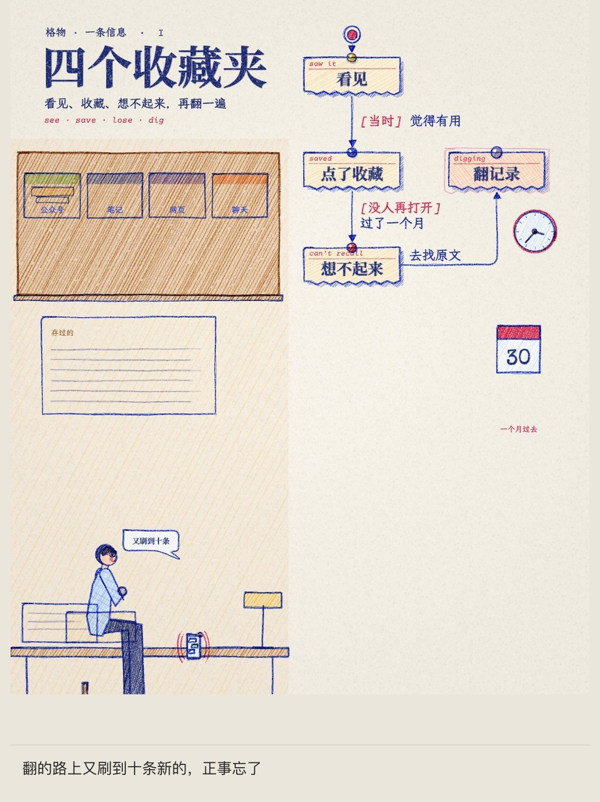
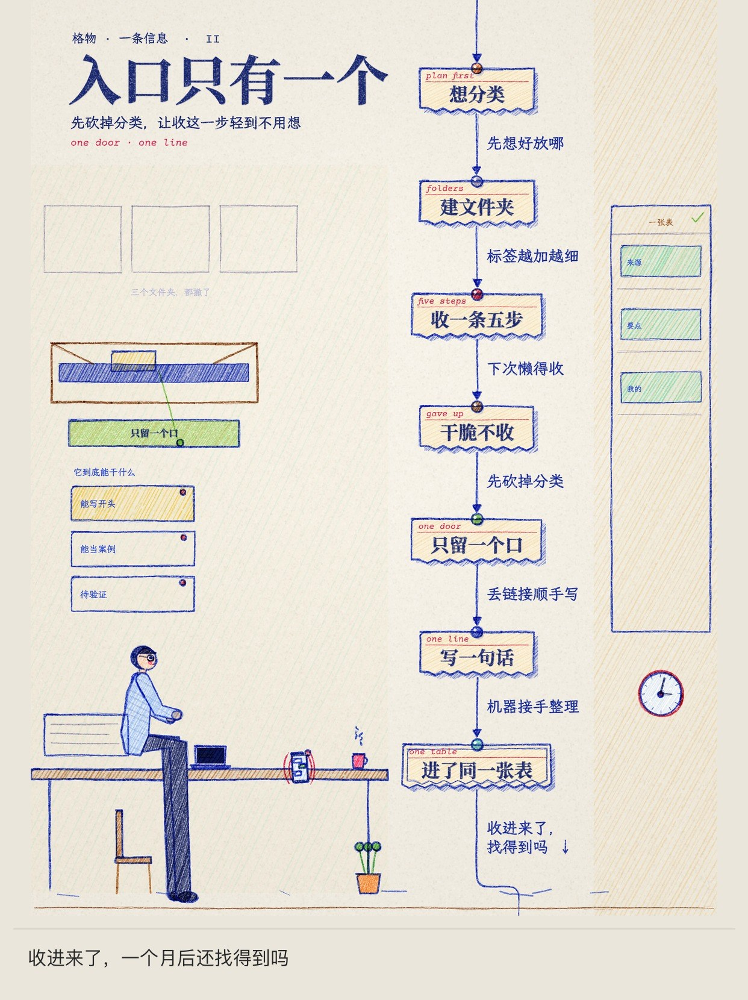
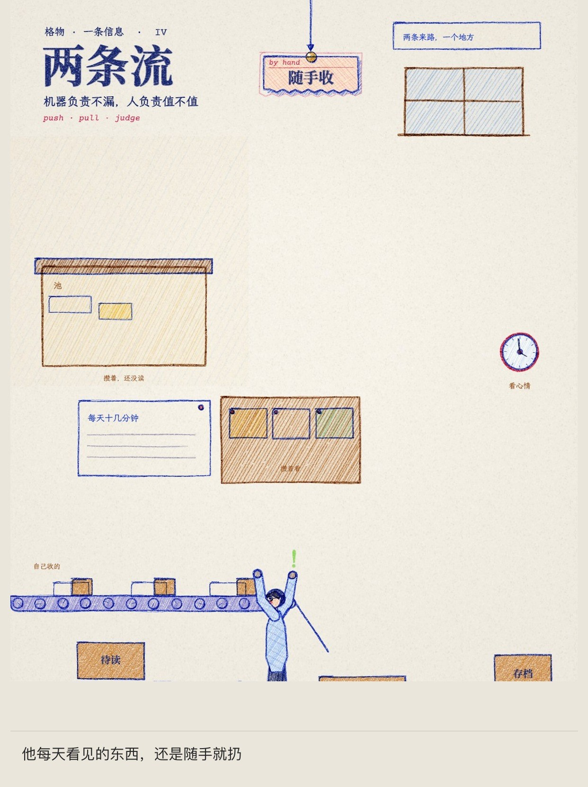
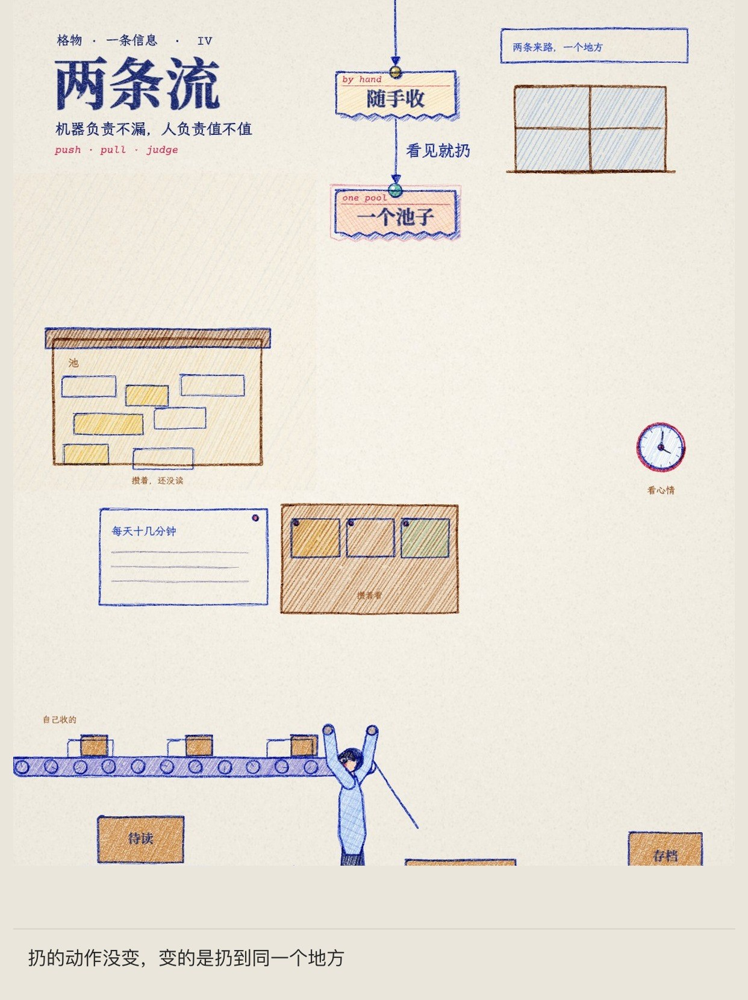
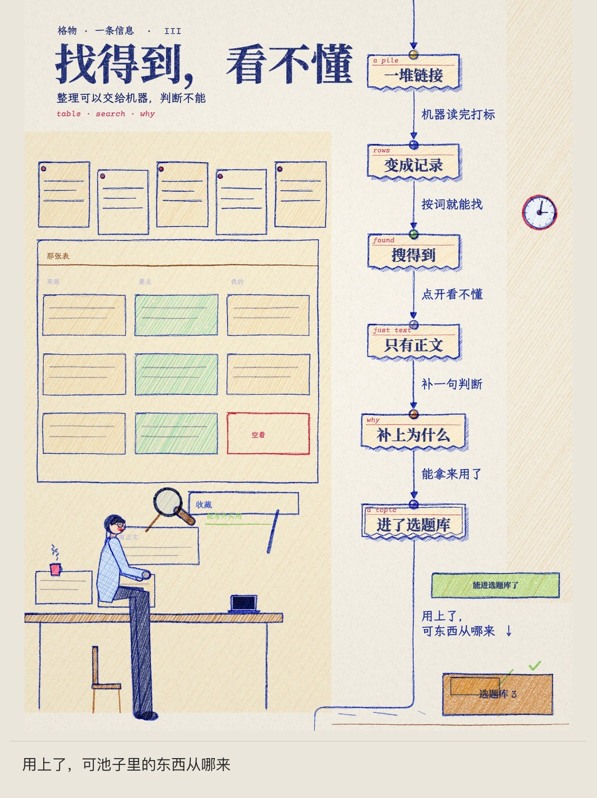
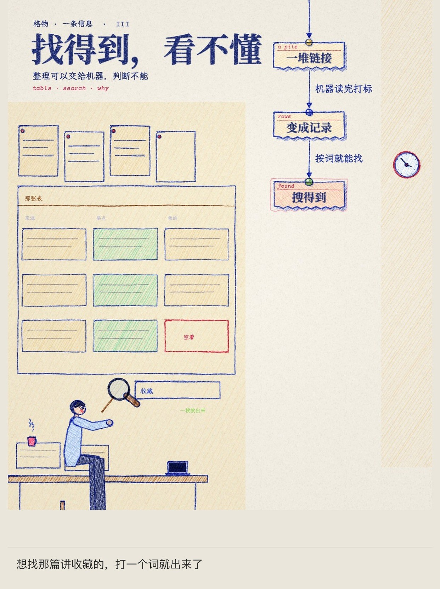
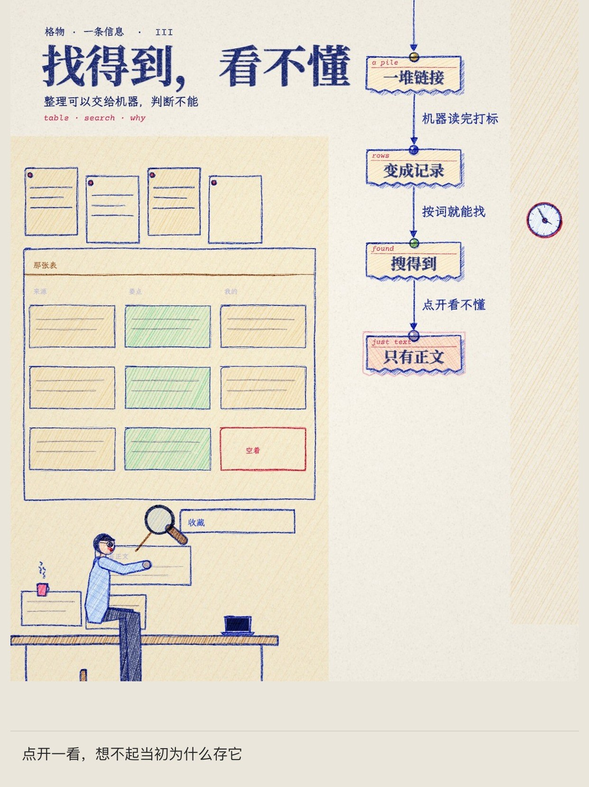
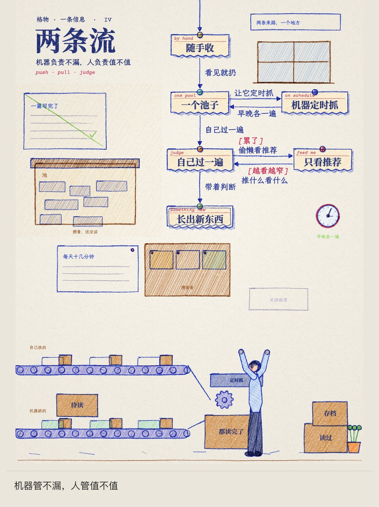
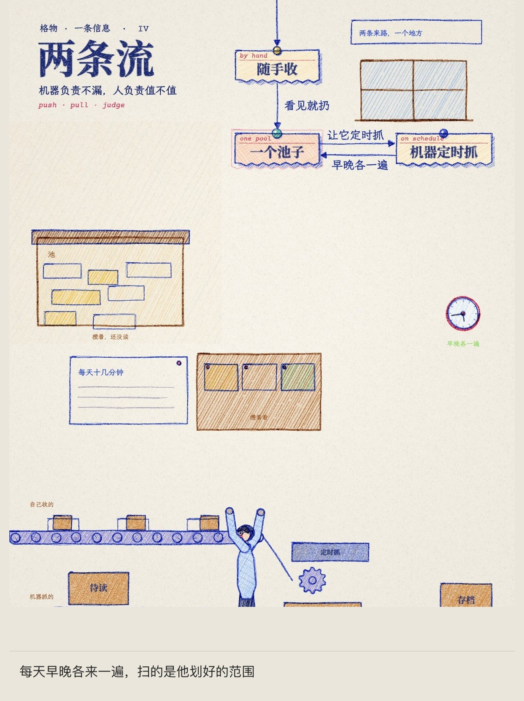
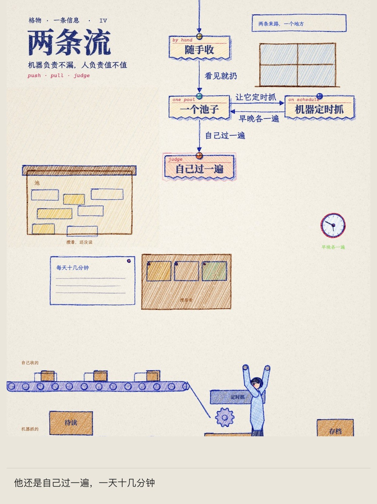

## 发布信息

| 项 | 值 |
|---|---|
| 平台 | 小红书 |
| 期数 | — |
| 发布时间 | 2026-11-11 12:32 |
| 正文长度 | 836 字 |
| 图片数量 | 12 张 |
| 状态 | 已发布 |
