# 200次曝光0咨询，先别换品

> — · 2026-11-12 12:32 发布 · AI 赚钱内容

## 标题（可直接复制）

```
200次曝光0咨询，先别换品
```

## 正文（可直接复制发布）

第一单 50 块，一页 PPT。资料是客户给的，他 20 分钟做完，却压了一个小时才发出去。原因很实在：交得太快，客户会觉得不值。

邓兴超做了十年广告投放，累计经手两亿多预算，今年从公司出来单干。6 月中到 7 月中，他拿一个月试了代做 PPT、代写、商业计划书。按他自己报的数：一个月收入 9000 多，投流花了 3000 多，投一返三；加上好友的 70 多人；小单均价 100 出头，企业定制 2000 往上，商业计划书 3000 往上。获客九成半来自一个二手交易平台。

这条链上，每一格都有一个数。

第一格叫没量。新号上架，第一关不是成交，是链接还活不活：他撞上一句敏感描述，商品当场被下架。删掉那句重上，等两天，曝光只有几十到一百多，点进来几个人，一个开口问的都没有。到这一步多数人会去改产品，他没有——一两百次曝光判断不了哪个品能卖，他直接把钱花在曝光上。投流开的当天，第一个咨询就进来了，成交的就是那 50 块。

第二格叫有量没开口。他把从曝光到成交拆成四段，每段记一个数：曝光到点击 3 到 4 个点；点进来的人里开口的 10 到 15 个点；问的人里加上好友的 40 到 50 个点；好友里成交的 30 到 50 个点。这几组是他自测的经验值，不是行业标准。够不到哪一格就只修那一格：点击不够，先改主图和标题，别动价格；开口不够，把商品描述的前两句改成「你能拿到什么」；加上好友不够，第一句话别报价，先问他要什么。

第三格叫有单不会算。同样一单：100 元的，流量花 50，交付 30，剩 20；500 元的，流量 150，交付 50，剩 300。这笔账他直接用来决策：赚钱的加预算；不上不下的设三天期限，到期汇总一次再定；连着亏的直接停，不再往里垫。

卡在哪：他说这是阶段性验证，不是能复制的项目。7 月开始把活包出去，利润率从 53% 掉到 35%，返工和退单都发生过。一个月、70 多个好友，样本就这么大，数字只能当参考。

我没做过这门生意。你现在这条链接，卡在第几格？曝光、点击、开口、好友、成交，这五个数你手上有几个？缺哪个就先补哪个，别急着换品。

## 话题标签

#AI赚钱术 #AI变现 #案例拆解 #副业 #接单 #转化率 #AI代做

## 配图（12 张）

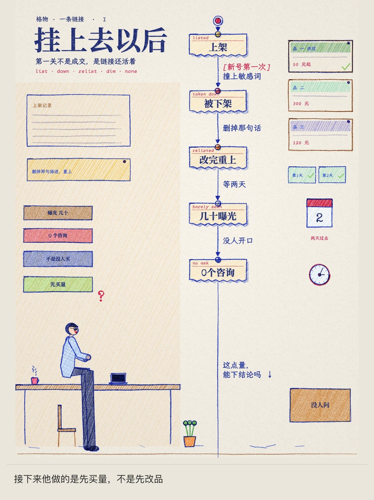
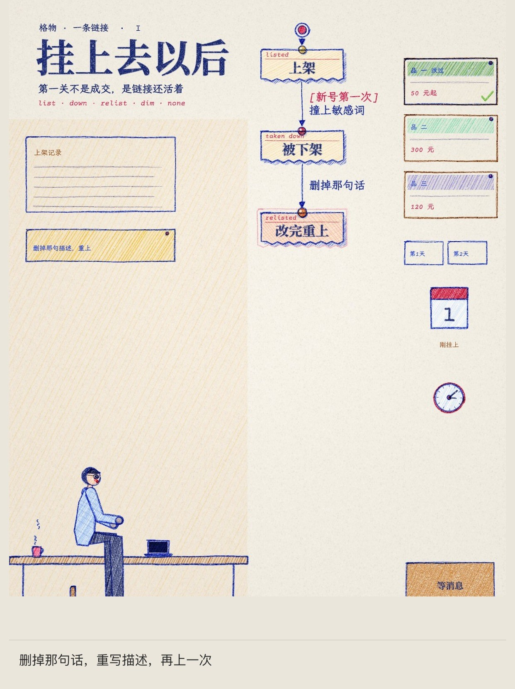
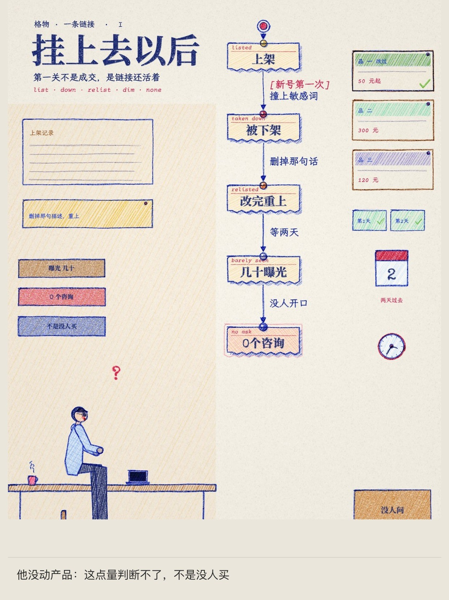
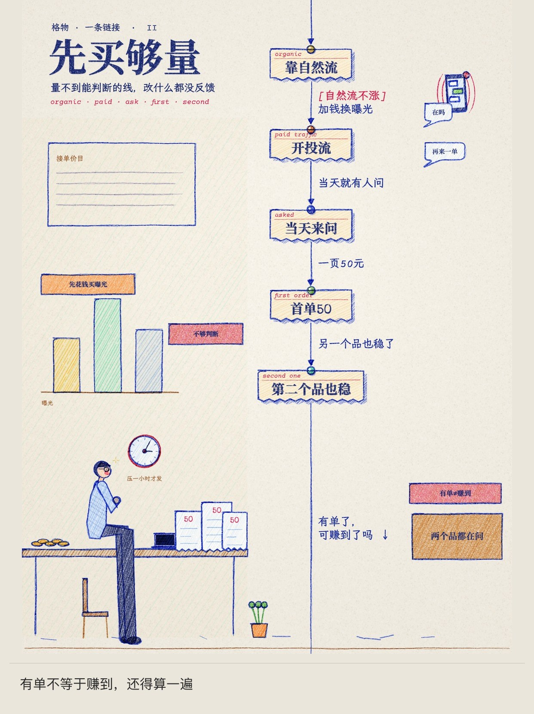
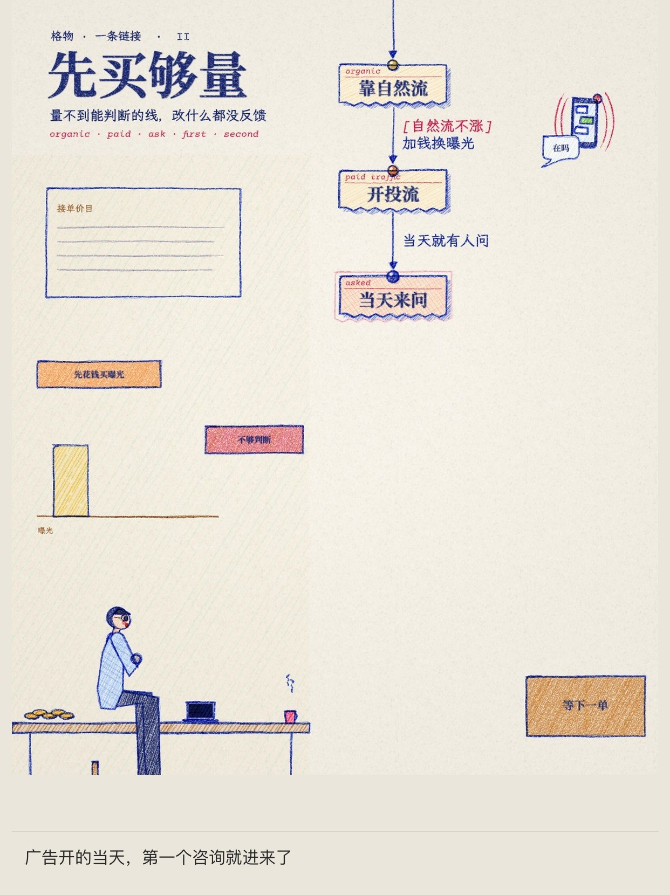
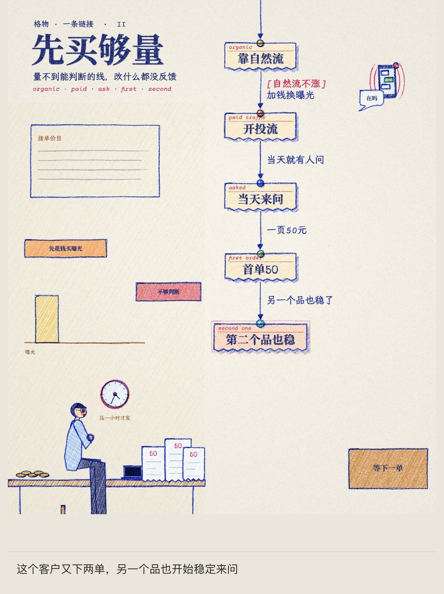
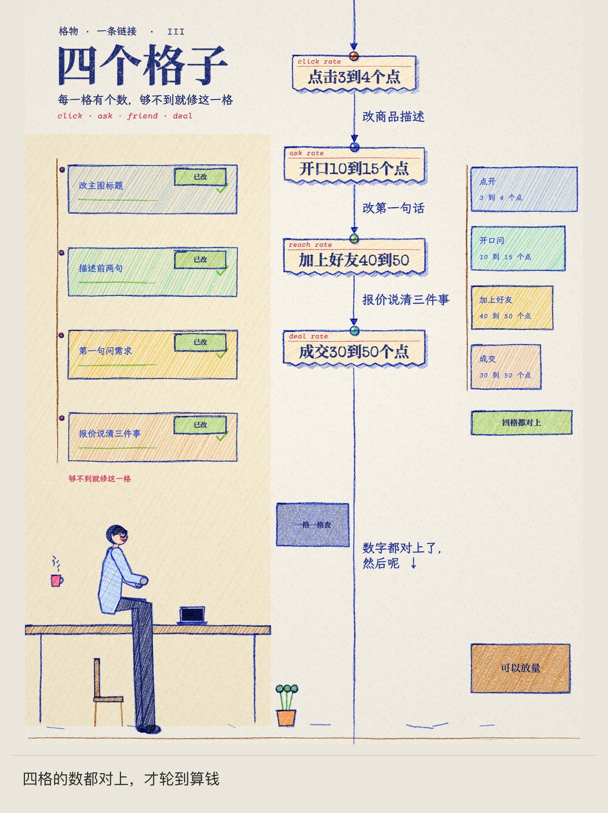
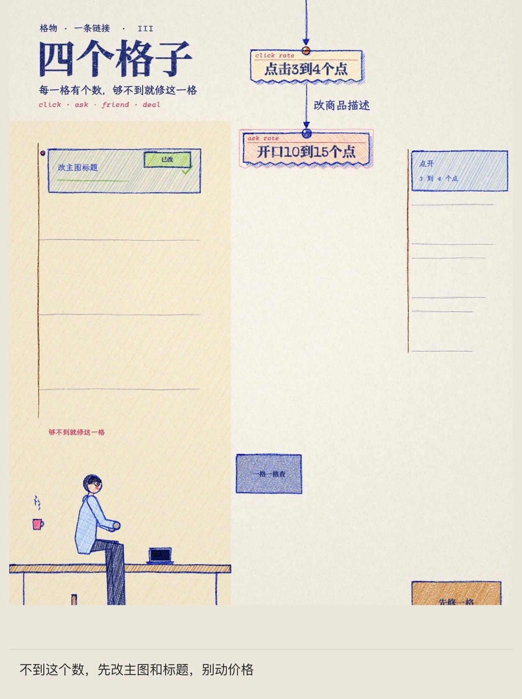
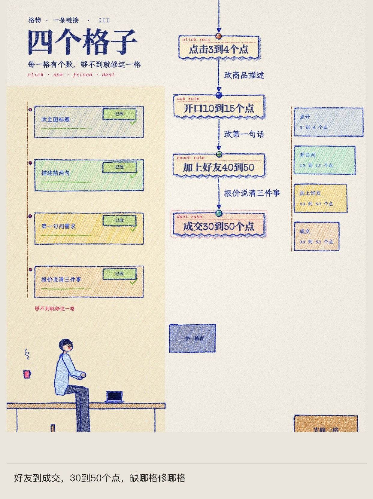
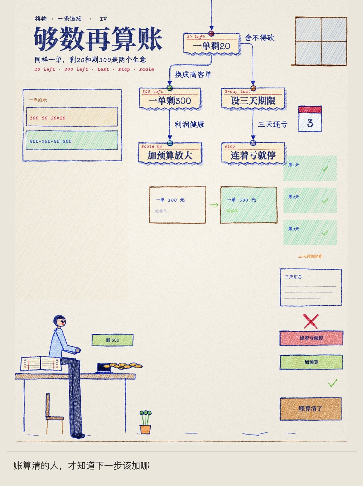
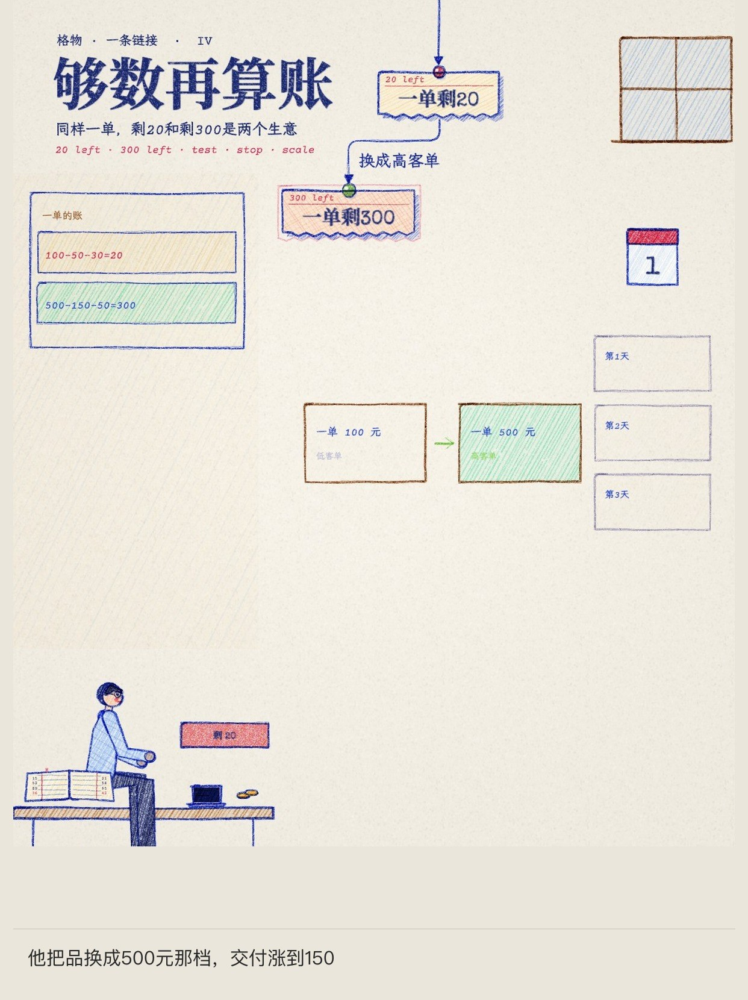
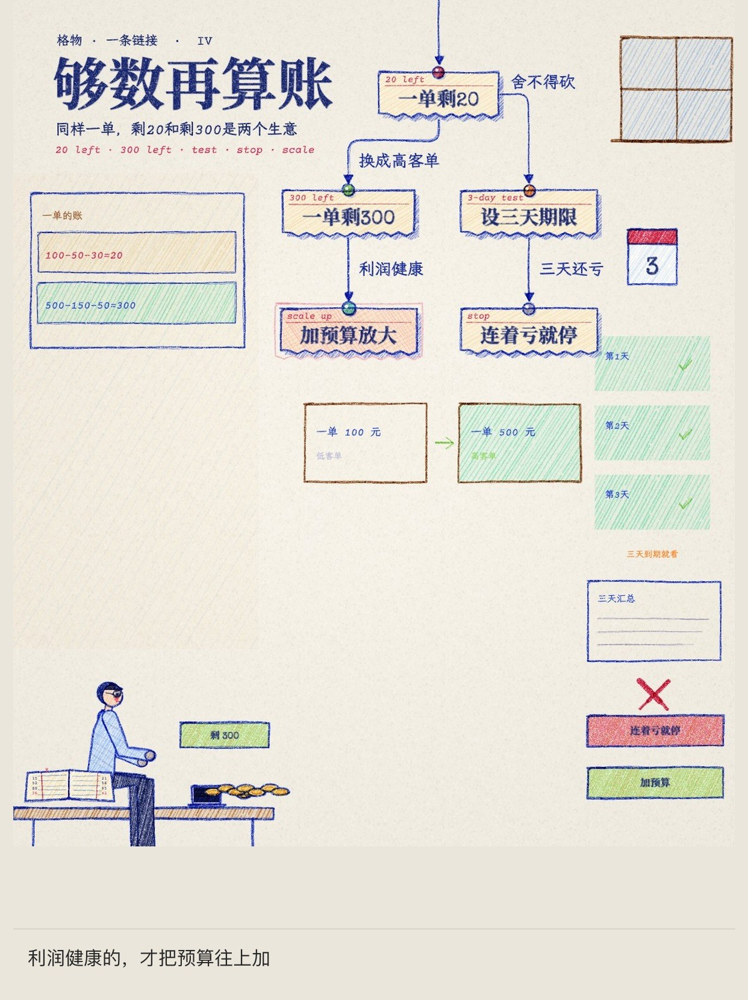

## 发布信息

| 项 | 值 |
|---|---|
| 平台 | 小红书 |
| 期数 | — |
| 发布时间 | 2026-11-12 12:32 |
| 正文长度 | 894 字 |
| 图片数量 | 12 张 |
| 状态 | 已发布 |
