# 剪过20条，接了一门教剪辑的课

> — · 2026-11-13 12:33 发布 · AI 赚钱内容

## 标题（可直接复制）

```
剪过20条，接了一门教剪辑的课
```

## 正文（可直接复制发布）

她剪过的片子加起来不到 20 条，蒙版、关键帧都没碰过。客户追加的这门课，要教的正是剪辑。这活她接了，几天备完，进账 2 万多（按她自己的说法）。

小圆，企业 AI 培训讲师，客户是一家国企的老客户。一门课几个小时，全要自己上手演示，还得带着学员一步步做。她不是剪辑师，这单也不是按剪辑师的价格报的——2 万多是一整门课的钱。

第一格：需求落在你不会的那块。
变的条件很具体：这些需求能不能收成 2 到 3 类。她的做法是先跟客户把 3 件事问清——学员什么基础、要剪哪几类片、要达成什么目的。问完她判断：基础一般、片子集中在 2 到 3 类，能收成一套流程，于是接；同时当场把期待说清：教的是提效，不是把人剪成大师。你可以照着自查：手上那个不熟的活，你是先报了价，还是先把这 3 件事问回来？问完发现有八类片子、学员水平参差，就先别接。

第二格：有结构，没手感。
变的条件是手上真有一份能排进几天的步骤。她把三样一起喂给一个 AI 问答工具：我的底子、客户是谁、还剩几天。她的观察是，时间说得越极限，给的越具体。出来的是“一二三四”，几天怎么排心里先定了。但结构不等于手感——这一步她拿到了课表，手上还是空的。

第三格：手感从哪来。
变的条件是你自己能独立剪完一条。她没报几千块的课，而是在一个二手交易平台上找了两个正在接单的剪辑师，让她们先拿客户的真实素材剪一遍，再一对一投屏讲怎么剪。两个人一共不到 300 块，她们平时剪一条 20 到 30。判定很简单：自己能复现，才算过了这一格。大多数人跳过这格直接上台，现场演示一崩，整堂课就废了。

卡在哪：卡在生产，不在讲。她提前做好的模板，在那个剪辑软件里不支持复制，一打开就乱码，处理了一个下午。她的处理是先喊停、安抚两个人、把动作拆碎重来；后来多找了模板，也给了超出预期的报酬，两个人留成了长期的线上帮手。另一个她自己说的限制是，客户是国企，很多国外工具用不了，只能教土办法。

交付完一个月，企业自己办了一场视频比赛，交上来 56 份成品——第一次上课时，这些人还是第一次在电脑上装那个软件。这门课能成，不是因为她会剪辑，是因为她把“不会”拆成了 3 个能验证的格子：能不能收成类、有没有步骤、能不能自己复现。3 个缺 1 个，课就讲不成。

你现在手上那个不熟的活，卡在哪一格？

## 话题标签

#AI赚钱术 #AI变现 #案例拆解 #企业培训 #交付 #技能变现 #剪辑

## 配图（12 张）

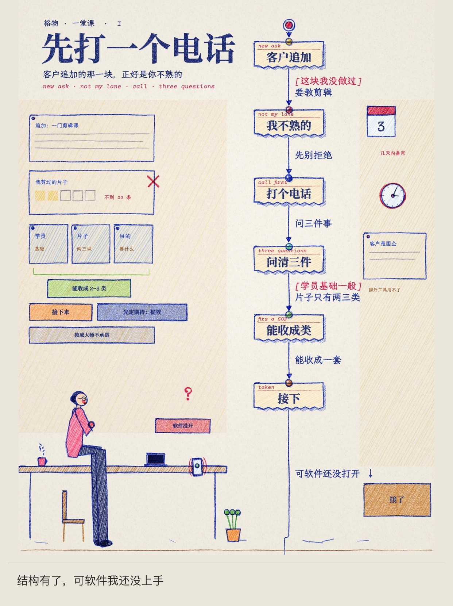
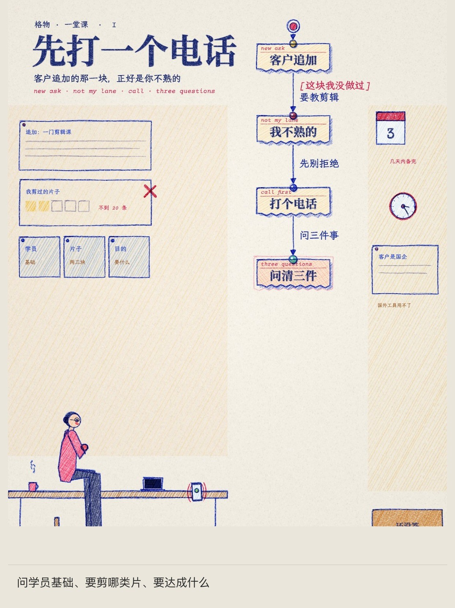
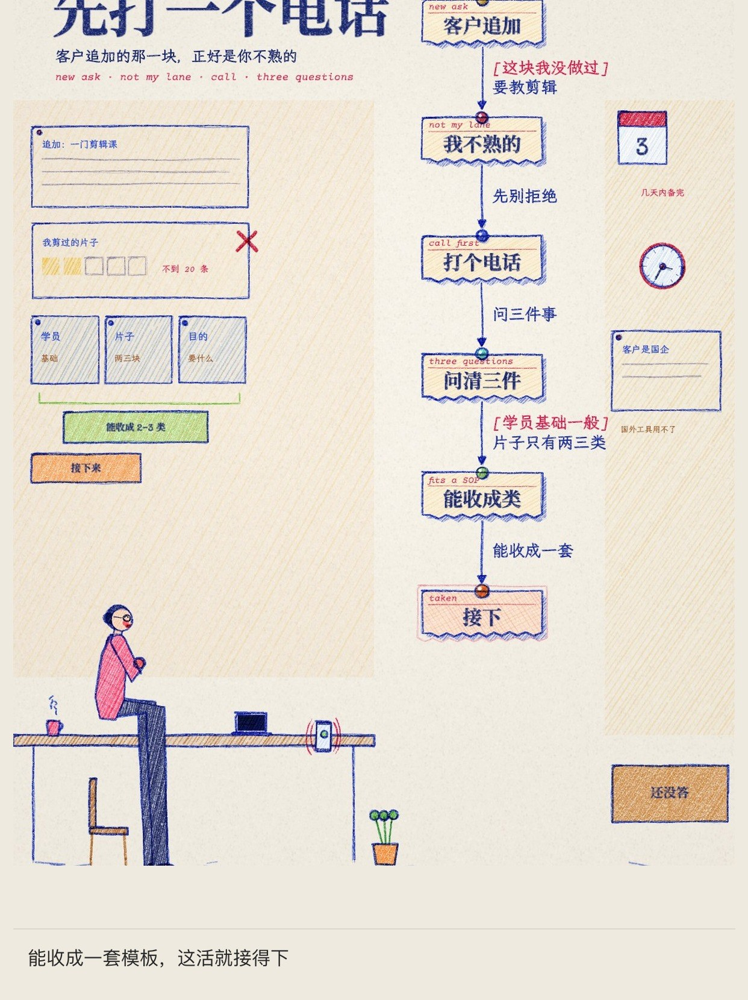
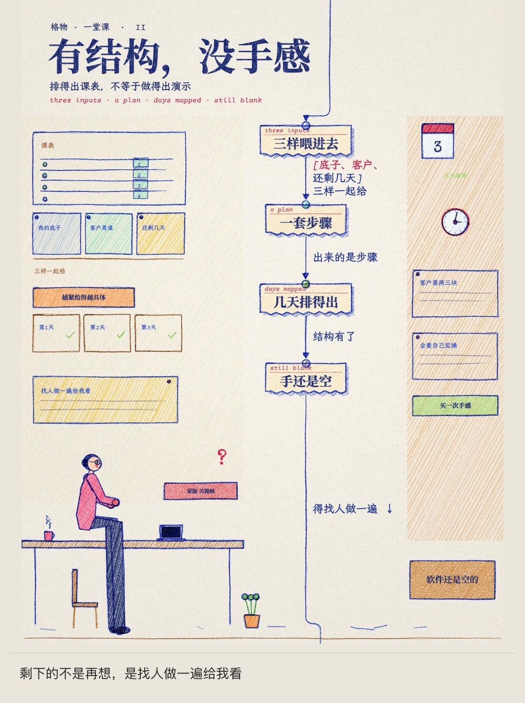
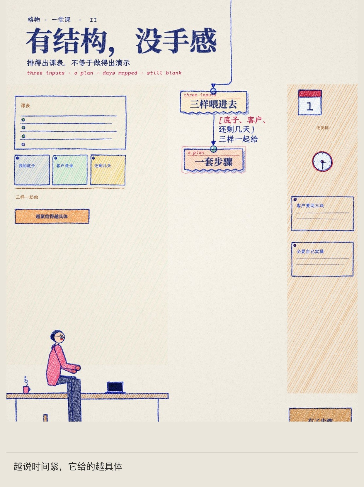
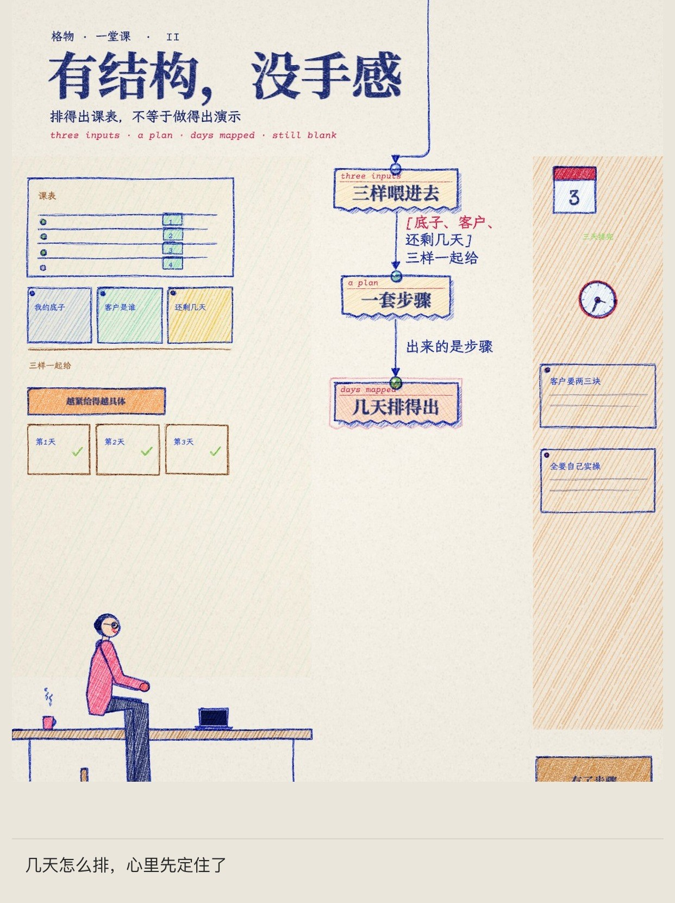
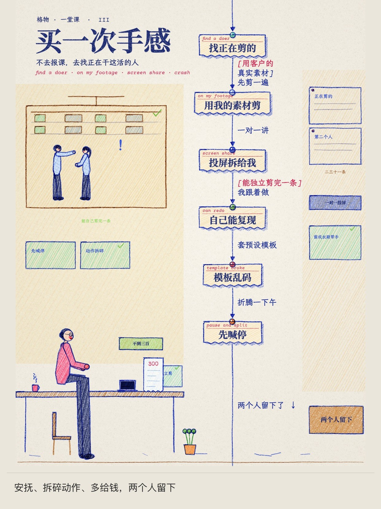
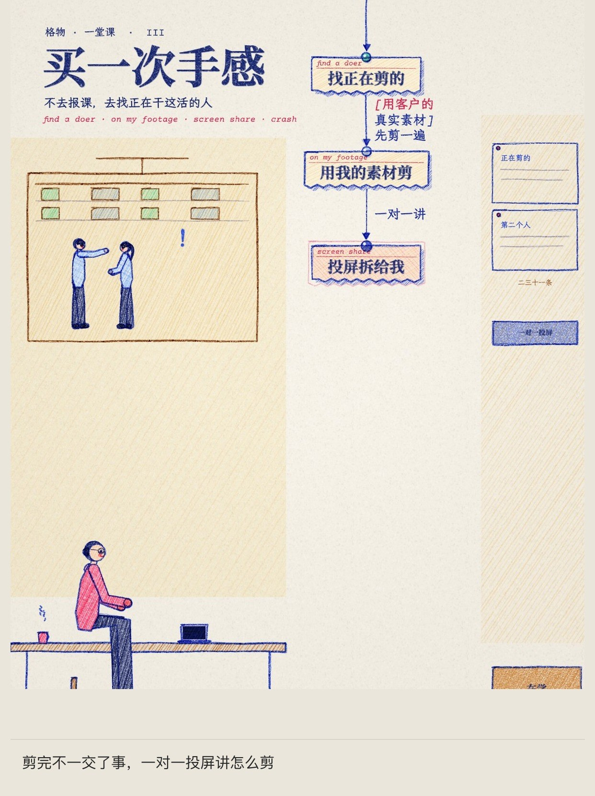
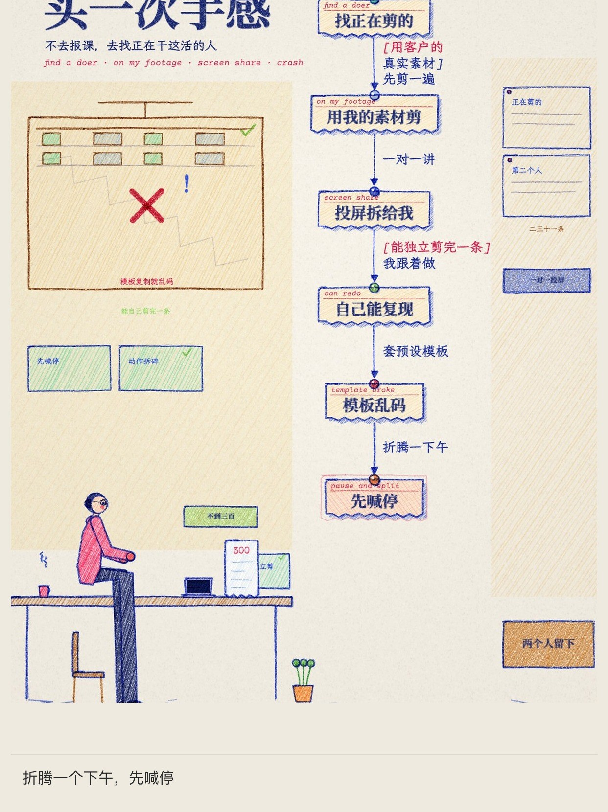
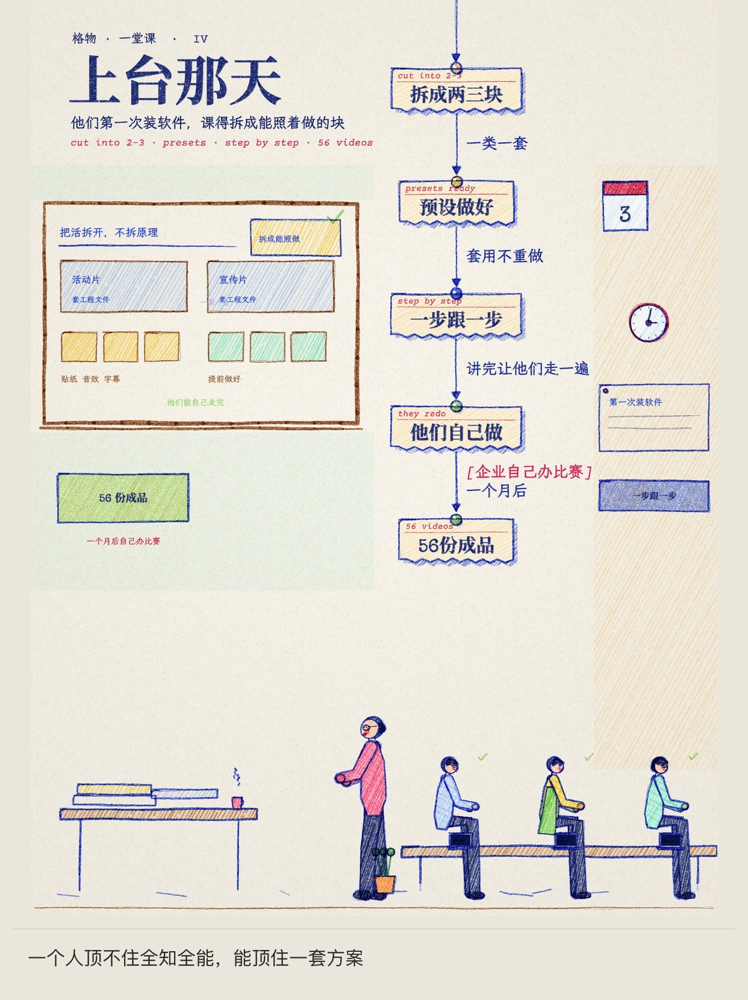
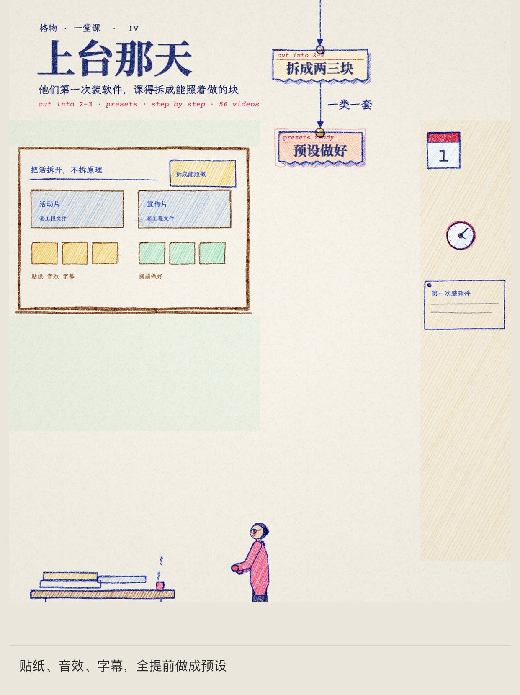
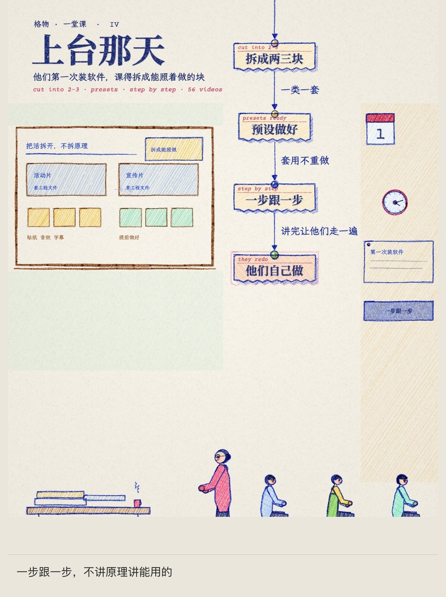

## 发布信息

| 项 | 值 |
|---|---|
| 平台 | 小红书 |
| 期数 | — |
| 发布时间 | 2026-11-13 12:33 |
| 正文长度 | 973 字 |
| 图片数量 | 12 张 |
| 状态 | 已发布 |
