# 10篇长文，只有1篇涨粉700

> — · 2026-11-14 12:33 发布 · AI 赚钱内容

## 标题（可直接复制）

```
10篇长文，只有1篇涨粉700
```

## 正文（可直接复制发布）

高考语文 37 分的人，28 天写了 10 篇长文，篇篇曝光过万，最高一篇 20 万。十篇里只有一篇涨了粉，700 多个。

差的不是文笔，是标题写给了哪一圈人。他把账号的长文数据摊开过，这三圈我照他的说法排了一遍。

先说这摊生意。他是写长文的，被语文老师叫过「文科生的毒瘤」。早期在一个短视频平台写长文，把一篇做到 60 万曝光；后来换到一个以文字为主的平台，28 天写了 10 篇，篇篇破万，最高 20 万，其中一篇换来 700 多粉。他不卖课，这摊生意换回来的是关注：一篇长文能换几个粉，就是他要算的账。

第一格，原圈。他举过的旧标题是「AI小白怎么搭建网站」。「AI小白」四个字一摆，能点进来的只剩正在学的人。这一格的信号很好认：收藏在涨、关注不动，评论里全是在问「怎么做的」。先看自己数据最好那篇的赞藏比，再对一遍粉丝数，收藏在涨、粉丝没动，你就在这一格。什么会让它变：把标题里的限定词一个一个拿掉，每拿掉一个问一句「他到底想要什么」。

第二格，邻圈。把「AI小白」换成「普通人怎么搭站」。人多了，可他们不是同行，点进来不是来存做法的。这时候拼的是正文：标题替正文许了愿，前三段就得还。给 3 个数：做了几次、成了几次、花了多久。他给的规矩是前三段必须回到自己的真实经历和数字；回不去，读者第二段就退出去。退出去也不算白做，退半步：改说法，别改结论。

第三格，大圈。挂上大母题——赚钱、不想上班、普通人翻身。他的写法是「普通人如何从 0 到 1 做一个网站，赚到第一笔美金」。池子最大，账也最贵：标题答应了「赚到美金」，前三段就得给出你自己的数字。给得出，这一格就是那篇涨 700 粉的；给不出，标题欠的账读者第二段就来收。

卡在哪：他自己承认高考语文 37 分。代价也是可核的——28 天 10 篇，只有 1 篇涨到 700 粉，其余九篇曝光都过万，粉基本没动。泛流量七成、垂直三成是他给的起步建议，不是测出来的定论，得自己按数据调。

去找你上一篇数据最好的，先把标题里的限定词数出来，再一个一个划掉，每划一个问一句「他到底想要什么」，划到兑现不了就停。你划完还剩几个字？

## 话题标签

#AI赚钱术 #AI变现 #案例拆解 #内容创作 #选题 #标题 #长文

## 配图（12 张）

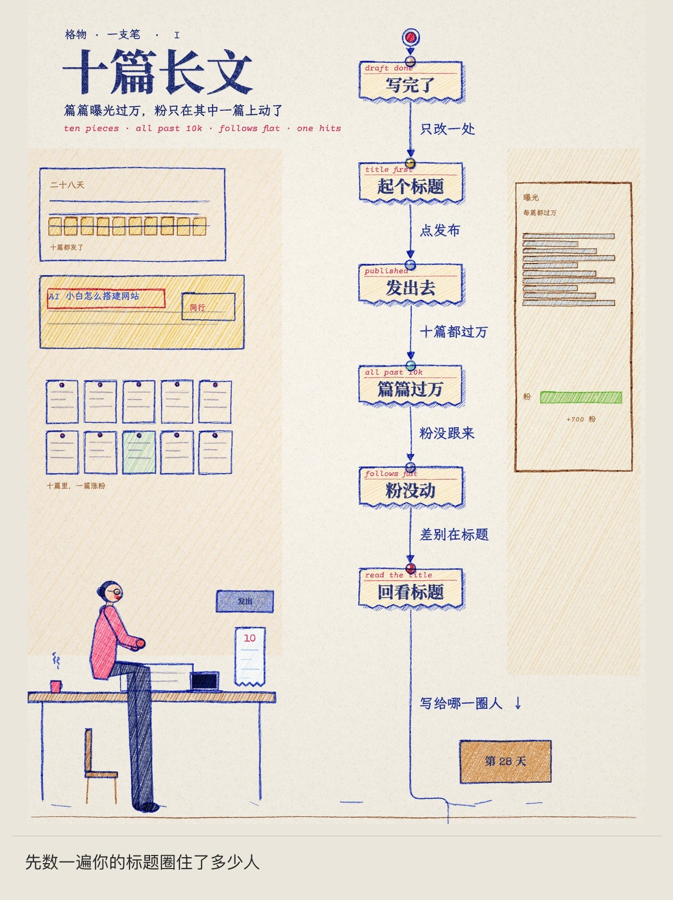
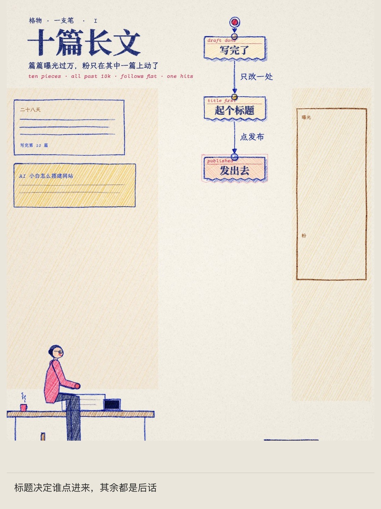
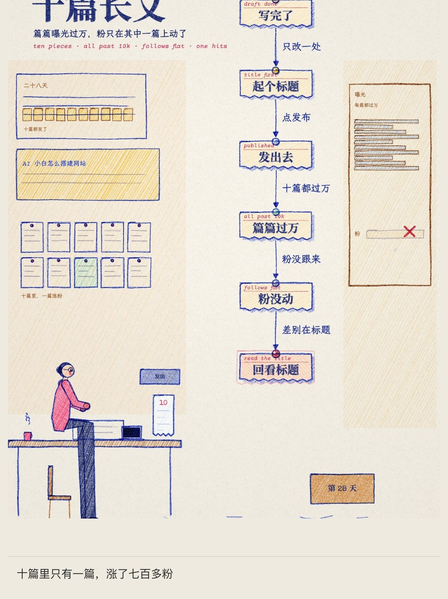
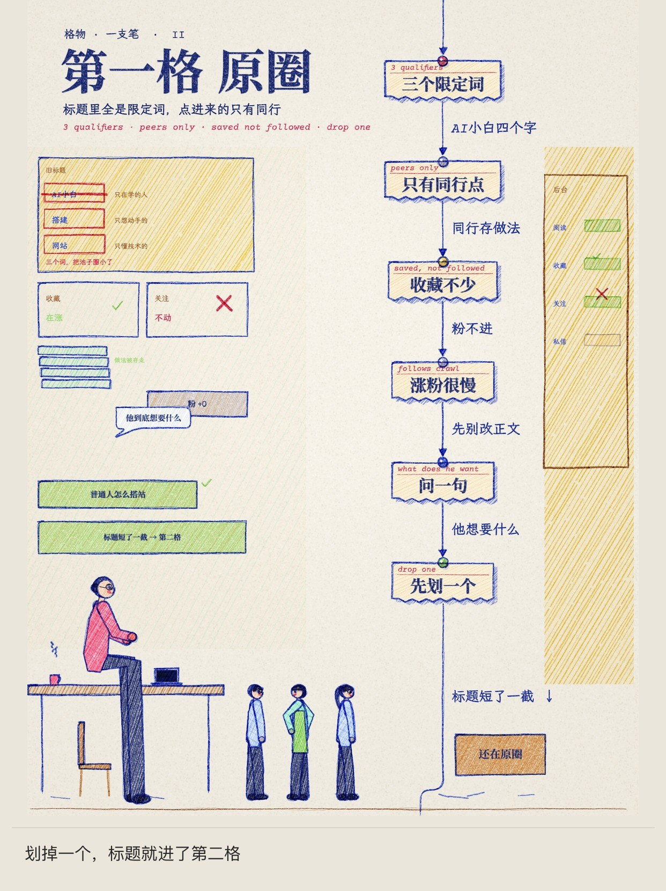
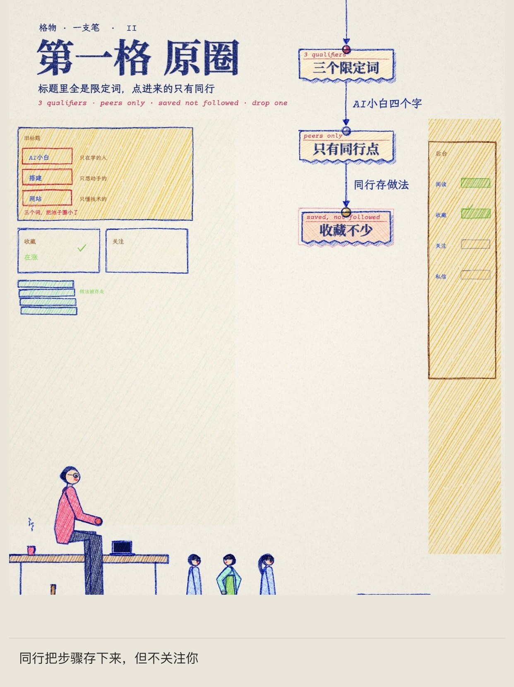
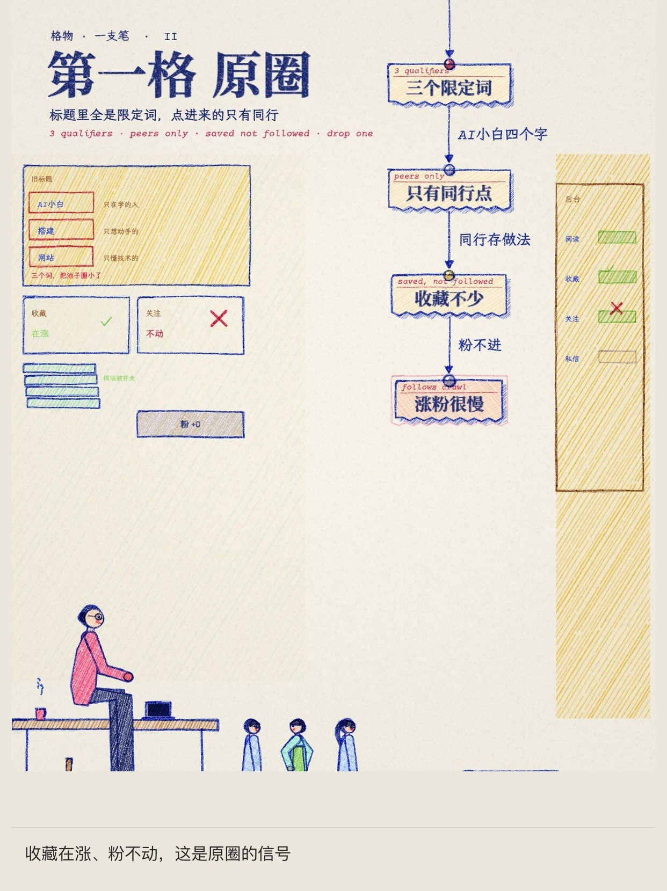
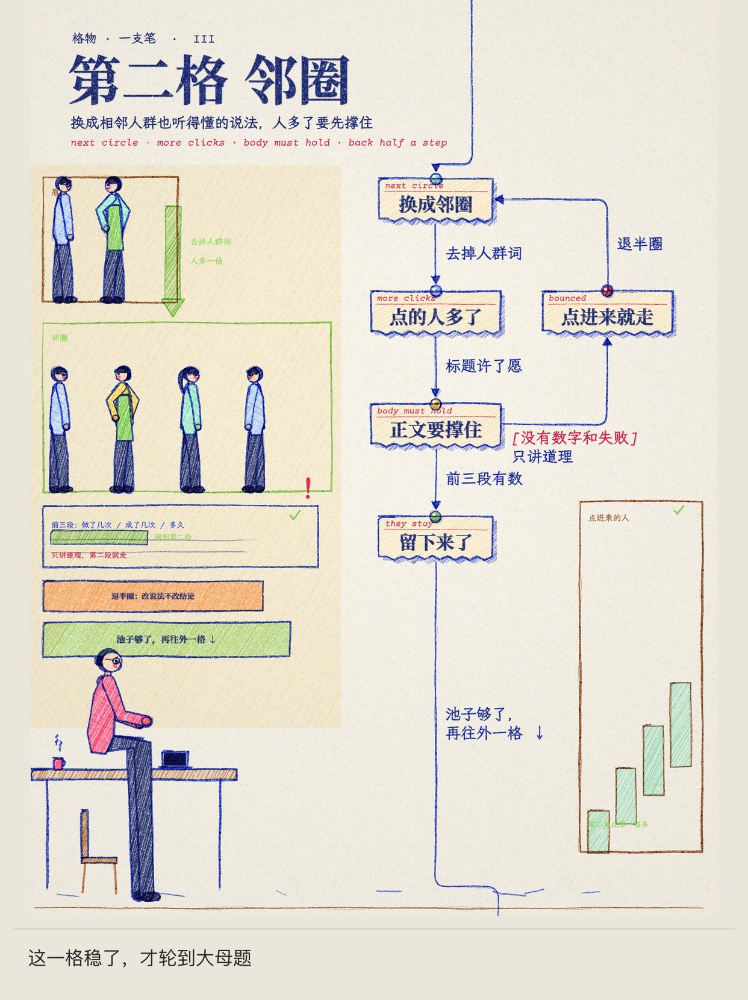
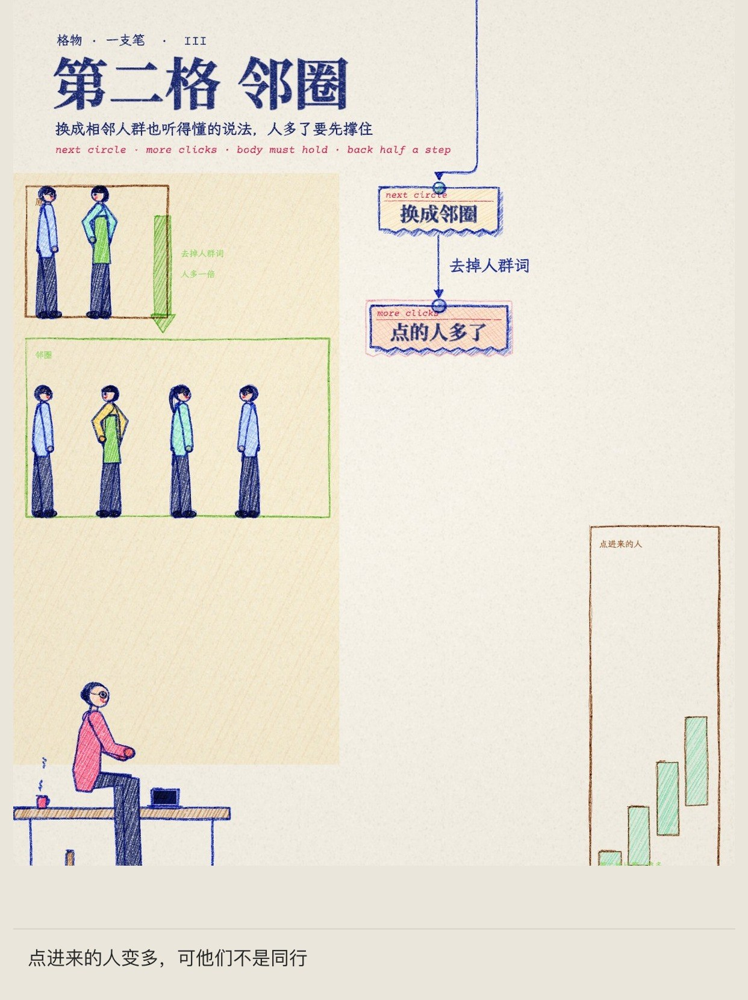
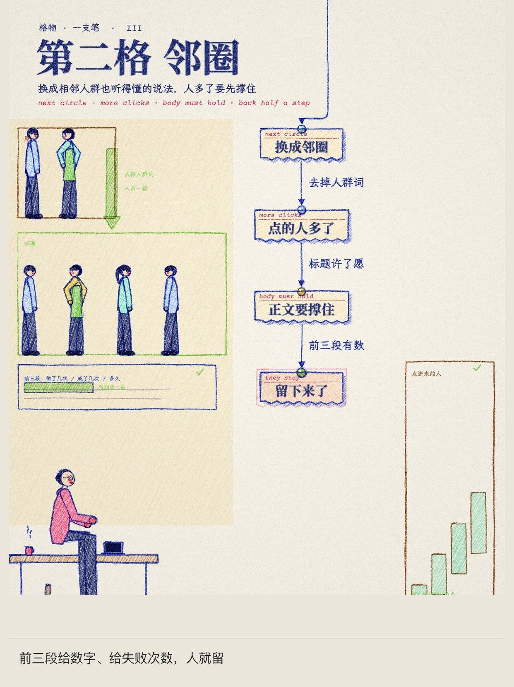
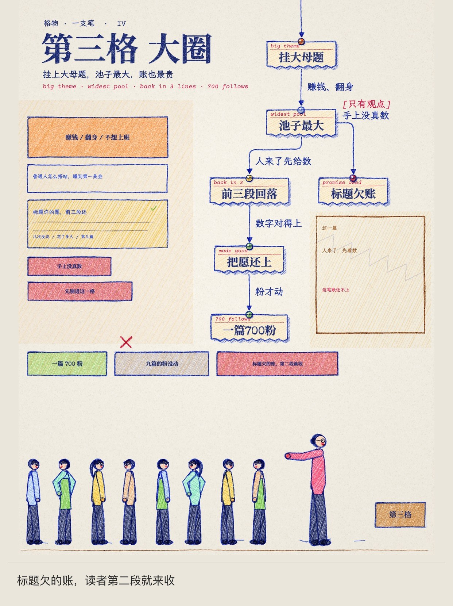
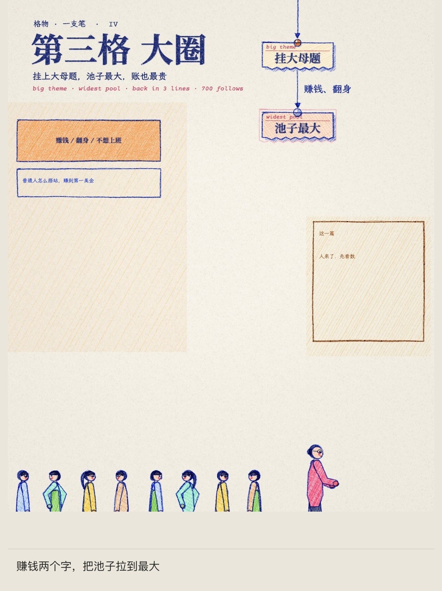
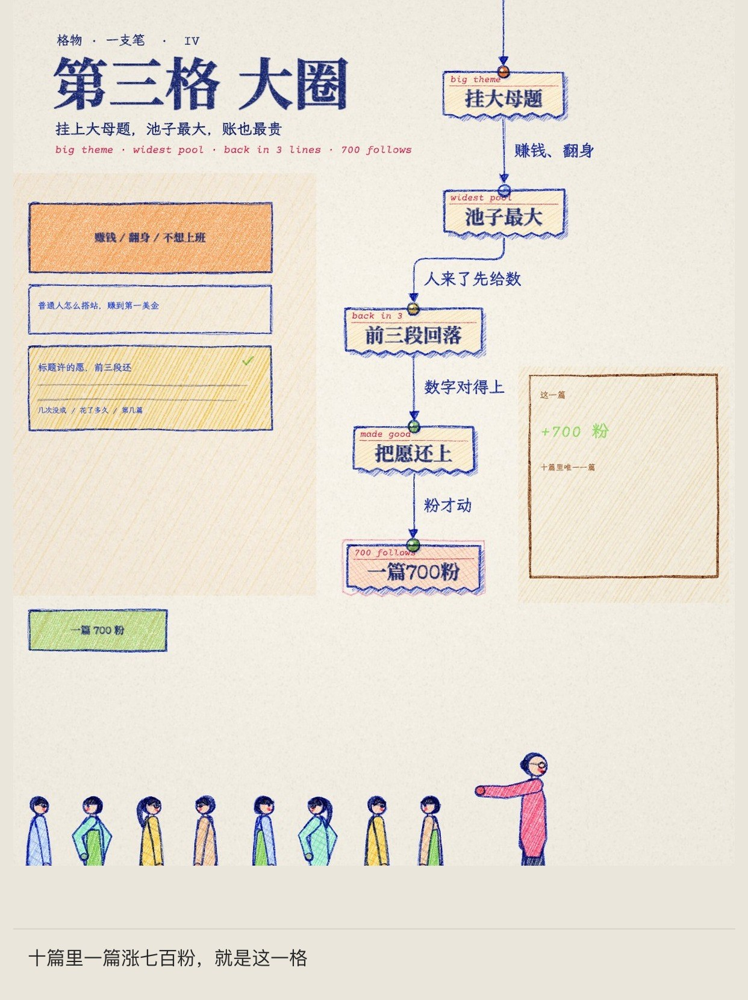

## 发布信息

| 项 | 值 |
|---|---|
| 平台 | 小红书 |
| 期数 | — |
| 发布时间 | 2026-11-14 12:33 |
| 正文长度 | 898 字 |
| 图片数量 | 12 张 |
| 状态 | 已发布 |
