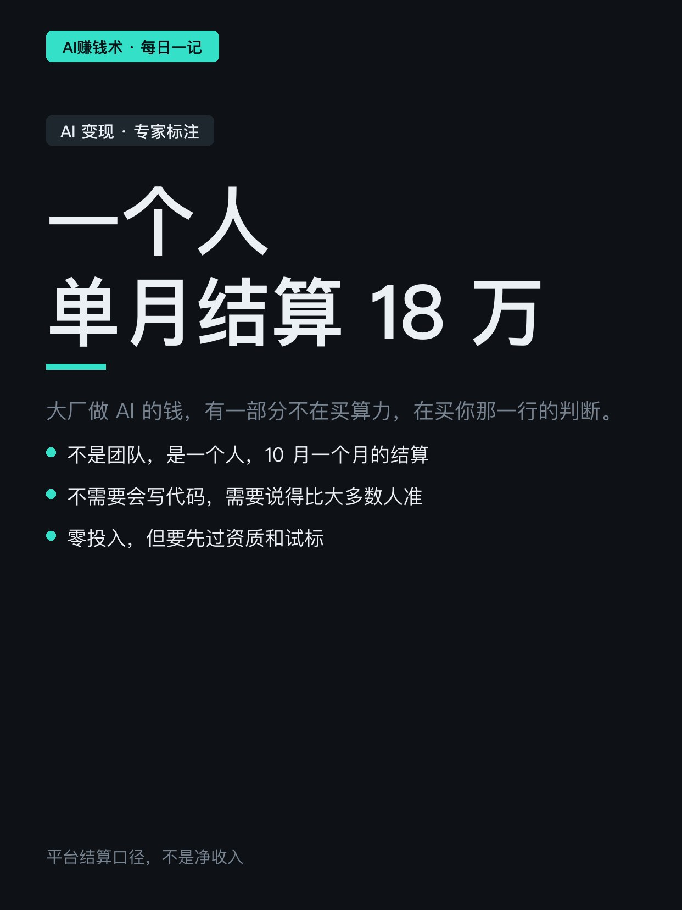
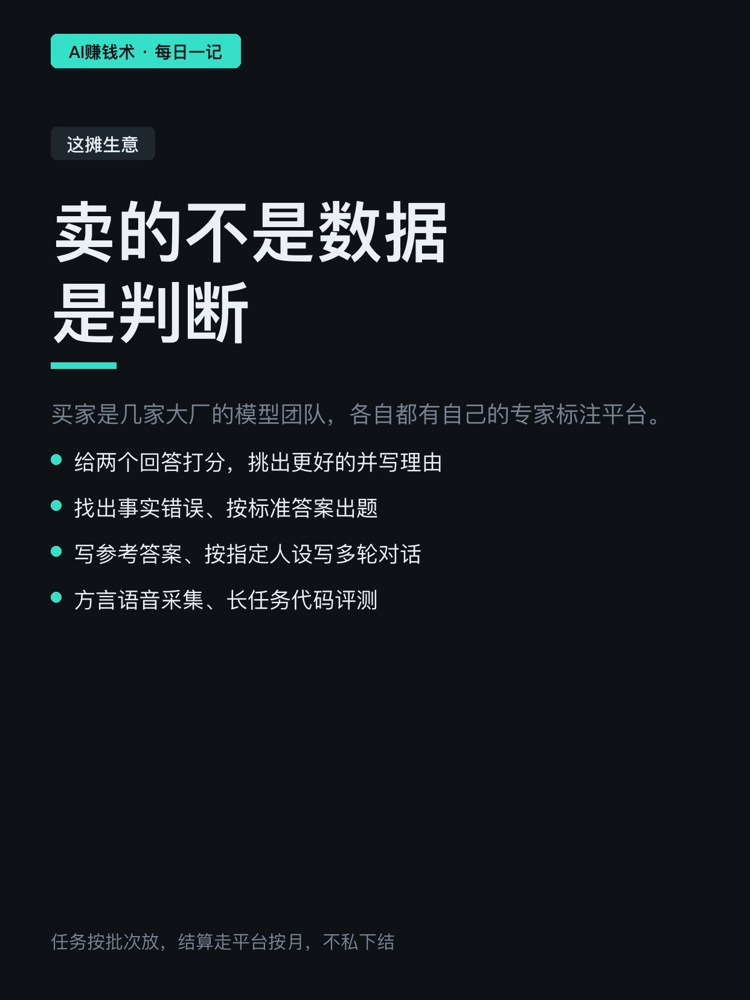
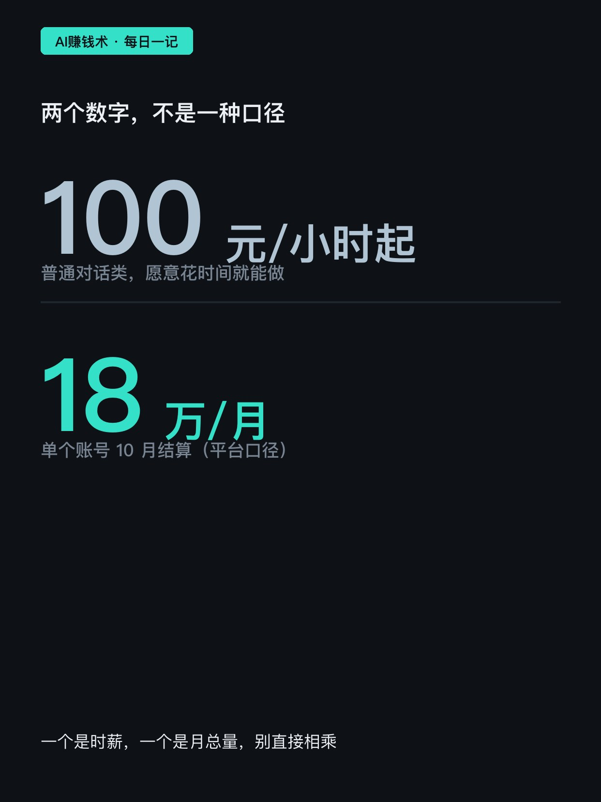
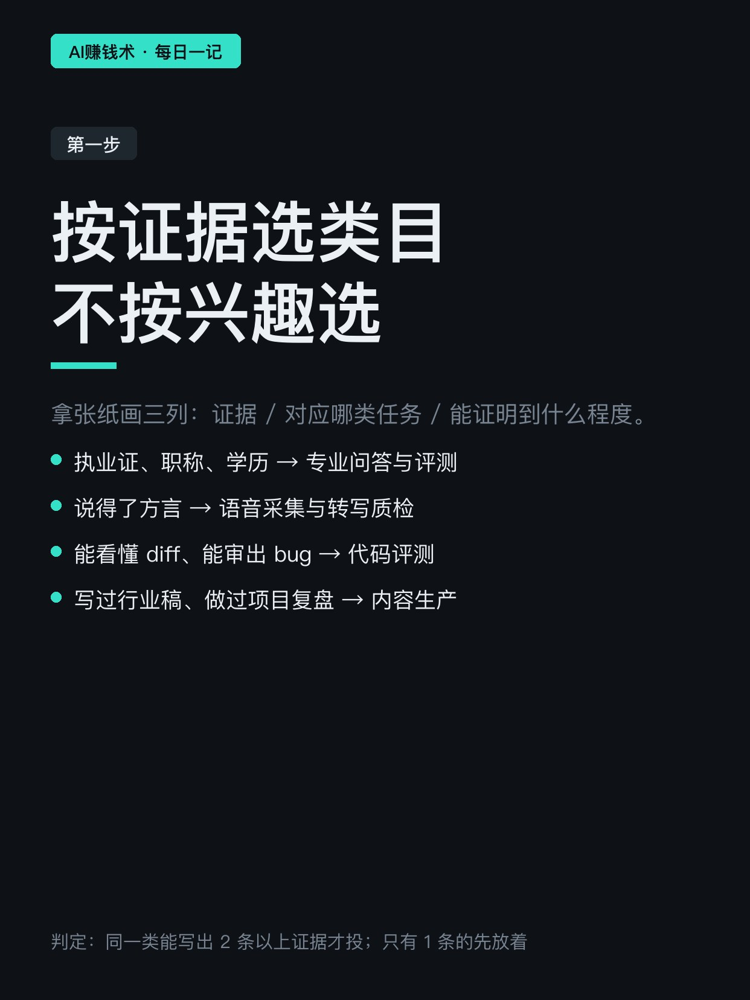
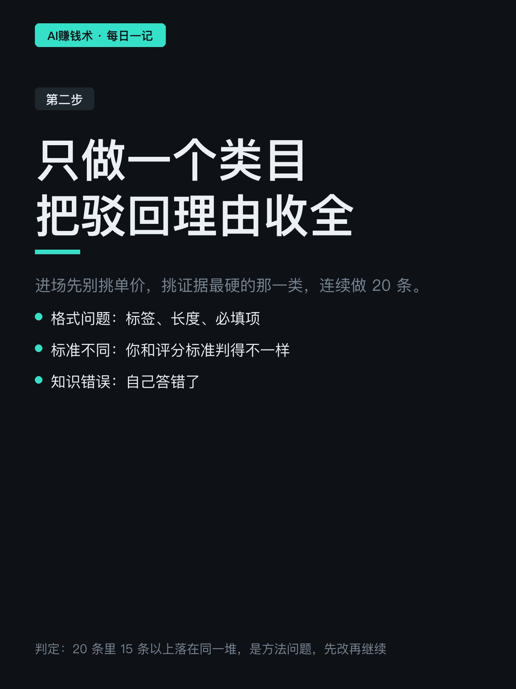
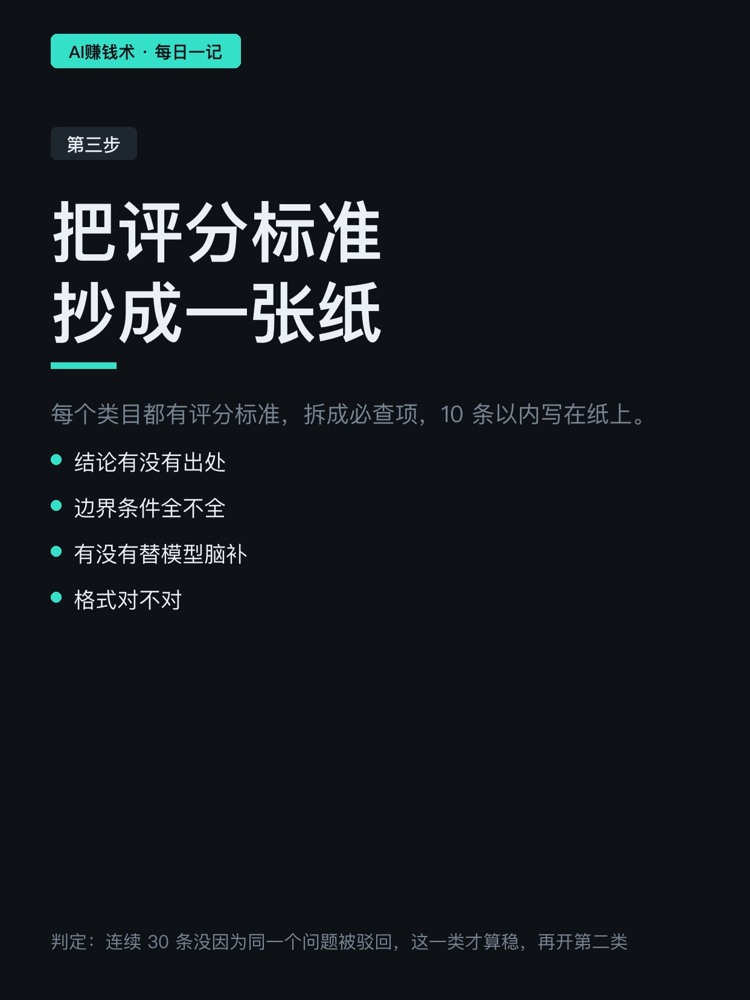
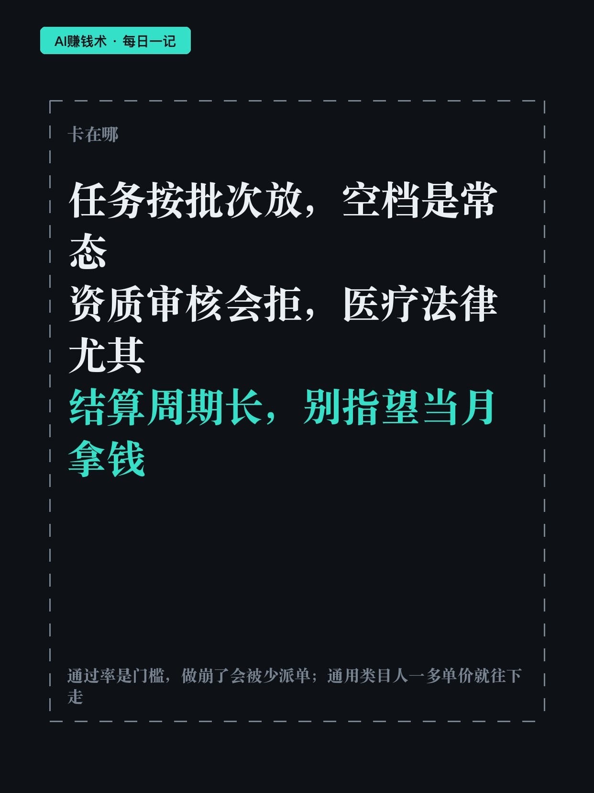
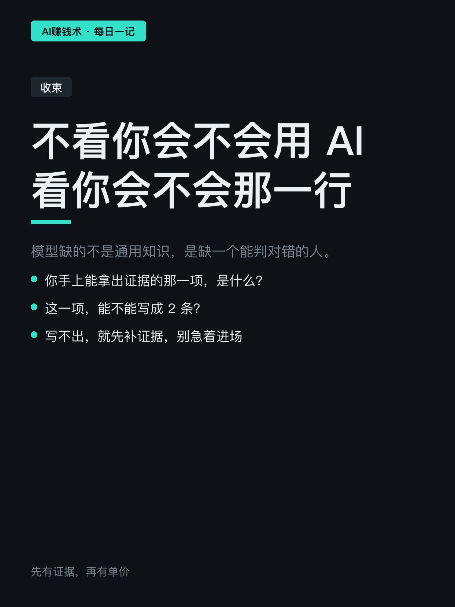

# 10月一个人结算18万，这活怎么接

> — · 2026-11-15 09:02 发布 · AI 赚钱内容

## 标题（可直接复制）

```
10月一个人结算18万，这活怎么接
```

## 正文（可直接复制发布）

大厂做 AI 的钱，有一部分不是在买算力，是在买人的判断。大厂自己的专家标注平台上，10 月有一个人单月结算 18 万——不是团队，是一个人。

一、这摊生意长什么样

买家是几家大厂的模型团队，一家做社交、一家做短视频、一家做电商，各有自己的专家标注平台。卖的不是数据，是「专业场景下的判断」：给两个回答打分并写理由、找出事实错误、按标准答案出题、按指定人设写多轮对话、采集方言语音、评测长任务里的代码。

普通对话类愿意花时间就能做，时薪三位数；医疗、法律、金融、制造这类要资质的，单价往上翻。任务按批次放，接不接得到看类目和资质；结算走平台按月。投入是零，但要先花时间过资质和试标，这一段不付钱。

二、第一步：按证据选类目，不按兴趣选

拿张纸画三列：证据 / 对应哪类任务 / 能证明到什么程度。执业证、职称、学历对应专业问答；说得了方言对应语音采集；能看懂 diff、能审出 bug 对应代码评测；写过行业稿、做过项目复盘对应内容生产。

判定：同一类能写出 2 条以上证据，才去投；只有 1 条的先放着。医疗、法律没证不碰——不是能力问题，是审核过不去。

三、第二步：只做一个类目，把驳回理由收全

进场先别挑单价，挑证据最硬的那一类，连续做 20 条。每被驳回一条，把平台的原话抄进一个文档，分三堆：格式问题（标签、长度、必填项）、标准不同（你和评分标准判得不一样）、知识错误（自己答错了）。

判定：20 条里 15 条以上落在同一堆，是方法问题，停下来改那一堆再做；三堆都散着，是手生，继续做。换类目等于从零攒通过率。

四、第三步：把评分标准抄成一张纸

每个类目平台都会给评分标准，拆成必查项，控制在 10 条以内写在纸上，下笔前过一遍：结论有没有出处、边界条件全不全、有没有替模型脑补、格式对不对。前三条能挡掉大部分驳回。

判定：连续 30 条没因为同一个问题被驳回，这个类目才算稳；稳了再开第二个，按证据第二硬的那个来。

五、卡在哪

任务按批次放，一个月接满和半个月空着都正常。资质审核会拒，医疗、法律尤其。通过率是隐形门槛，做崩了会被少派单。结算周期长，别指望当月干活当月拿钱。通用类目人一多，单价就往下走。

我的判断：这行不看你会不会用 AI，看你在自己那一行里，能不能给出别人给不出的判断。你手上能拿出 2 条证据的那一项，是什么？

## 话题标签

#AI赚钱术 #AI变现 #案例拆解 #副业思路 #信息差 #AI工具 #数据标注

## 配图（8 张）










## 发布信息

| 项 | 值 |
|---|---|
| 平台 | 小红书 |
| 期数 | — |
| 发布时间 | 2026-11-15 09:02 |
| 正文长度 | 988 字 |
| 图片数量 | 8 张 |
| 状态 | 已发布 |
