# 8家店剩5家，1个品卖了11万

> — · 2026-11-15 12:33 发布 · AI 赚钱内容

## 标题（可直接复制）

```
8家店剩5家，1个品卖了11万
```

## 正文（可直接复制发布）

八家店，三家在同一个节点上没了类目。剩下那批里有一家只摆一个商品，从四月做到十一月，提现 113,198 元。

冬青的账本，一家资料店：没投放，没团队，成本是时间。另有一家开 128 天的新店，一个月七千上下。

这摊生意卖的是打包好的虚拟资料，一份一份卖，单价不高，靠量；一店一品，笔记带流量，成交在店里。另一条线他给了价：网站上同一份资料 24.9 元一份，上线一个月 316 单，七千多。

下面三格，对着自己的店数一遍。

第一格，八家店吃一个类目。他一开始有八家店，卖同一类资料，收入全压在同一个类目上。触发点是类目资质被调整：三家被收回，而那三家恰好是主要收入。他没去反复申诉，直接申请退店。变了之后该做什么：把断流的店停掉，别赌一个不再给的入口；省下的时间全挪到还在长的那一家。你先数一遍：把手上每家店的类目列成一张表，再把吃同一个类目的圈出来。

第二格，一店一品，吃季节。剩下的店里，他挑了一家只放一件的。四月起收，前三个月很平，七月暑假到顶，单月近三万；开学一掉，曲线跟着掉。触发点是需求本身有峰谷。变了之后该做什么：不在谷底加投，把上新往前挪到旺季前；一个品的好处也在这，库存、客服、退换只有一条线，掉量时没一堆货压着。

第三格，同一份货，第二条渠道。单店一年十一万，听着稳，他把它当上限：入口随时会动，一个品的天花板看得见。于是同一份资料搬到自己的网站，定价 24.9 不打折；另一条是小程序，先只跑通一个，第五天开始一天十块。变了之后该做什么：先用一份在卖、被验证过的资料开第二条渠道，别为渠道新做一个品；价格先不动，先看有没有人回头买第二次。

卡在哪。他自己讲得很直白：三家店被收的时候「极度丧失信心」，退店是止损，不是把问题解决。第二条腿还很细——网站上线一个月，小程序一天十块，短期撑不起原来的收入，主力仍是一个品。手里：五家店、一个品、两条新口子。

我看这三格，最容易被跳过的是第一格，它不像努力，像运气。差别不在谁更努力，在手上有几条腿。你现在几家店吃的是同一个类目？超过一半，就先补最短的那条：同一份卖得动的货，换个渠道原价上架，一个月后再看单量。

## 话题标签

#AI赚钱术 #AI变现 #案例拆解 #虚拟资料 #小店 #副业 #生意拆解

## 配图（12 张）

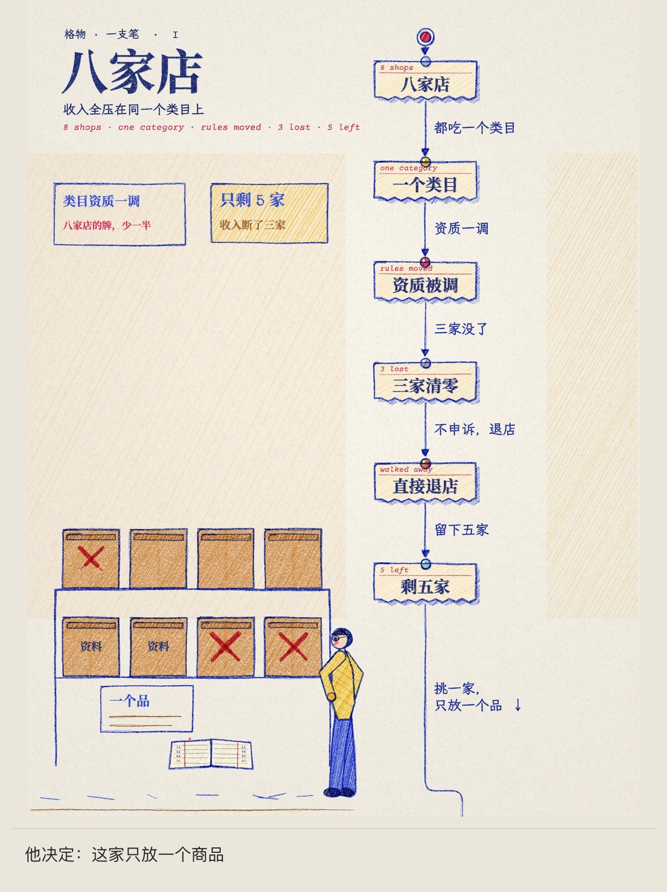
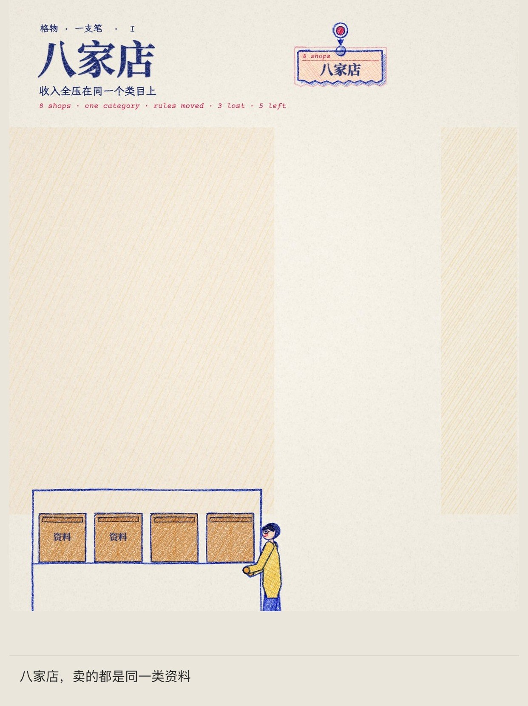
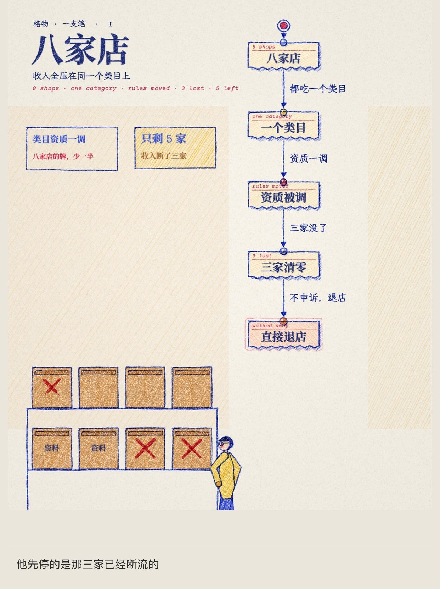
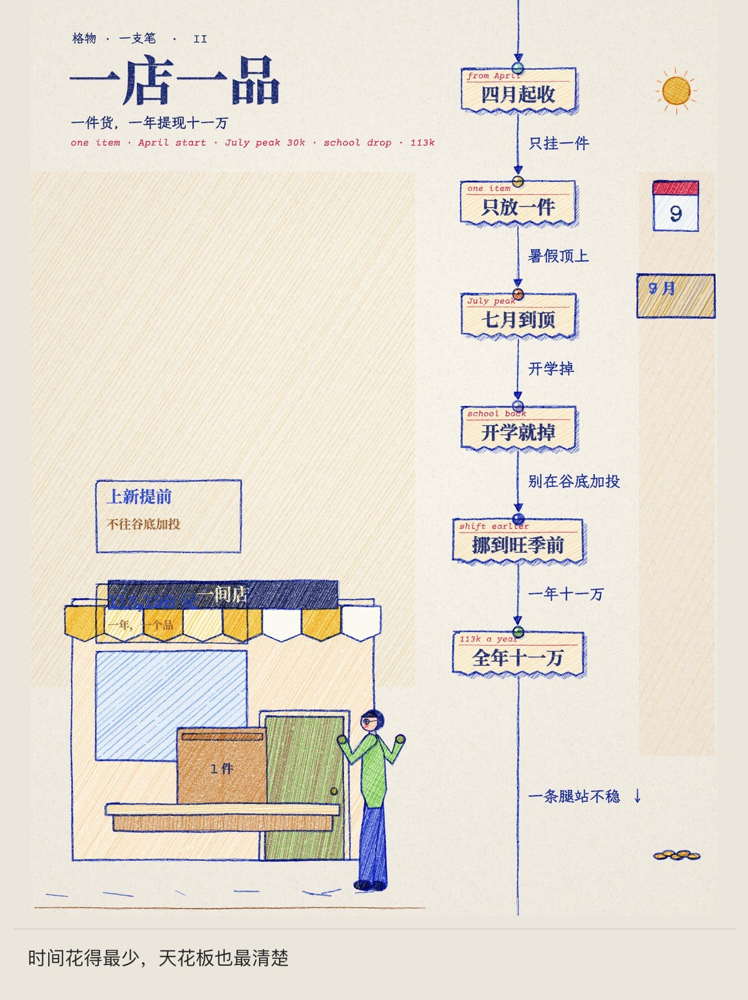
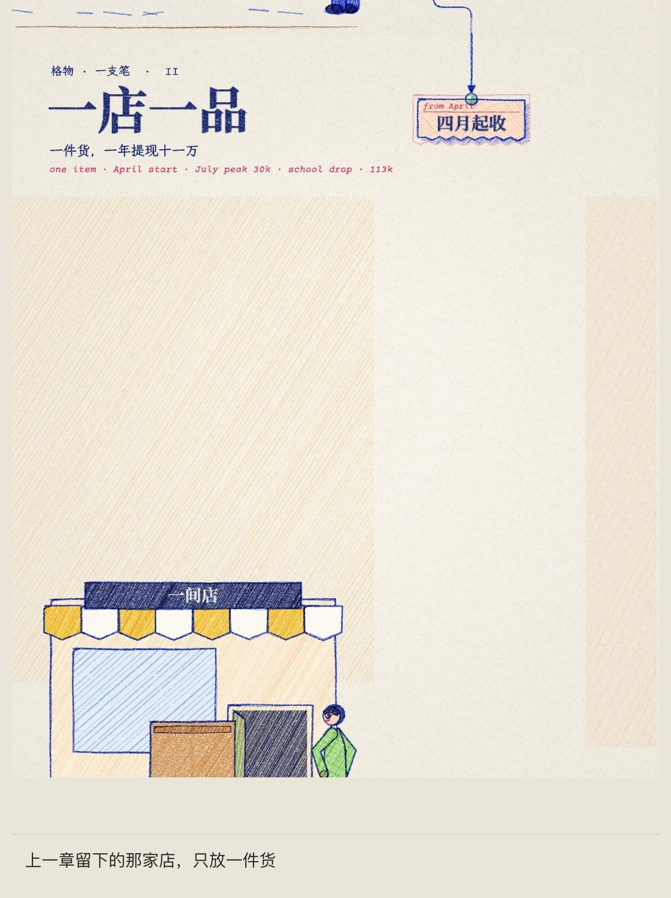
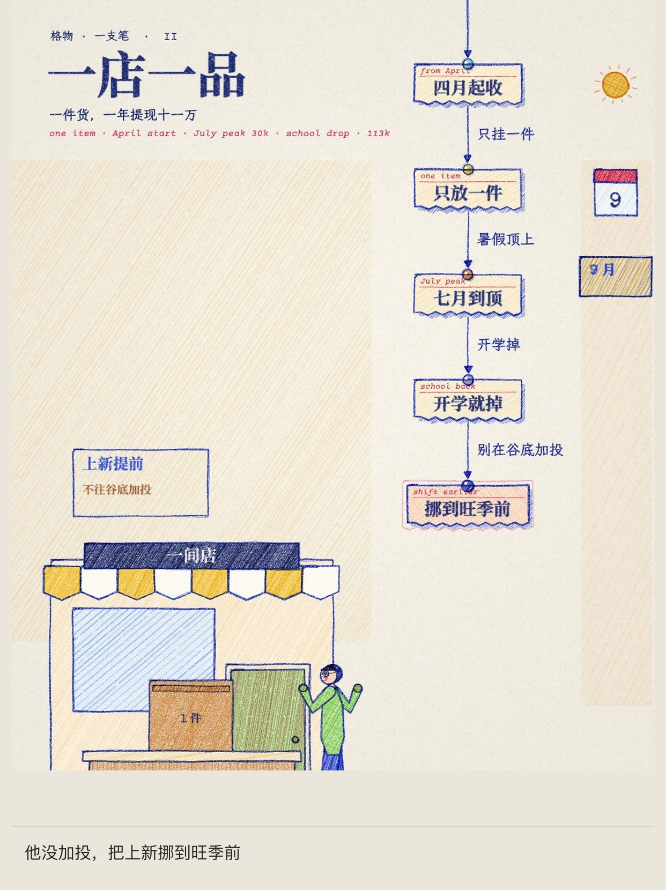
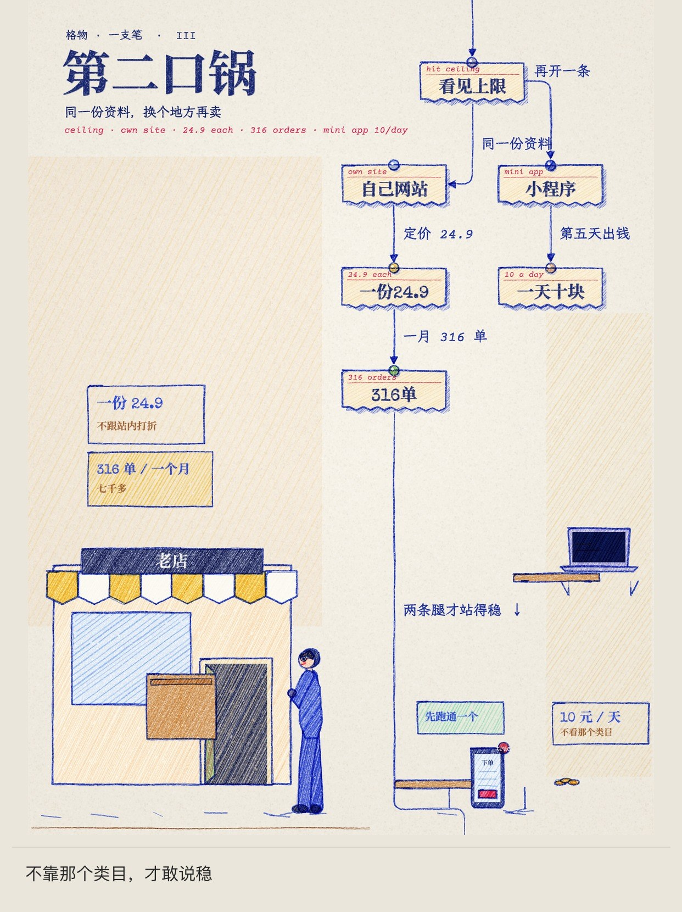
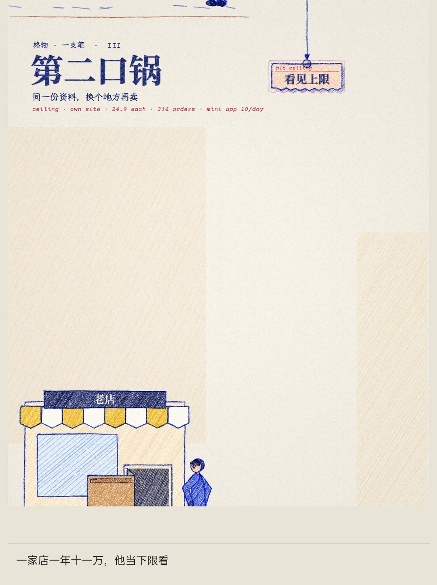
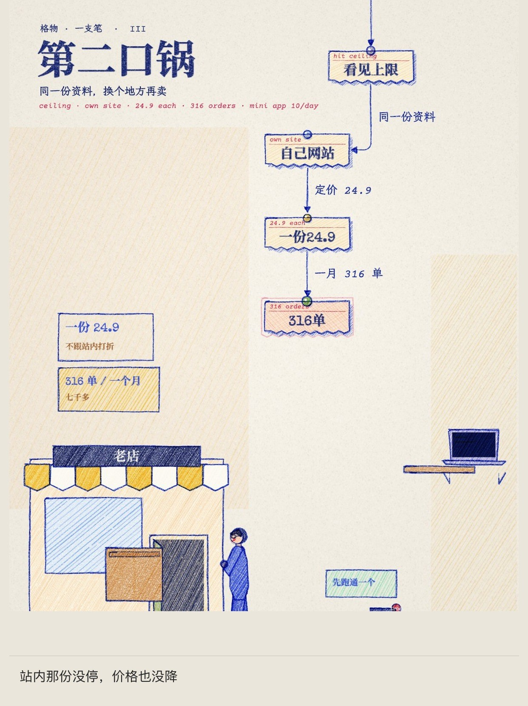
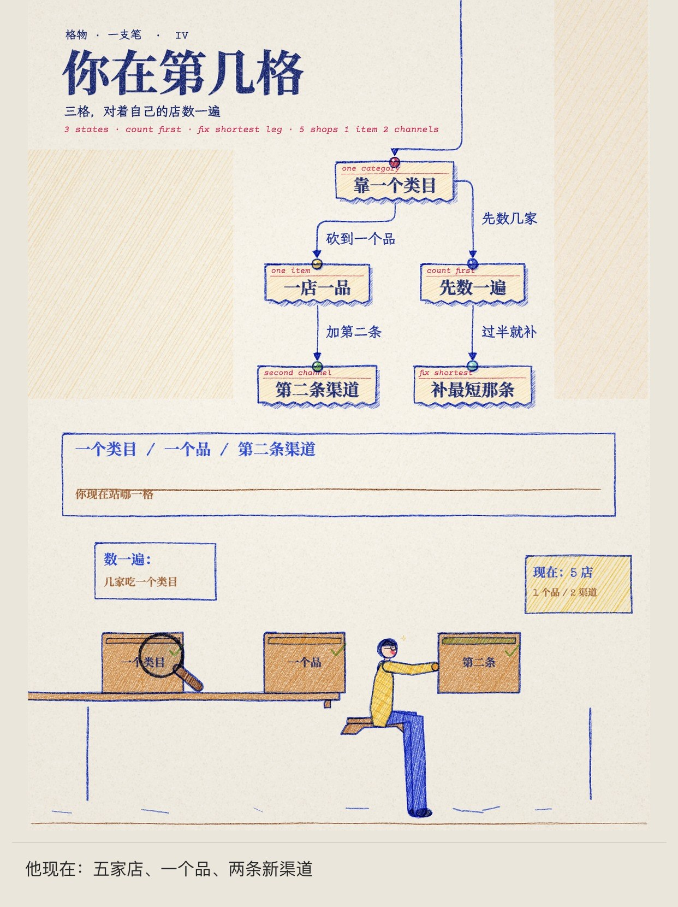
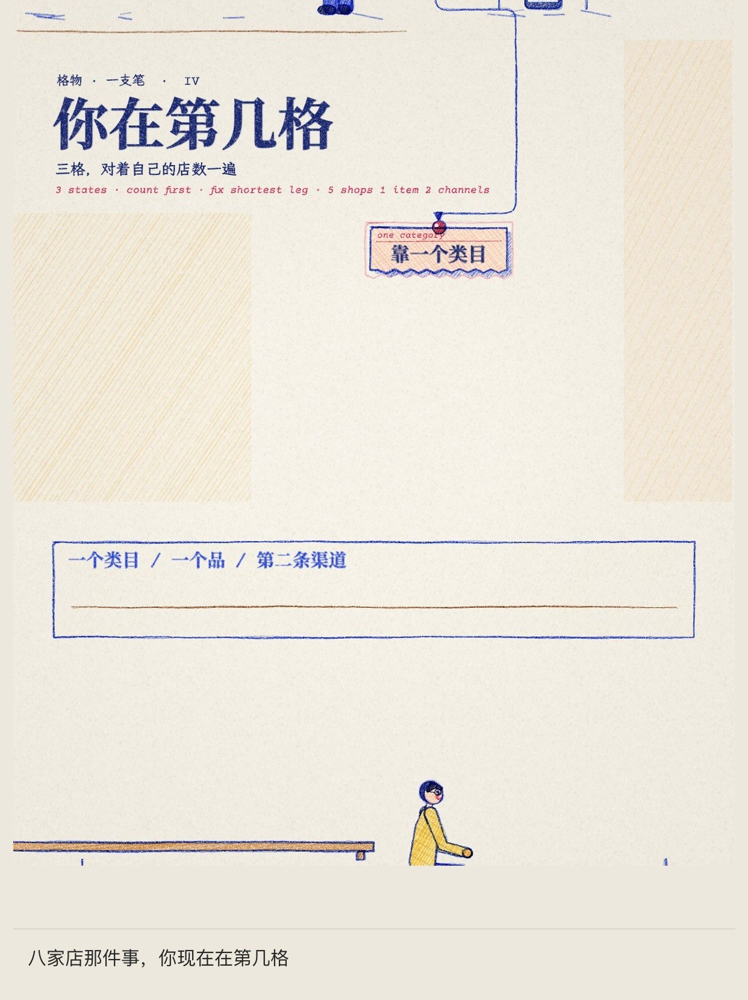
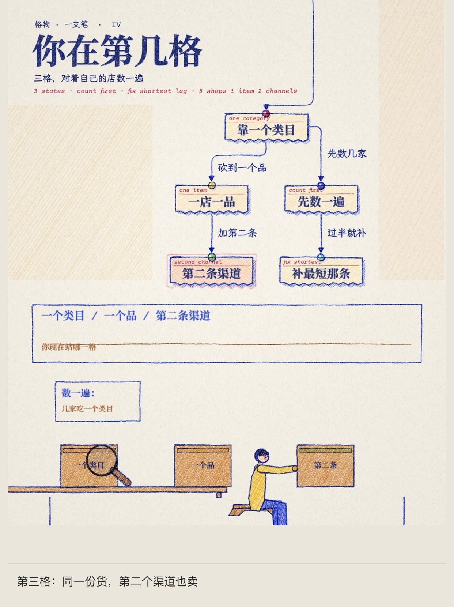

## 发布信息

| 项 | 值 |
|---|---|
| 平台 | 小红书 |
| 期数 | — |
| 发布时间 | 2026-11-15 12:33 |
| 正文长度 | 897 字 |
| 图片数量 | 12 张 |
| 状态 | 已发布 |
