# 账号停了5小时，他用三段话要回来

> — · 2026-11-16 12:33 发布 · AI 赚钱内容

## 标题（可直接复制）

```
账号停了5小时，他用三段话要回来
```

## 正文（可直接复制发布）

一天里所有的活都从一个账号上出。它停了 5 个小时，他靠三段话把它要回来。

这摊生意的形状很简单：一个人，一台放在家里的电脑，一个月一份订阅费。他卖的不是软件，是每周交出去的东西——笔记、文档、脚本，还有半夜自己跑的几个整理任务。单价按件算，量按天算，成本只有订阅和电费，一单活就把这个月的订阅赚回来。也正因为这样，停一天不是少赚一天，是所有在跑的任务一起停。

下面三格，对着自己手上的活数一遍。

第一格，能用。触发变化的东西很轻：授权过期。他的定时任务开始一条条失败，他没先手动登一次，而是按建议签了一个一年期的令牌，存进钥匙串，再用环境变量喂给命令行。这一步没错，错在没留痕迹。变了之后该做什么：把 3 样写进一个文件——哪天改的、什么命令、存在哪。后面真要申诉，这三样是唯一能对得上的线索。

第二格，跳验证。他一边干活一边在群里聊天，界面忽然跳一行报错，接着要求去身份验证门户认证。这个号 3 月已经被要求过一次。他这次走的是服务商代认证，认证完没多久，账号被暂停。这一格最该做的是停手：同一天不要再改任何配置，不要登新设备，把正在跑的任务截个图。你越动，能说清的东西越少。

第三格，已暂停。他做的顺序值得抄：先导出数据，再把定时任务一条条搬到还能跑的地方，最后写申诉。申诉只写 3 段——这个号平时拿来干什么；那天改了什么，命令、存在哪、为什么要改；请求人工复核，把疑点自己摊开。4 个小时后收到通过，登录进去，订阅也没掉。

他自己没把因果说死：那天只动了令牌这一处，暂停是不是它引起的，他写的是无法确定两者是否相关。服务商代认证这条路本身不合规，他把它当反面例子写出来，不是方法。能核的代价是：一封就停摆 4 个小时，手上的活全断。

他最后那句比申诉有用：所有上下文都在本地，号被封了也不慌。我自己的检查顺序就一条：先把活列出来，再看每条活换号能不能接。你现在能数出几条换个号就干不了的活？超过 3 条，先把笔记和任务搬回本地，再谈别的。

## 话题标签

#AI赚钱术 #AI变现 #案例拆解 #账号安全 #独立开发者 #副业 #工作流

## 配图（12 张）

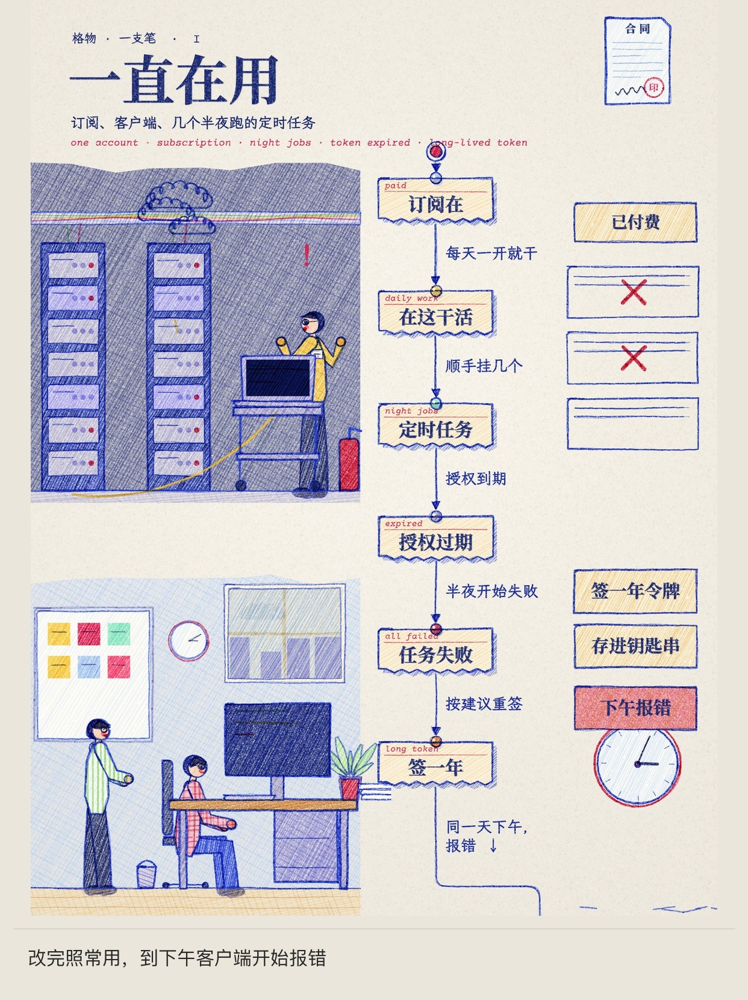
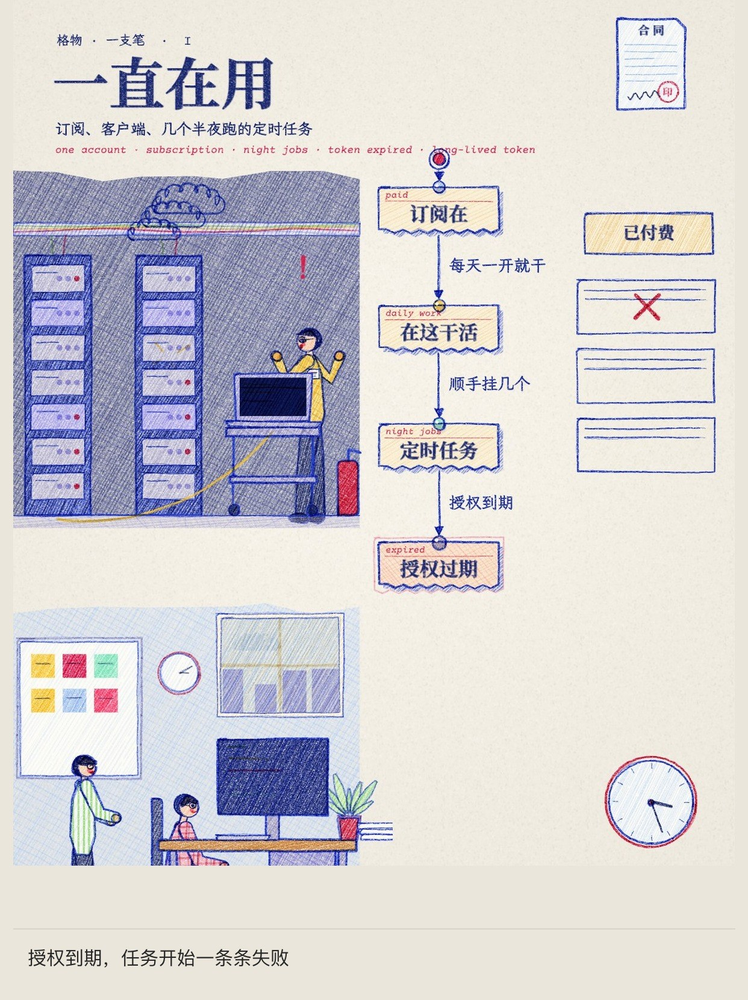
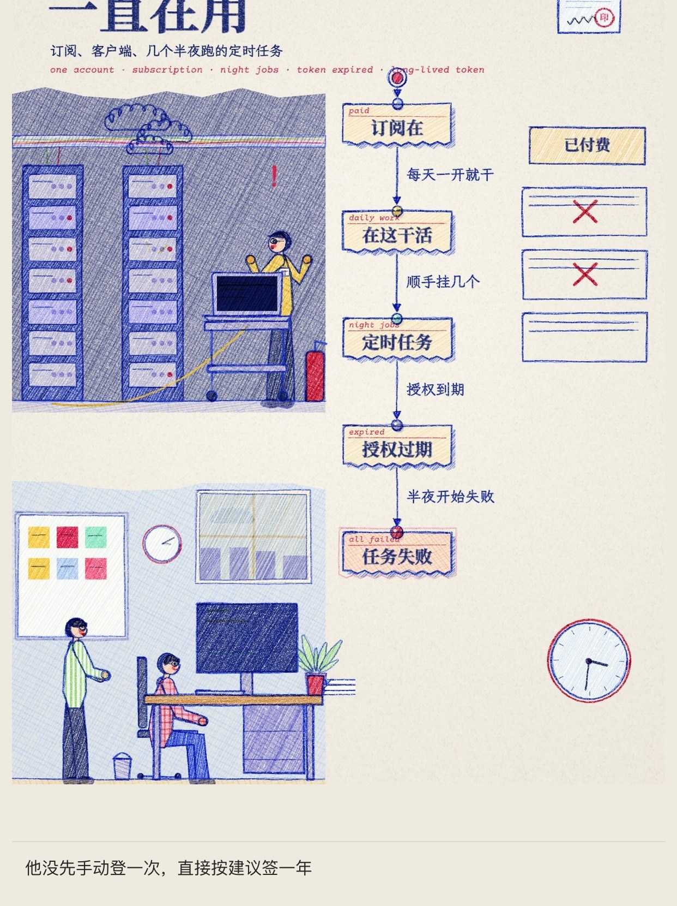
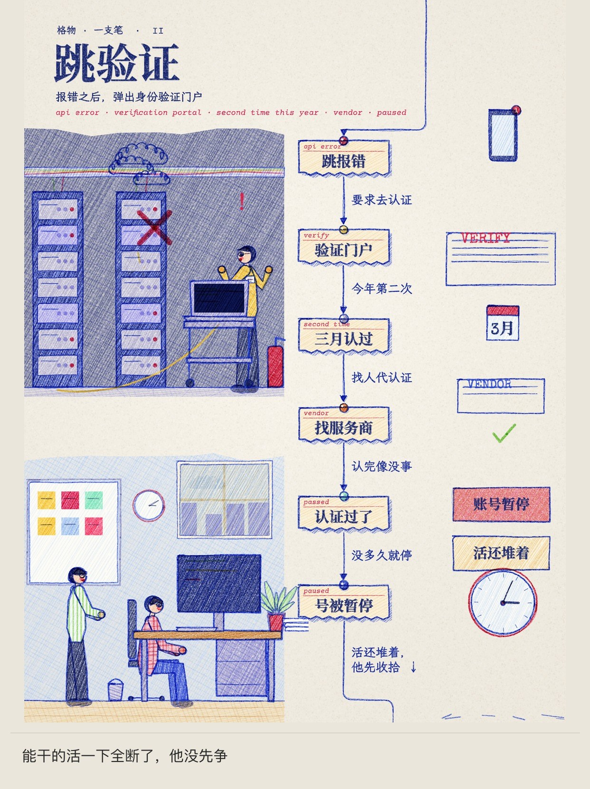
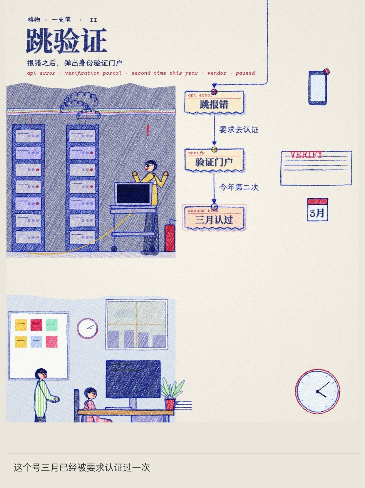
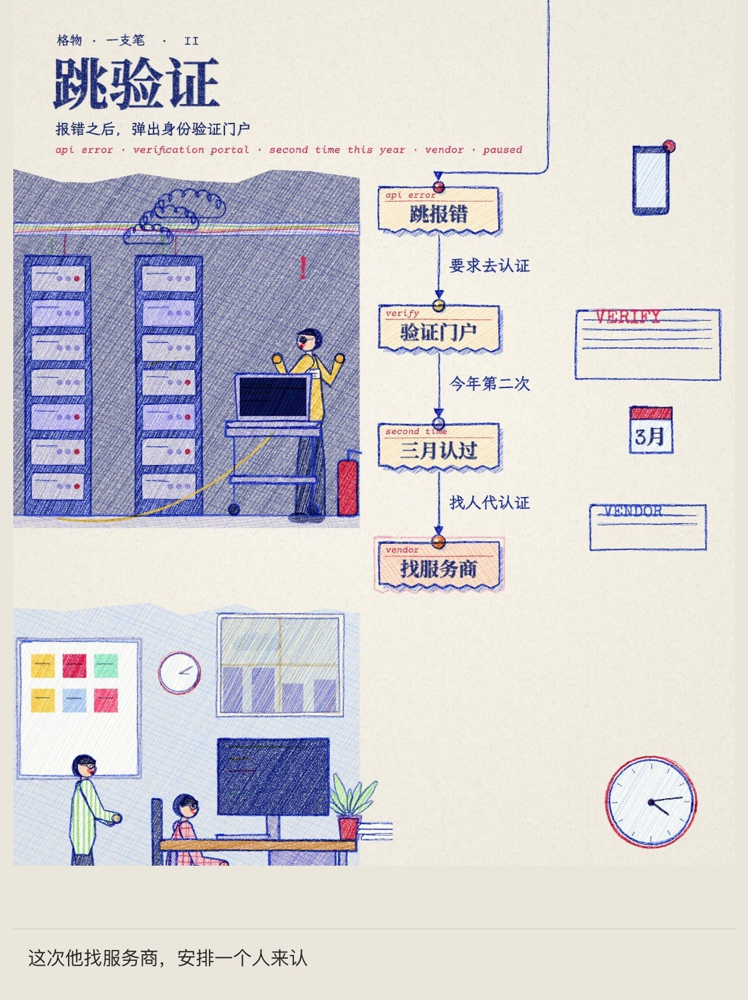
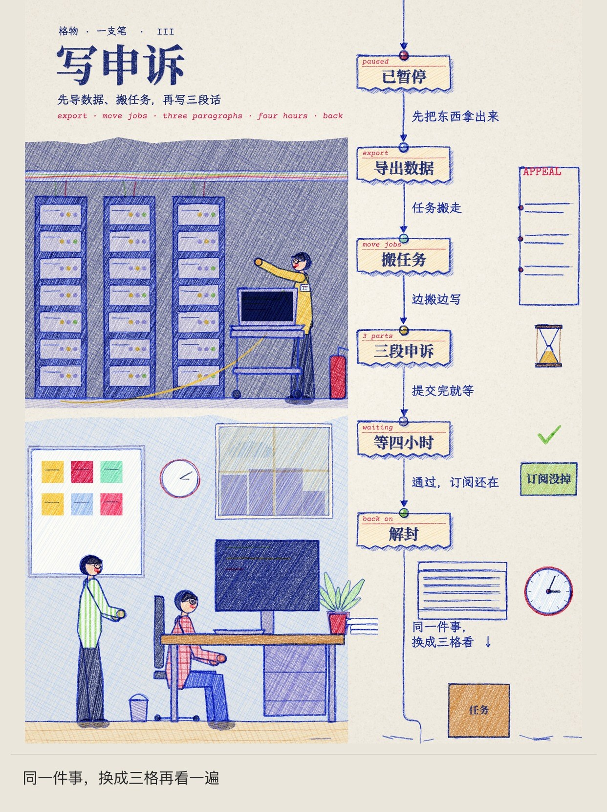
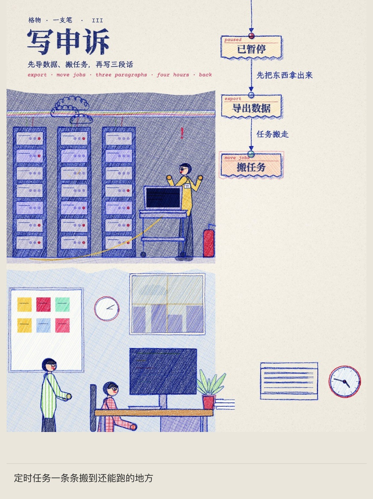
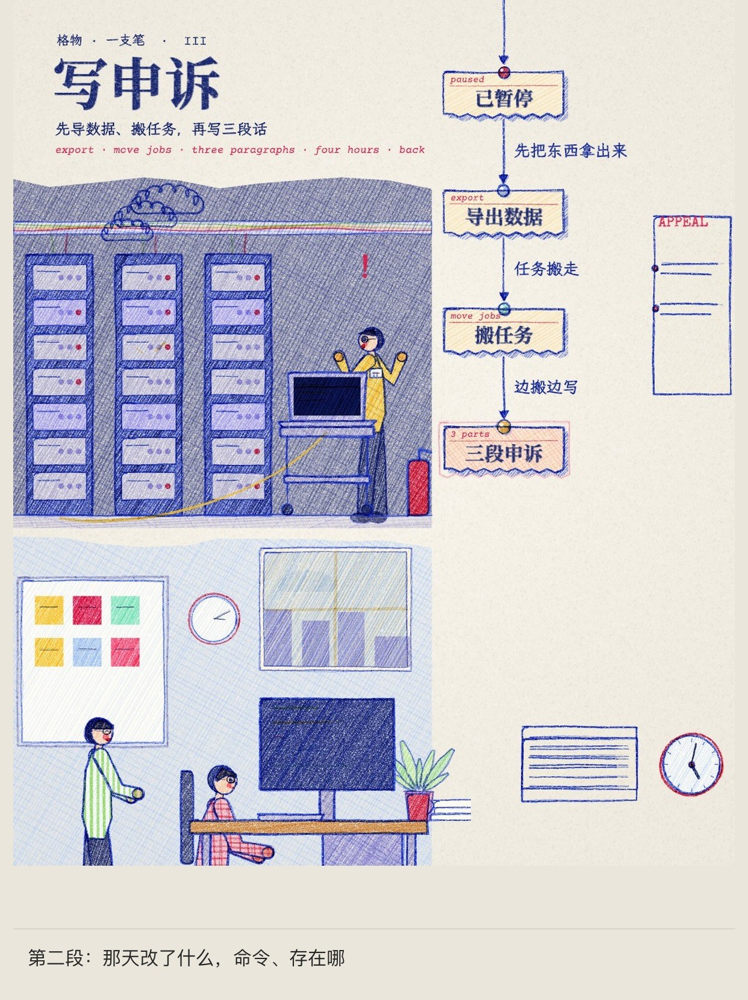
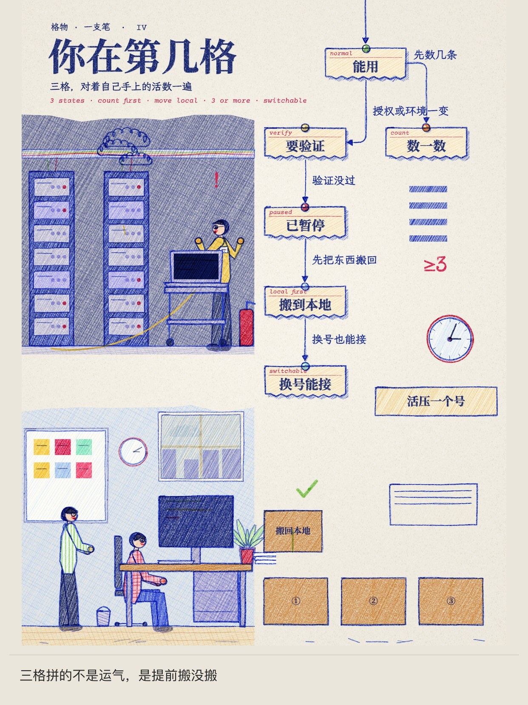
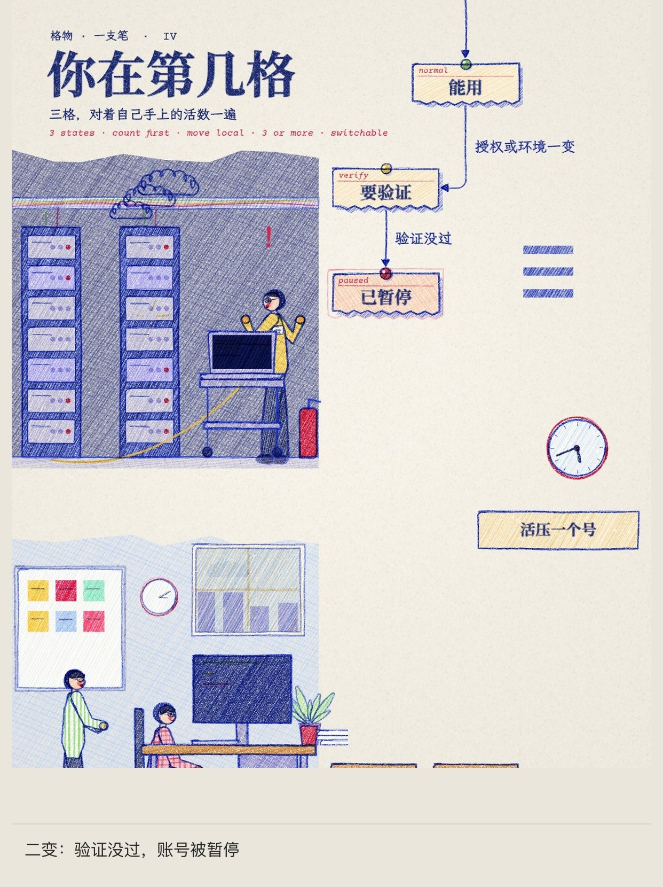
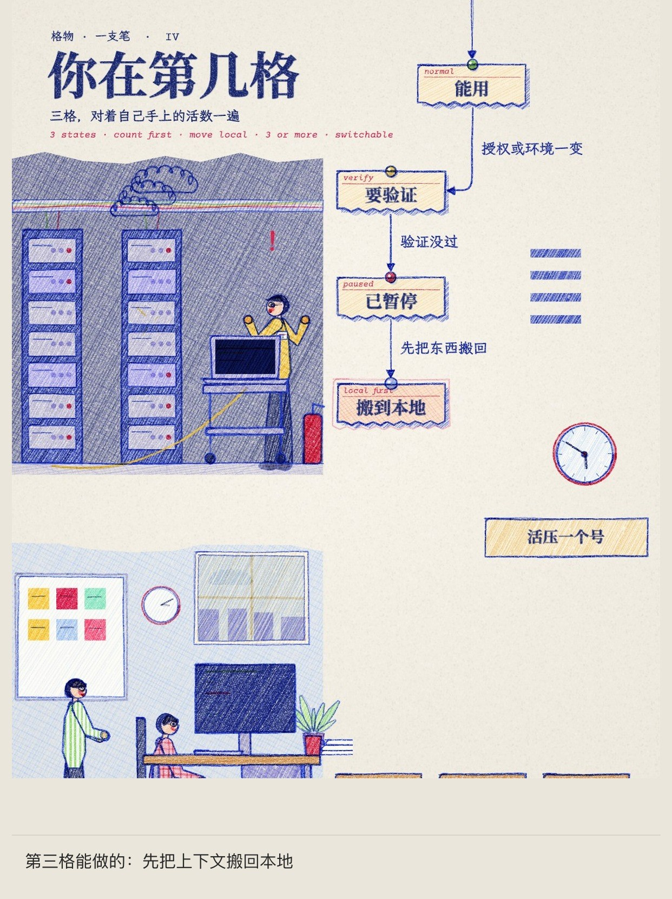

## 发布信息

| 项 | 值 |
|---|---|
| 平台 | 小红书 |
| 期数 | — |
| 发布时间 | 2026-11-16 12:33 |
| 正文长度 | 831 字 |
| 图片数量 | 12 张 |
| 状态 | 已发布 |
