# 两天50个曝光，这条链接就该删

> — · 2026-11-17 12:31 发布 · AI 赚钱内容

## 标题（可直接复制）

```
两天50个曝光，这条链接就该删
```

## 正文（可直接复制发布）

一条链接挂上去两天，曝光停在四十几次，是改还是删？在二手交易平台上做 PPT 代做的阿皓，一次铺二三十条，遇到这种链接连改都不改：直接下架删掉，当天补一条新的。

他卖的是课堂展示、答辩用的演示文稿代做，AI 出初稿、写手补细节，一页报价从二三十到一两百（他自述）。今年 4 月是他第一个完整月：投流 3039.41，成交 20014，扣掉写手成本和投流费，净利是投流费的四点六四倍，一个月两万上下。本钱就是几十条链接，加每天三十到五十的试探预算。

第一格，链接还没被看见。判据一条就够：上架两三天，曝光不到五十。他不优化，删掉重铺——平台都不推的链接，你换主图也是白换。什么时候往上走：同品类铺到第二十几条，其中一条开始有人发消息问，二三十条里能跑出一条就算不错。

第二格，被看见了，没人开口。你看两个数的比例：曝光两百、浏览只有十个，就是主图和标题不行，一次只改一样，改完挂两天再看；浏览上来了咨询还是零，就把详情页换成三样：案例、怎么交付、怎么问价，一样一段。这一格最容易自我安慰，以为有人在看就是有需求。分水岭是咨询数：跑出第一个咨询，这条链接才值得花钱。

第三格，有人开口，接不住。顾客第一句基本都是「多少钱」。一上来把价报出去，这单立刻变成比价单。他的顺序是先问六样：主题、多少页、什么时候要、从零做还是已有内容美化、要不要全英文、要不要讲稿；六个问题问完，工时算得出来，再报价。同一份活，他敢报同行的五倍（他自述）。

跑通之后才轮到加钱：每天三十到五十只投这一条链接，出价先按八成，两天跑不动再抬；每天收工记八栏——消耗、曝光、浏览、咨询、成交、加好友、写手成本、净利；净利投产比过一比三才放大，一次只加两三成。

他自己先说清了限制：正式做才两个多月，跟做了几年的人没法比；4 月那波靠期末季，六月中学生一放假，咨询明显少；三个号同样的打法，投产比一个 7.76、一个只有 1.25，差六倍；放量之后人群变泛、客服和交付接不住，容易退款差评。

所以他删链接不是脾气，是算过账的止损。你现在那条链接，两天曝光、浏览、咨询各多少？把这三个数写下来，就知道自己卡在第几格。

## 话题标签

#AI赚钱术 #AI变现 #案例拆解 #副业 #接单 #二手交易 #PPT

## 配图（12 张）

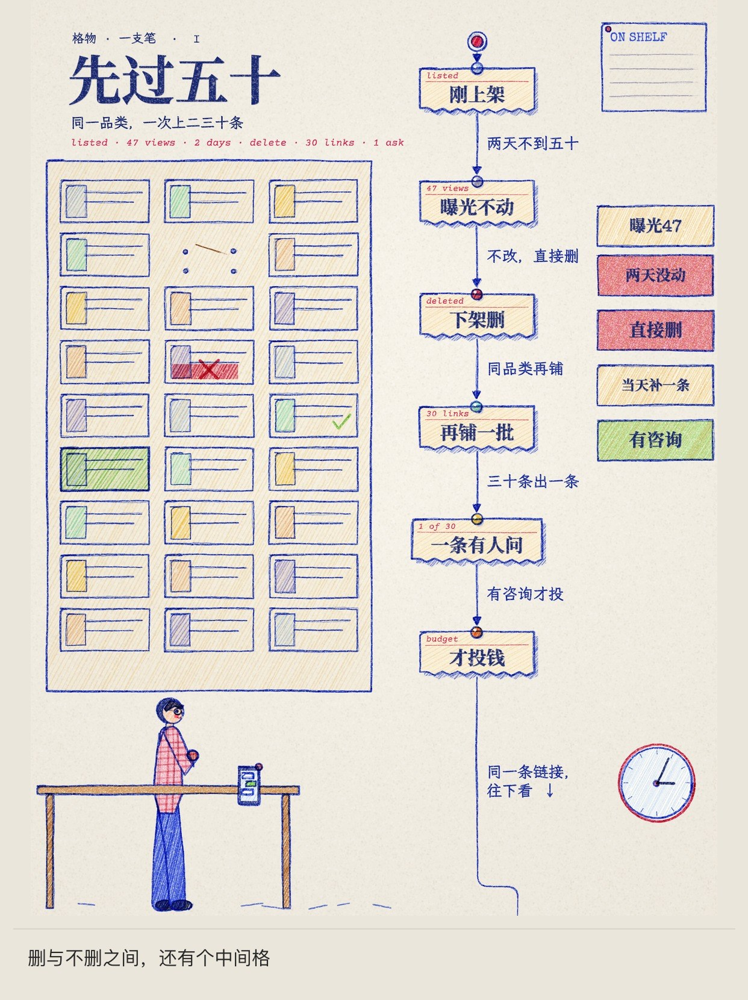
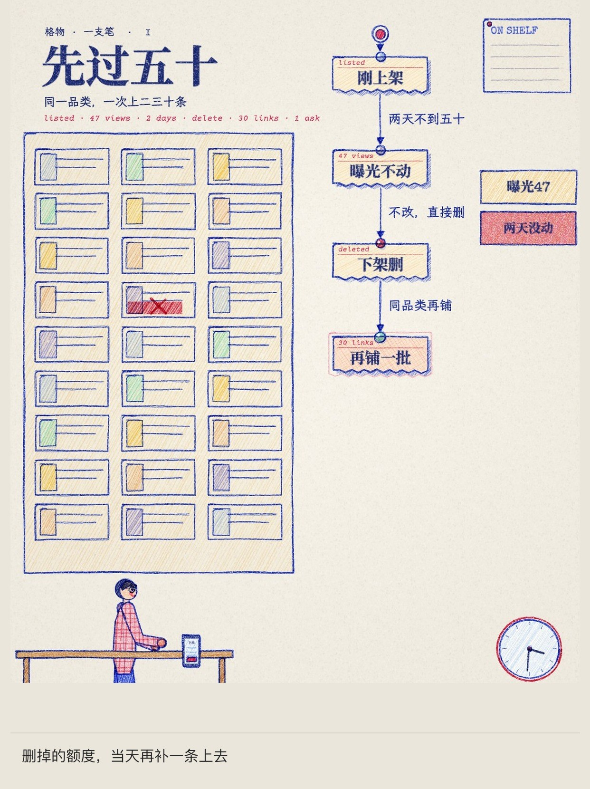
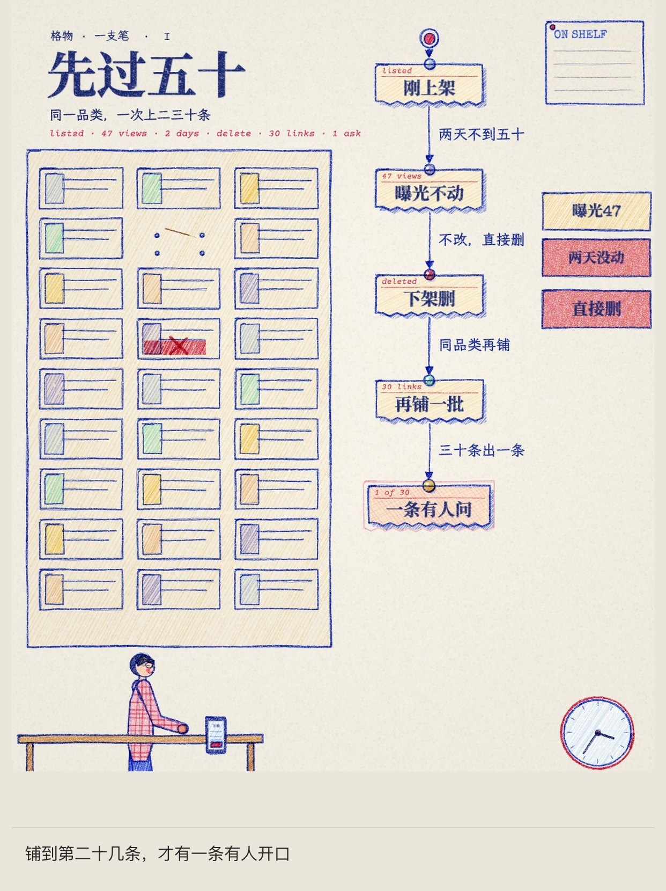
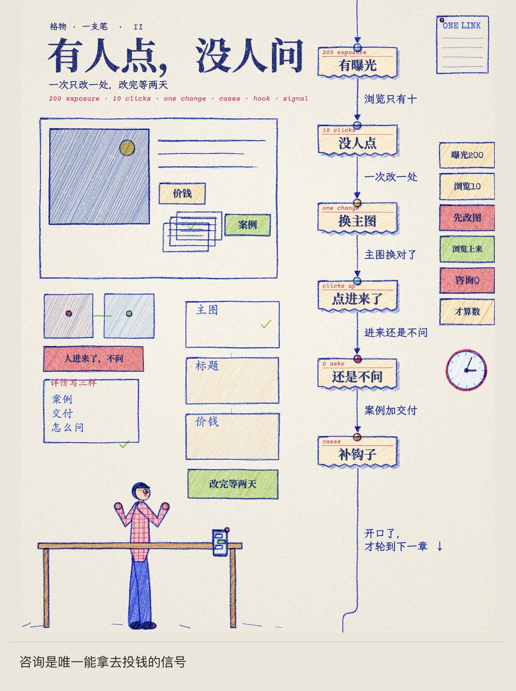
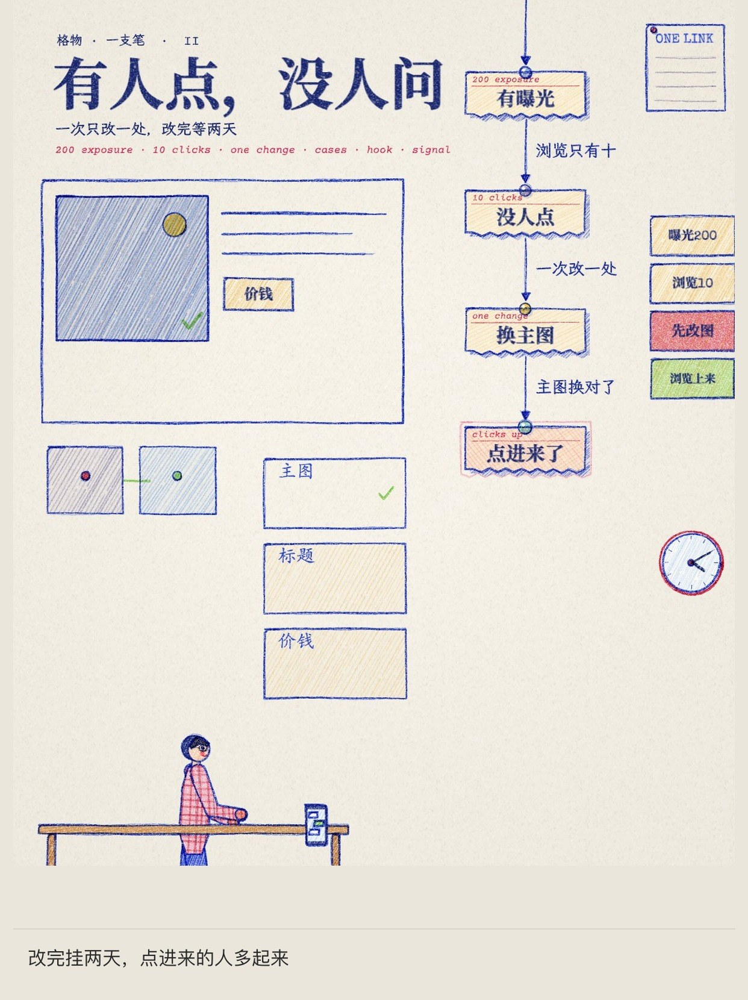
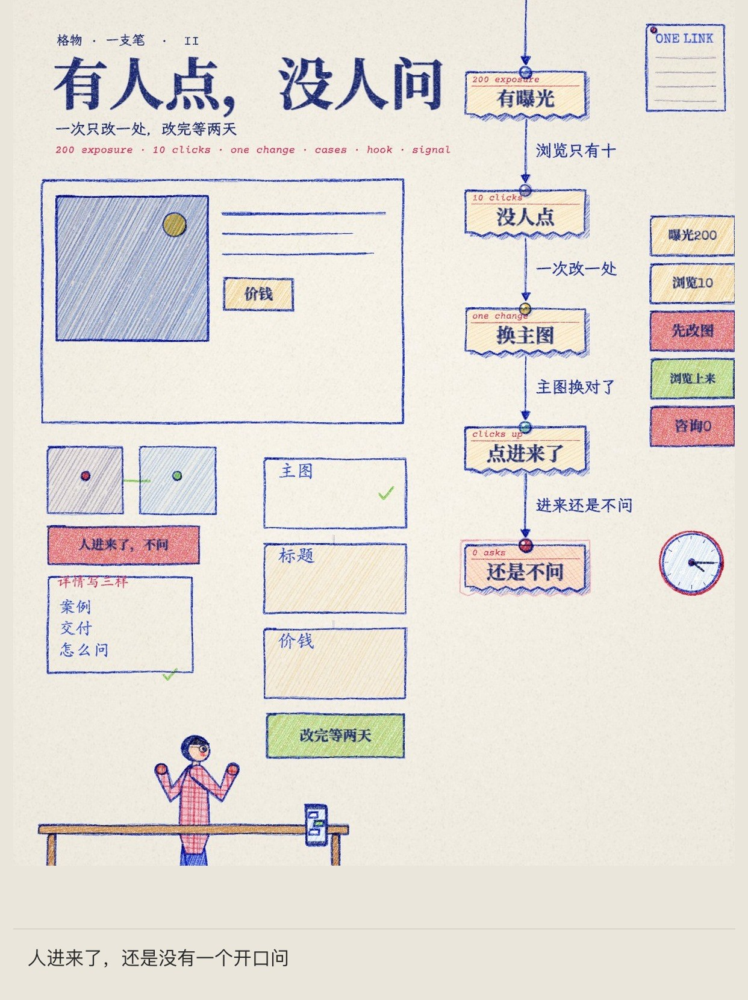
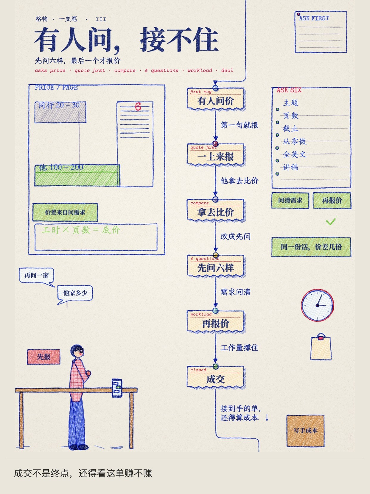
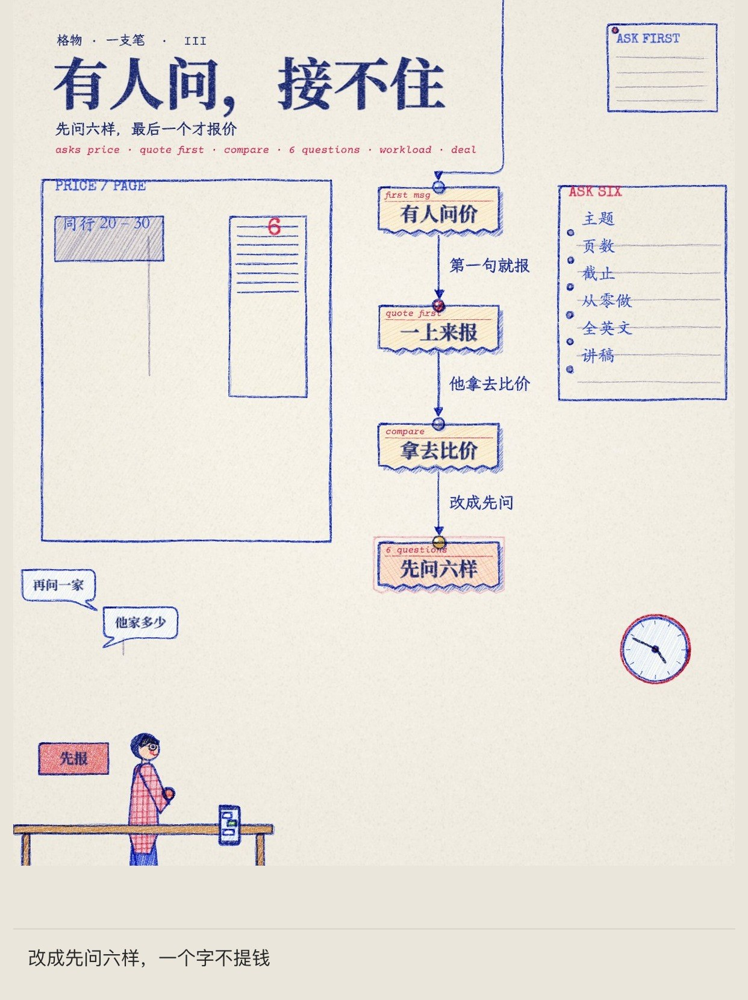
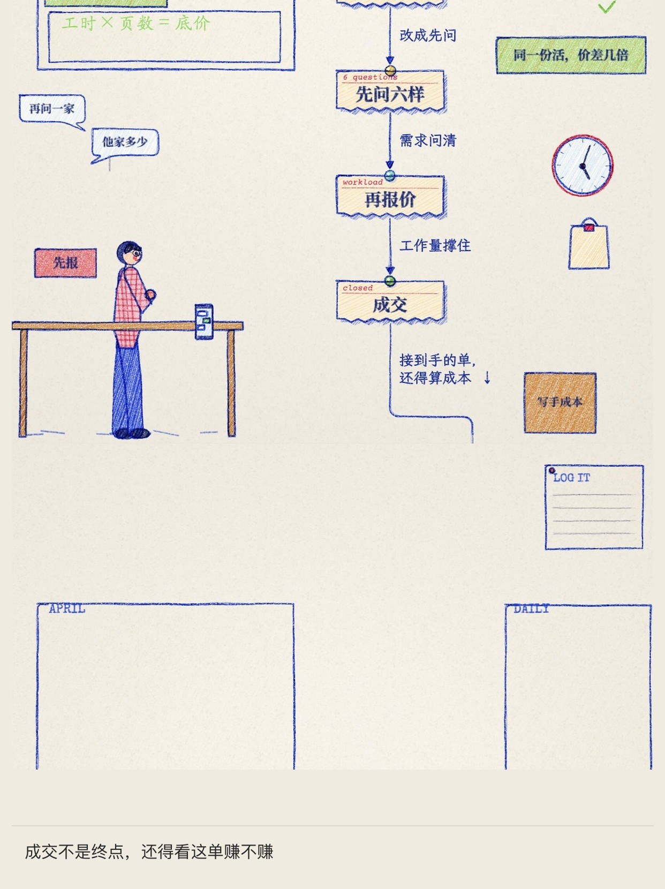
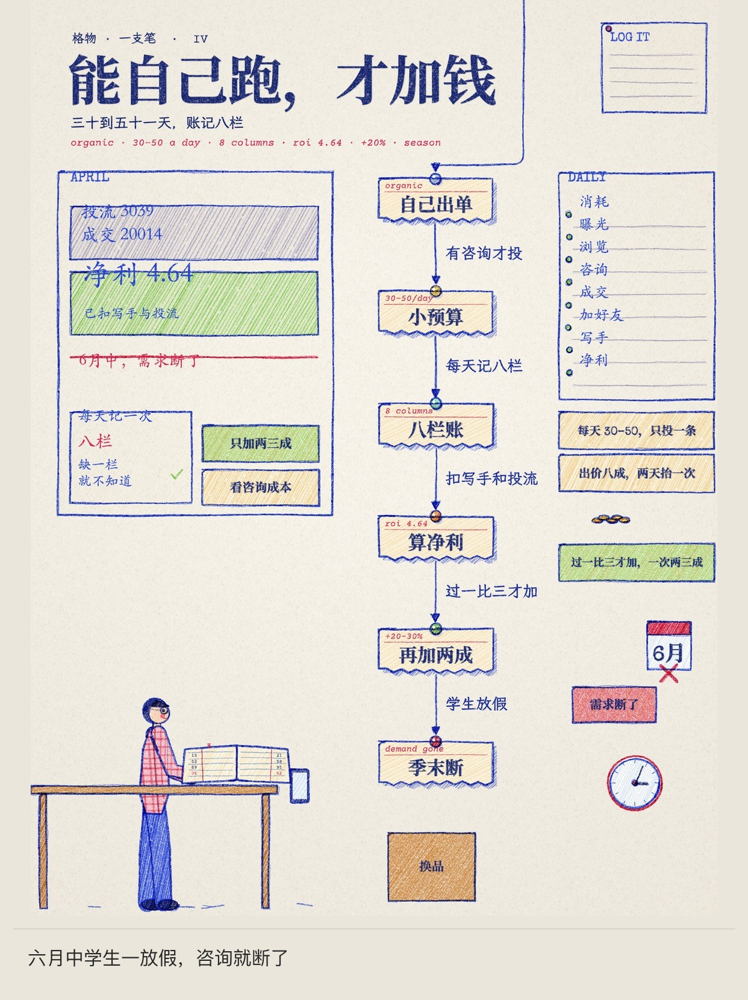
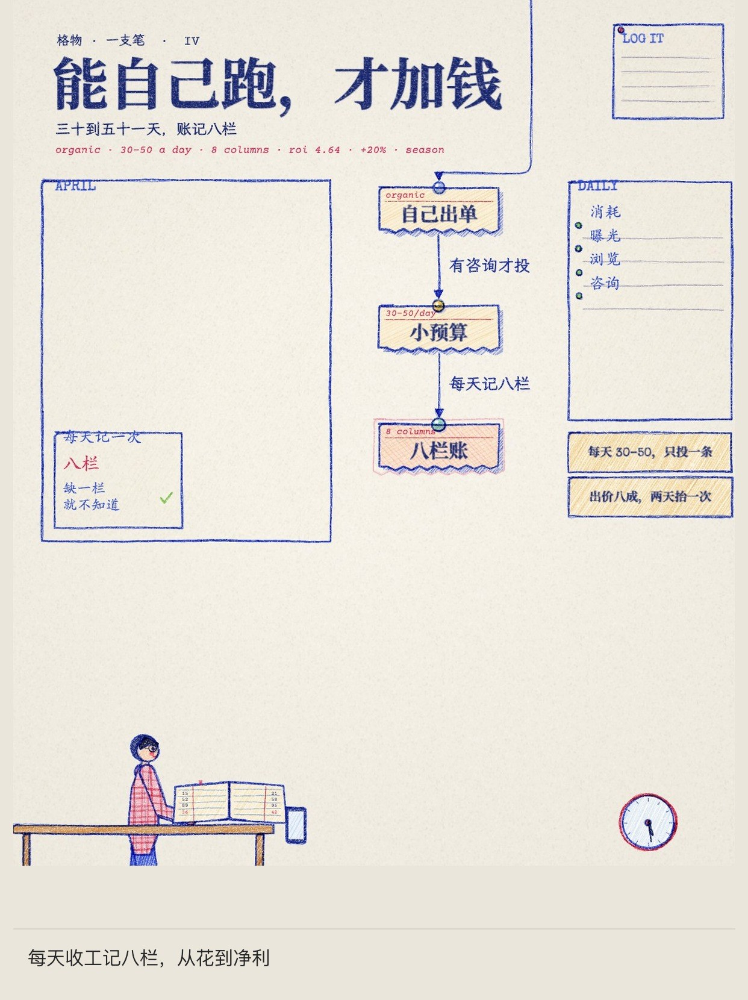
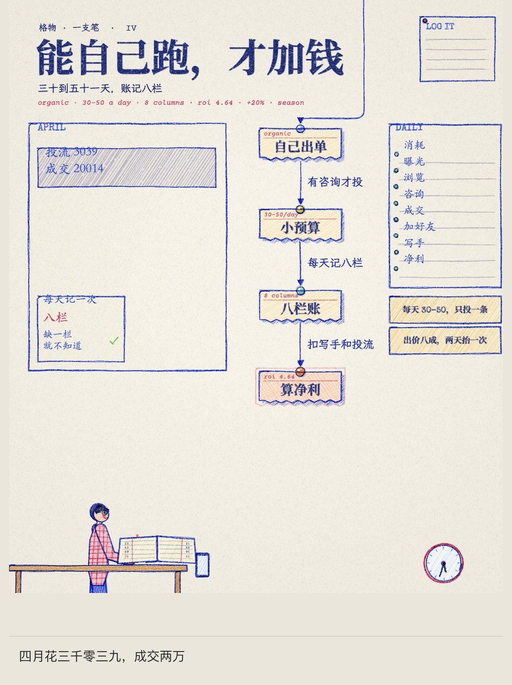

## 发布信息

| 项 | 值 |
|---|---|
| 平台 | 小红书 |
| 期数 | — |
| 发布时间 | 2026-11-17 12:31 |
| 正文长度 | 896 字 |
| 图片数量 | 12 张 |
| 状态 | 已发布 |
