# 26个部门要上AI，他只接了一个

> — · 2026-11-18 12:32 发布 · AI 赚钱内容

## 标题（可直接复制）

```
26个部门要上AI，他只接了一个
```

## 正文（可直接复制发布）

2023 年，一家西北头部地接社的老板找上来，说 26 个部门都能上 AI，预算 400 万以内都可以。他没全接，只挑了一个场景，打包价 31 万。

他卖的是「把企业里一个岗位的活，改成 AI 跑」，按场景打包收费，不卖软件、不按人头，起步时没有大厂品牌也没有销售团队。第一家 31 万；第二家先给 19 万试点，一家乳企两年累计做到 5300 万——都是他在线下大会上自己讲的。老板要的不是漂亮工作台，是一个岗位明天就少干半小时。

第一个状态，客户有预算，但说不清先动哪。判据就是那句「26 个部门都能上」。他挑派单后的出方案：同一条线索派几家社，业务员聊完还要半小时整路线、报价，客人可能已在别家下单。转折是一个客户自己能看到数：通话里填需求，系统调他自家的线路和资料出方案，人工过了就发；首次发方案从 30 分钟压到 1 分钟内，派单转化涨 33.7%（项目记录）。这个数出来，第一格才站住。

第二个状态，一个部门在试点。判据是金额小、期限写死：19 万、两周。变了之后该做的不是加功能，是让那个真干活的人天天打开它。这一格有分岔——装了没人用，合同到期就安静停掉；有人靠它交差，他才会替你在会上说一句。

第三个状态，成果在客户内部扩散。动作是三样东西：使用视频、效果测算、推广建议，交到业务负责人手里，让他拿去别的部门讲。转折是别的部门主动来问；走到这步才轮到集团框架，一单一单往上加。他说得很直白：大单不是喝出来的，是在客户内部被卖了很多遍。

落地他只给了两个动作：先把 3 个新人拉出来打样，让别人看见效果，再拿 20 元红包收员工截图、专挑 AI 生成错的地方。80 多人的销售团队，人均每天从 2.5 条做到 15 条。

他自己说清了限制：如果第十个客户做起来还和第一个一样累，这套模式就得重新看；26 个部门只做一个，等于主动放掉 400 万里的大部分；系统用不用得起来，取决于天天干活的人，不取决于老板签字。他没给工具全名，只说把客户过去的线路和资料接进系统。你去看同类项目，头一句该问：模型调用算谁的钱、一年多少。

别先问「这个客户有多大」，先数三个数：几个部门在用、几个人每天打开、这一格的时间有没有变短。你手上那家，是有个天天在用的人，还是只有老板点过头？

## 话题标签

#AI赚钱术 #AI变现 #案例拆解 #企业服务 #接单 #小团队 #AI落地

## 配图（12 张）

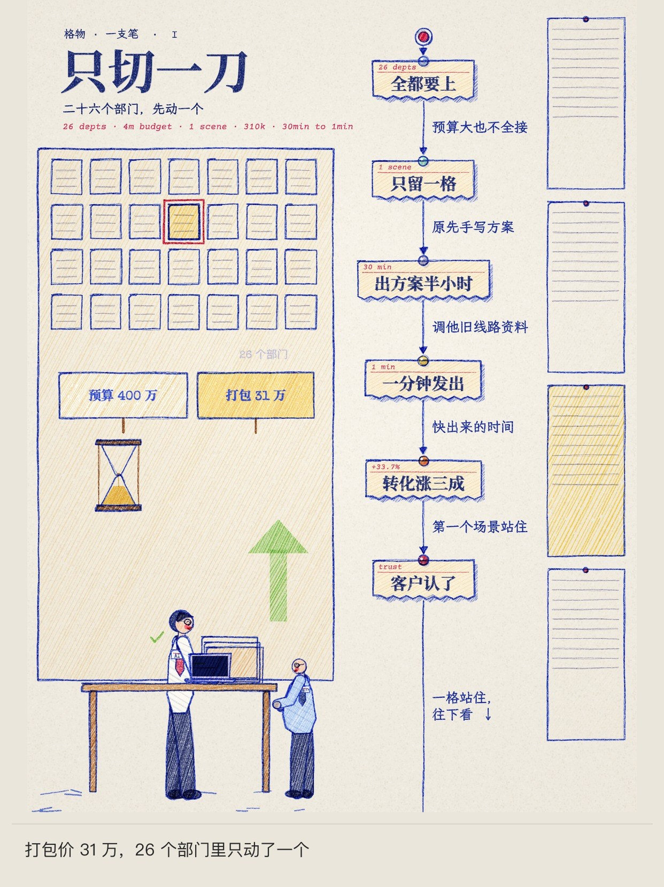
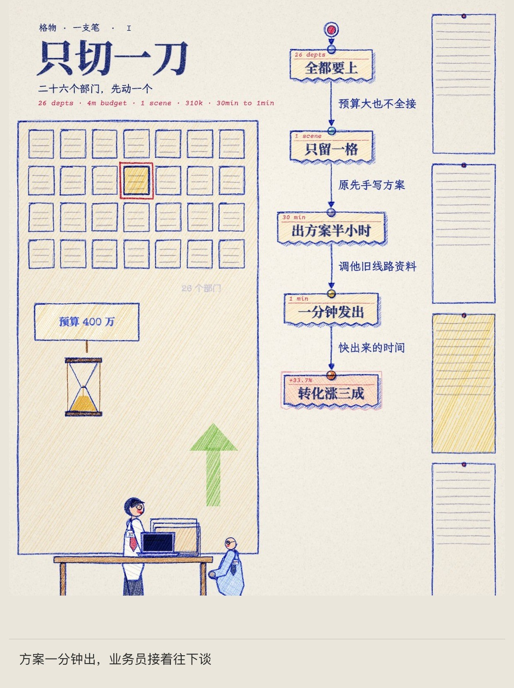
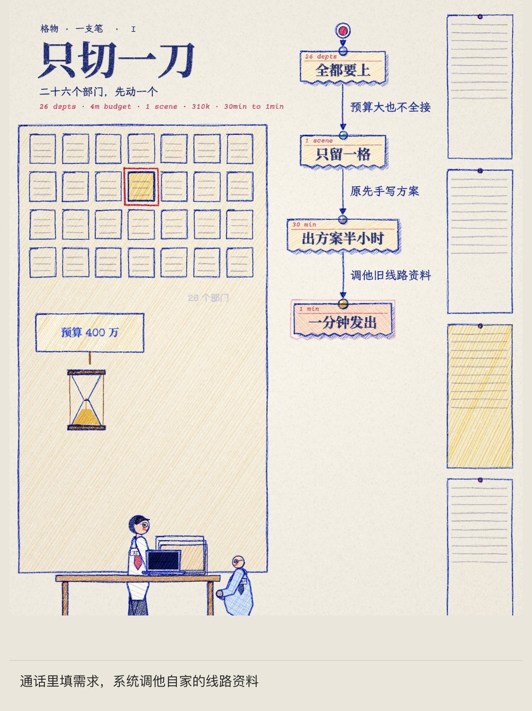
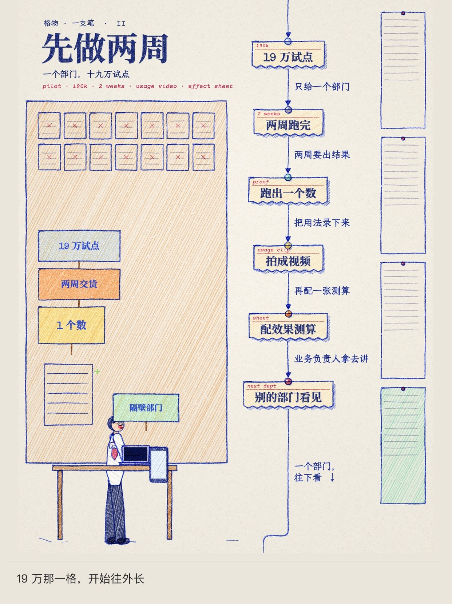
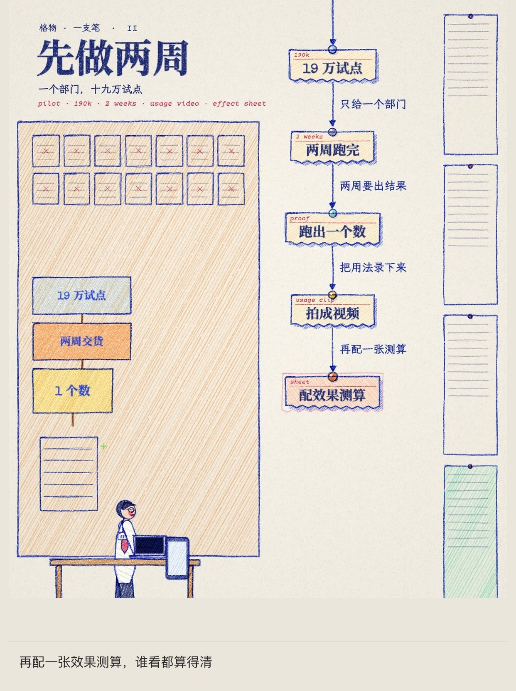
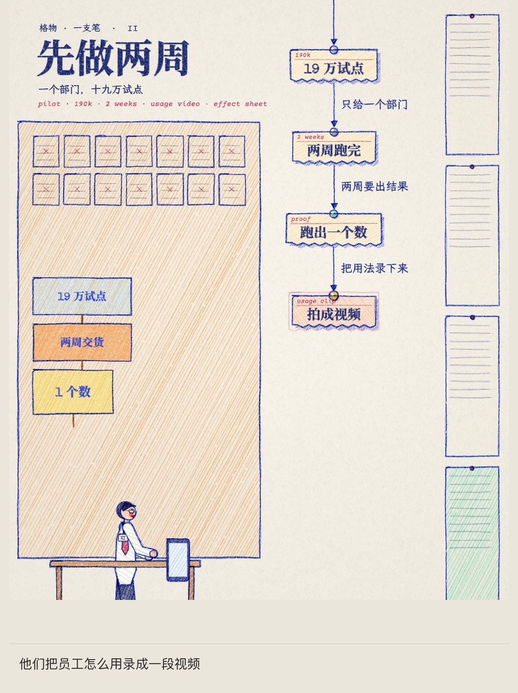
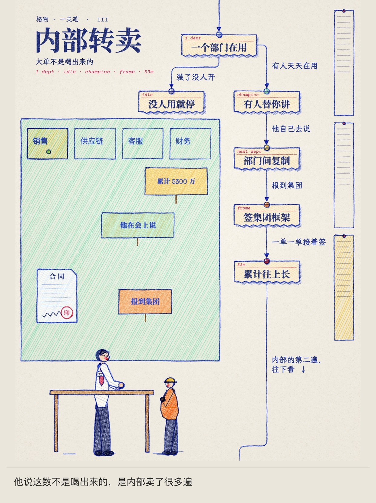
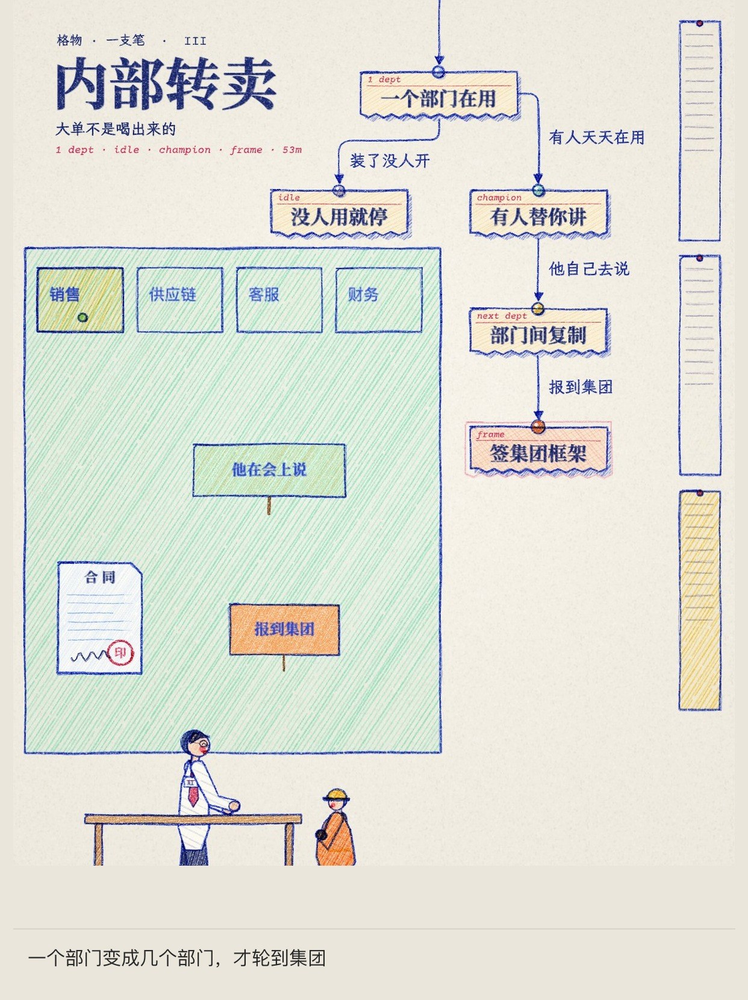
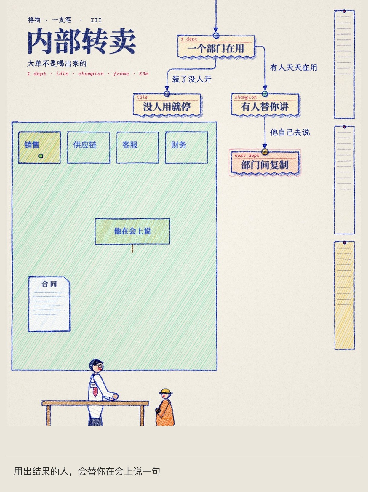
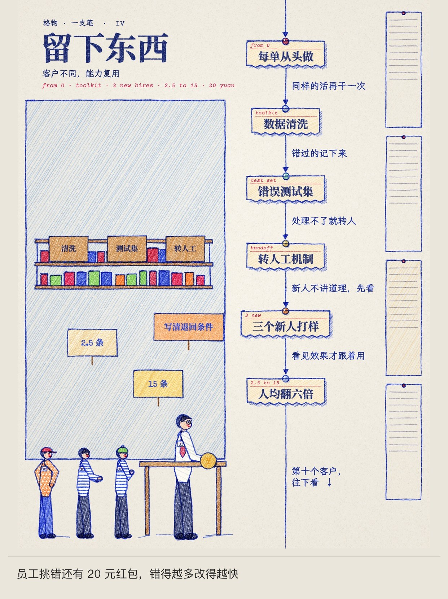
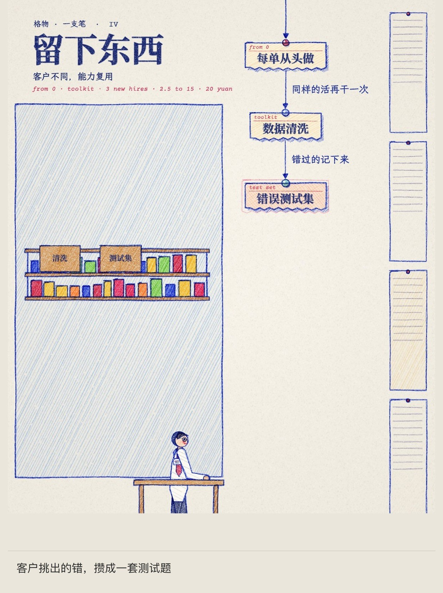
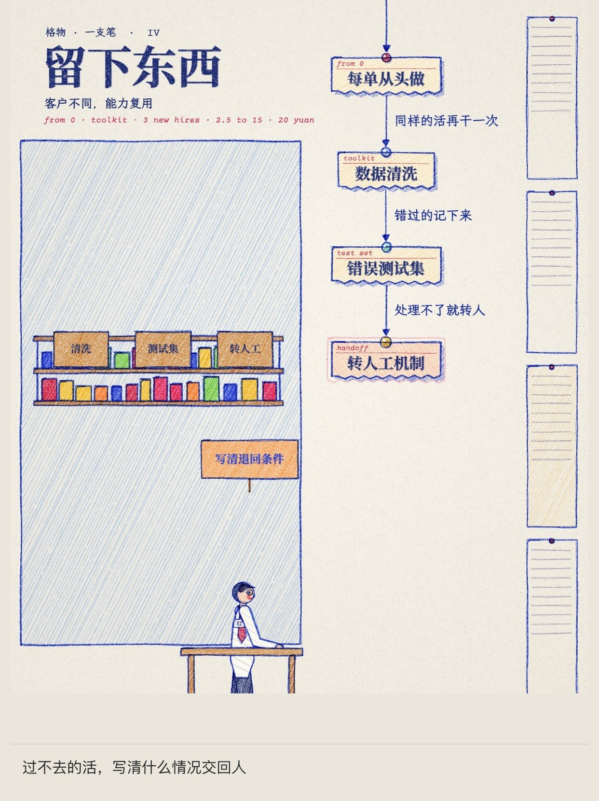

## 发布信息

| 项 | 值 |
|---|---|
| 平台 | 小红书 |
| 期数 | — |
| 发布时间 | 2026-11-18 12:32 |
| 正文长度 | 948 字 |
| 图片数量 | 12 张 |
| 状态 | 已发布 |
