# 日销5000的第二天，他动了那个商品

> — · 2026-11-19 12:32 发布 · AI 赚钱内容

## 标题（可直接复制）

```
日销5000的第二天，他动了那个商品
```

## 正文（可直接复制发布）

一天卖到五千，第二天中午他改了一下这个商品。第三天，营收掉到一千多。

这是他一家老店的账。店四个月没发过一篇笔记，两个老商品还挂着，每天零零散散出三五单。东西是电子商品，做一次卖很多次，没有进货也没有物流，这次升级他只花了三到五天。七月重新打理，一个月累计八万出头（他后台的支付金额，数字都是他自述）。

值得抄的不是这个数，是这条商品在三个状态里各该怎么动。

第一格，停更还在出单。一个商品四个月没人管，还能每天出三五单，说明要它的那批人还在，需求没走，只是你的版本旧了。这时候别急着发笔记，他先去翻同行销量，同类还在卖、版本比他新，于是他先花三五天把产品补一版，新版本单独上一个链接，老链接一个字不动。你去翻自己那件老商品：停更还在出单，是需求在撑；一停更就归零，那是笔记在撑。前者先把版本补上，后者先修内容。

第二格，正在起量。他换了一种在别处验证过的内容形式，头两天一天两三百，他没改标题也没改封面，照常发。第四五天过五百，一周后八九百，第二周一千九，第十天冲过五千。这一格最危险：破五千的第二天中午，半天已经卖了两千五，他把刚做好的新版本直接塞进原来那个商品，重新上架。下午增长就停了，全天只勉强三千，第三天掉到一千多。带单的几篇笔记被重新审核、推荐断了，这是他查出来的，平台的机制他自己也说没法确认。要改就走新链接，改之前先看一眼：还有哪几篇笔记在给这个链接带单。

第三格，被冻结下架。高峰一周累计四万多，然后商品被冻。先问客服要原因，再按反馈改到能过、重新上架，最后把带单笔记上的旧链接一条条换掉：每天换一部分，当天的笔记照发。一周过渡回每天两三千，没回到六七千。

卡在哪：他自己说，破五千那天已经在算一个月十几万、一年上百万，还盘算着开第二三家店；两天后掉到一千，那晚没睡好。能核的代价是，第一次高峰只有十天，第二次高峰只有一周，掉下去恢复用了五六天，最后落在日均两三千。

把一个商品卖起来，靠选品和内容；守住它，靠不手贱。你现在店里那个每天都在出单的链接，上一次被你改是什么时候？

## 话题标签

#AI赚钱术 #AI变现 #案例拆解 #电商运营 #店铺运营 #选品 #小红书电商

## 配图（12 张）

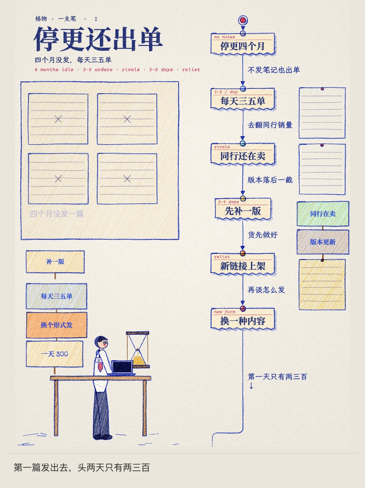
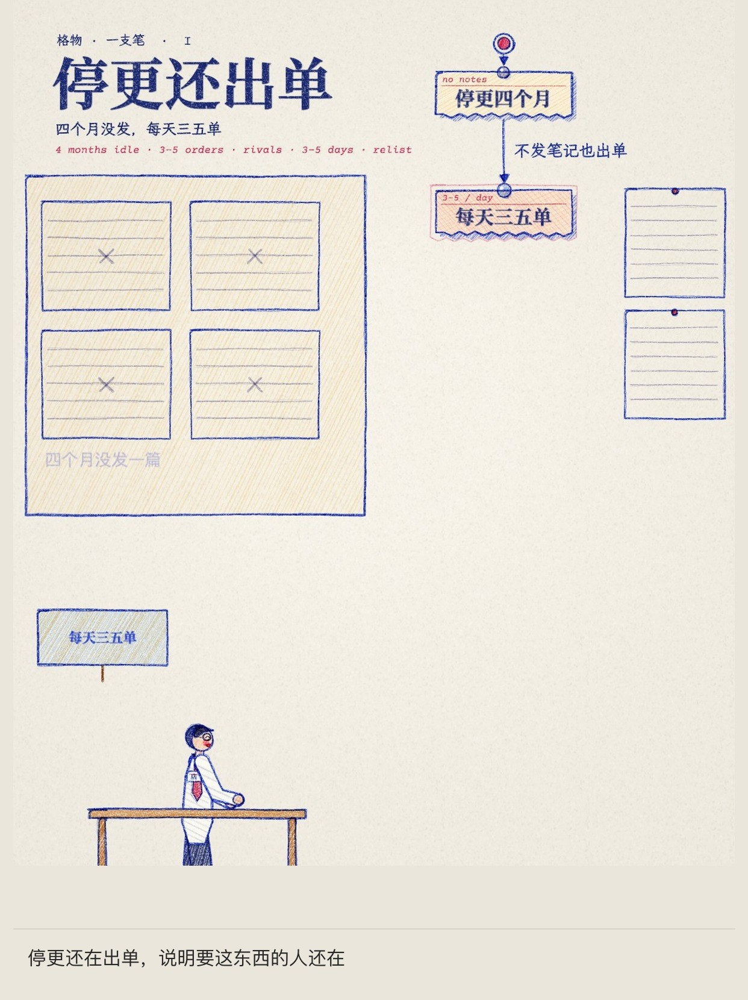
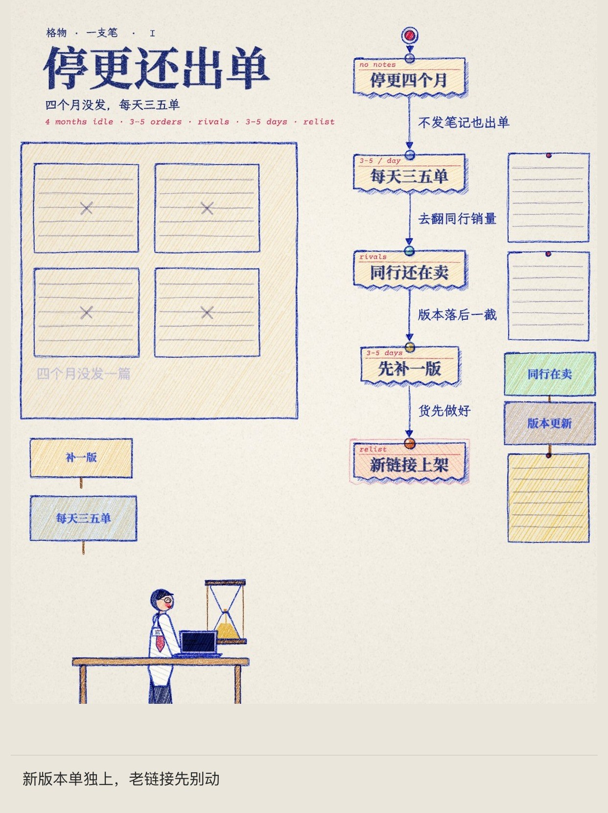
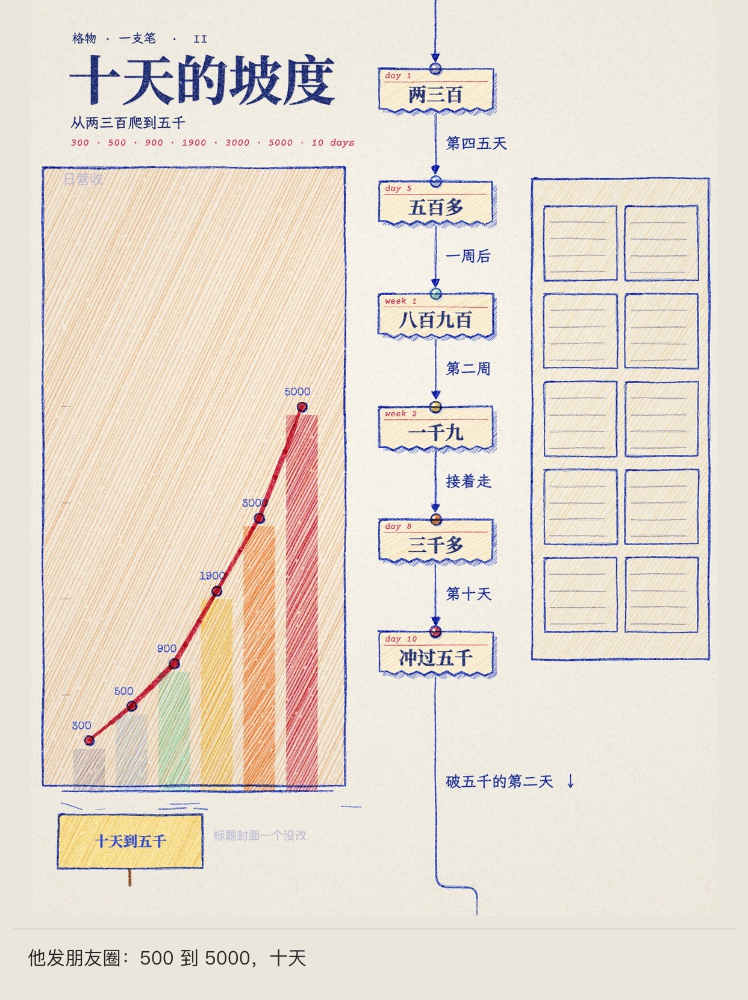
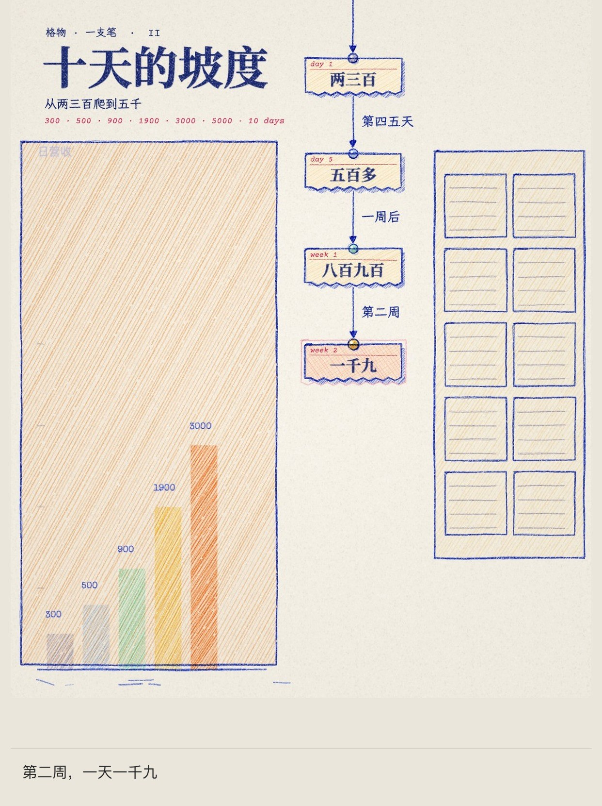
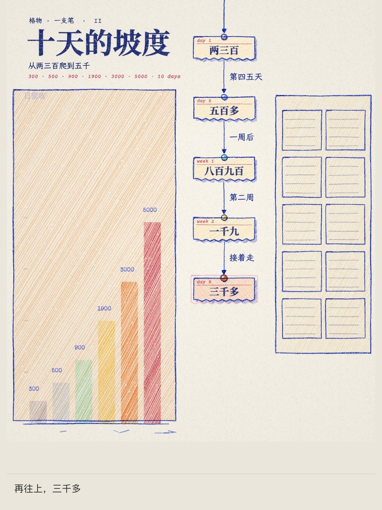
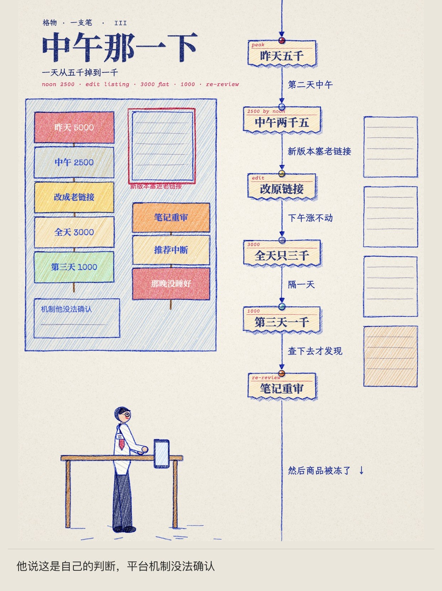
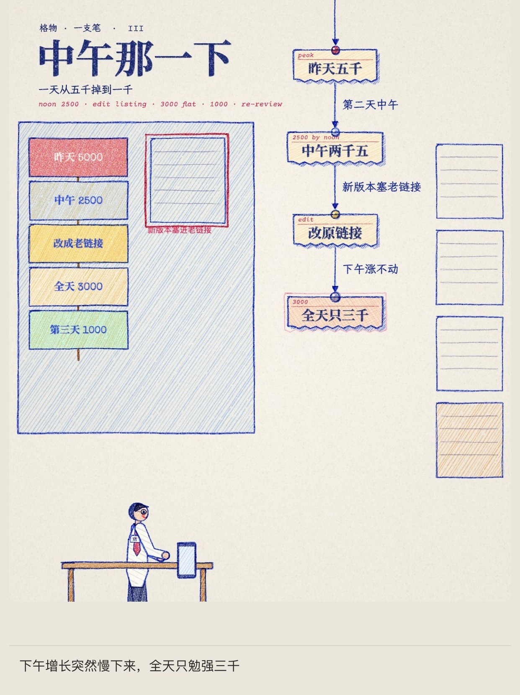
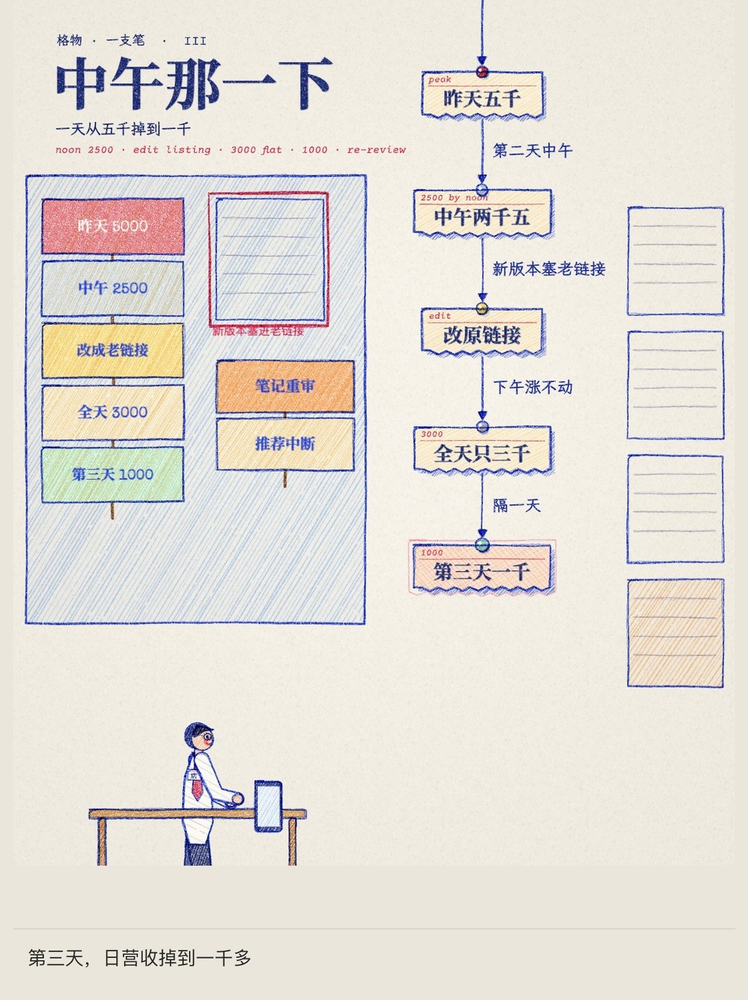
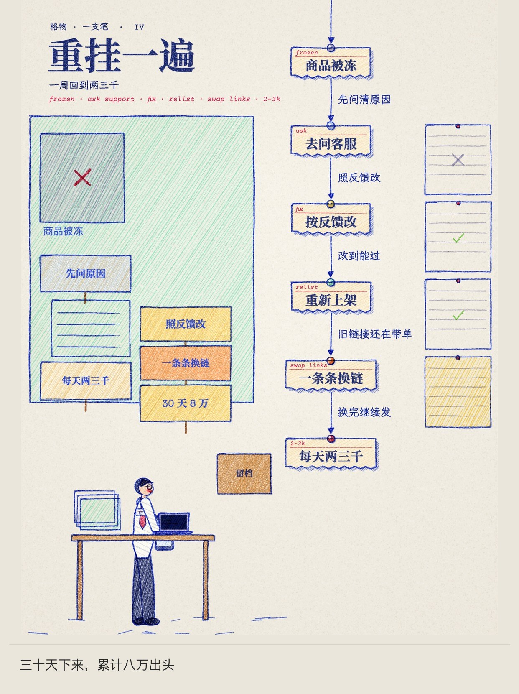
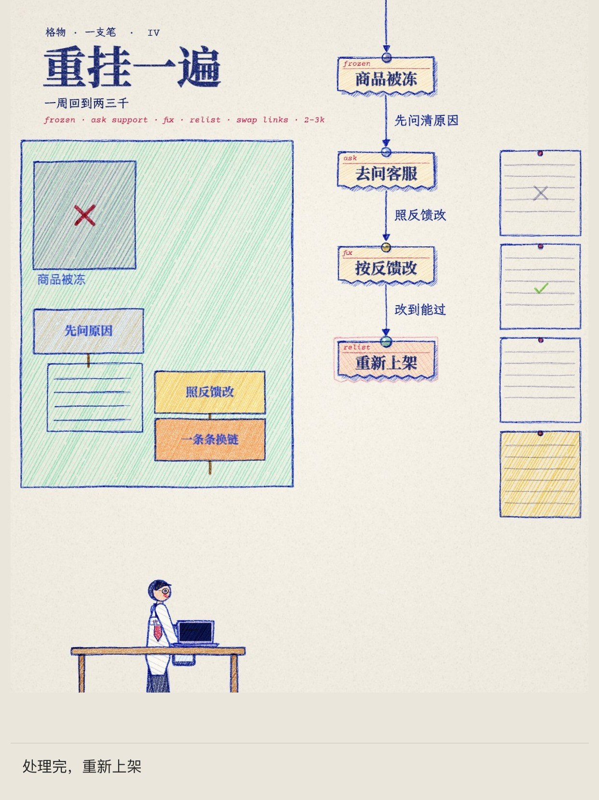
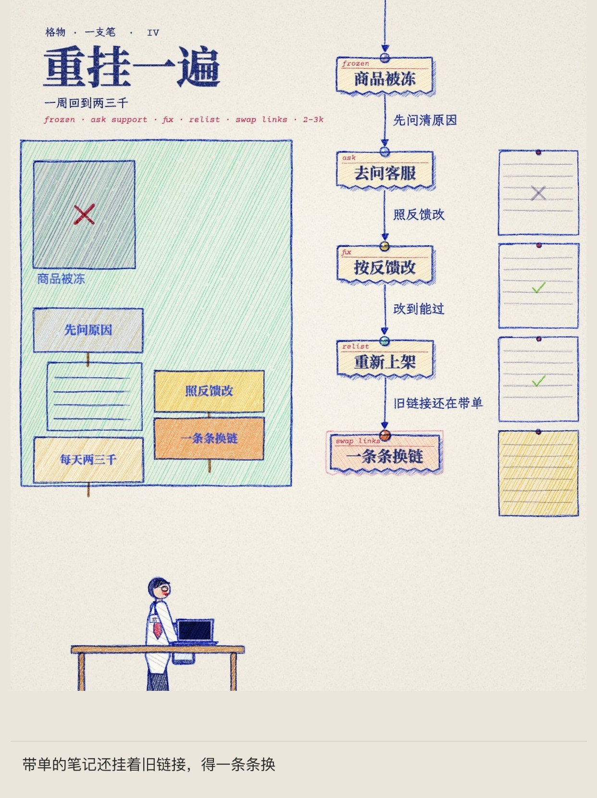

## 发布信息

| 项 | 值 |
|---|---|
| 平台 | 小红书 |
| 期数 | — |
| 发布时间 | 2026-11-19 12:32 |
| 正文长度 | 855 字 |
| 图片数量 | 12 张 |
| 状态 | 已发布 |
